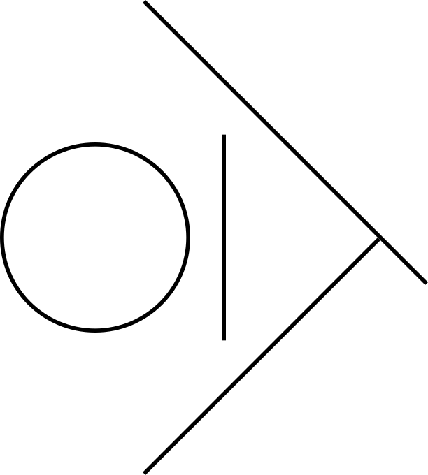

<center></center>
OmegaDocker: an OligoMEr-supported and Gpu-Accelerated Docking program
======================================================================

# About

* OmegaDocker is a docking program for small molecules, biomolecules and oligomers (oligopeptides, oligonucleotides and other oligomers), without a fixed upper limit on the number of atoms.
* Version 0.40.0 is a redesign; versions up to 0.33.0 (see the git tags) were modified from AutoDock-GPU v1.5.2.
* Status: under development. The CPU version currently reads the input structures (mmCIF, SDF/MOL, mol2) and analyzes their topology (backbone, torsion classes, DSSP secondary structure), and writes and validates the molecule configuration file (TOML); docking is not implemented yet.
* Specification: [doc/OmegaDocker_0.40.xx_spec.md](doc/OmegaDocker_0.40.xx_spec.md)

# Build

Requirements: GCC with C++20 and OpenMP, CMake >= 3.20, RDKit, Boost, Eigen.

```
cmake -S . -B build -DCMAKE_PREFIX_PATH="<RDKit prefix>;<Boost prefix>;<Eigen prefix>"
cmake --build build -j
build/tests/od_tests
```

`-DOD_STATIC_DEPS=ON` links RDKit, Boost and the OpenMP runtime statically.

`-DOD_CUDA=ON` builds the CUDA back end (CUDA 12.x; `CMAKE_CUDA_ARCHITECTURES` defaults to 70). Set `CMAKE_CUDA_COMPILER` to the `nvcc` to use.

`-DOD_NATIVE=ON` compiles the host code with `-march=native` (faster on the CPU of the build machine; the program may not run on other CPUs).

# License

OmegaDocker is licensed under the GNU Lesser General Public License v2.1 or later (LGPL-2.1-or-later); see [LICENSE](LICENSE).

Versions up to 0.33.0 are modified from [AutoDock-GPU](https://github.com/ccsb-scripps/AutoDock-GPU) v1.5.2 (LGPL-2.1-or-later):
* Copyright (C) 2017 TU Darmstadt, Embedded Systems and Applications Group, Germany.
* For some of the code, Copyright (C) 2019 Computational Structural Biology Center, the Scripps Research Institute.

Version 0.40.0 uses the AD4 parameters and energy function forms of AutoDock-GPU v1.6 (`src/ad4.cpp`, `src/ad4_pair.hpp`; same license and copyright holders).

AutoDock is a Trade Mark of the Scripps Research Institute.

## Third-party components

| Component | Location | License |
|---|---|---|
| gemmi 0.7.5 | `third_party/gemmi/` | MPL-2.0 |
| toml++ 3.4.0 | `third_party/tomlplusplus/` | MIT |
| pocketfft (C++) | `third_party/pocketfft/` | BSD-3-Clause |
| Top8000 rama8000 Ramachandran contour grids, Copyright (c) 2016-2026 David C. Richardson, Jane S. Richardson, and contributors, Richardson Lab at Duke University ([rlabduke/reference_data](https://github.com/rlabduke/reference_data)); Williams CJ et al. (2018) Protein Science 27:293-315, https://doi.org/10.1002/pro.3330 | `third_party/top8000/` (embedded in the executable) | CC BY 4.0 |
| doctest 2.4.11 (bundled with gemmi) | `third_party/gemmi/third_party/` | MIT |
| wwPDB Chemical Component Dictionary subset | `data/ccd/` | CC0 1.0 |
| PDB entries 1D18, 1D3Z, 1L2Y, 1PIT, 1RNG, 2KJJ, 2KOC, 2LZX, 1ZNF (first model only), ligand BTN and CCD components ACE, NH2, ZN | `tests/data/` | CC0 1.0 |
| RDKit test files `benzene.mol2`, `pyrazole_pyridine.mol2` | `tests/data/` | BSD-3-Clause |
| DSSP algorithm, behavior following DSSP 4 ([PDB-REDO/dssp](https://github.com/PDB-REDO/dssp)), Copyright (c) 2020 NKI/AVL, Netherlands Cancer Institute | `src/dssp.cpp` | BSD-2-Clause |
| PROPKA 3 ([jensengroup/propka](https://github.com/jensengroup/propka), commit 58ceb7b): parameter file `propka.cfg` and the pKa algorithm ported to C++; Olsson MHM, Søndergaard CR, Rostkowski M, Jensen JH (2011) J Chem Theory Comput 7:525-537, https://doi.org/10.1021/ct100578z | `third_party/propka/` (embedded in the executable), `src/propka.cpp` | LGPL-2.1 |

Linked at build time: RDKit (BSD-3-Clause), Boost (BSL-1.0), Eigen (MPL-2.0).

