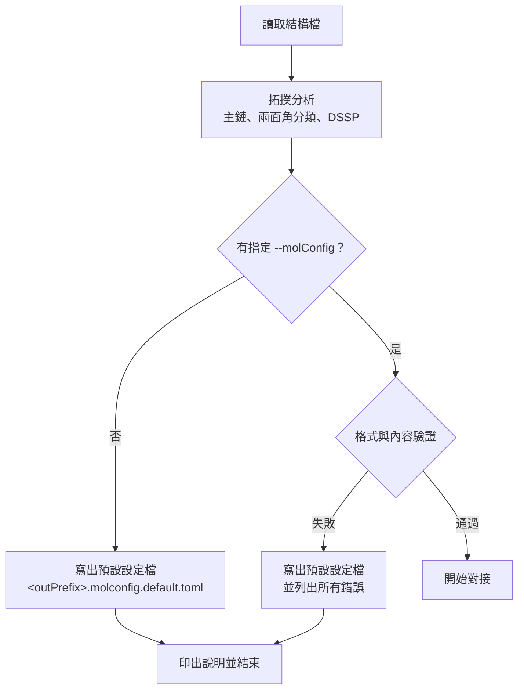

# OmegaDocker 0.40.0 規格書

| 項目 | 內容 |
|---|---|
| 文件版本 | 1.25 |
| 日期 | 2026-10-14 |
| 程式版本號 | **0.40.0** |
| 程式基礎 | 新架構；能量與梯度 kernel 取自 AutoDock-GPU 1.6，並移植 OmegaDocker 的修改 |
| 狀態 | 定案（1.0）；實作中需修正時遞增版本，修訂紀錄見第 19 節 |

---

## 1. 目的與範圍

- 支援 **生物分子（蛋白質、核酸）與寡聚物** 的對接，同時保留小分子對接能力。
- **不設原子數硬性上限**（取消 AutoDock-GPU 的 256 原子限制），實際上限由 GPU 記憶體決定。
- 將「構型取樣」與「位置與定向取樣」分成兩個階段（9a、9b），以輪次反覆進行。
- 本版只最佳化 **兩面角**；鍵長、鍵角維持輸入值。能量函式沿用目前 OmegaDocker（AD4 系列）。兩者的擴充列於第 18 節。

---

## 2. 名詞定義

| 名詞 | 英文 / 縮寫 | 定義 |
|---|---|---|
| 穩態分子 | Stationary molecule, **StaM** | 不可平移、不可轉動的分子；內部兩面角可依設定變動 |
| 穩態分子群 | StaM group | 所有 StaM 的集合，視為一個整體（multimer）；可只含一個分子 |
| 動態分子 | Mobile molecule, **MobM** | 可個別平移、轉動的分子；每個 MobM 彼此獨立，不考慮 MobM 間作用 |
| 重原子 | heavy atom | 氫以外的原子 |
| 兩面角 | dihedral / torsion | 由 4 個重原子定義，繞中間鍵旋轉 |
| 主鏈 | backbone | 蛋白質 `N–CA–C(=O)` 重複單元，或核酸 `P–O5'–C5'–C4'–C3'–O3'` 重複單元 |
| 構型樣本 | conformational sample | 一個一維陣列，內容為該分子（或 StaM 群）所有可轉動兩面角的數值 |
| 第一階構型樣本 | L1 conf sample | 由 csgm 產生、尚未經 9a 最佳化與篩選的樣本 |
| 第二階構型樣本 | L2 conf sample | 9a 最佳化後能量 < `E_max` 的樣本 |
| 第二階構型樣本池 | L2 pool | 儲存 L2 樣本的池子，供補充 dcss |
| 對接構型樣本集 | Docking Conformational Sample Set, **dcss** | 本輪參與 9b 的構型樣本集合 |
| 構型樣本產生方式 | Conformational Sample Generation Method, **csgm** | csgm1a、csgm1b、csgm2、csgm3 |
| 位置與定向樣本 | Position and Orientation Sample, **pos** | MobM 的平移向量 + 定向（單位四元數） |
| 位置與定向取樣方法 | Position and Orientation Sampling Method, **posm** | posm1、posm2、posm2_fft、posm3、posm4 |
| 第一階 / 第二階位置與定向樣本集 | **L1poss** / **L2poss** | 篩選前 / 篩選後的 pos 集合 |
| 強靜電勢區域集合 | Strong Electrostatic Potential Area Set, **sepas** | 見 8.4.4 |
| 強靜電勢區域配對集合 | Strong Electrostatic Potential Area Pairs Set, **sepaps** | 見 8.4.4 |
| 構型配對 | conformation pair | 一個 StaM dcss 樣本 × 一個 MobM dcss 樣本 |
| 對接樣本 | docking sample | 構型配對 + 一個 pos，經 9b 最佳化後的結果 |
| topSampleSet | — | 每個 MobM 累計所有輪次的最佳對接樣本集合 |

---

## 3. 輸入

### 3.1 檔案格式

| 格式 | 鍵級來源 | 殘基 / 鏈資訊 | 部分電荷 |
|---|---|---|---|
| mmCIF | 化學成分字典（CCD）的 `chem_comp_bond`；殘基間連接用 `struct_conn` 與主鏈規則 | 有 | 程式計算 Gasteiger |
| SDF / MOL（V2000、V3000） | 檔案本身 | 無（主鏈以圖形比對辨識） | 程式計算 Gasteiger |
| mol2 | 檔案本身（含 `am`、`ar`） | 有（substructure） | 讀取檔案 |

規則：
- **不自行推斷鍵級**。mmCIF 中查不到 CCD 定義的殘基 → 報錯並結束。
- 內附標準胺基酸、核苷酸的 CCD 子集；使用者可用 `--ccd <file>` 提供額外的 CCD 檔。
- **氫原子由使用者提供**（質子化狀態由使用者負責）。程式不新增、不刪除氫原子。
- 鍵長、鍵角必須合理；程式不修正。

**mmCIF 讀取細則：**
- 只讀第一個 model；同一殘基有多個 altloc 時，保留第一個出現的 altloc，其餘略過並警告。同一鏈中重複的殘基序號（微異質性）只保留第一個。
- 內附 CCD 子集：20 種標準胺基酸、`A C G U DA DC DG DT`、`HOH`。
- 殘基內的鍵取自 CCD；CCD 未列出的末端原子：胜肽 N 端的 `H`、`H1`、`H2`、`H3` 接到 `N`；核酸 5′ 端的 `HO5'` 接到 `O5'`。其他 CCD 沒有的原子名稱 → 報錯。元素與 CCD 不符 → 報錯。
- 殘基間的鍵：同一鏈相鄰殘基的 C–N（≤ 2.0 Å）與 O3′–P（≤ 2.2 Å）；`_struct_conn` 中 `covale`、`disulf`、`metalc` 類型（`metalc` 與含金屬的鍵視為金屬配位鍵）。
- 形式電荷：依每個原子在檔案中實際的鍵（含使用者提供的氫）的鍵級總和決定，例如 N 為 4 → +1、O 為 1 → −1。不支援的情況（例如 C 為 3、O 為 3）→ 報錯，提示可能缺原子或氫，或改用 SDF / mol2。金屬與無鍵的離子使用 CCD 的電荷。
- CCD 標為芳香的鍵所組成的共軛系統，依實際存在的氫重新分配單、雙鍵（例如 HIS 的 HID / HIE / HIP）；只有在沒有中性解時，才把吡咯型 N 設為 +1。此步驟只在 CCD 的芳香鍵範圍內進行，不屬於自行推斷鍵級。
- 硫醇陰離子（S 為 −1）與另一個 S 的距離 ≤ 2.5 Å 時警告，提示 `_struct_conn` 可能缺少雙硫鍵。
- 元素符號 `D`、`T` 視為氫；但原子名稱仍須與 CCD 一致。

**SDF / mol2 讀取細則：**
- 檔案可含多筆紀錄（SDF record、mol2 `@<TRIPOS>MOLECULE`）；所有紀錄的分子都依 3.2 劃分。
- 依原子價需要但檔案中沒有的氫，不會補上，只警告。
- mol2 的殘基取自每個原子的 `subst_id`、`subst_name`（殘基名稱與序號由 `subst_name` 拆出，例如 `ALA12`），鏈名稱取自 `@<TRIPOS>SUBSTRUCTURE` 的 chain 欄。
- mol2 標示 `NO_CHARGES` 或缺電荷欄時，改算 Gasteiger 電荷並警告。

**Gasteiger 電荷細則：**
- 計算前先移除金屬配位鍵；金屬原子的部分電荷等於其形式電荷。
- 沒有 Gasteiger 參數的其他原子使用形式電荷，並警告。
- 原因：金屬沒有 Gasteiger 參數；若保留金屬配位鍵，無效數值會沿鍵結擴散到大部分原子（實測 1ZNF：424 個原子中 231 個）。

### 3.2 分子的劃分與角色指定

- 一個 **分子** = 鍵結圖中的一個連通元件（connected component）。
- `--stamFile <file>`：檔案中的**所有分子**皆為 StaM，共同組成 StaM 群。不支援在檔案內細分角色。**只能指定一次**，指定多次時報錯並結束。
- `--mobmFiles <file>`：檔案中**必須只有一個分子**，否則報錯並結束。可指定多次，每個檔案一個 MobM。
- 每個 MobM 視為獨立的對接任務（見第 11 節）。

### 3.3 對接範圍

- `--boxCenter x,y,z`、`--boxSize x,y,z`（Å）。
- 能量網格與距離網格涵蓋此範圍。
- posm1、posm2 只產生使 MobM 所有探針原子都在範圍內的 pos（8.4）；8.5 仍保留「超出範圍」檢查。

---

## 4. 分子拓撲分析

### 4.1 主鏈辨識

| 類型 | 辨識規則（以鍵結圖比對，不依賴殘基名稱） |
|---|---|
| 蛋白質 | 連續的 `N–CA–C(=O)–N` 模式（`-NC(CO)-NC(CO)-`） |
| 核酸 | 連續的 `P–O5'–C5'–C4'–C3'–O3'–P` 模式 |

- 不辨識側鏈是否為標準胺基酸或標準核酸鹼基。
- 實作細則：
  - 蛋白質單元：C 以雙鍵連接只有一個重原子鄰居的 O，C 連接 CA（碳），CA 連接 N。核酸單元：C3′、C4′ 為環上的碳且以環內鍵相連，O3′、C5′、O5′ 不在環上；P 可缺（5′ 端無磷酸）。
  - 單元之間以 C(i)–N(i+1)（蛋白質）或 O3′(i)–P(i+1)（核酸）相連；至少兩個相連的單元才算主鏈。
  - 同一分子同時有兩種主鏈時，採用單元數較多者並警告。
- 辨識結果寫入分子設定檔的 `backboneType`（`protein` | `nucleic` | `none`），使用者不可修改。

### 4.2 主鏈兩面角

| 類型 | 兩面角 | StaM 預設 | MobM 預設 |
|---|---|---|---|
| 蛋白質 | φ（C–N–CA–C）、ψ（N–CA–C–N） | 不可動 | 可動 |
| 蛋白質 | ω（CA–C–N–CA） | 保持輸入（`fixed`） | 保持輸入（`fixed`） |
| 核酸 | α、β、γ、δ、ε、ζ | 不可動 | 可動 |

- ω 若設為 `cisTrans`，只產生 0° 或 180°。
- 兩面角歸屬：φ_i = C_{i−1}–N_i–CA_i–C_i、ψ_i = N_i–CA_i–C_i–N_{i+1}、ω_i = CA_i–C_i–N_{i+1}–CA_{i+1}（ω 歸屬前一個殘基 i）；α_i = O3′_{i−1}–P_i–O5′_i–C5′_i、β_i = P_i–O5′–C5′–C4′、γ_i = O5′–C5′–C4′–C3′、δ_i = C5′–C4′–C3′–O3′、ε_i = C4′–C3′–O3′–P_{i+1}、ζ_i = C3′–O3′–P_{i+1}–O5′_{i+1}。缺少所需原子的兩面角（鏈端）不屬於主鏈兩面角，依 4.4 分類。
- 角度符號依 IUPAC 慣例，範圍 (−180°, 180°]。
- **脯胺酸的 φ** 在吡咯烷環內，固定不可動（除非該環設定斷鍵，見 4.5）。
- 核酸 δ（C5'–C4'–C3'–O3'）的中間鍵屬於核糖環，固定不可動（除非設定斷鍵）。

### 4.3 ω 檢查

- 若 ω 為 `fixed`，且輸入角度與 0° 和 180° 的差距 **都** 大於 `omegaTolerance`（預設 30°）→ 警告並結束程式。
- 使用 `--acceptNonPlanarOmega` 可接受此情況並繼續。

### 4.4 側鏈與非主鏈分子的兩面角分類

主鏈分子的側鏈，與沒有主鏈的分子，使用相同規則。

**預設不可轉動：**

| 類型 | 例子 |
|---|---|
| 醯胺鍵（含側鏈） | 肽鍵、Asn/Gln 的 C(=O)–N |
| 共振部分雙鍵 | 酯 C(=O)–O、胍基（Arg NE–CZ、CZ–NH1/NH2）、脒、脲、胺甲酸酯、硫醯胺 |
| 雙鍵 | C=C、C=N、N=N |
| 三鍵與共線原子 | C≡C、C≡N；兩端原子共線導致兩面角無定義的鍵 |
| 芳香鍵 | 芳香環內所有鍵 |
| 環內鍵 | 非芳香環內的鍵（除非設定斷鍵） |
| 無重原子兩面角的鍵 | 鍵的一端只連接氫原子（例如 –CH3、–OH） |
| 對稱基團 | –CF3、–C(CH3)3、–NO2、–SO3⁻、–PO3²⁻ 等，轉動只產生等價結構 |
| 金屬配位鍵 | 含金屬原子的鍵 |

**預設可轉動**：其餘的單鍵（包含雙硫鍵 S–S、聯芳基鍵、核酸醣苷鍵 χ）。

**實作細則**：
- 列出的兩面角：兩端重原子都另有重原子鄰居的鍵（含環內鍵與芳香鍵，供 `ringBreak` 使用）。「無重原子兩面角的鍵」不列出。
- 非主鏈兩面角的 4 個原子：鍵兩端各取編號最小的重原子鄰居（優先非金屬）。
- 分類依下列順序，取第一個符合者：金屬 → 芳香 → 環內 → 三鍵／共線（任一端的所有其他重原子鄰居與鍵的夾角 > 170°）→ 雙鍵 → 醯胺（C(=O)–N）→ 共振（其他 C(=X)–Y，X ∈ {O, S, N}，Y ∈ {N, O}）→ 對稱 → 單鍵。
- 對稱基團：鍵的一端除另一端外，其餘鄰居（至少兩個，含氫）都是只連接該端的重原子，且元素與氫數相同。不依鍵級判斷，因此共振等價的基團（–COO⁻、–NO2、–SO3⁻、–PO3²⁻）也屬於此類；例如 Asp χ2、Glu χ3、C 端 ψ。

**StaM 的範圍限制**：StaM 中，只有「任一重原子位於對接範圍外擴 `stamFlexMargin`（預設 4 Å）內」的殘基（無殘基資訊時以原子為單位），其兩面角才依上述規則預設可轉動；其餘預設不可轉動。使用者可在分子設定檔中修改。

### 4.5 環狀結構斷鍵

- 使用者在分子設定檔的 `ringBreak` 中指定要斷開的鍵。
- 斷開後，環內鍵依 4.4 重新判斷是否可轉動。
- `ringBreak` 的鍵必須在環內（以未斷開的鍵結圖判斷），且不可為芳香鍵或金屬配位鍵（金屬配位鍵見 4.7 的 `metalBond`）。
- 被斷開的鍵（`ringBreak`、`chainBreak`）本身的兩面角由閉合約束決定（4.8），不可設為可轉動。
- 以距離約束恢復斷鍵，方式見 4.8。每對約束原子：能量 `E = G·d²`、梯度 `2G·d`（`G` 預設 200，`--closureG`）。
- 源自 OmegaDocker v0.34.0 的 G 原子對做法（`pdbqtAddDistFix.pl`），新版不再需要前處理腳本，並修正兩個已知問題：
  1. 梯度只有正確值一半（`calcLigandEneGra.cu` 中累加 `G·d`）。
  2. 「距離過遠」判斷因 `else if` 結構，實際門檻變成 `collDistance` 而非 `inRangeDist`。
- 約束能量只用於 9a、9b 最佳化；**不計入** 9c 排序與 `E_max` 篩選。閉合是否成功由 `maxBreakDist` 判斷（4.8）。

### 4.6 二級結構判定

- 對所有蛋白質分子（StaM 與 MobM）以 **DSSP 演算法**（Kabsch & Sander 1983）判定每個殘基的二級結構，包含 DSSP 4 新增的 κ 螺旋（PPII，代碼 `P`；Hekkelman et al. 2025）。
- 不使用 STRIDE：STRIDE 授權僅限學術使用；且其判定所需的 φ/ψ 機率表只見於原始碼，論文中沒有數值，無法自行實作。
- 自行實作，行為與 DSSP 4（PDB-REDO/dssp，BSD-2-Clause）一致，包括單精度座標、氫鍵能量取到 0.001 kcal/mol、H 原子由前一個殘基的 C=O 方向放置、梯子（ladder）合併時的間隔判斷。
- 判定範圍：StaM 群組的所有分子一起判定（可找到分子之間的 β 摺板）；每個 MobM 各自判定。
- 殘基依主鏈單元（4.1）取得 N、CA、C、O，不依原子名稱；N 除了 CA 與前一殘基的 C 之外另連有重原子者（脯胺酸、N-甲基化殘基）不作為氫鍵供體。
- 代碼：`H` α 螺旋、`G` 3₁₀ 螺旋、`I` π 螺旋、`P` κ 螺旋、`E` 摺板、`B` 孤立橋、`T` 轉角、`S` 彎曲、`.` 無。
- 驗證：開發時以 mkdssp 4.6.1 比對（只用於驗證，不隨 OmegaDocker 散佈）；18 個 PDB 結構共約 5,800 個殘基，結果完全一致。

### 4.7 扭轉樹與錨點

- MobM：扭轉樹的根原子為最靠近分子質心的重原子（同 AutoDock）。質心取重原子座標的平均。
- **錨點與移動側（通則）**：錨點原子在兩面角轉動時不動。轉動一個兩面角時，移動的是「不含錨點原子」的一側（不經過已斷開的鍵）。
  - 兩側都含錨點原子 → 該兩面角無法轉動，驗證時報錯（5.3），提示改為不可轉動或在兩者之間加斷鍵。
  - 斷鍵後分出的每一段都必須含錨點原子，否則報錯（5.3）。MobM 與只有一個錨點原子的 StaM，等同「分子不可分成兩段」。
  - 錨點以分子（3.2 的連通分量）為單位；含多條鏈的分子（以交聯鍵相連）共用錨點。
- StaM：依 `stamFixedResMovable`（預設 `false`）決定。

**固定殘基**：主鏈兩面角全部不可動的殘基（蛋白質 φ、ψ、ω 皆不可動，ω 為 `fixed`；核酸 α–ζ 皆不可動）。
**loop**：同一條鏈上連續的非固定殘基。

#### `stamFixedResMovable = false`（預設）
- 固定殘基的**主鏈原子**座標在 9a 最佳化中不變；側鏈依 4.4 的設定，不受此限制。
- 每段 loop 的錨點與斷鍵：

| loop 位置 | 錨點 | 建構方向 | 斷鍵（4.8） |
|---|---|---|---|
| 兩個固定段之間 | N 端側相鄰的固定殘基 | N → C | loop 最後一個殘基與下一個固定殘基之間的主鏈鍵（蛋白質 C–N；核酸 O3′–P） |
| 鏈的 N 端 | C 端側相鄰的固定殘基 | C → N | 無（自由端） |
| 鏈的 C 端 | N 端側相鄰的固定殘基 | N → C | 無（自由端） |
| 整條鏈無固定殘基 | 該鏈最靠近質心的殘基 | 由錨點往兩端 | 無 |

- 錨點原子：分子中有固定殘基時，為所有固定殘基的主鏈原子（蛋白質 N、CA、C、O；核酸 P～O3′）；整個分子都沒有固定殘基時，為最靠近分子質心的主鏈單元的 CA（蛋白質）或 C4′（核酸）；沒有主鏈的 StaM 為最靠近質心的重原子。
- **loop 斷鍵在讀取分子設定檔時決定**：StaM 的主鏈兩面角預設不可轉動（全部為固定殘基），因此預設檔沒有 loop；使用者把主鏈改為可轉動後才形成 loop。驗證通過後：
  - 兩個固定段之間的 loop，若其主鏈相連鍵（前一個固定殘基 → loop → 下一個固定殘基之間的 C–N 或 O3′–P）都沒有斷開，程式在上表的位置自動斷開，並在執行紀錄中列出（`added chainBreak ... source = "auto-loop"`）。
  - 使用者可在設定檔以 `[[molecule.chainBreak]]`（`source = "user"` 或 `"auto-loop"`）改選同一 loop 中其他主鏈相連鍵；每段 loop 只能斷一處（否則中間一段沒有錨點）。
  - 自動斷開處的 ω（或 ζ）若為 `cisTrans`（或可轉動）→ 報錯，提示改為 `fixed` 或改選其他斷鍵位置。
  - `source = "auto-loop"` 只能用於兩個固定段之間 loop 的主鏈相連鍵。
- 預設可轉動的限制：StaM（`stamFixedResMovable = false`）中，非主鏈兩面角若兩側都含主鏈原子（例如未斷開的鏈間雙硫鍵上 Cys 的 χ2、χ3），預設不可轉動。

- 交聯鍵（雙硫鍵 S–S 等跨殘基共價鍵）若使扭轉樹形成環，自動在該鍵斷開，並依 4.8 約束閉合。
  - 候選鍵：兩端原子屬於不同殘基、不是主鏈相連鍵（蛋白質 C–N、核酸 O3′–P）、不是金屬配位鍵。
  - 選取方式：不計金屬配位鍵，先放入所有非候選鍵，再依鍵的順序放入候選鍵；兩端已相連的候選鍵才斷開。因此分子不會因斷鍵而分成兩段（例如 A、B 兩條鏈之間有兩個雙硫鍵時，只斷開一個）。
  - 判斷兩面角類別時，已斷開的鍵不算在環內（4.4、4.5）。
  - 沒有殘基資訊的分子（SDF、無 substructure 的 mol2）不偵測交聯鍵；需要時使用 `ringBreak`。

#### 金屬配位鍵（`metalBond`）
- 金屬配位鍵在環內的分子（例如鋅指蛋白中 Zn 與 Cys、His 配位），使用者須在分子設定檔以 `metalBond` 選擇處理方式：

| `metalBond` | 處理 | 結果 |
|---|---|---|
| `"keep"`（選項 A，預設） | 不斷開 | 經過金屬的環內所有鍵不可轉動（例如 1ZNF 中殘基 3 的 ψ 到殘基 23 的 φ，共 40 個主鏈兩面角，以及配位殘基的側鏈） |
| `"break"`（選項 B） | 斷開金屬配位鍵，寫成 `[[molecule.chainBreak]]`，`source = "auto-metal"`；以距離約束閉合（4.8） | 金屬仍與一個配位原子相連，隨分子移動；經過金屬的環消失，環內的鍵依 4.4 重新判斷，使用者可再設為可轉動 |

- 預設檔寫 `metalBond = "keep"`，並以註解（`# `）列出選項 B 建議斷開的 `auto-metal` 項目；改選 `"break"` 時，使用者把 `metalBond` 改為 `"break"`，並移除這些項目開頭的 `# `。
- 建議斷鍵的選取：先放入所有非金屬配位鍵（自動斷開的交聯鍵除外），再依鍵的順序放入金屬配位鍵；兩端已相連者才斷開。例如 1ZNF 的 Zn 有 4 個配位鍵，建議斷開 3 個。
- 使用者可改選要斷開的金屬配位鍵，但驗證時（5.3）：
  - `"break"`：斷鍵後，不可有金屬配位鍵仍在環內；分子不可分成兩段。
  - `"keep"`：不可有斷開金屬配位鍵的項目。
  - 不符合時報錯並結束，由使用者重新決定。
- 金屬配位鍵不在環內的分子不使用 `metalBond`。

#### `stamFixedResMovable = true`
- 錨點為最靠近分子質心的主鏈單元的 CA（蛋白質）或 C4′（核酸）（無主鏈時為最靠近質心的重原子）；轉動兩面角時，遠離錨點的一側移動。單鏈分子即為「最靠近該鏈質心的殘基」；含多條鏈的分子共用一個錨點。
- 不自動產生 loop 斷鍵；交聯鍵仍依上述規則處理。

### 4.8 斷鍵與閉合

- 斷鍵來源：(1) 使用者在 `ringBreak` 指定；(2) 4.7 自動產生的 loop 斷鍵、交聯斷鍵與金屬配位斷鍵（`metalBond = "break"`）。
- 自動產生的交聯斷鍵寫入預設分子設定檔（`[[molecule.chainBreak]]`，見 5.2）；金屬配位斷鍵以註解列出（4.7）；loop 斷鍵在讀取設定檔時決定（4.7）。三者都在執行紀錄中列出。
- 閉合約束方式：程式內部在斷鍵兩端產生虛擬複製原子（不參與其他能量計算，位置取自輸入座標），約束三對原子重合，同時約束鍵長、兩個鍵角與斷鍵兩面角：

| 斷鍵 A–B | A 端帶的複製原子 | B 端帶的複製原子 | 約束的兩面角 |
|---|---|---|---|
| 肽鍵 C_i–N_{i+1} | N′、CA′ | C′ | ω |
| 核酸 O3′–P | P′、O5′′ | O3′′ | ζ |
| 雙硫鍵 S–S | S′、CB′ | S′ | χ3 |
| 使用者指定的斷鍵 | B′、B 的一個重原子鄰居′ | A′ | 斷鍵所在的兩面角 |

- 複製原子的取法：斷鍵 A–B 有兩面角（4.4）時，A、B 依該兩面角的原子順序 `X–A–B–Y` 決定，B 的鄰居取 `Y`（因此肽鍵 A = C、Y = CA；O3′–P 的 A = O3′、Y = O5′；雙硫鍵 Y = CB）。沒有兩面角時，A、B 依鍵的原子順序，Y 取 B 的其他重原子鄰居中序號最小者，沒有則不放 Y′。
- 複製原子與其所屬原子剛性相連：所屬原子被某個兩面角移動時，複製原子一起移動。
- 金屬配位斷鍵（`auto-metal`）：配位角度變化大，**只約束距離**——金屬 M 與配位原子 L 的距離維持輸入值 `r₀`：`E = G·(|M−L| − r₀)²`。閉合失敗篩選以 `||M−L| − r₀| > maxBreakDist` 判斷。

- 閉合失敗篩選：9a 最佳化後，任一約束原子對距離 > `maxBreakDist`（預設 0.5 Å）→ 捨棄該樣本。
- 可達距離篩選（`CsgmBuild = grow` 時）：每建一段，若目前末端到閉合目標的距離 > 剩餘殘基數 × `reachPerRes`（蛋白質預設 3.8 Å；核酸預設 7.0 Å），即依 7.8 的規則重抽或捨棄。
  - 只用於主鏈連接鍵（蛋白質 C–N、核酸 O3′–P）的斷鍵；交聯斷鍵與金屬配位不檢查。
  - 斷鍵 A–B 的兩端各檢查一次：往 A 建構時目標為 B，往 B 建構時目標為 A；目標原子尚未建構時不檢查。
  - 目前末端：扭轉樹中通往該端的路徑上、本段所含最深的兩面角的移動側鍵原子。
  - 剩餘殘基數：從目前末端所在殘基到目標原子所在殘基（同一條鏈上，含兩端）的殘基數；不在同一條鏈時不檢查。
  - 命令列：`--reachPerRes <蛋白質>,<核酸>`。

---

## 5. 分子設定檔（TOML）

### 5.1 流程



- 程式**不覆寫**使用者的檔案；預設檔一律使用新檔名。檔案已存在時改用 `<outPrefix>.molconfig.default.<n>.toml`（n = 1, 2, …）。
- 未指定 `--molConfig` 時，寫出預設檔後以狀態 0 結束；驗證失敗時以狀態 1 結束。
- 錯誤訊息須包含：行號、欄位名稱、原因；依行號排序，一次列出全部錯誤。
- ω 檢查（4.3）在設定檔驗證通過後進行，只檢查設為 `fixed` 的 ω。

### 5.2 格式

原子參照：
- 同一殘基項目內的原子：有原子名稱且在該殘基內唯一時用名稱，例如 `"CB"`。
- 其他殘基的原子，以及分子層級的項目（`molecule.torsion`、`ringBreak`、`chainBreak`）：`<鏈>:<殘基序號><插入碼>:<原子名稱>`，例如 `"A:45:C"`。
- 原子沒有殘基資訊、名稱空白或在殘基內不唯一時：`#<檔案內原子序號>`（1 起算；SDF / mol2 為該筆紀錄內的序號）。

項目的位置：
- 有主鏈的分子：每個主鏈單元一個 `[[molecule.residue]]`，依鏈的順序排列。有殘基資訊時以 `chain`、`resSeq`、`iCode` 識別（`resName` 必須與偵測結果一致）；沒有殘基資訊時以 `unit`（依序 1 起算）識別。
- 主鏈兩面角寫成殘基的欄位：蛋白質 `phi`、`psi`、`omega`；核酸 `alpha`～`zeta`。鏈端缺少的角度不寫。
- 其他兩面角：中間鍵第一個原子所在的殘基若有主鏈單元，寫在該殘基的 `[[molecule.residue.torsion]]`；否則寫在 `[[molecule.torsion]]`。
- `ssType`、`dsspSS`、`csgm1` 只用於蛋白質分子。
- `[[ssType]]` 列出全部內建類型（`R`、`O` 與 7.5 的 `RAMA_*`）。
- `ssType` 預設：鏈端殘基（缺 φ 或 ψ）→ `R`；DSSP 為 H / G / I → `O`；其他 → `R`。
- `metalBond` 只在金屬配位鍵位於環內的分子寫出（4.7），預設檔的值為 `"keep"`，並以註解列出選項 B 的 `auto-metal` 斷鍵。檔案開頭的註解說明兩個選項與改選方式。

分子 `id`：
- 有殘基與鏈資訊：`<stam|mobm>:<檔名>:<鏈名稱，多條以 + 連接>`；同一檔案中有重複時，再加上 `:<第一個殘基名稱><序號><插入碼>`（例如水分子 `stam:r.cif:A:HOH501`）。
- 沒有殘基或鏈資訊：`<stam|mobm>:<檔名>:<k>`，`k` 為該分子在檔案中的順序（1 起算）。

```toml
formatVersion = 1
generatedBy   = "OmegaDocker <version>"

# ---------- 二級結構產生類型（僅 csgm1b 使用） ----------
ssHalfWidth    = 15.0            # 自訂 point 與 O 的 φ、ψ 範圍（±度），所有點統一；0 < 值 ≤ 90
ssOriginalProb = 0.9             # O 取輸入角度範圍內的機率，其餘依 R；0 < 值 ≤ 1

# R、O 為必要的內建類型，不可刪除或修改
[[ssType]]
name    = "R"                    # 均勻分佈
builtin = true

[[ssType]]
name    = "O"                    # Original：以輸入角度 ± ssHalfWidth，機率 ssOriginalProb
builtin = true

# RAMA_GENERAL、RAMA_GLY、RAMA_TRANSPRO、RAMA_CISPRO、RAMA_PREPRO、RAMA_ILEVAL、RAMA_AUTO 同上（builtin = true）

[[ssType]]
name = "A"                       # 自訂範例：alpha
  [[ssType.point]]
  phi  = -58
  psi  = -48
  prob = 0.9                     # 在 (−58 ± ssHalfWidth, −48 ± ssHalfWidth) 內均勻取值；其餘 0.1 均勻分配給範圍外的所有角度組合

# ---------- 蛋白質分子 ----------
[[molecule]]
id           = "stam:receptor.cif:A"
role         = "StaM"            # StaM | MobM（由命令列決定，僅供參考）
file         = "receptor.cif"
chain        = "A"
backboneType = "protein"         # 偵測結果，不可修改
csgm1        = "1a"              # 僅蛋白質：1a | 1b
metalBond    = "keep"            # 只在金屬配位鍵位於環內時：keep | break（4.7）

  [[molecule.chainBreak]]       # 自動產生（4.7）；使用者可刪除或新增
  bond   = ["A:45:C", "A:46:N"]  # 鏈:殘基序號[插入碼]:原子名
  source = "auto-loop"           # auto-loop | auto-crosslink | auto-metal | user

  # metalBond = "break": set metalBond and remove the leading "# " of these entries (spec 4.7)
  # [[molecule.chainBreak]]
  # bond   = ["A:60:NE2", "A:301:ZN"]
  # source = "auto-metal"

  [[molecule.residue]]
  chain    = "A"
  resName  = "SER"
  resSeq   = 12
  iCode    = ""
  dsspSS   = "."                 # DSSP 結果（參考用）
  ssType   = "R"                 # 預設：鏈端 → R；helix(H/G/I) → O；其他 → R
  phi      = false               # StaM 預設 false；MobM 預設 true
  psi      = false
  omega    = "fixed"             # fixed | cisTrans
    [[molecule.residue.torsion]]
    atoms     = ["N", "CA", "CB", "OG"]
    rotatable = true
    category  = "single"         # 分類結果（參考用）

# ---------- 核酸分子 ----------
[[molecule]]
id           = "mobm:rna.cif:A"
role         = "MobM"
file         = "rna.cif"
chain        = "A"
backboneType = "nucleic"

  [[molecule.residue]]
  chain   = "A"
  resName = "G"
  resSeq  = 2
  iCode   = ""
  alpha   = true                 # StaM 預設 false；MobM 預設 true
  beta    = true
  gamma   = true
  delta   = false                # 核糖環內，不可設為 true（除非 ringBreak）
  epsilon = true
  zeta    = true

# ---------- 無主鏈分子 ----------
[[molecule]]
id           = "mobm:lig1.sdf:1"
role         = "MobM"
file         = "lig1.sdf"
backboneType = "none"

  [[molecule.torsion]]
  atoms     = ["#3", "#4", "#9", "#12"]
  rotatable = true
  category  = "single"

  [[molecule.ringBreak]]
  bond = ["#5", "#10"]
```

### 5.3 驗證規則

| 項目 | 規則 |
|---|---|
| 版本 | `formatVersion` 必須為程式支援的版本（目前為 1） |
| 取值範圍參數 | `ssHalfWidth`：數值，0 < 值 ≤ 90，省略時為 15；`ssOriginalProb`：數值，0 < 值 ≤ 1，省略時為 0.9 |
| 欄位 | 不認得的欄位視為錯誤；設定欄位（`csgm1`、`ssType`、主鏈兩面角、`rotatable`、`source`）必須寫出；參考欄位（`role`、`file`、`chain`、`dsspSS`、`category`、`generatedBy`）不檢查內容 |
| 分子 | 每個偵測到的分子都必須出現一次；`id`、`backboneType` 必須與偵測結果一致 |
| 殘基與兩面角 | 必須與偵測結果一一對應，不可增減 |
| 不可轉動的類別 | 依斷鍵後重新分類的結果（4.5），不可轉動類別者 `rotatable = true` 視為錯誤（主鏈兩面角相同） |
| 脯胺酸 φ、核酸 δ | 不可設為 `true`（除非該環有 `ringBreak`） |
| 斷鍵 | `ringBreak` 見 4.5；`chainBreak` 的 `source` 為 `auto-loop`、`auto-crosslink`、`auto-metal`、`user`；鍵必須存在、不可重複；被斷開的鍵不可設為可轉動，該處的 ω 不可設為 `cisTrans`；斷鍵後每一段都必須含錨點原子（MobM 等同不可分成兩段）（4.7） |
| loop 與扭轉樹 | 以上全部通過後檢查（4.7）：`auto-loop` 只能用於兩個固定段之間 loop 的主鏈相連鍵；自動斷開處的兩面角必須不可轉動；可轉動的兩面角兩側不可都含錨點原子 |
| 金屬配位鍵 | 金屬配位鍵在環內的分子必須有 `metalBond`（`keep` 或 `break`），其他分子不可有；金屬配位鍵只能以 `source = "auto-metal"` 斷開，`auto-metal` 只能用於金屬配位鍵；`keep` 時不可斷開任何金屬配位鍵；`break` 時斷鍵後不可有金屬配位鍵仍在環內（4.7） |
| `csgm1` | 只有 `backboneType = "protein"` 可設定，值為 `1a` 或 `1b` |
| `ssType` 名稱 | 必須已定義；必須包含 `R`、`O`；`builtin = true` 只能用於內建名稱，且不可有 `point`；自訂類型不可使用內建名稱 |
| `RAMA_*` 與殘基 | `RAMA_AUTO` 以外的 `RAMA_*` 必須與殘基類別相符（7.5），否則報錯；Pro 前一個 ω 為 `cisTrans` 時不可用 `RAMA_TRANSPRO`、`RAMA_CISPRO`（改用 `RAMA_AUTO`） |
| 自訂類型 | 至少一個 `point`；同一類型內 (φ, ψ) 不可重複；`prob` 皆 > 0 且總和 ≤ 1；每個 `point` 的範圍為 φ ± `ssHalfWidth`、ψ ± `ssHalfWidth`（所有點統一，不可個別設定；跨越 ±180° 時環繞） |
| 角度範圍 | (−180°, 180°] |

---

## 6. 整體流程


- 每個 MobM 各自擁有：MobM 的 dcss / L2 pool、**StaM 的 dcss**、topSampleSet。
- 所有 MobM 共用：StaM 的 L2 pool、StaM 構型的網格快取。
- 每輪的 9a 依 MobM 順序補滿：先補第 i 個 MobM 的 StaM dcss（從共用的 StaM L2 pool 取），再補其 MobM dcss。樣本移入 dcss 時取得 ID（StaM 群一組、每個 MobM 一組，從 0 起依序編號）；無可動兩面角的分子只有 ID 0（輸入結構）。
- 每輪的 9b：取所有 MobM 的 StaM dcss 的聯集，依 StaM 構型樣本 ID 由小到大，每個 StaM 構型建立一次網格與距離網格，供 StaM dcss 含有它的所有 MobM 使用；用完即釋放，下一輪若仍需要則重建，不跨輪快取。例外：StaM 群完全不可動（無可動兩面角，只有輸入結構）時，第一輪建立的網格與距離網格保留到所有輪次結束。每個 MobM 依 MobM dcss 的順序對接每個構型配對。

---

## 7. 9a：構型樣本生成

### 7.0 csgm 參數的分組

7.4 的批次與上限（`MaxL1TotalNum`、`MaxL1BatchNum`）及 7.3–7.8 的 csgm 參數與 7.2 相同分為兩組：StaM 群一組（前綴 `stam`），所有 MobM 共用一組（前綴 `mobm`）。本章中以大寫開頭、不帶前綴的名稱（如 `CsgmBuild`、`GrowMaxRetry`）指該分子所屬的一組，例如 `--stamCsgmBuild`、`--mobmCsgmBuild`。

### 7.1 樣本表示

- 一個構型樣本 = `float[D]`，D = 該分子（StaM 群則為所有 StaM）可轉動兩面角數。
- 數值為絕對角度（度），範圍 (−180°, 180°]。
- D = 0 的分子（無可轉動兩面角）：dcss 只有輸入結構一個樣本，略過 9a。

### 7.2 樣本數參數

兩組命令列參數：StaM 群一組（前綴 `stam`，套用到每個 MobM 的 StaM dcss），所有 MobM 共用一組（前綴 `mobm`）；不提供個別 MobM 的覆寫。

| 參數（StaM 群／MobM） | 預設 | 限制 |
|---|---|---|
| `stamDockingConfSampleNum`／`mobmDockingConfSampleNum` | 有可動兩面角時**必填** | ≥ 4 |
| `stamMinL2confSampleNum`／`mobmMinL2confSampleNum` | `2 × dockingConfSampleNum` | ≥ `2 × dockingConfSampleNum` |
| `stamInitL1confSampleNum`／`mobmInitL1confSampleNum` | `minL2confSampleNum` | ≥ `minL2confSampleNum` |
| `stamEliteConfSampleNum`／`mobmEliteConfSampleNum` | `max(2, ceil(0.25 × dockingConfSampleNum))` | 2 ≤ 值 ≤ `dockingConfSampleNum / 2` |

- 本節其他段落中不帶前綴的名稱（`dockingConfSampleNum` 等）指該分子所屬的一組。
- StaM 群有可動兩面角 → `stamDockingConfSampleNum` 必填；任一 MobM 有可動兩面角 → `mobmDockingConfSampleNum` 必填。是否有可動兩面角在讀取分子設定檔後判斷。
- 只給 `MinL2`／`InitL1`／`Elite` 而未給同組的 `DockingConfSampleNum` → 報錯。
- 第一批之後的 L1 數量由 7.4 計算，沒有對應的參數。

違反限制 → 報錯並結束。

### 7.3 補充 dcss 的邏輯

```text
need = dockingConfSampleNum − |dcss|
if |L2pool| < need:
    if 第一次產生: L1 = initL1confSampleNum
    method = csgm1  if |dcss| < eliteConfSampleNum
             else 使用者指定的 csgm2 或 csgm3
    repeat:
        產生 L1 個 L1 樣本（method）→ 9a 最佳化 → 能量 < E_max 者加入 L2pool
        if |L2pool| ≥ minL2confSampleNum: break
        L1 = nextL1（7.4）
從 L2pool 取出 need 個樣本移入 dcss（取出順序：先進先出）
```

- 「使用者指定」：StaM 群用 `--stamCsgmGA`，MobM 用 `--mobmCsgmGA`。
- csgm1 的父代不依賴 dcss。
- 目前尚未實作 csgm2、csgm3，也尚未提供 `--stamCsgmGA`、`--mobmCsgmGA`：所有補充都使用 csgm1。
- csgm2 的父代、csgm3 的端點 = 目前 dcss 中的樣本（必定 ≥ `eliteConfSampleNum` ≥ 2 個，且都已有 9b 能量）。

### 7.4 下一批 L1 數量

```text
if addedL2 > 0:
    nextL1 = 2 × ceil((minL2confSampleNum − nowL2) × L1 / addedL2)
else:
    nextL1 = L1 × 1024
nextL1 = min(nextL1, MaxL1BatchNum)
```

- `nowL2`：加入後 L2 pool 的樣本數；`addedL2`：本批新增數；`L1`：本批產生數。
- `MaxL1BatchNum`：由 `--gpuMemLimit` 推算的單批上限；超過時分批處理。CPU 版以 `--stamMaxL1BatchNum`／`--mobmMaxL1BatchNum`（預設 65536）指定。
- 一批（L1 個）全部處理完才檢查是否達到 `minL2confSampleNum`，因此 L2 pool 可能超過該數。
- 單次補充的累計 L1 達 `MaxL1TotalNum` 仍未達到 `minL2confSampleNum` → 報錯並結束；最後一批的數量不超過剩餘額度。
- `MaxL1TotalNum`（`--stamMaxL1TotalNum`／`--mobmMaxL1TotalNum`，預設 10⁹）：單次補充的累計 L1 上限；達到時報錯並結束（避免產率為 0 時無限迴圈）。

### 7.5 csgm1：憑空產生

#### csgm1a（均勻分佈）
- 每個可轉動兩面角：`θ = θ_input + Δ`，`Δ` 為 `Csgm1AngleStep`（預設 1°，0 < 值 ≤ 180）的整數倍，均勻取自 (−180, 180] 內所有的倍數。
- ω 為 `cisTrans` 時：0° 或 180° 各 0.5。

#### csgm1b（序列與結構關係）
- 只用於 `csgm1 = "1b"` 的蛋白質分子；其他分子仍用 csgm1a。
- **兩面角是否可轉動，一律以分子設定檔的開關為最終標準**（所有分子，不論是否有主鏈）。`ssType` 只決定「可轉動的主鏈 φ、ψ 依什麼機率分佈取值」；不可轉動的兩面角維持輸入角度，與 `ssType` 無關。
- φ、ψ 都可轉動的殘基，依 `ssType` 同時取 (φ, ψ)：
  - `R`：φ、ψ 依 csgm1a。
  - `O`（Original）：盡量保持該殘基在輸入結構中的二級結構。以機率 `ssOriginalProb`（預設 0.9）在輸入角度 φ₀ ± `ssHalfWidth`、ψ₀ ± `ssHalfWidth`（預設 ±15°）內均勻取值；否則（機率 `1 − ssOriginalProb`）依 `R`。
  - 自訂類型：以 `prob` 選中某個 `point`，在 φ ± `ssHalfWidth`、ψ ± `ssHalfWidth` 內均勻取值；否則（機率 `1 − Σprob`）從所有 `point` 範圍以外的角度組合中均勻選取。例如 `A` 類型以 90% 取 α 螺旋附近的角度，10% 取其他角度。
  - `RAMA_*`：見下表。
- 鏈端殘基（缺 φ 或 ψ）：不論 `ssType`，一律依 `R`。
- 只有 φ、ψ 其中之一可轉動的殘基：不論 `ssType`，可轉動的角度依 `R`。
- 側鏈兩面角與 ω 依 csgm1a。
- 取值方式：`R` 與 csgm1a 為 `Csgm1AngleStep` 的倍數；`O`、自訂 `point` 範圍內、自訂範圍外與 `RAMA_*` 格內為連續均勻分佈。
- 自訂類型的範圍外：在 (φ, ψ) 平面均勻取值，落在任一 `point` 範圍內則重抽；若所有 `point` 範圍幾乎涵蓋全部角度（重抽 100000 次仍失敗），改依各 `point` 的相對機率選一個 `point`。
- 產生順序：先取所有非 φ/ψ 配對的兩面角（含 `cisTrans` 的 ω），再取 φ/ψ 配對；因此 `RAMA_AUTO` 可依同一樣本中已取得的 ω 判斷 cis／trans-Pro。
- Pro 的 φ 位於環內，預設不可轉動，因此 Pro 殘基依「只有 φ、ψ 其中之一可轉動」的規則取值；`RAMA_TRANSPRO`、`RAMA_CISPRO` 只在該 Pro 環有 `ringBreak` 且 φ 設為可轉動時才實際使用。
- 內建 Ramachandran 類型，資料取自 Richardson Lab 的 Top8000 `rama8000-*.data`（CC BY 4.0，見第 15 節）：

| 類型名稱 | 資料檔 | 適用殘基 |
|---|---|---|
| `RAMA_GENERAL` | `rama8000-general-noGPIVpreP.data` | 其他殘基 |
| `RAMA_GLY` | `rama8000-gly-sym.data` | Gly |
| `RAMA_TRANSPRO` | `rama8000-transpro.data` | trans-Pro |
| `RAMA_CISPRO` | `rama8000-cispro.data` | cis-Pro |
| `RAMA_PREPRO` | `rama8000-prepro-noGP.data` | Pro 前一個殘基（非 Gly/Pro） |
| `RAMA_ILEVAL` | `rama8000-ileval-nopreP.data` | Ile、Val（非 Pro 前） |
| `RAMA_AUTO` | — | 依殘基自動選用上列之一 |

- 殘基類別依殘基名稱判定，順序：`GLY` → Gly；`PRO` → trans-Pro 或 cis-Pro；下一個殘基為 `PRO` → pre-Pro；`ILE`、`VAL` → Ile/Val；其他 → general。沒有殘基名稱的主鏈單元視為 general。
- Pro 的 cis / trans 依其前一個 ω：ω 為 `fixed` 時，輸入角度與 0° 相差 < 90° 為 cis，否則為 trans；ω 為 `cisTrans` 時，先抽 ω 再選分佈（只能用 `RAMA_AUTO`）；沒有前一個 ω（鏈的第一個殘基）視為 trans。
- 資料檔放在 `third_party/top8000/`（原檔，未修改），建置時以組譯器 `.incbin` 嵌入執行檔，第一次使用時解析。

  - 格式：φ、ψ 各 180 格（2° 一格），週期邊界；檔案中未列出的格點值為 0。
  - 檔案數值是 MolProbity 用的**百分位等高值**，不是機率密度，但隨密度單調增加。本版以該值作為抽樣權重（正規化後），格內再均勻取角度。
  - 權重下限 `RamaFloor`（預設 1×10⁻⁴，正規化前加上），使所有角度都有被抽到的機會。

### 7.6 csgm2：基因演算法

承襲 AutoDock-GPU 1.6 的遺傳操作，只作用在兩面角基因上：

| 參數 | 預設（AutoDock-GPU 1.6） |
|---|---|
| `TournamentRate` | 60% |
| `CrossoverRate` | 80%（兩點交配） |
| `MutationRate` | 2% |
| `AbsMaxDang` | ±90° |

- 父代池：dcss，適應度 = 該樣本在 9b 的最低對接能量。
- 產生數量：依 7.3、7.4 的 L1 數量。
- 不沿用 OmegaDocker v0.34 kernel4 的錦標賽寫法（該處能量與候選者索引不對應）。

### 7.7 csgm3：Path Exploring

輸入：dcss 中 k 個樣本（k ≥ 2，D ≥ 2）。

1. 取所有有序配對 (i, j)，i ≠ j，共 k(k−1) 條線。
2. 對每條線：
   1. 方向 `u = wrap(P_j − P_i) / |…|`；`wrap` 取每一維繞週期後的最短差值。
   2. 產生兩個垂直向量 v1、v2：隨機向量 r → `v = r − (r·u)u` → 正規化 → 乘上長度。長度為整數，均勻取自 [0°, `PeMaxOffset`]（預設 30°）。
   3. `A = P_i + v1`、`B = P_j + v2`，直線 L 方向 `w = wrap(B − A)` 正規化。
   4. 隨機選 A 或 B 為基準點 S。
   5. 延伸長度 `Ltot`：使 `|w|` 最大分量的維度涵蓋 `PeCoverAngle`（預設 360°）。
   6. 新樣本：`S + m·(Ltot/n)·w`，m = 0 … n−1，每一維 wrap 到 (−180°, 180°]。
3. 新樣本數 = `k(k−1)·n`；n = `PeSampleNumPerLine`（預設 4）。

- **每次產生全部 k(k−1) 條線**，依 `--gpuMemLimit` 分批在 GPU 上即時產生、篩選，只有通過的樣本寫入 L2 pool。
- 規模參考（k = 2000、n = 4）：約 1,600 萬個 L1 樣本；記憶體由分批控制，計算時間隨樣本數線性增加。

### 7.8 建構方式 `CsgmBuild`

適用所有 csgm。

| 值 | 做法 |
|---|---|
| `whole`（預設） | 一次套用所有兩面角，再進行 9a 最佳化 |
| `grow` | 沿扭轉樹由根部逐段建構，每加一段檢查新原子與已建原子的碰撞 |

`grow` 細節：
- 一段：一起取值的兩面角。csgm1b 的 φ/ψ 配對為一段（`RAMA_AUTO` 且前一個 ω 為 `cisTrans` 時，該 ω 也在同一段）；其餘每個兩面角各為一段。
- 建構順序：依各段第一個兩面角在扭轉樹中的順序；某段只在其所有兩面角的父兩面角都已建構（或在同一段內）時才建構。
- 每建一段，檢查「兩原子都已建構、且其中一個由本段建構」的重原子對；先檢查碰撞，再檢查可達距離（4.8）。
- 兩面角移動側的鍵原子（如 χ1 的 CB、φ 的 CA）位於旋轉軸上，位置由父兩面角決定，因此歸屬父兩面角所在的段建構與檢查（否則碰撞會晚一段才發現，重抽本段無法排除）。
- 碰撞判定同 7.9（重原子、排除 1-2/1-3/1-4、距離 < `clashDistance`）。
- csgm1：碰撞時重新抽該段的兩面角，最多 `GrowMaxRetry` 次（預設 16），仍失敗則捨棄該樣本。
- csgm2、csgm3：兩面角已決定，碰撞即捨棄（不重抽）。
- 搭配 `confMinMaxStep = 0` 時，9a 最佳化只計算能量。
- 第一次嘗試的取值與 `whole` 相同（先產生完整樣本）；重抽只改變該段的兩面角，已建構的段不變。
- 捨棄的樣本計入 L1，但不進行 9a 最佳化。

### 7.9 9a 能量與最佳化

**能量項：**
- 分子內 AD4 能量（vdW、氫鍵、靜電、去溶劑化），沿用目前 OmegaDocker；**不含溶劑**。
- StaM 群：包含不同鏈之間的作用（視為一個整體）。
- 斷鍵約束能量（4.5）。
- **碰撞懲罰**：對每個重原子對（排除 1-2、1-3、1-4），距離 d < `clashDistance`（預設 1.8 Å）時加上
  `E_clash = E_clashBase + K_clash·(clashDistance − d)²`

| 參數 | 預設 | 說明 |
|---|---|---|
| `clashDistance` | 1.8 Å | 可設定 |
| `E_clashBase` | 10000 kcal/mol | 必須 > `E_max`，使任何殘留碰撞都會被淘汰 |
| `K_clash` | 1000 kcal/mol/Ų | 提供推開原子的梯度 |
| `E_max` | 1000 kcal/mol | 9a 篩選門檻；實測後調整 |

**AD4 原子類型**（規則同 AutoDock／Meeko；計算鄰居數與鍵級總和時不計金屬配位鍵）：

| 元素 | 類型 |
|---|---|
| H | 接在 N、O、F、P、S 上 → `HD`；接在其他原子上 → 併入該重原子（united atom）；無鍵 → `H` |
| C | 芳香 → `A`；其他 → `C` |
| N | 預設 `NA`；形式電荷 +1，或 3 個鄰居、鍵級總和 3 且接芳香原子或 sp2 碳（3 個鄰居、鍵級總和 4）→ `N` |
| O | `OA` |
| S | 非芳香且 2 個鄰居 → `SA`；其他 → `S` |
| P、F、Cl、Br、I、Mg、Ca、Mn、Fe、Zn、B、Si | 同名類型 |
| 其他元素 | 無 AD4 參數 → 報錯並結束 |

- 併入的非極性氫：不參與能量計算，部分電荷加到所接的重原子；座標保留（輸出用）。
- 驗證：與 Meeko 0.8.0 比對（蛋白質 1L2Y、2KJJ、1D3Z，核酸 1D18、1RNG 以 `mk_prepare_receptor.py`；40 個涵蓋各類官能基的小分子與 `tests/data` 的 SDF／mol2 以 `MoleculePreparation`），類型全部一致。
- 參數與係數取自 AutoDock-GPU 1.6（AD4.1_bound，unbound model 為 bound：vdW 0.1662、氫鍵 0.1209、靜電 0.1406 × 332.06363、去溶劑化 0.1322；qasp 0.01097）。

**原子對能量**（函式形式同 AutoDock-GPU 1.6 的 GPU kernel `calcMergeEneGra.cu`，CPU 與 GPU 共用同一份 `src/ad4_pair.hpp`）：
- vdW（12-6）／氫鍵（12-10，`HD`／`HS` 與 `NA`、`NS`、`OA`、`OS`、`SA`）：距離 < 8 Å；平滑 0.5 Å（距離在 reqm ± 0.25 Å 內視為 reqm，其外往 reqm 移 0.25 Å）。
- 靜電（擬合的 Mehler–Solmajer 距離相依介電常數）與去溶劑化（擬合的 σ = 3.6 Å 高斯）：距離 < 20.48 Å；距離 < 0.01 Å 時以 0.01 Å 計算。
- 梯度為上述計算式的精確導數。AutoDock-GPU 的去溶劑化梯度使用未擬合高斯的導數，與能量式不一致；新版不沿用。
- 扭轉自由能項（`N_tors × 0.2983`）為常數，不計入 9a 能量。

**參與計算的原子對**：
- 排除 1-2、1-3、1-4（以全部鍵判斷，含已斷開的鍵與金屬配位鍵）。
- 排除距離不隨兩面角改變的原子對（同 AutoDock-GPU `get_intraE_contributors` 的情況 1、3、4）：同一剛體段的原子；兩面角軸上的原子與軸另一側剛體段的原子。所有 StaM 的錨點段同屬固定座標，StaM 群中不同分子的固定部分之間也排除。
- 碰撞懲罰只用於上述原子對中的重原子對。
- 輸入結構檢查：距離不隨兩面角改變的原子對（不含 1-2、1-3、1-4）中，若有重原子對距離 < `--clashDistance`，列出這些原子對（最多 50 對）並報錯結束；StaM 群與每個 MobM 各自檢查。
- 閉合用的虛擬複製原子不參與上述能量。

**最佳化變數**：只有該分子的兩面角（不含平移、定向）。

**停止條件**（任一成立即停止）：
1. 步數達 `confMinMaxStep`（預設 100）。
2. 單步 `|ΔE| < confMinDeltaE`（預設 10 kcal/mol）。

**篩選**：最佳化後 `E < E_max` → L2 pool；否則捨棄。
`E_max` 不再作為停止條件，但仍是 L1 → L2 的篩選條件。

**最佳化方法**：預設 FIRE（第 12 節）；每步每個兩面角變化上限 `confMaxDihedralStep`（預設 10°）。
- 最佳化的目標函數為含閉合約束的總能量；篩選用的能量（比較 `E_max`）不含閉合約束（4.5）。
- FIRE 細節：變數為兩面角（rad），質量 1；`dt₀ = 0.1`、`dt_max = 1.0`；每步先依 FIRE 規則調整速度，再 `v += dt·F`、`Δx = dt·v`；任一兩面角的變化超過 `confMaxDihedralStep` 時，整個 `Δx` 等比例縮小（保持方向）。
- 每步計算一次能量與梯度；`confMinMaxStep = 0` 時只計算能量。
- 回傳最佳化過程中能量最低的構型（不一定是最後一步）。

**亂數**：每個樣本的亂數由 (`--seed`, 分子串流, 樣本序號) 決定，與執行緒數及分批方式無關；StaM 群為串流 0，第 i 個 MobM 為串流 i。未指定 `--seed` 時隨機產生，並寫入執行紀錄。

### 7.10 StaM 的特殊情況

- 所有 StaM 兩面角皆不可動 → StaM dcss 只有輸入結構。
- StaM 的 L2 pool 只依分子內能量，與 MobM 無關，所有 MobM 共用。
- StaM 的 dcss 每個 MobM 各一份（適應度依該 MobM 的對接結果）。

### 7.11 loop 閉合演算法（待實作）

- 兩種都實作：CCD（cyclic coordinate descent，先做）與 KIC（kinematic closure）。
- 位置：csgm 產生樣本之後、9a 最佳化之前；用於主鏈連接鍵的斷鍵（4.8）。
- 細節見 17.2。

---

## 8. 9b：對接樣本生成

### 8.1 能量場（StaM–MobM 分子間能量）

網格在程式內以 GPU 計算，不需外部 AutoGrid。網格間距 `gridSpacing`（預設 0.375 Å），參數檔沿用 AD4。

| `gridMode` | 做法 | 適用 |
|---|---|---|
| `full` | 每個 StaM 構型樣本一份完整網格 | 任何情況；對照基準 |
| `flexres` | 固定原子用一份網格；可動原子與 MobM 逐對計算（鄰近表） | StaM 主鏈不可動時最有效率 |
| `delta` | 樣本 0 完整網格；其他樣本只存差異區塊 | 主鏈不可動或局部變動 |

- 預設：StaM 主鏈全部不可動 → `flexres`；否則 → `full`。
- **固定原子**：不在任何可動兩面角下游的 StaM 原子。
- `delta` 實作：
  - 網格切成 8³ 格點的區塊。
  - 樣本 k 對每個區塊記錄一個索引：−1 表示沿用樣本 0；否則指向差異區塊。
  - 差異區塊 = 樣本 k 與樣本 0 在該區塊有任一格點差值 > `deltaThreshold`（預設 1×10⁻⁴ kcal/mol）。
  - 差異區塊儲存樣本 k 的完整數值（不是差值），查詢時不需相加。
- 網格依 StaM 構型快取，多個 MobM 選到同一 StaM 構型時共用。

**網格範圍與內容**（CPU 參考版已實作 `full`）：
- 範圍：以 `boxCenter` 為中心，每軸的間隔數為 ≥ `boxSize / gridSpacing` 的最小偶數，格點數 = 間隔數 + 1。
- 產生網格的原子：StaM 的實際原子；併入重原子的非極性氫與斷鍵的複製原子不列入。
- 探針類型：所有 MobM 的 AD4 類型聯集（第 11 節），每個類型一張 type map；另有 elec map 與 desolv map。
- MobM 原子 i（類型 t、電荷 q）在點 p 的能量：`E = typeMap_t(p) + q·elecMap(p) + |q|·desolvMap(p)`，三張圖皆以三線性內插取值與梯度。
  - `typeMap_t = Σ_j [vdW/H-bond(t, j) + c_desolv·(S_t·V_j + S_j·V_t)·G(r)]`，其中 `S_t` 為類型 t 的溶劑化參數（不含電荷項），`S_j = solpar_j + qasp·|q_j|`。
  - `elecMap = Σ_j c_elec·q_j·ε(r)/r`；`desolvMap = Σ_j c_desolv·qasp·V_j·G(r)`。
  - 三者相加即 7.9 原子對能量 `vdW/H-bond + elec + c_desolv·(S_i V_j + S_j V_i)·G(r)`。
- 函數形式與截斷距離同 7.9（vdW/H-bond 8 Å，elec 與 desolv 20.48 Å）；與 AutoGrid 不同，**不使用 H-bond 方向性**，使網格與 `flexres` 的逐對計算一致。
- type map 的格點值上限 1×10⁵ kcal/mol（同 AutoGrid 的 EINTCLAMP）；elec、desolv map 不設上限。
- 格點以 float 儲存。
- 網格外的 MobM 原子不計入網格能量，另外計數；9b 最佳化中出現網格外原子時移除該 pos（8.6）。

### 8.2 距離網格

- 每個格點存「到最近 StaM 重原子的距離」（distance transform），上限為 `max(maxNearDistance, clashDistance)` 再加 2 個 `gridSpacing`；超過者存上限值。
- 查詢以三線性內插取值。
- 與能量網格使用相同的 `gridMode`（`flexres` 時：固定原子用網格，可動原子逐對計算）。
- 用途：8.5 的快速篩選。

### 8.3 定向表示

- 所有定向以 **單位四元數** 表示，繞 **MobM 重原子中心**旋轉。重原子中心 = MobM 所有重原子座標的不加權平均（與質量無關），在 MobM 構型樣本的座標上計算。
- 隨機定向：Shoemake 方法，u1、u2、u3 ∈ [0, 1)：
  `q = (√(1−u1)·sin2πu2, √(1−u1)·cos2πu2, √u1·sin2πu3, √u1·cos2πu3)`
- 均勻定向：Yershova (2010) Hopf 格點。基礎層 72 點，每加一層 ×8，間距約減半：

| 層 | 點數 | 約略間距 |
|---|---|---|
| 0 | 72 | 60° |
| 1 | 576 | 30° |
| 2 | 4,608 | 15° |
| 3 | 36,864 | 7.5° |
| 4 | 294,912 | 3.75° |

- 參數 `rotStep`（預設 7.5°，即第 3 層）：選用間距最接近的層，並印出實際間距。
- 格點：第 L 層的 S2 部分為 HEALPix（RING 編號，`Nside = 2^L`，12·4^L 個像素中心 (θ, φ)），S1 部分為 `ψ_k = (k + 0.5)·2π / (6·2^L)`；四元數 `(cos(θ/2)cos(ψ/2), cos(θ/2)sin(ψ/2), sin(θ/2)cos(φ+ψ/2), sin(θ/2)sin(φ+ψ/2))`。
- 實測（CPU 參考版測試）：第 0、1、2 層最近兩點夾角 58.3°、27.8°、12.7°，覆蓋半徑（任一定向到最近格點的最大角度）51.4°、27.1°、13.2°。
- 四元數 q 與 −q 表示相同定向；兩定向的夾角為 `2·acos(|q1·q2|)`。

### 8.4 位置與定向取樣方法

每個構型配對各自產生 L1poss。

**位置格點與定向的精確範圍（posm1、posm2 共用）**
- 位置格點：MobM 重原子中心 t（8.3）取 `boxMin + posStep × i`，`boxMin = boxCenter − boxSize/2`，每軸 `i = 0～floor(boxSize / posStep)`；`posStep` 預設 1 Å。
- 定向 q 決定後，以所有探針原子（8.1）相對重原子中心 c 旋轉後的座標 `r = R(q)(y − c)`，求每軸 `lo = min r`、`hi = max r`。
- 合法範圍：`boxMin + m ≤ t + lo` 且 `t + hi ≤ boxMax − m`，即 `i` 在 `ceil((m − lo) / posStep)`～`floor((boxSize − m − hi) / posStep)` 之間；`m = 0.01 Å`，吸收 float 計算（12.1）的捨入誤差。此範圍是精確的（差 m 以內）：範圍內的 pos 所有探針原子都在對接範圍內，多一格即有原子比 m 更靠近或超出邊界。
- r、lo、hi 以 float 計算（與 9b 能量計算相同的座標）。
- 某軸範圍為空時，該定向放不下，沒有位置。
- 不使用 radius / diameter of gyration：Rg 不保證所有原子在範圍內，2Rg 與最遠原子距離則與定向無關，會排除細長分子在部分定向下放得下的位置。

#### 8.4.1 posm1：隨機取樣
- 先取定向（Shoemake 隨機四元數），再於該定向的合法範圍內，每軸均勻取整數 i。
- 定向放不下時，該 L1pos 計為「超出範圍」並捨棄，不重新抽定向（避免定向分佈偏向放得下的定向）。
- 亂數：第 k 個 L1pos 只由 `(seed, 構型配對的串流, k)` 決定；串流由（輪次（從 1 起）、MobM 編號（從 0 起）、StaM 構型樣本 ID、MobM 構型樣本 ID）雜湊而得，與執行緒數無關。
- 數量：`posm1SampleNum`（每個構型配對，預設 1000，含捨棄者）。
- 所有 L1pos 都被捨棄時輸出警告，提示 `--boxSize` 可能太小。

#### 8.4.2 posm2：均勻完整取樣
- 定向：Hopf 格點（`rotStep`，預設 7.5°）。
- 位置：每個定向只取其合法範圍內的格點。
- 樣本數 = Σ（各定向的合法格點數），全部進入篩選與最佳化。順序以定向為外層、位置為內層。
- 樣本數為 0 時輸出警告。

#### 8.4.3 posm2_fft：FFT 均勻完整取樣
1. 每個 StaM 構型：對各原子類型網格（含靜電、去溶劑化）做 FFT，結果快取。
   - 先將網格值上限設為 `fftClamp`（預設 +10 kcal/mol），避免碰撞區破壞數值精度。
   - 補零：每邊補 MobM 最大半徑。
2. 每個定向（Hopf 格點）：
   1. 旋轉 MobM，各類型原子以三線性權重分配到網格（靜電項乘以電荷）。
   2. 各類型做正向 FFT，在頻率空間與 StaM 網格共軛相乘並加總。
   3. 做 1 次 IFFT，得到所有平移（間距 = `gridSpacing`）的分子間能量。
   4. 保留能量最低的 `fftTopPerRot` 個平移（預設 1，同 ZDOCK / PIPER）。
3. 保留的 pos 進入 8.5 篩選與最佳化。

- `flexres` / `delta` 模式下，FFT 使用該 StaM 構型的完整網格（臨時組合）。

#### 8.4.4 posm3：最低靜電位能配對法

**建立 sepas：**
- StaM：靜電網格上，距最近 StaM 重原子 `sepaShellMin`–`sepaShellMax`（預設 2.5–6 Å）的格點中，`|φ|` 位於前 `sepaPotPercentile`（預設 5%）者；若使用者指定 `sepaPotThreshold`（kcal/mol/e），則改用 `|φ| ≥ sepaPotThreshold`。相連且同號的格點合併為一個區域，以質心代表，記錄正負號。
- MobM：`|q| ≥ sepaChargeThreshold`（預設 0.3 e）的原子，記錄位置與正負號。

**建立 sepaps**：每個 sepas 內所有兩兩配對，記錄距離與兩端正負號。

**配對取樣：**
1. StaM 配對 (s1, s2) 與 MobM 配對 (m1, m2) 符合：
   - `|d_StaM − d_MobM| ≤ sepaDistTolerance`（預設 1.0 Å）。
   - 正負號互補：sign(m1) = −sign(s1) 且 sign(m2) = −sign(s2)。
2. 對齊：MobM 的 m1→m2 軸對齊 s1→s2 軸，兩軸中點重合。
3. 平移：中點周圍 ±`sepaPosRange`（預設 4 Å），間距 `posStep`（預設 1 Å）均勻取點。
4. 定向：繞配對軸每 `rotStep`（預設 7.5°）取一個角度。

**單點取樣：**
1. StaM 區域 s 與 MobM 原子 m 符號互補。
2. 平移：使 m 落在 s 周圍 ±`sepaPosRange`、間距 `posStep` 的格點上。
3. 定向：以 m 為中心，Hopf 格點（`rotStep`）。

- 以百分位為預設的原因：不同 StaM 的靜電勢大小差異很大，固定門檻在某些系統會選不到區域、在另一些系統會選到太多。實測後可再改為固定門檻。

#### 8.4.5 posm4
- L1poss = posm3 結果 ∪ posm1 結果。

### 8.5 L1poss → L2poss 快速篩選

對每個 pos，以距離網格查 MobM 每個重原子的 d：

| 條件 | 移除規則 | 參數（預設） |
|---|---|---|
| 重疊 | d < `clashDistance` 的原子數 ≥ `maxOverlapAtomNum` | `maxOverlapAtomNum` = 1 |
| 太遠 | 所有原子 d > `maxNearDistance` | `maxNearDistance` = 6 Å |
| 超出範圍 | 任一 MobM 原子在對接範圍外 | — |

- d 由距離網格三線性內插取得；「重疊」「太遠」只看重原子，「超出範圍」看所有探針原子（8.1）。
- 檢查順序：超出範圍 → 重疊 → 太遠；每個 pos 只計入第一個成立的條件。
- posm1、posm2 產生的 pos 已在範圍內（8.4），「超出範圍」只作為保險；posm1 放不下的定向也計入此項。

### 8.6 9b 最佳化

- **全部 L2poss 都進行最佳化**（不預先篩選）。
- 變數：MobM 的平移（3）、定向（3，旋轉向量增量）、可轉動兩面角。
- 座標：`x = R(q)·(y(θ) − c) + t`；y 為扭轉樹座標系中的 MobM 座標，c 為最佳化開始時構型的重原子中心（最佳化過程中固定），t 為 c 的位置。
- 旋轉增量乘在左側（`q ← exp(ω)·q`，繞 t 旋轉），每接受一步後把 ω 併入 q 並歸零；梯度 `∂E/∂ω = Σ (x_i − t) × ∂E/∂x_i`。
- StaM 構型在 9b 固定（本版不調整 StaM 兩面角）。
- 能量：分子間（8.1）+ StaM–MobM 碰撞懲罰 + MobM 分子內（含 MobM 碰撞懲罰）+ 斷鍵約束；StaM 分子內能量在 9b 為常數，不計入。
  - StaM–MobM 碰撞懲罰：MobM 每個重原子以距離網格內插得 d，d < `clashDistance` 時加 `E_clashBase + K_clash·(clashDistance − d)²`（7.9 的形式，以原子計，不以原子對計）。
  - 對接樣本的能量（9c 排序用）= 上述總和扣除斷鍵約束（4.5）。
- 停止條件（任一成立）：
  1. 步數達 `dockMinMaxStep`（預設 1000）。
  2. 連續 `dockMinConvSteps`（預設 10）步 `|ΔE| < dockMinDeltaE`（預設 1×10⁻³ kcal/mol）。
- 最佳化方法：預設 L-BFGS（第 12 節）。
- **移出網格**：最佳化過程中任一 MobM 探針原子（8.1 的實際原子，不含併入重原子的非極性氫）移出網格範圍，即移除該 pos，不再最佳化，也不進入 9c，並計數（`left grid`）。line search 的試探點也算在內。
  - 起始 pos 已由 8.4 保證在對接範圍（⊆ 網格）內。
  - 出界判定不設容許值。
- **計算精度**：能量在 float 的 pose（`float(t)`、`float(q)`）與 float 的兩面角上計算（精度分工見 12.1）。
- **對接樣本 = 最後被接受的點**：儲存的 pose、兩面角（float）與能量，就是最後一次被接受的那次計算所用的值與結果，不在最佳化之後重算；以相同的值重算會得到完全相同的結果。
- 每個構型配對記錄其所有對接樣本中的最低能量，作為 9c 篩選 dcss 的依據；StaM 構型樣本與 MobM 構型樣本的「最低能量」分別取其參與之所有構型配對的最小值。

---

## 9. 9c：排序與篩選

每個 MobM 獨立進行：

1. **合併**：上一輪 topSampleSet ∪ 本輪所有對接樣本。合併順序：上一輪 topSampleSet（依其順序），再接本輪對接樣本（依 9b 的對接順序：StaM 構型樣本 ID、MobM dcss 順序、L1pos 序號）。
2. **排序**：依 9b 能量（8.6 的排序能量，不含閉合約束）由低到高；能量相同時保持合併順序（穩定排序）。
3. **多樣性篩選**（貪婪法）：
   - 依序檢查每個樣本；若與已保留樣本「使用相同 StaM 構型」且 RMSD < `diversityRmsd`，則跳過。
   - RMSD：MobM 重原子（8.1 的探針原子中 H、HD、HS 以外者），不疊合（StaM 為固定座標框架）；座標與 9b 相同，以 float 由對接樣本的 pose 與兩面角計算。對稱修正採同類型原子最近配對（同 AutoDock）：受檢樣本的每個原子，與已保留樣本中同一 AD4 類型、距離最近的原子配對。
   - 不使用質心距離加速：採最近配對時，RMSD 可能小於質心距離，以質心距離判定為不同會保留應跳過的樣本。
   - 相同位置、不同定向的樣本因 RMSD 大，會被保留。
   - 依序檢查到保留 `topSampleNum` 個為止；只計算被檢查樣本的座標。
   - `diversityRmsd` 預設 2.0 Å；設為 0 表示關閉。

**分批（sampleBuffer）**：
- 9b 產生的對接樣本先放入每個 MobM 各自的 sampleBuffer；每當其中的樣本數 ≥ `sampleBufferNum`，就先對「目前的 topSampleSet ∪ sampleBuffer」執行步驟 1–4（合併時 topSampleSet 在前），清空 sampleBuffer 後回到 9b 繼續；本輪全部對接完後，再對剩下的樣本執行一次步驟 1–4，然後做步驟 5。
- `sampleBufferNum` 預設 65536；實際值 = max(`sampleBufferNum`, 4 × `topSampleNum`)。
- 9b 在一個構型配對內也分批最佳化：每批 `sampleBufferNum` 個 L2pos（依 L1pos 序號），每批結束後把對接樣本放入 sampleBuffer 並檢查是否達到上限。批次邊界只由對接順序決定，與執行緒數無關。
- 分批的結果與一次做完不一定相同：多樣性篩選中，先前批次被截掉的樣本，在後來的批次中可能本應因其他樣本被跳過而入選。不使用多樣性篩選時兩者相同。
- 步驟 5 的本輪最低能量跨批累計，不受分批影響。
- `sampleBufferNum` 太小時，每批可平行處理的樣本少，平行效率較差。
4. **取前 `topSampleNum` 個** 為新的 topSampleSet。
   - 預設 `topSampleNum = eliteConfSampleNum(StaM) × eliteConfSampleNum(MobM)`。
   - StaM 無可動兩面角時，StaM 的 elite 視為 1；MobM 無可動兩面角時，該 MobM 的 elite 視為 1。
   - 保存：StaM 構型、MobM 構型、位置、定向、最佳化後兩面角、能量。
5. **篩選 dcss**：
   - `E_top_max` = topSampleSet 中的最高能量。
   - MobM dcss 與 StaM dcss 中，本輪最低能量 > `E_top_max` 的樣本移除。
   - 樣本的「本輪最低能量」：該樣本與本輪 dcss 中所有配對對象的構型配對中，對接樣本的最低能量；不重做的配對（決定性 posm）使用先前記錄的值。
   - 本輪沒有任何對接樣本的樣本（所有配對的 pos 都被移除），本輪最低能量記為 +∞，因此一律移除；topSampleSet 為空時，dcss 全部移除。
   - 無可動兩面角的分子（只有輸入結構）不篩選。
6. 下一輪的 9a 補滿 dcss。

**已對接過的構型配對**：以 (StaM 構型樣本 ID, MobM 構型樣本 ID) 記錄。後續輪次中：
- posm2、posm2_fft、posm3：不重做（決定性方法，結果相同）。
- posm1：重做（使用新亂數）。
- posm4：posm3 部分不重做，posm1 部分重做。

---

## 10. 9d：停止與輸出

- 停止條件：輪數達 `maxRound`。
- 目前只實作到 9c：所有輪次結束後，在執行紀錄列出每個 MobM 的 topSampleSet（能量、StaM／MobM 構型樣本 ID、位置）；精確重算、分群與檔案輸出尚未實作。
- 精確重算：沿用目前 OmegaDocker 的 CPU 重算流程（`make_resfiles` 中的 `calc_interE_f`、`calc_intraE_f`），本版不改能量函式。
- 分群：沿用 AutoDock-GPU 的 RMSD 分群（`rmstol` 預設 2.0 Å）。
- 輸出（每個 MobM 一個目錄 `<outPrefix>/<MobM id>/`）：
  - 每個 top 樣本：MobM 座標，依下表啟用的格式各輸出一份。
  - 每個被使用到的 StaM 構型：依下表啟用的格式各輸出一份。
  - `summary.tsv`：排名、能量各項、使用的 StaM 構型編號、分群編號（一律輸出）。

| 格式 | 參數 | 預設 | 副檔名 |
|---|---|---|---|
| PDB | `--outPdb` | `true` | `.pdb` |
| mmCIF | `--outCif` | `false` | `.cif` |
| SDF / MOL | `--outSdf` | `false` | `.sdf` |
| mol2 | `--outMol2` | `false` | `.mol2` |

- 四個參數各自獨立，值為 `true` / `false`。
- 四個皆為 `false` → 報錯並結束。
- 部分電荷：mol2 寫入計算使用的電荷；SDF 以原子屬性寫入；PDB、mmCIF 不寫電荷。
- PDB 已啟用但原子數或鏈數超過 PDB 格式上限時，該檔改輸出 mmCIF（即使 `--outCif = false`），並在執行紀錄中警告；若 `--outCif = true`，則該檔只輸出 mmCIF 一份。

---

## 11. 多 MobM 批次執行

- 每個 MobM 等同一個獨立的 docking 程序，各自有完整輸出。
- 共用：StaM 拓撲、StaM L2 pool、StaM 網格與距離網格快取。
- 網格原子類型取所有 MobM 原子類型的聯集。
- GPU 工作分配：依 MobM 原子數分組送出，同組內原子數相近。

---

## 12. 最佳化方法（共同規格）

| 方法 | 名稱 | 說明 |
|---|---|---|
| `sd` | Steepest Descent | 步長自適應（成功放大、失敗縮小） |
| `cg` | Conjugate Gradient | Polak–Ribière，回溯式 line search |
| `fire` | FIRE | 標準參數（N_min = 5、f_inc = 1.1、f_dec = 0.5、α₀ = 0.1、f_α = 0.99） |
| `lbfgs` | L-BFGS | 記憶 `lbfgsMemory`（預設 7）步，Armijo 回溯式 line search |
| `adadelta` | ADADELTA | 保留自 AutoDock-GPU，作為比較基準 |

| 階段 | 參數 | 預設 |
|---|---|---|
| 9a | `confMinMethod` | `fire` |
| 9b | `dockMinMethod` | `lbfgs` |

- 變數尺度：平移（Å）、旋轉（rad）、兩面角（rad）以 `scaleTrans`、`scaleRot`、`scaleTors` 預先縮放（預設 1、1、1）。
- 每步最大變化：平移 `maxTransStep`（預設 0.5 Å）、旋轉與兩面角 `maxAngleStep`（預設 10°）。平移以向量長度、旋轉以旋轉向量長度、兩面角以各自的變化量判斷；超過時整個搜尋方向等比例縮小，再進行 line search。
- L-BFGS 細節（CPU 參考版）：
  - two-loop recursion，初始 Hessian 取 `(sᵀy / yᵀy)·I`；`sᵀy ≤ 10⁻¹²` 的步不存入記憶。
  - 方向不是下降方向時清空記憶，改用最陡下降方向。
  - Armijo 條件 `E(x + αd) ≤ E(x) + 10⁻⁴·α·∇Eᵀd`，α 從 1 開始每次減半，最多 20 次；仍不滿足時視為收斂並停止。目標函數回報不可行（8.6 移出網格）時立即中止最佳化。
- 目前只實作 9b 的 `lbfgs` 與 9a 的 `fire`，尚未提供 `--dockMinMethod`、`--confMinMethod`。

### 12.1 9b 的數值精度

9b 的計算以 float 為主；只有下列地方用 double：

| 項目 | 內容 | 原因 |
|---|---|---|
| 加總 | 能量各項的總和；每個原子的梯度累加；每個兩面角的梯度（Σ 原子梯度 · (u × v)）；平移與旋轉梯度（Σ g、Σ r × g）；重原子中心（座標平均） | 生物分子的原子對可達 10⁵～10⁶ 個，float 累加的捨入誤差會累積 |
| L-BFGS | 變數向量、搜尋方向、記憶 (s, y)、內積與 two-loop recursion、Armijo 比較、步長限制 | 變數只有數十至數百個，成本可忽略；避免 sᵀy 因相減抵銷而誤判 |
| pose 更新 | 旋轉增量與四元數相乘、正規化；格點位置 `boxMin + posStep·i`；亂數轉四元數 | 少量純量運算；結果轉成 float 後才用於能量計算 |

- 以 float 計算：扭轉樹座標、四元數旋轉、網格內插、逐原子（分子間）與逐原子對（分子內）的能量與梯度、碰撞懲罰、斷鍵約束、8.4 位置範圍、8.5 快速篩選。單項結果以 double 加總。
- 9b 以外（輸入、拓撲、網格與距離網格的產生、Hopf 格點產生、9a）目前維持 double；網格本身以 float 儲存。
- 精度檢查（測試）：
  - 1D3Z（287 個兩面角，扭轉樹深度 86）以隨機兩面角建構座標，float 與 double 最大差 7.5×10⁻⁴ Å，鍵長最大變化 1.1×10⁻⁴ Å。
  - 9b 能量的 float 與 double 參考版相對差 < 10⁻⁴；梯度差 < 10⁻⁴ × 最大梯度分量。
- CPU 參考版與 GPU 版因 FMA、加總順序不同，不會逐位元相同，兩者之間以容許誤差比對。

---

## 13. 記憶體管理

- `--gpuMemLimit <MiB>`：預設為啟動時可用 GPU 記憶體的 90%。
- 所有大量樣本的步驟（9a L1 生成、9b L1poss/L2poss、最佳化）依此上限分批。
- L2 pool、topSampleSet 存在主機記憶體；L2 pool 不設容量上限。
- 9b 的對接樣本以 sampleBuffer 分批交給 9c（9），主機記憶體中同時存在的對接樣本最多約 2 × `sampleBufferNum` + `topSampleNum` 個；另外每個構型配對保留其 L2pos 序號（每個 8 bytes）。
- csgm2、csgm3 的一批樣本即使 L2 pool 已達 `minL2confSampleNum`，仍處理完整批。

---

## 14. 參數總表

| 參數 | 預設 | 節 |
|---|---|---|
| `--stamFile`、`--mobmFiles` | 必填 | 3.2 |
| `--molConfig` | 無 | 5 |
| `--ccd` | 無 | 3.1 |
| `--boxCenter`、`--boxSize` | 必填 | 3.3 |
| `--outPrefix` | 必填 | 10 |
| `--outPdb` | true | 10 |
| `--outCif` | false | 10 |
| `--outSdf` | false | 10 |
| `--outMol2` | false | 10 |
| `--maxRound` | 10 | 10 |
| `--resume <dir>` | 無 | 16 |
| `--gpuMemLimit` | 可用量 90% | 13 |
| `--omegaTolerance` | 30° | 4.3 |
| `--stamFixedResMovable` | false | 4.7 |
| `--maxBreakDist` | 0.5 Å | 4.8 |
| `--closureG` | 200 | 4.5 |
| `--reachPerRes` | `3.8,7.0`（蛋白質,核酸；Å） | 4.8 |
| `--stamFlexMargin` | 4 Å | 4.4 |
| `--acceptNonPlanarOmega` | 關閉 | 4.3 |
| `--stamDockingConfSampleNum`、`--mobmDockingConfSampleNum` | 有可動兩面角時必填 | 7.2 |
| `--stamMinL2confSampleNum`、`--mobmMinL2confSampleNum` | 2 × docking | 7.2 |
| `--stamInitL1confSampleNum`、`--mobmInitL1confSampleNum` | minL2 | 7.2 |
| `--stamEliteConfSampleNum`、`--mobmEliteConfSampleNum` | max(2, ceil(0.25 × docking)) | 7.2 |
| `--stamMaxL1TotalNum`、`--mobmMaxL1TotalNum` | 10⁹ | 7.4 |
| `--stamMaxL1BatchNum`、`--mobmMaxL1BatchNum` | 65536（CPU 版；GPU 版由 `--gpuMemLimit` 推算） | 7.4 |
| `--seed` | 隨機（寫入執行紀錄） | 7.9 |
| `--stamCsgmGA`、`--mobmCsgmGA` | `csgm2` | 7.3（`csgm2` 或 `csgm3`） |
| `--stamCsgmBuild`、`--mobmCsgmBuild` | `whole` | 7.8 |
| `--stamGrowMaxRetry`、`--mobmGrowMaxRetry` | 16 | 7.8 |
| `--stamCsgm1AngleStep`、`--mobmCsgm1AngleStep` | 1° | 7.5 |
| `--stamRamaFloor`、`--mobmRamaFloor` | 1×10⁻⁴ | 7.5 |
| `--{stam,mobm}TournamentRate`、`--{stam,mobm}CrossoverRate`、`--{stam,mobm}MutationRate`、`--{stam,mobm}AbsMaxDang` | 60%、80%、2%、90° | 7.6 |
| `--stamPeMaxOffset`、`--mobmPeMaxOffset` | 30° | 7.7 |
| `--stamPeCoverAngle`、`--mobmPeCoverAngle` | 360° | 7.7 |
| `--stamPeSampleNumPerLine`、`--mobmPeSampleNumPerLine` | 4 | 7.7 |
| `--clashDistance` | 1.8 Å | 7.9 |
| `--Emax` | 1000 kcal/mol | 7.9 |
| `--EclashBase` | 10000 kcal/mol | 7.9 |
| `--Kclash` | 1000 kcal/mol/Ų | 7.9 |
| `--confMinMethod` | `fire` | 7.9 |
| `--confMinMaxStep` | 100 | 7.9 |
| `--confMinDeltaE` | 10 kcal/mol | 7.9 |
| `--confMaxDihedralStep` | 10° | 7.9 |
| `--gridMode` | 依主鏈可動與否 | 8.1 |
| `--gridSpacing` | 0.375 Å | 8.1 |
| `--deltaThreshold` | 1×10⁻⁴ kcal/mol | 8.1 |
| `--posm` | 必填 | 8.4 |
| `--posStep` | 1 Å | 8.4 |
| `--rotStep` | 7.5° | 8.3 |
| `--posm1SampleNum` | 1000 | 8.4.1 |
| `--fftClamp` | 10 kcal/mol | 8.4.3 |
| `--fftTopPerRot` | 1 | 8.4.3 |
| `--sepaShellMin`、`--sepaShellMax` | 2.5 Å、6 Å | 8.4.4 |
| `--sepaPotPercentile` | 5% | 8.4.4 |
| `--sepaPotThreshold` | 無（指定時取代百分位） | 8.4.4 |
| `--sepaChargeThreshold` | 0.3 e | 8.4.4 |
| `--sepaDistTolerance` | 1.0 Å | 8.4.4 |
| `--sepaPosRange` | 4 Å | 8.4.4 |
| `--maxOverlapAtomNum` | 1 | 8.5 |
| `--maxNearDistance` | 6 Å | 8.5 |
| `--dockMinMethod` | `lbfgs` | 8.6 |
| `--dockMinMaxStep` | 1000 | 8.6 |
| `--dockMinConvSteps` | 10 | 8.6 |
| `--dockMinDeltaE` | 1×10⁻³ kcal/mol | 8.6 |
| `--topSampleNum` | eliteStaM × eliteMobM | 9 |
| `--diversityRmsd` | 2.0 Å | 9 |
| `--sampleBufferNum` | 65536（至少 4 × `topSampleNum`） | 9 |
| `--lbfgsMemory` | 7 | 12 |
| `--scaleTrans`、`--scaleRot`、`--scaleTors` | 1、1、1 | 12 |
| `--maxTransStep` | 0.5 Å | 12 |
| `--maxAngleStep` | 10° | 12 |

樣本數參數（7.2）與 csgm 參數（7.0）：StaM 群用 `--stam*`，所有 MobM 共用 `--mobm*`，不提供個別 MobM 的覆寫。StaM 專用的參數也使用 `stam` 前綴（`--stamFlexMargin`、`--stamFixedResMovable`）。

---

## 15. 開發順序、語言與依賴套件

### 15.1 開發順序
| 階段 | 版本 | 語言 |
|---|---|---|
| 1 | CPU 版 | C++20 + OpenMP |
| 2 | GPU 版（CUDA） | C++20（主機端）+ CUDA C++ |
| 3 | GPU 版（OpenCL） | C++20（主機端）+ OpenCL C |

- 三個版本共用同一套主機端程式（輸入、拓撲分析、設定檔、9a–9d 流程控制、檢查點、輸出）；只有計算後端不同。
- CPU 版作為正確性基準：GPU 版的能量、梯度與篩選結果須與 CPU 版在容許誤差內一致。
- AutoDock-GPU 1.6 的能量與梯度 kernel 為 C++ / CUDA C++，CPU 版與 CUDA 版盡量沿用；OpenCL 版改寫為 OpenCL C。
- CPU 與 CUDA 共用的計算函式以 `__host__ __device__` 撰寫一份；需與 OpenCL 共用的部分限用 C 子集。
- CPU 版以 OpenMP 平行化。

- **GPU 效能最佳化與原子數（之後處理）**：AutoDock-GPU 以 256 個原子為上限，並針對這個規模最佳化（例如資料放入 shared memory／constant memory、每個 block 的執行緒安排）。超過 256 個原子時，最佳的資料結構與 CUDA 資源安排很可能不同。舊版 OmegaDocker 不論原子數都使用同一套演算法。新版不硬性限制原子數，但進行 GPU 效能最佳化時，應依原子數（及兩面角數）分級，各級採用不同的資料結構與 kernel 設定；分級界線與做法待 GPU 版實作時以實測決定。

### 15.1.1 開發與測試環境
| 項目 | 內容 |
|---|---|
| CPU 版 | `source sansGcc1430`（GCC 14.3.0） |
| CUDA 版 | `source sansGcc1430openmpi5010cuda1299211`（GCC 14.3.0、CUDA 12.9.86） |
| OpenCL 版 | CUDA 12.9 內附的 `CL/` 標頭與 `libOpenCL.so` |
| 建置工具 | CMake 3.28.3 |
| GPU | NVIDIA TITAN V（Volta，sm_70，12 GiB） |

- CUDA 13.0 已移除 sm_70 以下的編譯支援，CUDA 12.9 是支援 TITAN V 的最後一版；本版以 CUDA 12.x 為目標，CUDA 程式碼不得使用需要 sm_75 以上的功能。
- 已確認 `nvcc -std=c++20 -arch=sm_70 -Xcompiler -fopenmp` 可編譯並在 TITAN V 上執行。

### 15.2 依賴套件

| 用途 | 套件 | 形式 | 取得方式 | 授權 |
|---|---|---|---|---|
| GPU 計算（階段 2） | CUDA Toolkit 12.x | 已安裝 | 環境腳本 | NVIDIA EULA |
| FFT（階段 2） | cuFFT | 已安裝（CUDA 內附） | 環境腳本 | NVIDIA EULA |
| GPU 計算（階段 3） | OpenCL | 已安裝（CUDA 內附） | 環境腳本 | — |
| 大數計數（沿用現有） | GMP 6.3.0 | 編譯式函式庫 | 已安裝：`~/bin/gcc1430/gmp630`（含 `libgmpxx`，GCC 14.3 環境內附） | LGPL-3.0 / GPL-2.0 |
| TOML | toml++ 3.4.0 | 純標頭檔 | `third_party/tomlplusplus/toml.hpp` | MIT |
| CPU FFT | pocketfft（C++ 版，commit `c90e55b`） | 純標頭檔 | `third_party/pocketfft/pocketfft_hdronly.h` | BSD-3-Clause |
| OpenCL FFT（階段 3） | VkFFT | 純標頭檔 | 原始碼放入 `third_party/` | MIT |
| mmCIF / CCD 讀取 | gemmi 0.7.5 | 標頭檔 + 編譯 `src/*.cpp` | `third_party/gemmi/`；由 OmegaDocker 的 CMake 直接編譯為靜態函式庫 `od_gemmi`（不使用 gemmi 的 CMakeLists、不含 gz 支援） | MPL-2.0 |
| 單元測試 | doctest 2.4.11 | 純標頭檔 | 使用 gemmi 內附的 `third_party/gemmi/third_party/doctest.h` | MIT |
| SDF / mol2 讀取、芳香性、環、Gasteiger | RDKit 2026.09.1 | 編譯式函式庫 | 原始碼以 GCC 14.3 自行編譯：`~/bin/gcc1430/rdkit202609` | BSD-3-Clause |
| RDKit 依賴 | Boost 1.90.0 | 編譯式函式庫 | 原始碼以 GCC 14.3 自行編譯：`~/bin/gcc1430/boost1900`（動態＋靜態，含 ICU）；`~/bin/gcc1430/boost1900noicu`（只有靜態，無 ICU，只含 iostreams、serialization、regex、random） | BSL-1.0 |
| RDKit 依賴 | Eigen 3.4.0 | 純標頭檔 | `~/bin/gcc1430/eigen340` | MPL-2.0 |
| Ramachandran 資料 | Top8000 `rama8000-*.data`（6 個檔） | 資料檔 | `third_party/top8000/`，取自 [rlabduke/reference_data](https://github.com/rlabduke/reference_data) commit `5ee6875`（`Top8000/Top8000_ramachandran_pct_contour_grids/`），附原 `LICENSE`、`README` 與 `README.reference_data.md`（版權與引用說明）；以 `.incbin` 嵌入執行檔 | CC BY 4.0 |

- `third_party/` 中每個套件固定版本（git submodule，同 AutoDock-GPU 1.6 的 `wmma_extension`），並保留其授權檔。
- DSSP：自行實作（4.6），不連結 DSSP 4 函式庫；mkdssp 僅作開發驗證。行為比照 DSSP 4（BSD-2-Clause），其版權聲明列於 `src/dssp.cpp` 與 README。
- Top8000 資料檔隨程式散佈時，附上原 `LICENSE` 與出處說明，並在文件中列出引用文獻：Williams CJ et al. (2018) MolProbity: More and better reference data for improved all-atom structure validation. *Protein Science* 27(1):293–315. https://doi.org/10.1002/pro.3330
- 未採用 Dunbrack NDRD（同為 CC BY 4.0）：需填表申請下載，且只含 loop 區域（不含 α 螺旋與 β 摺板），不適合作為全部殘基的分佈。
- CPU FFT 不使用 FFTW：FFTW 為 GPL，與 LGPL 散佈不相容。

### 15.3 RDKit / Boost / Eigen 建置紀錄
- 版本選擇：RDKit 2026.09.1（2026-10-03 發佈）要求 Boost ≥ 1.81、C++20；選 Boost 1.90.0，與 conda-forge 的 RDKit 2026.09.1 所用版本相同。Eigen 3.4.0 為 RDKit `External/Eigen` 指定版本。
- 校驗：Boost 1.90.0 的 SHA-256 與官方 `.json` 一致。
- Boost：`b2 toolset=gcc cxxstd=20 variant=release link=shared,static threading=multi`，排除 python、mpi、graph_parallel。
- RDKit：關閉 Python / SWIG / PostgreSQL / CoordGen / MaeParser / MolInterchange / PubChemShape / ChemDraw / InChI / Avalon / Cairo / FreeType / Qt；開啟 Descriptors3D、Boost serialization、Boost iostreams、RPATH。
- 測試：RDKit C++ 測試 195 項全部通過。另以小程式驗證 SDF、mol2 讀取、芳香性、環偵測、Gasteiger 電荷（含隱含氫的 `_GasteigerHCharge`，總電荷等於形式電荷）。
- 使用方式：OmegaDocker 的 CMake 以 `find_package(RDKit CONFIG)` 引入，`CMAKE_PREFIX_PATH` 加入上述三個目錄。不可只用 `-I`／`-l` 手動連結：RDKit 的編譯定義（如 `RDK_BUILD_THREADSAFE_SSS`）會改變類別記憶體配置，缺少時程式會在執行期損壞記憶體（已實測）。
- 建置目錄：`OmegaDocker_v.0.40.0/build_deps/`（原始碼壓縮檔、解壓原始碼、`env.sh`、`rdkit_cfg.sh`、建置與測試紀錄）。
- RUNPATH：RDKit 函式庫的 RUNPATH 只含 RDKit 與 Boost 目錄；OmegaDocker 執行檔需在 RUNPATH 加入 `~/bin/gcc1430/lib64`，使 `libstdc++` 取自 GCC 14.3。

### 15.3.1 動態／靜態連結（`OD_STATIC_DEPS`）

| 值 | 連結方式 | Boost 目錄 | 用途 |
|---|---|---|---|
| `OFF`（預設） | 全部動態 | `boost1900` | 開發 |
| `ON` | RDKit（`RDKit::*_static`）、Boost、GMP、cudart、cuFFT（`libcufft_static`）、libstdc++、libgcc 靜態；glibc、libz、libbz2、liblzma 動態 | `boost1900noicu` | 拿到其他機器執行 |

- `Boost_USE_STATIC_LIBS` 必須在 `find_package(RDKit)` 之前設定，否則 RDKit 內部的 `find_package(Boost)` 會選用動態版。
- 使用含 ICU 的 Boost 靜態連結時，系統 ICU 會再載入系統 `libstdc++`，造成同一程式有兩份 libstdc++；因此靜態版改用無 ICU 的 Boost。
- 實測（RDKit 測試程式）：動態版 73 KB；靜態版 16 MB，執行結果相同，`ldd` 只剩 glibc、libz、libbz2、liblzma。
- OpenMP 執行期函式庫（libgomp）在 `ON` 時也靜態連結（`-l:libgomp.a`），否則執行檔會依 RUNPATH 尋找 `~/bin/gcc1430/lib64/libgomp.so`。實測 `ldd` 只剩 glibc、libz、libbz2、liblzma。
- 授權：GMP 為 LGPL，靜態連結須讓使用者能重新連結；OmegaDocker 原始碼公開即滿足。cuFFT 靜態函式庫依 CUDA EULA 可隨程式散佈。

### 15.3.2 原始碼位置與建置

- 原始碼：`OmegaDocker_v.0.40.0/OmegaDocker/`（`src/`、`tests/`、`data/ccd/`、`third_party/`、`cmake/`）。
- 內附 CCD 子集在建置時嵌入執行檔（`cmake/embed_ccd.cmake`），執行時不需要資料檔。
- 建置：
  ```
  source OmegaDocker_v.0.40.0/build_deps/env.sh
  cmake -S . -B build -DCMAKE_PREFIX_PATH="$HOME/bin/gcc1430/rdkit202609;$HOME/bin/gcc1430/boost1900;$HOME/bin/gcc1430/eigen340"
  cmake --build build -j16 && build/tests/od_tests
  ```
  靜態版加 `-DOD_STATIC_DEPS=ON`，並把 `boost1900` 換成 `boost1900noicu`。

### 15.4 環境腳本注意事項
- 腳本為切換式（設計如此）：第二次 `source` 會移除路徑。`sansGcc1430openmpi5010cuda1299211` 內含 `sansGcc1430`，兩者依需求擇一；切換時先再 `source` 一次目前使用的腳本，再 `source` 另一個。
- 結尾 `:` 問題：原本變數為空時，舊版腳本會產生結尾 `:`（空項目，代表目前目錄），`LD_RUN_PATH` 的空項目會寫進執行檔 RUNPATH；移除最後一個路徑後留下的「已設定但為空」的 `LD_RUN_PATH` 也會寫入空的 RUNPATH（均已實測）。修正版範本為工作目錄下的 `sansGcc1430`：加入時改用 `$targetPath${VAR:+:$VAR}`，移除後若為空則 `unset`。其他腳本待依此修正。

---

## 16. 檢查點與接續執行

### 16.1 OmegaDocker v0.34.0 的做法（對照）
- 參數：`--stateFileOutPre <prefix>`（啟用寫出）、`--stateFileInName <file>`（啟用讀入）。
- 寫出時機：每一代迴圈結束、`cudaSortArray()` 排序之後（第 0 代除外），檔名 `<prefix>_<generation>.bin`；結束時另寫 `<prefix>_last.bin`（`host/src/performdocking.cpp.Cuda`）。
- 內容（每個 run）：上一代的族群、能量、`energyToConforIndex`，以及目前的族群與能量。
- 未保存：代數 `generation_cnt`、評估次數、亂數狀態；接續後代數從 0 開始、亂數重新產生種子。
- 無輸入一致性檢查；無訊號處理。

### 16.2 新版做法
- 寫出時機：**僅在每輪 9c 結束時**（對應 v0.34.0 的「每代排序後」）。
- 收到 SIGINT / SIGTERM：不做特別處理，直接結束程式；接續時從最後一個完整的 9c 檢查點開始。
- 寫入方式：先寫暫存檔，完成後以 rename 取代，避免中斷時產生損壞的檢查點。
- 檔名：`<outPrefix>/checkpoint/round_<r>/`，每輪各留一份（同 v0.34.0），使用者自行刪除；另以 `last` 指向最新一輪。
- 每次寫出時，同時輸出目前的 topSampleSet（第 10 節格式，不做 9d 精確重算），供中途檢視。

### 16.3 內容
| 項目 | 說明 |
|---|---|
| `manifest.toml` | 程式版本、輸入檔與分子設定檔的 SHA-256、全部參數、已完成輪次 |
| 每個 MobM | dcss、L2 pool、StaM dcss、topSampleSet、已對接構型配對清單 |
| 共用 | StaM L2 pool |
| 亂數狀態 | 所有亂數產生器狀態（v0.34.0 未保存；新版保存，使接續結果與不中斷時相同） |

- 網格不存入檢查點（可由 StaM 構型重算）。

### 16.4 接續
- `--resume <outPrefix>`：從最後一個完整的檢查點的下一輪開始。
- 輸入檔或分子設定檔的 SHA-256 不一致 → 報錯並結束。
- 參數只允許修改 `maxRound`、`gpuMemLimit`；其他參數不同 → 報錯並結束。
- 程式版本不同 → 報錯並結束。

---

## 17. 決定紀錄與待確認問題

### 17.1 已決定
| # | 決定 |
|---|---|
| Q1 | 新架構；能量 kernel 取自 AutoDock-GPU 1.6，移植 OmegaDocker 修改 |
| Q2 | 版本號 0.40.0 |
| Q3 | `--stamFile` 檔案內全部為 StaM；`--mobmFiles` 每個檔案只有一個分子，可多次指定 |
| Q4 | 樣本數參數：命令列共同值 + 分子設定檔覆寫 |
| Q5 | StaM 依 `stamFixedResMovable`（預設 false）：固定殘基主鏈不動、loop 由固定端建構並在另一端斷鍵；true 時錨點為最靠近質心的殘基（4.7） |
| Q6 | 9b 不調整 StaM 兩面角 |
| Q7 | 決定性 posm 不重做 |
| Q8 | L2 pool 先進先出、不設上限、整批處理完 |
| Q9 | `E_max` 1000、`E_clashBase` 10000、`K_clash` 1000，實測後調整 |
| Q10 | `fftTopPerRot` = 1 |
| Q11 | `maxRound` 10、`posm1SampleNum` 1000、sepas 以百分位 5% 篩選 |
| Q12 | Ramachandran 資料使用 Top8000（CC BY 4.0） |
| Q13 | StaM 只有對接範圍外擴 4 Å 內的殘基預設可動 |
| Q14 | 超過 PDB 上限時輸出 mmCIF |
| Q15 | 核酸 δ 預設不可動（除非斷環） |
| Q16 | 寫出檢查點，並支援從中斷處接續（第 16 節） |
| R1 | `--stamFile` 只能指定一次 |
| R2 | Top8000 數值直接作為抽樣權重 |
| R3 | 檢查點僅在 9c 結束時寫出；SIGINT / SIGTERM 直接結束 |
| — | 開發順序：CPU 版 → CUDA 版 → OpenCL 版 |
| R5 | CPU 版使用 OpenMP |
| R6 | 檢查點每輪各留一份，使用者自行刪除 |
| R4 | 主機端使用 C++20 |
| R7 | RDKit、Boost 下載原始碼以 GCC 14.3 自行編譯；GMP 使用 GCC 14.3 環境內附的 6.3.0 |
| — | 固定殘基只限制主鏈原子；側鏈依 4.4 |
| — | 交聯鍵自動斷開並約束閉合 |
| — | 加入可達距離篩選、`maxBreakDist` 0.5 Å |
| — | CMake 選項 `OD_STATIC_DEPS`；靜態版使用無 ICU 的 Boost |
| R8 | 閉合約束採三對原子（4.8） |
| R9 | `G` 預設 200；約束能量不計入 9c 排序與 `E_max` |
| — | 輸入只支援 mmCIF、SDF/MOL、mol2；不支援 PDB、pdbqt 輸入 |
| — | 輸出格式 PDB、mmCIF、SDF/MOL、mol2 各自以參數開關；預設只開 PDB（第 10 節） |
| — | 二級結構改用 DSSP（取代 STRIDE）；設定檔欄位 `dsspSS`（4.6） |
| — | 核酸殘基的設定檔欄位 `alpha`～`zeta`（δ 不可設為 true，除非斷環）（5.2） |
| — | 金屬配位鍵在環內時，由使用者以 `metalBond` 選擇 `keep`（選項 A，預設，保留，環內不可轉動）或 `break`（選項 B，斷開，距離約束）；設定衝突時報錯結束（4.7、4.8、5.3） |
| — | `O` 為 Original：csgm1b 下盡量保持輸入結構的二級結構（7.5） |
| — | 只有 φ、ψ 其中之一可轉動時依 `R`（7.5） |
| — | 自訂類型的 `point` 範圍為 ±`ssHalfWidth`（預設 15°，所有點統一，使用者可設定）（5.2、5.3、7.5） |
| — | `O` 以輸入角度 ± `ssHalfWidth`、機率 `ssOriginalProb`（預設 0.9）取值，其餘依 `R`（5.2、7.5） |
| — | Gasteiger 電荷計算前移除金屬配位鍵，金屬使用形式電荷（3.1） |
| — | 兩面角是否可轉動以設定檔開關為最終標準；`ssType` 只用於 csgm1b 且 φ、ψ 可轉動的殘基（7.5） |
| — | 鏈端殘基一律依 `R`（7.5） |
| — | `RAMA_*` 必須與殘基類別相符，否則報錯（5.3、7.5） |
| — | Top8000 資料檔與授權文件現在加入 `third_party/top8000/`，嵌入執行檔（7.5、15.2） |
| — | `rotStep` 預設 7.5°（Hopf 第 3 層）（8.3） |
| — | GPU 效能最佳化依原子數分級，之後處理（15.1） |
| — | 扭轉樹的移動側為不含錨點原子的一側；兩側都含錨點 → 報錯；斷鍵後每段須含錨點（4.7、5.3） |
| — | loop 斷鍵在讀取設定檔時決定並列入執行紀錄；使用者可改選同一 loop 的其他主鏈相連鍵（4.7） |
| — | 錨點以分子為單位（含多條鏈的分子共用）；質心取重原子座標平均（4.7） |
| — | 閉合複製原子依斷鍵的兩面角原子順序 X–A–B–Y 決定（4.8） |
| — | 9a 能量：AD4 原子類型（非極性氫併入重原子）、參數取自 AutoDock-GPU 1.6；函式形式同其 GPU kernel；梯度為精確導數（7.9） |
| — | 原子對排除 1-2/1-3/1-4 與距離固定的原子對；碰撞懲罰只用於參與計算的重原子對（7.9） |
| — | 距離固定的重原子對在輸入結構中若碰撞，報錯結束（7.9） |
| — | csgm1 取值方式、FIRE 細節（dt₀ 0.1、dt_max 1.0、整步等比例縮小、回傳最低能量點）、計數式亂數（7.5、7.9） |
| — | 樣本數參數分為 StaM 群（`--stam*`）與所有 MobM 共用（`--mobm*`），不提供個別 MobM 覆寫（7.2） |
| — | `grow` 的段、建構順序與可達距離檢查的細節；可達距離只用於主鏈連接鍵的斷鍵（4.8、7.8） |
| — | 參數前綴統一為 `stam`／`mobm`；csgm 參數分為 StaM 群與 MobM 兩組（7.0） |
| — | 9a 的批次與上限分為兩組；9a 最佳化、可達距離與能量相關參數兩組共用（7.0） |
| — | 輸入參數改為 `--stam`／`--mobm`，分子 id 前綴改為 `stam:`／`mobm:`（3.2、5.2） |
| — | 輸入參數再改為 `--stamFile`／`--mobmFiles`（3.2） |
| — | posm1／posm2 的位置與定向的旋轉中心為 MobM 重原子中心（重原子座標的不加權平均，與質量無關）（8.3、8.4） |
| — | 9b 最佳化中任一 MobM 原子移出網格（含 line search 試探點）時，移除該 pos（8.6）；曾改為拒絕試探點（1.20），1.22 改回 |
| — | 9b 以 float 計算，只有加總、L-BFGS、pose 更新用 double；對接樣本即最後被接受的點，不重算（8.6、12.1） |
| — | `--gridSpacing` 預設維持 0.375 Å（8.1） |
| — | loop 閉合演算法 CCD 與 KIC 都實作，先做 CCD（7.11） |
| — | 9c：穩定排序、AutoDock 式最近配對 RMSD（不用質心距離加速）；沒有對接樣本的 dcss 樣本移除；每輪每個 StaM 構型建一次網格，只有 StaM 完全不可動時跨輪快取（6、9） |
| — | 沒有對接樣本的 dcss 樣本，本輪最低能量記為 +∞（不用 `E_max − 1`）；9b／9c 以 `--sampleBufferNum` 分批，接受分批與一次做完結果不同（9） |

### 17.2 待確認
- loop 閉合（7.11）：CCD 的細節（迭代上限、收斂門檻、作用的兩面角範圍）與參數名稱；KIC 的取樣方式。

---

## 18. 未來版本預計支援項目

以下項目不在 0.40.0 範圍內，列為後續版本的開發方向。

| # | 項目 | 0.40.0 的現況 |
|---|---|---|
| F1 | 鍵長、鍵角的最佳化 | 只最佳化兩面角；鍵長、鍵角維持輸入值（1、3.1） |
| F2 | 更多種能量函式／評分函數 | 只支援 AD4 系列能量函式（1、10） |

---

## 19. 修訂紀錄

| 版本 | 日期 | 內容 |
|---|---|---|
| 1.0 | 2026-10-14 | 定案（草案 0.11 內容） |
| 1.1 | 2026-10-14 | 實作階段 1：補充 mmCIF / SDF / mol2 讀取細則（3.1）、分子 `id` 規則（5.2）、第三方套件版本與原始碼位置（15.2、15.3.2）、libgomp 靜態連結（15.3.1）；刪除與 `--closureG` 重複的 `--ringRestraintG` |
| 1.2 | 2026-10-14 | 實作拓撲分析：補充主鏈辨識細則（4.1）、主鏈兩面角歸屬與角度慣例（4.2）、兩面角列出範圍、原子選取、分類順序與對稱基團判定（4.4） |
| 1.3 | 2026-10-14 | 二級結構判定由 STRIDE 改為 DSSP（4.6、5.1、15.2）；設定檔欄位 `strideSS` 改名為 `dsspSS`（5.2） |
| 1.4 | 2026-10-14 | 實作分子設定檔：補充斷環規則（4.5）、交聯鍵選取方式（4.7）、流程細則（5.1）、原子參照與項目位置、核酸 `alpha`～`zeta` 欄位（5.2）、驗證規則（5.3） |
| 1.5 | 2026-10-14 | 金屬配位鍵 `metalBond`（4.7、4.8、5.2、5.3）；Gasteiger 電荷排除金屬配位鍵（3.1）；交聯鍵選取不計金屬配位鍵（4.7）；csgm1b 與開關的關係、鏈端用 `R`、`RAMA_*` 殘基檢查與類別判定、Top8000 嵌入（5.2、5.3、7.5、15.2）；`rotStep` 預設 7.5°（8.3、8.4、14）；GPU 效能最佳化依原子數分級的註記（15.1）；待確認 P1–P3（17.2） |
| 1.6 | 2026-10-14 | `metalBond` 預設改為 `keep`（選項 A），選項 B 的斷鍵以註解列出（4.7、5.2）；`O` 定義為 Original（5.2、7.5）；只有 φ、ψ 其中之一可轉動時依 `R`（7.5）；自訂 `point` 範圍 ±15°（5.3、7.5）；P2、P3 已確認，P1 改為 `O` 的分佈 |
| 1.7 | 2026-10-14 | 設定檔頂層 `ssHalfWidth`（預設 15°）與 `ssOriginalProb`（預設 0.9）；`O` 的分佈確定（P1）（5.2、5.3、7.5） |
| 1.8 | 2026-10-14 | 實作扭轉樹與閉合約束：錨點與移動側通則、錨點原子、loop 斷鍵在讀取設定檔時決定、預設可轉動限制（4.7）；複製原子取法（4.8）；驗證規則（5.3） |
| 1.9 | 2026-10-14 | 實作 9a 能量：AD4 原子類型、參數、原子對能量與梯度、參與計算的原子對、碰撞懲罰（7.9）；新增 `--clashDistance`、`--Emax`、`--EclashBase`、`--Kclash` |
| 1.10 | 2026-10-15 | 輸入結構中距離固定的重原子對碰撞時報錯結束；記錄 AD4 類型與 Meeko 0.8.0 的比對（7.9） |
| 1.11 | 2026-10-15 | 實作 csgm1a、csgm1b、FIRE 與 9a 的 L2 pool 補充（7.3–7.5、7.9）；新增 `--dockingConfSampleNum` 等樣本數參數、`--maxL1BatchNum`、`--csgm1AngleStep`、`--ramaFloor`、`--confMinMaxStep`、`--confMinDeltaE`、`--confMaxDihedralStep`、`--seed` |
| 1.12 | 2026-10-15 | 樣本數參數分為 `--stam*` 與 `--mobm*` 兩組（7.2）；實作 `csgmBuild = grow`（7.8）與可達距離檢查（4.8）；新增 `--csgmBuild`、`--growMaxRetry`、`--reachPerRes` |
| 1.13 | 2026-10-15 | `--staFlexMargin`、`--staFixedResMovable` 改名為 `--stamFlexMargin`、`--stamFixedResMovable`；csgm 參數分為 `--stam*`／`--mobm*` 兩組（7.0、14）；決定加入 loop 閉合演算法（17） |
| 1.14 | 2026-10-15 | 輸入參數 `--sta`、`--mob` 改為 `--stam`、`--mobm`，分子 id 前綴改為 `stam:`、`mobm:`；`--maxL1TotalNum`、`--maxL1BatchNum` 分為 `--stam*`／`--mobm*`（7.0、7.4）；新增 7.11 loop 閉合（CCD、KIC） |
| 1.15 | 2026-10-15 | 實作 9b 能量網格（`full`）與距離網格的 CPU 參考版：補充網格範圍、探針類型、type/elec/desolv map 的分解、截斷距離、不用 H-bond 方向性、格點上限（8.1、8.2）；新增 `--gridSpacing` |
| 1.16 | 2026-10-15 | 實作定向（8.3）：四元數、Shoemake 隨機定向、Hopf 格點的取點方式與實測間距；新增 `--rotStep` |
| 1.17 | 2026-10-15 | 輸入參數改為 `--stamFile`、`--mobmFiles`（3.2）；定向的旋轉中心與 posm1／posm2 的位置改為 MobM 重原子中心（8.3、8.4）；9b 最佳化中移出網格即移除該 pos（8.1、8.6） |
| 1.18 | 2026-10-15 | 實作 9b 的 posm1、posm2、8.5 快速篩選、L-BFGS 與 9b 最佳化（CPU 參考版）：補充位置取樣範圍、亂數串流、篩選順序、pose 座標定義、旋轉增量、StaM–MobM 碰撞懲罰、L-BFGS 細節（8.4、8.5、8.6、12）；新增 `--posm`、`--posStep`、`--posm1SampleNum`、`--maxOverlapAtomNum`、`--dockMin*`、`--lbfgsMemory`、`--scale*`、`--maxTransStep`、`--maxAngleStep` |
| 1.19 | 2026-10-15 | posm1、posm2 依每個定向計算 MobM 重原子中心的精確位置範圍（探針原子旋轉後的每軸上下限），只產生所有探針原子都在對接範圍內的 pos；posm1 定向放不下時捨棄不重抽；全部放不下時輸出警告（3.3、8.4、8.5） |
| 1.20 | 2026-10-15 | 9b 最佳化中有探針原子在網格外的試探點改為直接拒絕（視同不滿足 Armijo 條件），不再移除 pos；最佳化後重算樣本時允許 10⁻³ Å 的出界容許值（8.1、8.6、12） |
| 1.21 | 2026-10-15 | 9b 改為 float 計算（加總、L-BFGS、pose 更新維持 double），新增 12.1 數值精度；對接樣本直接取最後被接受的點，不重算，移除 1.20 的 10⁻³ Å 容許值；8.4 位置範圍改以 float 計算並向內保留 0.01 Å（8.4、8.6、12.1） |
| 1.22 | 2026-10-15 | 9b 最佳化中有探針原子移出網格（含 line search 試探點）時改回移除該 pos（1.17 的做法），取消 1.20 的拒絕試探點（8.1、8.6、12） |
| 1.23 | 2026-10-15 | 實作輪次流程與 9c（CPU 參考版）：補滿 dcss 的順序與樣本 ID、每輪的網格建立、合併順序與穩定排序、RMSD 的原子與配對方向、移除質心距離加速（與最近配對不相容）、dcss 的本輪最低能量與無對接樣本的處理；csgm2／csgm3 尚未實作前一律用 csgm1；新增 `--maxRound`、`--topSampleNum`、`--diversityRmsd`（6、7.3、8.4、9、10、13） |
| 1.24 | 2026-10-15 | StaM 群完全不可動時，網格與距離網格跨輪快取；其他情況每輪重建（6） |
| 1.25 | 2026-10-15 | 新增 sampleBuffer：9b 在構型配對內分批最佳化，對接樣本每達 `sampleBufferNum`（至少 4 × `topSampleNum`）就先執行 9c 步驟 1–4；無對接樣本的本輪最低能量記為 +∞；新增 `--sampleBufferNum`（9、13、14） |
