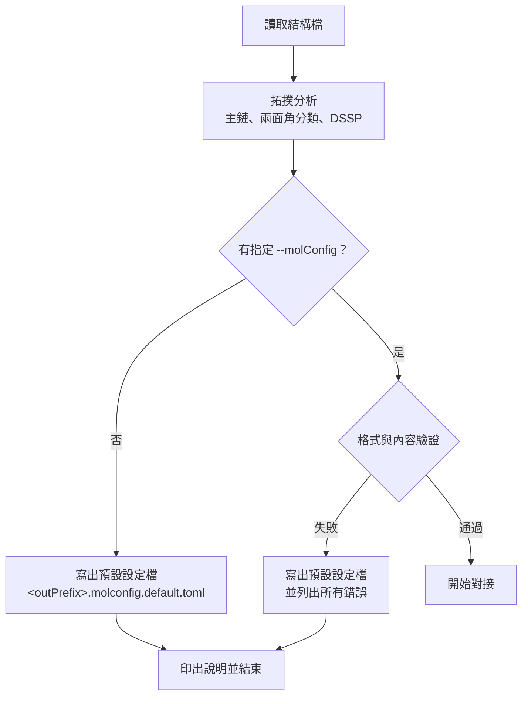
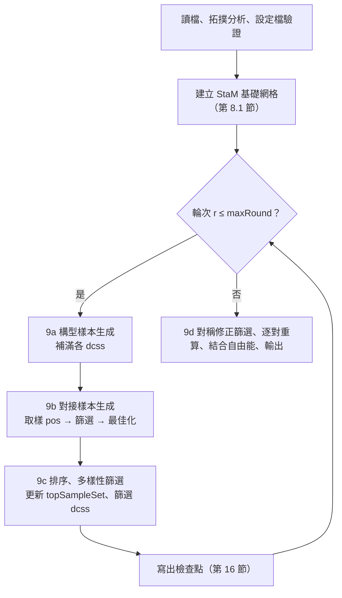

# OmegaDocker 0.40.0 規格書

| 項目 | 內容 |
|---|---|
| 文件版本 | 1.122 |
| 日期 | 2026-10-28 |
| 程式版本號 | **0.40.0** |
| 程式基礎 | 新架構；能量與梯度 kernel 取自 AutoDock-GPU 1.6，並移植 OmegaDocker 的修改 |
| 狀態 | 定案（1.0）；實作中需修正時遞增版本，修訂紀錄見第 19 節 |

---

## 1. 目的與範圍

- 支援 **生物分子（蛋白質、核酸）與寡聚物** 的對接，同時保留小分子對接能力。
- **不設原子數硬性上限**（取消 AutoDock-GPU 的 256 原子限制），實際上限由 GPU 記憶體決定。
- 將「構型取樣」與「位置與定向取樣」分成兩個階段（9a、9b），以輪次反覆進行。
- 本版只最佳化 **兩面角**；鍵長、鍵角維持輸入值。能量函式沿用目前 OmegaDocker（AD4 系列）。兩者的擴充列於第 18 節。

---

## 2. 名詞定義

| 名詞 | 英文 / 縮寫 | 定義 |
|---|---|---|
| 穩態分子 | Stationary molecule, **StaM** | 不可平移、不可轉動的分子；內部兩面角可依設定變動 |
| 穩態分子群 | StaM group | 所有 StaM 的集合，視為一個整體（multimer）；可只含一個分子 |
| 動態分子 | Mobile molecule, **MobM** | 可個別平移、轉動的分子；每個 MobM 彼此獨立，不考慮 MobM 間作用 |
| 重原子 | heavy atom | 氫以外的原子 |
| 兩面角 | dihedral / torsion | 由 4 個重原子定義，繞中間鍵旋轉 |
| 主鏈 | backbone | 蛋白質 `N–CA–C(=O)` 重複單元，或核酸 `P–O5'–C5'–C4'–C3'–O3'` 重複單元 |
| 構型樣本 | conformational sample | 一個一維陣列，內容為該分子（或 StaM 群）所有可轉動兩面角的數值 |
| 第一階構型樣本 | L1 conf sample | 由 csgm 產生、尚未經 9a 最佳化與篩選的樣本 |
| 第二階構型樣本 | L2 conf sample | 9a 最佳化後能量 < `E_max` 的樣本 |
| 第二階構型樣本池 | L2 pool | 儲存 L2 樣本的池子，供補充 dcss |
| 對接構型樣本集 | Docking Conformational Sample Set, **dcss** | 本輪參與 9b 的構型樣本集合 |
| 構型樣本產生方式 | Conformational Sample Generation Method, **csgm** | csgm1a、csgm1b、csgm2、csgm3 |
| 位置與定向樣本 | Position and Orientation Sample, **pos** | MobM 的平移向量 + 定向（單位四元數） |
| 位置與定向取樣方法 | Position and Orientation Sampling Method, **posm** | posm1、posm2、posm2_fft、posm3、posm4 |
| 第一階 / 第二階位置與定向樣本集 | **L1poss** / **L2poss** | 篩選前 / 篩選後的 pos 集合 |
| 強靜電勢區域集合 | Strong Electrostatic Potential Area Set, **sepas** | 見 8.4.4 |
| 強靜電勢區域配對集合 | Strong Electrostatic Potential Area Pairs Set, **sepaps** | 見 8.4.4 |
| 構型配對 | conformation pair | 一個 StaM dcss 樣本 × 一個 MobM dcss 樣本 |
| 對接樣本 | docking sample | 構型配對 + 一個 pos，經 9b 最佳化後的結果 |
| topSampleSet | — | 每個 MobM 累計所有輪次的最佳對接樣本集合 |

---

## 3. 輸入

### 3.1 檔案格式

| 格式 | 鍵級來源 | 殘基 / 鏈資訊 | 部分電荷 |
|---|---|---|---|
| mmCIF | 化學成分字典（CCD）的 `chem_comp_bond`；殘基間連接用 `struct_conn` 與主鏈規則 | 有 | 程式計算 Gasteiger |
| SDF / MOL（V2000、V3000） | 檔案本身 | 無（主鏈以圖形比對辨識） | 程式計算 Gasteiger |
| mol2 | 檔案本身（含 `am`、`ar`） | 有（substructure） | 讀取檔案 |

規則：
- **不自行推斷鍵級**。mmCIF 中查不到 CCD 定義的殘基 → 報錯並結束。
- 內附標準胺基酸、核苷酸的 CCD 子集；使用者可用 `ccd <file>` 提供額外的 CCD 檔。
- 氫原子：`stam.protonation`／`mobm.protonation = pH`（預設）時程式移除檔案中的氫，依 `protonation.pH` 決定質子化狀態並補氫（3.4）；`= input` 時由使用者提供（質子化狀態由使用者負責），程式不新增、不刪除氫原子。
- 鍵長、鍵角必須合理；程式不修正。

**mmCIF 讀取細則：**
- 只讀第一個 model；同一殘基有多個 altloc 時，保留第一個出現的 altloc，其餘略過並警告。同一鏈中重複的殘基序號（微異質性）只保留第一個。
- 內附 CCD 子集：20 種標準胺基酸、`A C G U DA DC DG DT`、`HOH`。
- 殘基內的鍵取自 CCD；CCD 未列出的末端原子：胜肽 N 端的 `H`、`H1`、`H2`、`H3` 接到 `N`；核酸 5′ 端的 `HO5'` 接到 `O5'`。其他 CCD 沒有的原子名稱 → 報錯。元素與 CCD 不符 → 報錯。
- 殘基間的鍵：同一鏈相鄰殘基的 C–N（≤ 2.0 Å）與 O3′–P（≤ 2.2 Å）；`_struct_conn` 中 `covale`、`disulf`、`metalc` 類型（`metalc` 與含金屬的鍵視為金屬配位鍵）。`covale` 的鍵級為 1；若其中一端在 CCD 定義中與一個不存在的重離去原子（`pdbx_leaving_atom_flag` = Y）以雙鍵或三鍵相連，連接鍵取該鍵級（例如 LYS NZ 與 PLP C4A 的 Schiff 鹼，C4A=O4A 的 O4A 離去，NZ=C4A 為雙鍵；1.119）。
- 形式電荷：依每個原子在檔案中實際的鍵（含使用者提供的氫）的鍵級總和決定，例如 N 為 4 → +1、O 為 1 → −1。As 同 P。不支援的情況（例如 C 為 3、O 為 3）→ 報錯，提示可能缺原子或氫，或改用 SDF / mol2；例外：已給定電荷（CCD 或 3.4 的 pKa 規則）時接受 C 為 3（−1 或 +1，例如氰離子、異腈、一氧化碳的 C）與 O 為 3（+1，例如一氧化碳的 O）（1.119）。金屬與無鍵的離子使用 CCD 的電荷。
- CCD 標為芳香的鍵所組成的共軛系統，依實際存在的氫重新分配單、雙鍵（例如 HIS 的 HID / HIE / HIP）；只有在沒有中性解時，才把吡咯型 N 設為 +1。已給定 −1 電荷（CCD 或 3.4 的 pKa 規則）且只有兩個鍵的 N 視為芳香陰離子 N⁻（例如去質子化的四唑），不需雙鍵；若因此無解則改視為吡啶型 N（1.119）。此步驟只在 CCD 的芳香鍵範圍內進行，不屬於自行推斷鍵級。失敗且該殘基缺少 CCD 中的芳香原子時，錯誤訊息列出缺少的原子（環不完整）。
- 硫醇陰離子（S 為 −1）與另一個 S 的距離 ≤ 2.5 Å 時警告，提示 `_struct_conn` 可能缺少雙硫鍵。
- 元素符號 `D`、`T` 視為氫；但原子名稱仍須與 CCD 一致。

**SDF / mol2 讀取細則：**
- 檔案可含多筆紀錄（SDF record、mol2 `@<TRIPOS>MOLECULE`）；所有紀錄的分子都依 3.2 劃分。
- 依原子價需要但檔案中沒有的氫，不會補上，只警告。
- mol2 的殘基取自每個原子的 `subst_id`、`subst_name`（殘基名稱與序號由 `subst_name` 拆出，例如 `ALA12`），鏈名稱取自 `@<TRIPOS>SUBSTRUCTURE` 的 chain 欄。
- mol2 標示 `NO_CHARGES` 或缺電荷欄時，改算 Gasteiger 電荷並警告。

**Gasteiger 電荷細則：**
- 計算前先移除金屬配位鍵；金屬原子的部分電荷等於其形式電荷。
- 沒有 Gasteiger 參數的其他原子使用形式電荷，並警告。
- 原因：金屬沒有 Gasteiger 參數；若保留金屬配位鍵，無效數值會沿鍵結擴散到大部分原子（實測 1ZNF：424 個原子中 231 個）。

### 3.2 分子的劃分與角色指定

- 一個 **分子** = 鍵結圖中的一個連通元件（connected component）。
- `--stamFile=<file>`：檔案中的**所有分子**皆為 StaM，共同組成 StaM 群。不支援在檔案內細分角色。**只能指定一次**，指定多次時報錯並結束。
- `--mobmFiles=<file>`：檔案中**必須只有一個分子**，否則報錯並結束。可指定多次，每個檔案一個 MobM。`run.mode = score`／`localMin`（6.1）時，檔案中每一筆紀錄（SDF／mol2 的 record、mmCIF 的 model）是同一個分子的一個姿態：每筆紀錄只能有一個分子，原子（元素、名稱、順序）與鍵必須與第一筆相同，否則報錯並結束；第一筆作為該 MobM 的輸入結構（拓撲分析、分子設定檔、自動盒子）。
- `--refFiles=<file>`（選用）：MobM 的參考結構，依 `--mobmFiles` 的順序一個 MobM 一個（數目不同 → 報錯）。只讀第一筆紀錄，必須只有一個分子；氫原子可有可無（只用重原子與鍵結；mmCIF 不判定形式電荷與鍵級）。用途見 10.3 的 `rmsd_ref`。
- 每個 MobM 視為獨立的對接任務（見第 11 節）。

### 3.3 對接範圍

- `box.mode`（1.99）：
  - `manual`（預設）：`box.center x,y,z`、`box.size x,y,z`（Å）必須有值；盒子的三軸為輸入座標軸（不旋轉）。
  - `sidechainAuto`：自動決定盒子；StaM 的預設可轉動範圍依 4.4（盒子決定後再判斷）。
  - `fixAuto`：自動決定盒子；StaM 的兩面角預設全部不可轉動（使用者仍可在分子設定檔中改為可轉動）。
- 自動模式（`sidechainAuto`、`fixAuto`）：
  - `box.center`／`box.size` 不必有值；有值時給警告，有值的項目（整個向量）取代計算結果。只給 `box.center` 時，每軸邊長 = 2 × StaM 重原子到該中心的最大投影距離 + 邊距（盒子以該中心對稱）。`box.center` 以輸入座標系解讀；`box.size` 以盒子座標軸解讀。
  - 盒子的方向（`box.autoRotate`，預設 `true`）：以 StaM 重原子座標的主軸（PCA，依變異數由大到小；前兩軸絕對值最大的分量為正，第三軸為外積）為起點，再測試三輪旋轉（繞盒子三軸各 −3…3 步，步長 10°、2°、0.4°，每輪以目前最佳者為中心），取加完邊距後體積最小者（有 `box.center` 時以對稱的邊長計算體積）。`false`：三軸為輸入座標軸。
  - 中心：旋轉後 StaM 重原子包圍盒的中點。
  - 每軸邊長 = StaM 重原子沿該軸的投影範圍 + `box.stamMargin`（預設 4 Å，每軸總共）+ 2 × r_max。
  - r_max：MobM 重原子中心（不加權平均）到最遠重原子的距離，取所有 MobM 中最大者；`box.mobmRadius`：
    - `max`（預設）：拓撲上限。剛性片段為扭轉樹（4.7）中同一個最內層扭轉移動的原子；每個片段另含與相鄰片段之間扭轉的兩個鍵原子。任兩個重原子距離的上限 d_ub(i, j) 為沿片段樹路徑上固定距離之和，r_max = maxᵢ (1/N) Σⱼ d_ub(i, j)（|xᵢ − c| = |(1/N) Σⱼ (xᵢ − xⱼ)| ≤ (1/N) Σⱼ |xᵢ − xⱼ|，任何構型都不超過）。有環構形（4.9）時，片段內的距離取「會改變該片段內距離的環變數」所有構形組合中的最大值（每個片段最多 100000 種組合；超過時各環變數單獨變化並給警告，此時不保證為上限）。
    - `sampled`：輸入構型與 `box.mobmSampleNum`（預設 1000）個 csgm1 樣本（無重原子碰撞，`energy.clashDistance`）中最大的半徑；第 i 個 MobM 的樣本 k 使用 `Rng(seed, 2⁶² + i, k)`（與 9a 的亂數流分開）；環變數（4.9）在構形庫中均勻抽樣，使用 `Rng(seed, 2⁶¹ + 2⁶² + i, k)`（同 9a 環變數的做法）。有斷鍵（loop、交聯、金屬配位、大環）時，每個樣本先以 MobM 的閉合設定（`mobm.closure` 等，7.11）閉合；閉合失敗、或閉合後偏差 > `conf9a.preCloseFactor` × `topology.maxBreakDist`（同 9a 最小化前的檢查）的樣本不計入。執行紀錄列出未閉合的樣本數。
    - `input`：輸入構型。
    - `max`／`sampled` 的扭轉樹與 csgm1 設定：取自 `--molConfig`（只讀 MobM，略過其他分子）；未指定或驗證失敗時用該 MobM 的預設設定檔內容（含 4.9 的大環斷鍵）；都無法使用時改用輸入構型並給警告。
    - `max`／`sampled` 的環構形庫：與 9a 相同的參數（`ring.*`）與亂數流（`2⁶⁰ + 分子序號`），在決定盒子前產生（輸入座標系）；只在 9a 會產生構形庫時（`run.mode = dock` 或 `run.unbound = conf9a`、`ring.maxConfNum` > 1、分子設定 `ringConformers = true`）。之後 9a 的設定（斷鍵與可動範圍內的扭轉）相同時直接沿用（盒子旋轉時第 0 號構形轉到盒子座標系），執行紀錄寫 `from the box`；不同時重新產生。
  - 執行紀錄寫出各 MobM 的半徑與來源、r_max、`box.center`（輸入座標系）與 `box.size`（盒子座標軸或輸入座標軸）的數值與來源（`computed`／`given`）、旋轉時盒子三軸在輸入座標系的方向。
  - 旋轉時，所有分子在讀檔後立即轉到盒子座標系（中心為輸入座標的原點，不平移），之後的計算（拓撲、9a–9d）都在盒子座標系；輸出的結構座標一律轉回輸入座標系（StaM 不動的原子位置與輸入相同）。因座標的數值不同，結果與在輸入座標系計算的不逐位元相同。
  - 盒子在讀檔後、拓撲分析前決定，各輪不變；`--resume` 時以相同的參數與輸入重新計算，得到相同的盒子。
  - 一個 StaM 構型的網格（MobM 探針類型數 + 3 張 float 圖：各類型、靜電、去溶劑化、距離）超過可用的主機記憶體（`memory.hostLimit` 減常駐記憶體）或任一 GPU 的可用記憶體時報錯，寫出盒子大小、格點數與所需記憶體，提示加大 `grid.spacing` 或改用 `manual`（不另設上限參數）。
- 能量網格與距離網格涵蓋此範圍。
- posm1、posm2 只產生使 MobM 所有探針原子都在範圍內的 pos（8.4）；8.5 仍保留「超出範圍」檢查。

### 3.4 質子化狀態與補氫（`protonation`）

- `stam.protonation`、`mobm.protonation`：`pH`（預設，移除檔案中的氫與氘，以 `protonation.pH`（預設 7.4）下的主要質子化狀態補氫）或 `input`（氫原子照檔案）。StaM 檔整個記錄一起處理（例如蛋白質＋配體＋金屬離子）；每個 MobM 檔各自處理（未結合狀態）。在讀檔時、分子劃分與化學判斷之前進行。
- 主要狀態：pKa ≥ pH 時為質子化型，否則為去質子化型。
- 方法：
  - 標準 20 種胺基酸殘基（mmCIF）的可滴定基團（Asp、Glu、His、Cys、Tyr、Lys、Arg、N 端、C 端）：PROPKA 3 的 C++ 移植（`src/propka.cpp`，LGPL-2.1，參數檔 `propka.cfg` 不修改內嵌）。輸入為整個記錄的重原子（PROPKA 略過 HOH 等 `ignore_residues`；配體依 PROPKA 的 `groups` 分型參與計算；ATOM／HETATM 依檔案）。與 Python 版 PROPKA（commit 58ceb7b）在 15 個結構（含配體、金屬離子、DNA）上的 pKa 到小數第 6 位相同。PROPKA 沒有對應基團時（例如缺原子、鏈中斷處的 N 端）用 `propka.cfg` 的模型 pKa。
  - 其他原子（小分子、核酸、非標準殘基；SDF／mol2 全部）：OmegaDocker 自己的官能基規則（`src/pka_rules.cpp`，1.104，不使用其他程式的檔案或程式碼）：
    - 中性起點：N、O、S、P 上可藉增減氫消去的電荷先消去；帶正電且無氫的芳香 N 取同環中性 N 上的氫；與相反電荷相鄰的電荷（硝基、N-氧化物）與無法消去的電荷（四級銨）保留。
    - 位點：依下表順序以 SMARTS 比對（以 RDKit 判斷芳香性後），一個原子只取第一個符合的規則；pKa 為代表化合物的文獻值（水溶液、25 °C）。多質子基團（磷酸、膦酸、焦磷酸）依序使用各級 pKa。
    - 脂肪族胺的 β 修正：每條路徑 N–C–C–X（中間為 sp3 碳）或 N–C–X 的雜原子 X 降低 pKa：O 1.1、N 0.9、S 1.0（亞碸／碸 2.5）、P 2.5、鹵素 1.6；N–C–Y 的不飽和碳 Y：芳香 1.2、C≡N 5.3、C=O／C=S／C=N 2.6、C=C 1.0。多個修正由大到小，每個乘上前一個的 0.75 倍（tris 8.1、三乙醇胺 7.8）。
    - 位點之間：一次決定一個位點，|pKa − pH| 最大者先（多質子基團依級數順序）；已帶電的位點使之後位點帶同號電荷較不利：依兩位點原子間的鍵數 d，同號 ΔpKa = 4.0、3.0、2.3、1.4、1.0、0.8、0.6（d = 2…8，更遠為 0），異號為一半、方向相反（乙二胺 9.9／6.9、丙二酸 2.8／5.7、胺甲基膦酸 5.4）；兩個都在 P 上的位點之間不計（磷酸類的 pKa 已含）。
    - 未涵蓋（維持中性）：醇、醯胺、脲、芳香雜環上的其他 N（例如嘧啶、三唑、吡唑）、硼酸、非環狀烯醇、只能在其他互變異構物上滴定的基團。
    | 規則 | 種類 | pKa | 代表化合物 |
    |---|---|---|---|
    | sulfonic acid | 酸 | -1.9 | methanesulfonic acid -1.9 |
    | sulfinic acid | 酸 | 1.8 | benzenesulfinic acid 1.8 |
    | diphosphoric acid | 酸 | 0.9、2、6.6、9.4 | diphosphoric acid 0.9, 2.0, 6.6, 9.4 |
    | phosphoric acid | 酸 | 2.15、7.2、12.35 | phosphoric acid 2.15, 7.20, 12.35 |
    | phosphate monoester | 酸 | 1.5、6.3 | methyl phosphate 1.5, 6.3 |
    | phosphonic acid | 酸 | 2.4、7.7 | methylphosphonic acid 2.4, 7.7 |
    | phosphate diester | 酸 | 1.3 | dimethyl phosphate 1.3 |
    | phosphonate monoester | 酸 | 2.3 | methyl methylphosphonate 2.3 |
    | phosphinic acid | 酸 | 3.1 | dimethylphosphinic acid 3.1 |
    | thiocarboxylic acid | 酸 | 3.4 | thioacetic acid 3.4 |
    | acyl sulfonamide | 酸 | 4.5 | N-acetylbenzenesulfonamide 4.5 |
    | tetrazole | 酸 | 4.9 | tetrazole 4.9 |
    | alpha-amino acid carboxyl | 酸 | 2.3 | glycine 2.3 |
    | N-acyl alpha-amino acid carboxyl | 酸 | 3.6 | N-acetylglycine 3.6（非標準殘基在鏈尾的羧基） |
    | aromatic carboxylic acid | 酸 | 4.2 | benzoic acid 4.2 |
    | carboxylic acid | 酸 | 4.8 | acetic acid 4.8 |
    | cyclic 1,3-dione enol | 酸 | 5 | 1,3-cyclohexanedione 5.3, ascorbic acid 4.1 |
    | 2,4-dinitrophenol | 酸 | 4.1 | 2,4-dinitrophenol 4.1 |
    | 2,6-dinitrophenol | 酸 | 3.7 | 2,6-dinitrophenol 3.7 |
    | 4-nitrophenol | 酸 | 7.2 | 4-nitrophenol 7.2 |
    | 2-nitrophenol | 酸 | 7.2 | 2-nitrophenol 7.2 |
    | phenol | 酸 | 10 | phenol 10.0 |
    | thiophenol | 酸 | 6.6 | thiophenol 6.6 |
    | thiol | 酸 | 10.5 | ethanethiol 10.6 |
    | N-heteroaryl sulfonamide | 酸 | 6.5 | sulfadiazine 6.5 |
    | N-aryl sulfonamide | 酸 | 8.5 | N-phenylmethanesulfonamide 8.9 |
    | sulfonamide | 酸 | 10.1 | benzenesulfonamide 10.1 |
    | hydroxamic acid | 酸 | 9 | acetohydroxamic acid 9.0 |
    | thiazolidinedione | 酸 | 6.5 | rosiglitazone 6.8 |
    | acyl carbamate | 酸 | 6.1 | dimethadione 6.1 |
    | barbiturate | 酸 | 7.8 | barbital 7.9 |
    | guanine N1 | 酸 | 9.2 | guanosine 9.2 |
    | thymine N3 | 酸 | 9.7 | thymidine 9.7 |
    | uracil N3 | 酸 | 9.3 | uridine 9.3 |
    | imide | 酸 | 9.6 | succinimide 9.6 |
    | acylguanidine | 鹼 | 8.3 | acetylguanidine 8.3 |
    | guanidine | 鹼 | 13.6 | guanidine 13.6 |
    | isourea | 鹼 | 9.7 | O-methylisourea 9.7, S-methylisothiourea 9.8 |
    | amidine | 鹼 | 12.4 | acetamidine 12.4 |
    | 4-aminopyridine | 鹼 | 9.2 | 4-aminopyridine 9.2 |
    | 2-aminopyridine | 鹼 | 6.9 | 2-aminopyridine 6.9 |
    | cytosine N3 | 鹼 | 4.2 | cytidine 4.2 |
    | adenine N1 | 鹼 | 3.5 | adenosine 3.5 |
    | guanine N7 | 鹼 | 2.2 | guanosine 2.2 |
    | benzimidazole | 鹼 | 5.5 | benzimidazole 5.5 |
    | imidazole | 鹼 | 7 | imidazole 7.0 |
    | pyridine | 鹼 | 5.2 | pyridine 5.2 |
    | alpha-amino acid amine | 鹼 | 9.6 | glycine 9.6 |
    | primary amine | 鹼 | 10.6（β 修正） | methylamine 10.6 |
    | secondary amine | 鹼 | 11（β 修正） | dimethylamine 10.7, piperidine 11.1 |
    | tertiary amine | 鹼 | 10（β 修正） | trimethylamine 9.8, triethylamine 10.7 |
    | hydrazine | 鹼 | 7.9 | methylhydrazine 7.9 |
    | aniline | 鹼 | 4.6 | aniline 4.6 |
    | N-alkylaniline | 鹼 | 4.9 | N-methylaniline 4.9 |
    | N,N-dialkylaniline | 鹼 | 5.1 | N,N-dimethylaniline 5.1 |
  - 起點：mmCIF 殘基用 CCD 定義的電荷與 Kekulé 鍵級（標準胺基酸為 CCD 的形式，例如 His 為 HIP、Lys 為 NH3+），隱含氫數由價數決定；SDF／mol2 用檔案的形式電荷與鍵級。
  - 金屬配位鍵（3.1）不計入價數；與金屬鍵結的可滴定原子一律為去質子化型（例如 Cys–Zn 為 CYM、His 的配位 N 不帶氫；兩個 N 都配位時兩者都不帶氫），水等非可滴定原子不受影響。
  - 雙硫鍵 Cys 不滴定。
  - 標準胺基酸側鏈原子（N、C 以外）與其他殘基共價相連時（雙硫鍵、配體的共價連接，例如 Asp 與血基質的酯、Lys 與 PLP 的 Schiff 鹼、Cys 與共價抑制劑），該原子不用 PROPKA，而與非標準殘基一樣由 pKa 規則依整個相連的結構決定（例如 Schiff 鹼為中性亞胺，規則表沒有亞胺）；His 的 ND1 或 NE2 有共價連接時，整個咪唑環由 pKa 規則決定（1.119）。
  - CCD 定義中與金屬直接成鍵的原子（金屬在同一殘基內，例如血基質的 N、鉬蝶呤的 Mo=O、Mo–OH）：氫數取 CCD 定義的氫數，不經 pKa 規則（1.119 以前這些原子在去掉金屬鍵後補氫，血基質的兩個 N 各多一個氫）。
- 殘基與原子的補全：
  - 鏈末端或鏈中斷處（C 與下一殘基的 N 沒有鍵）的胺基酸若缺 OXT，在 C 的平面上補 OXT（C–O 1.25 Å），視為 C 端；N 沒有與其他殘基鍵結時視為 N 端。
  - 標準胺基酸缺重原子時給警告並列出殘基；開放的價數以氫補滿（例如截斷的側鏈末端變成 CH3）。
- 氫的位置：依重原子的混成（RDKit）與鍵結的重原子放置：sp3 以四面體幾何、sp2 在平面上、sp 在直線上；鍵長 C–H 1.09、N–H 1.01、O–H 0.96、S–H 1.34 Å；只有一個重原子鄰居的基團以鄰居的另一個重原子為參考，交錯構型（反式起始）。
- 可轉動氫與翻轉的最佳化（依 reduce／probe 已發表的方法獨立實作：Word et al. 1999, J. Mol. Biol. 285:1711（Asn／Gln 翻轉）與 285:1735（小探針接觸點）；參數值取 reduce 說明（`reduce -Help`）列出的預設值；不讀、不用 reduce／reduce2／probe 的程式碼（Apache-2.0））：
  - 狀態：OH、SH、sp3 NH2（每 30°，12 個）、NH3+（每 30°，4 個）、共軛 OH（0°／180°）、自由水（36 個方向）；Asn／Gln 醯胺翻轉（交換 O 與 N 的座標，2 個）；His 翻轉（交換 ND1↔CD2、CE1↔NE2，2 個；中性 His 再乘以 HID／HIE，共 4 個）；質子化羧基（Asp、Glu、C 端）中帶氫的 O（交換兩個 O 的座標）× syn／anti（4 個）。
  - 分數：接觸點。每個移動原子的凡得瓦表面上放點（每 Ų 16 個，黃金螺旋分布），埋在直接鍵結原子內的點刪除。每個點只對「間隙」最小的原子計分（間隙 = 點到該原子中心的距離 − 該原子半徑；間隙 < 0.125 Å 才計）；相隔 3 個鍵以內的原子不計。每個點的分數：間隙 ≥ 0 為接觸 exp(−(間隙/0.25)²)；重疊（間隙 < 0）為 −10 × 重疊；極性氫與受體的重疊為氫鍵 +4 × min(重疊, c) − 10 × max(0, 重疊 − c)，c = 0.6 Å（供體與受體都帶電時 0.8 Å）；氫對金屬的半徑加 0.865 Å。基團狀態的分數為點分數總和 ÷ 16（Ų），能量 = −分數。半徑（明確氫，Word et al. 1999）：極性 H 1.00、非極性 H 1.17、sp3 C 1.70、羰基 C 1.65、其他 sp2／sp C 1.75、N 1.55、O 1.40、S 1.80、P 1.80、Se 1.90、F 1.30、Cl 1.77、Br 1.95、I 2.10；金屬用離子半徑（Zn 0.74、Mg 0.72、Ca 1.00、Mn 0.83、Fe 0.74、Co 0.75、Ni 0.69、Cu 0.73、Na 1.02、K 1.38，其他 1.0）。帶電：帶形式電荷的原子與其共振夥伴（O–C–O、N–C–N、His ND1／NE2）。成對分解：兩個基團的成對能量為「加入對方原子後，各自點的最近原子改變所造成的分數變化」之和（三個以上基團同時接近同一點時為近似）。翻轉狀態另加 1.5（翻轉需勝過 1.5 才採用）；羧基 anti 加 0.05。
  - 搜尋：相互作用（成對能量非零）的基團連成一組；先以 Goldstein dead-end elimination 刪除必定較差的狀態，組內狀態組合 ≤ 10⁶ 時以分枝界限法窮舉，否則逐一改善（最多 50 輪）；之後自由轉子各以 5° 步長在 ±15° 內微調。
  - 與 reduce 4.17（`-FLIP`，只比較輸出）在 17 個晶體結構（去水；2ACE 讀檔失敗不計）的 Asn／Gln／His 翻轉比較：reduce 翻轉 90 個；OmegaDocker 翻轉 92 個，其中雙方都翻轉 81 個（只有 OmegaDocker 翻轉 11 個、只有 reduce 翻轉 9 個）。1.105 的簡化分數為 88／77／11／13。翻轉偏差 0、0.5、0.75、1、1.25、1.5、2、3、5 的不一致數（只有 OmegaDocker + 只有 reduce）為 56、26、22、22、23、20、22、31、50，取 1.5。
- 氫的名稱：CCD 殘基用 CCD 中該重原子的氫名稱；兩個以上時以 CCD 的模型座標（其次理想座標；理想座標的前手性氫名稱與 PDB 慣例相反）疊合後依最近者命名；帶電的 N 端為 H1、H2、H3；CCD 沒有的氫命名為 `H` + 重原子名稱去掉第一個字元 + 編號；SDF（無原子名稱）不命名。新增的氫（與 OXT）的檔案序號接在記錄最後一個原子之後。順序：每個殘基的重原子之後；沒有殘基資訊時在所有重原子之後。
- 電荷：mmCIF 依補上的氫以 3.1 的規則重新決定形式電荷與 Kekulé 鍵級；SDF／mol2 用上述結果的形式電荷與鍵級；mol2 檔案中的部分電荷不再使用（改算 Gasteiger，給警告）。
- 覆寫：分子設定檔的 `[[protonation]]`（`file` 為 `--stamFile`／`--mobmFiles` 的路徑字串）：
  - 殘基：`site = "<chain>:<seq><iCode>"`、`state` = ASP／ASH、GLU／GLH、HID／HIE／HIP、CYS／CYM、TYR／TYM、LYS／LYN、ARG／ARN（只限 mmCIF）。
  - 原子：`site = "<chain>:<seq><iCode>:<name>"` 或 `"#<序號>"`、`charge` = 形式電荷（−3…3），氫數由價數決定（例如 N 端 N 的 0／+1、OXT 的 −1／0）。
  - 對應的 `protonation` 不是 `pH`、檔案或位點不存在、狀態不合殘基 → 報錯。改變狀態後若扭轉的原子不同，需重新寫出預設分子設定檔。
- `score`／`localMin` 的多筆紀錄（6.1）：第一筆紀錄決定的氫（名稱、母原子、電荷、鍵級，含 His 互變異構）套用到所有紀錄；各紀錄只重新最佳化轉子與翻轉。
- 輸出：執行紀錄寫出每個檔案移除與新增的氫數、各狀態的位點數、非標準狀態（例如 ASH、HIP、CYM、中性 N 端）與覆寫、金屬決定的位點、補上的 OXT、翻轉的基團；預設分子設定檔列出每個位點的狀態、方法與 pKa，並保留已有的 `[[protonation]]`。

#### 3.4.1 在其他構型重新計算質子化狀態（`protonation.recompute`）
- 值：`none`（預設，質子化狀態只在讀檔時決定）、`l2`（9a 進入 L2 pool 的構型樣本）、`final`（9d 的結構：每個複合物姿態，以及每個未結合候選構型單獨）。只對 `protonation = pH` 的組（StaM 群、每個 MobM）作用；兩組都是 `input` 時警告且無作用。不可在 `--resume` 時改變。
- 範圍：標準胺基酸的可滴定位點（ASP、GLU、C 端、N 端、CYS（非雙硫鍵）、TYR、LYS、ARG、HIS），StaM 群與胜肽 MobM 都適用。小分子、核酸、非標準殘基的官能基規則只看 2D 結構，不重算。與金屬鍵結的位點、`[[protonation]]` 指定的殘基（含其原子）固定不變。
- 方法：以構型的重原子座標執行 PROPKA 3（`final` 的複合物：StaM 群與 MobM 一起；無殘基資訊的分子以配體身分加入），pKa ≥ `protonation.pH` 為質子化。狀態與讀檔時（基準）不同的位點構成一個質子化變體；中性 His（由 HIP 變中性的，以及原本就是 HID／HIE 的，未固定者）的互變異構體依 AD4 能量選擇（見下）。PROPKA 沒有給值的位點保持原狀態。
- His 互變異構體（1.108）：不做環翻轉（重原子不動），只選氫在 ND1（HID）或 NE2（HIE）。從目前狀態開始（由 HIP 變中性者為 HIE），一次改一個 His、其他固定，能量較低才改，直到沒有改變（最多 4 輪）。能量：`l2` 與 `final` 的未結合候選構型為該組單獨的 9a 能量（分子內＋碰撞）；`final` 的複合物為該組單獨的 9a 能量＋分子間能量（`exactInter` 的四項＋碰撞），StaM 群與 MobM 輪流選擇，直到兩者都沒有改變（最多 4 輪）。互變異構體之間沒有質子數的改變，質子化自由能為 0（溶液中 HIE／HID 的固有差異不計）。選擇時建立的能量系統暫存，不給變體編號；編號只給最後的結果，依樣本順序指定，結果可重現。HID↔HIE 也是質子化變體（例如 `B:5:HIS HID->HIE`）。
- 質子化變體：每種變化組合一個分子變體與自己的能量系統（`ProtonationVariants`，第一次需要時建立）。變體只改變位點的氫、形式電荷（His 另依狀態設定環的鍵級），重新計算 Gasteiger 電荷；新增的氫以幾何放置（兩個以上鄰原子：反向和方向；一個鄰原子：sp2 鄰原子同側 0°、否則 180°；N–H 1.01、O–H 0.96、S–H 1.34 Å），名稱依 CCD 慣例（HD2、HE2、HXT、HG、HH、HD1、HE2、HZ1–3、HH21／HH22、N 端 H1–H3 或 H、H2），排在所屬殘基最後一個原子之後。扭轉樹沿用基準分子的扭轉（數量與順序相同，新增的氫隨母原子移動），因此樣本的兩面角向量不變，重原子座標與基準相同。
- 質子化自由能（kcal/mol，相對於基準狀態）：每個改變的位點，得到質子 ln(10)·RT·(pH − pKa)，失去質子 ln(10)·RT·(pKa − pH)，pKa 為這次重算的值，T = `od_0100.temperature`。因只在主要狀態改變時才改變，每項 ≤ 0。PROPKA 的 pKa 已含環境的靜電效應，變體的 AD4 能量也含部分相同效應（重複計入，未校正）。
- `l2`：每次 9a 補充 L2 pool 後，對新加入的樣本平行計算 PROPKA（變體編號依樣本順序指定，結果可重現）；有變化的樣本改用變體的能量（不重新最小化）＋質子化自由能作為 9a 能量（因此 StaM 項含 StaM 樣本的質子化自由能）；變體能量 ≥ `energy.Emax` 的樣本移除。9b：StaM 樣本的格點以其變體的原子建立（`flexres` 時變體樣本改建 `full`；`delta` 時變體樣本以兩組原子的全部位置作為可能改變的位置）；MobM 樣本依變體分組，每組以變體的能量系統對接（GPU：每個（MobM、變體、裝置）一個評估器，第一次需要時建立，不參與 15.1.35 的接手）；MobM 樣本的質子化自由能加到對接樣本能量（9c 排序）。檢查點記錄變體（每部分的位點與狀態）及每個樣本的變體與質子化自由能。9d 使用樣本的變體。
- `final`：9a–9c 不變。9d 對每個複合物姿態重算（StaM 構型與 MobM 姿態一起），未結合候選構型各自單獨重算；能量以變體計算，StaM 項加上 StaM 變體與基準的 9a 能量差。
- 9d 能量：`E_9b`、`dG_adgpu_16`、`G_complex` 加上複合物的質子化自由能（`l2` 的 `E_9b` 中 StaM 部分已在 StaM 項內）；od_0100 的未結合候選構型 G 加上其質子化自由能。`summary.tsv` 增加 `dG_prot`（複合物）、`prot_stam`、`prot_mobm`（改變的位點，例如 `A:1:GLY NH2->NH3+`；無變化為 `-`）。StaM 結構檔：基準為 `stam_<樣本>`，變體為 `stam_<樣本>_p<變體>`；姿態檔以 MobM 變體的原子寫出。
- 實測（資料集 A：2KJJ／1L2Y，posm1，1 輪，GPU）：pH 7.4，`l2` StaM 275 個樣本中 203 個改變（1 個變體：A:1:GLY N 端 NH2→NH3+），9a 重算 0.04 s；9b 54.6 s（`none` 54.5 s）；`final` 50 個複合物中 36 個改變，9d 重算 8.67 s（`none` 8.10 s）。pH 10.3：StaM 30 個變體、MobM 2 個，9b 77.6 s（MobM 依變體分組，每組的批次較小）。
- 實測（1.108，同上，pH 7.4）：`l2` StaM 275 個樣本中 257 個改變、7 個變體、275 次 His 互變異構體改變，9a 重算 0.11 s，9b 54.9 s；`final` 50 個複合物中 44 個改變（例如 `A:1:GLY NH2->NH3+ B:5:HIS HID->HIE B:10:HIS HIE->HID` 14 個），9d 重算 9.35 s（1.107：8.67 s）。
- GPU 上重新計算（每個 L1 樣本）為未來版本支援項目 F11（18）。

---

## 4. 分子拓撲分析

### 4.1 主鏈辨識

| 類型 | 辨識規則（以鍵結圖比對，不依賴殘基名稱） |
|---|---|
| 蛋白質 | 連續的 `N–CA–C(=O)–N` 模式（`-NC(CO)-NC(CO)-`） |
| 核酸 | 連續的 `P–O5'–C5'–C4'–C3'–O3'–P` 模式 |

- 不辨識側鏈是否為標準胺基酸或標準核酸鹼基。
- 實作細則：
  - 蛋白質單元：C 以雙鍵連接只有一個重原子鄰居的 O，C 連接 CA（碳），CA 連接 N。核酸單元：C3′、C4′ 為環上的碳且以環內鍵相連，O3′、C5′、O5′ 不在環上；P 可缺（5′ 端無磷酸）。
  - 單元之間以 C(i)–N(i+1)（蛋白質）或 O3′(i)–P(i+1)（核酸）相連；至少兩個相連的單元才算主鏈。
  - 同一分子同時有兩種主鏈時，採用單元數較多者並警告。
- 辨識結果寫入分子設定檔的 `backboneType`（`protein` | `nucleic` | `none`），使用者不可修改。

### 4.2 主鏈兩面角

| 類型 | 兩面角 | StaM 預設 | MobM 預設 |
|---|---|---|---|
| 蛋白質 | φ（C–N–CA–C）、ψ（N–CA–C–N） | 不可動 | 可動 |
| 蛋白質 | ω（CA–C–N–CA） | 保持輸入（`fixed`） | 保持輸入（`fixed`） |
| 核酸 | α、β、γ、δ、ε、ζ | 不可動 | 可動 |

- ω 若設為 `cisTrans`，只產生 0° 或 180°。
- 兩面角歸屬：φ_i = C_{i−1}–N_i–CA_i–C_i、ψ_i = N_i–CA_i–C_i–N_{i+1}、ω_i = CA_i–C_i–N_{i+1}–CA_{i+1}（ω 歸屬前一個殘基 i）；α_i = O3′_{i−1}–P_i–O5′_i–C5′_i、β_i = P_i–O5′–C5′–C4′、γ_i = O5′–C5′–C4′–C3′、δ_i = C5′–C4′–C3′–O3′、ε_i = C4′–C3′–O3′–P_{i+1}、ζ_i = C3′–O3′–P_{i+1}–O5′_{i+1}。缺少所需原子的兩面角（鏈端）不屬於主鏈兩面角，依 4.4 分類。
- 角度符號依 IUPAC 慣例，範圍 (−180°, 180°]。
- **脯胺酸的 φ** 在吡咯烷環內，固定不可動（除非該環設定斷鍵，見 4.5）；環的皺褶由 4.9 的構形庫取樣。
- 核酸 δ（C5'–C4'–C3'–O3'）的中間鍵屬於核糖環，固定不可動（除非設定斷鍵）。

### 4.3 ω 檢查

- 若 ω 為 `fixed`，且輸入角度與 0° 和 180° 的差距 **都** 大於 `omegaTolerance`（預設 30°）→ 警告並結束程式。
- 使用 `topology.acceptNonPlanarOmega` 可接受此情況並繼續。

### 4.4 側鏈與非主鏈分子的兩面角分類

主鏈分子的側鏈，與沒有主鏈的分子，使用相同規則。

**預設不可轉動：**

| 類型 | 例子 |
|---|---|
| 醯胺鍵（含側鏈） | 肽鍵、Asn/Gln 的 C(=O)–N |
| 共振部分雙鍵 | 酯 C(=O)–O、胍基（Arg NE–CZ、CZ–NH1/NH2）、脒、脲、胺甲酸酯、硫醯胺 |
| 雙鍵 | C=C、C=N、N=N |
| 三鍵與共線原子 | C≡C、C≡N；兩端原子共線導致兩面角無定義的鍵 |
| 芳香鍵 | 芳香環內所有鍵 |
| 環內鍵 | 非芳香環內的鍵（除非設定斷鍵） |
| 無重原子兩面角的鍵 | 鍵的一端只連接氫原子（例如 –CH3、–OH） |
| 對稱基團 | –CF3、–C(CH3)3、–NO2、–SO3⁻、–PO3²⁻ 等，轉動只產生等價結構 |
| 金屬配位鍵 | 含金屬原子的鍵 |

**預設可轉動**：其餘的單鍵（包含雙硫鍵 S–S、聯芳基鍵、核酸醣苷鍵 χ）。

**實作細則**：
- 列出的兩面角：兩端重原子都另有重原子鄰居的鍵（含環內鍵與芳香鍵，供 `ringBreak` 使用）。「無重原子兩面角的鍵」不列出。
- 非主鏈兩面角的 4 個原子：鍵兩端各取編號最小的重原子鄰居（優先非金屬）。
- 分類依下列順序，取第一個符合者：金屬 → 芳香 → 環內 → 三鍵／共線（任一端的所有其他重原子鄰居與鍵的夾角 > 170°）→ 雙鍵 → 醯胺（C(=O)–N）→ 共振（其他 C(=X)–Y，X ∈ {O, S, N}，Y ∈ {N, O}）→ 對稱 → 單鍵。
- 對稱基團：鍵的一端除另一端外，其餘鄰居（至少兩個，含氫）都是只連接該端的重原子，且元素與氫數相同。不依鍵級判斷，因此共振等價的基團（–COO⁻、–NO2、–SO3⁻、–PO3²⁻）也屬於此類；例如 Asp χ2、Glu χ3、C 端 ψ。

**StaM 的範圍限制**：StaM 中，只有「任一重原子位於對接範圍外擴 `stamFlexMargin`（預設 4 Å）內」的殘基（無殘基資訊時以原子為單位），其兩面角才依上述規則預設可轉動；其餘預設不可轉動。`box.mode = fixAuto` 時 StaM 的兩面角預設全部不可轉動（3.3）。使用者可在分子設定檔中修改。

### 4.5 環狀結構斷鍵

- 使用者在分子設定檔的 `ringBreak` 中指定要斷開的鍵。
- 斷開後，環內鍵依 4.4 重新判斷是否可轉動。
- `ringBreak` 的鍵必須在環內（以未斷開的鍵結圖判斷），且不可為芳香鍵或金屬配位鍵（金屬配位鍵見 4.7 的 `metalBond`）。
- 被斷開的鍵（`ringBreak`、`chainBreak`）本身的兩面角由閉合約束決定（4.8），不可設為可轉動。
- 以距離約束恢復斷鍵，方式見 4.8。每對約束原子：能量 `E = G·d²`、梯度 `2G·d`（`G` 預設 200，`energy.closureG`）。
- 源自 OmegaDocker v0.34.0 的 G 原子對做法（`pdbqtAddDistFix.pl`），新版不再需要前處理腳本，並修正兩個已知問題：
  1. 梯度只有正確值一半（`calcLigandEneGra.cu` 中累加 `G·d`）。
  2. 「距離過遠」判斷因 `else if` 結構，實際門檻變成 `collDistance` 而非 `inRangeDist`。
- 約束能量只用於 9a、9b 最佳化；**不計入** 9c 排序與 `E_max` 篩選。閉合是否成功由 `maxBreakDist` 判斷（4.8）。

### 4.6 二級結構判定

- 對所有蛋白質分子（StaM 與 MobM）以 **DSSP 演算法**（Kabsch & Sander 1983）判定每個殘基的二級結構，包含 DSSP 4 新增的 κ 螺旋（PPII，代碼 `P`；Hekkelman et al. 2025）。
- 不使用 STRIDE：STRIDE 授權僅限學術使用；且其判定所需的 φ/ψ 機率表只見於原始碼，論文中沒有數值，無法自行實作。
- 自行實作，行為與 DSSP 4（PDB-REDO/dssp，BSD-2-Clause）一致，包括單精度座標、氫鍵能量取到 0.001 kcal/mol、H 原子由前一個殘基的 C=O 方向放置、梯子（ladder）合併時的間隔判斷。
- 判定範圍：StaM 群組的所有分子一起判定（可找到分子之間的 β 摺板）；每個 MobM 各自判定。
- 殘基依主鏈單元（4.1）取得 N、CA、C、O，不依原子名稱；N 除了 CA 與前一殘基的 C 之外另連有重原子者（脯胺酸、N-甲基化殘基）不作為氫鍵供體。
- 代碼：`H` α 螺旋、`G` 3₁₀ 螺旋、`I` π 螺旋、`P` κ 螺旋、`E` 摺板、`B` 孤立橋、`T` 轉角、`S` 彎曲、`.` 無。
- 驗證：開發時以 mkdssp 4.6.1 比對（只用於驗證，不隨 OmegaDocker 散佈）；18 個 PDB 結構共約 5,800 個殘基，結果完全一致。

### 4.7 扭轉樹與錨點

- MobM：扭轉樹的根原子為最靠近分子質心的重原子（同 AutoDock）。質心取重原子座標的平均。
- **錨點與移動側（通則）**：錨點原子在兩面角轉動時不動。轉動一個兩面角時，移動的是「不含錨點原子」的一側（不經過已斷開的鍵）。
  - 兩側都含錨點原子 → 該兩面角無法轉動，驗證時報錯（5.3），提示改為不可轉動或在兩者之間加斷鍵。
  - 斷鍵後分出的每一段都必須含錨點原子，否則報錯（5.3）。MobM 與只有一個錨點原子的 StaM，等同「分子不可分成兩段」。
  - 錨點以分子（3.2 的連通分量）為單位；含多條鏈的分子（以交聯鍵相連）共用錨點。
- StaM：依 `stamFixedResMovable`（預設 `false`）決定。

**固定殘基**：主鏈兩面角全部不可動的殘基（蛋白質 φ、ψ、ω 皆不可動，ω 為 `fixed`；核酸 α–ζ 皆不可動）。
**loop**：同一條鏈上連續的非固定殘基。

#### `stamFixedResMovable = false`（預設）
- 固定殘基的**主鏈原子**座標在 9a 最佳化中不變；側鏈依 4.4 的設定，不受此限制。
- 每段 loop 的錨點與斷鍵：

| loop 位置 | 錨點 | 建構方向 | 斷鍵（4.8） |
|---|---|---|---|
| 兩個固定段之間 | N 端側相鄰的固定殘基 | N → C | loop 最後一個殘基與下一個固定殘基之間的主鏈鍵（蛋白質 C–N；核酸 O3′–P） |
| 鏈的 N 端 | C 端側相鄰的固定殘基 | C → N | 無（自由端） |
| 鏈的 C 端 | N 端側相鄰的固定殘基 | N → C | 無（自由端） |
| 整條鏈無固定殘基 | 該鏈最靠近質心的殘基 | 由錨點往兩端 | 無 |

- 錨點原子：分子中有固定殘基時，為所有固定殘基的主鏈原子（蛋白質 N、CA、C、O；核酸 P～O3′）；整個分子都沒有固定殘基時，為最靠近分子質心的主鏈單元的 CA（蛋白質）或 C4′（核酸）；沒有主鏈的 StaM 為最靠近質心的重原子。
- **loop 斷鍵在讀取分子設定檔時決定**：StaM 的主鏈兩面角預設不可轉動（全部為固定殘基），因此預設檔沒有 loop；使用者把主鏈改為可轉動後才形成 loop。驗證通過後：
  - 兩個固定段之間的 loop，若其主鏈相連鍵（前一個固定殘基 → loop → 下一個固定殘基之間的 C–N 或 O3′–P）都沒有斷開，程式在上表的位置自動斷開，並在執行紀錄中列出（`added chainBreak ... source = "auto-loop"`）。
  - 使用者可在設定檔以 `[[molecule.chainBreak]]`（`source = "user"` 或 `"auto-loop"`）改選同一 loop 中其他主鏈相連鍵；每段 loop 只能斷一處（否則中間一段沒有錨點）。
  - 自動斷開處的 ω（或 ζ）若為 `cisTrans`（或可轉動）→ 報錯，提示改為 `fixed` 或改選其他斷鍵位置。
  - `source = "auto-loop"` 只能用於兩個固定段之間 loop 的主鏈相連鍵。
- 預設可轉動的限制：StaM（`stamFixedResMovable = false`）中，非主鏈兩面角若兩側都含主鏈原子（例如未斷開的鏈間雙硫鍵上 Cys 的 χ2、χ3），預設不可轉動。

- 交聯鍵（雙硫鍵 S–S 等跨殘基共價鍵）若使扭轉樹形成環，自動在該鍵斷開，並依 4.8 約束閉合。
  - 候選鍵：兩端原子屬於不同殘基、不是主鏈相連鍵（蛋白質 C–N、核酸 O3′–P）、不是金屬配位鍵。
  - 選取方式：不計金屬配位鍵，先放入所有非候選鍵，再依鍵的順序放入候選鍵；兩端已相連的候選鍵才斷開。因此分子不會因斷鍵而分成兩段（例如 A、B 兩條鏈之間有兩個雙硫鍵時，只斷開一個）。
  - 判斷兩面角類別時，已斷開的鍵不算在環內（4.4、4.5）。
  - 沒有殘基資訊的分子（SDF、無 substructure 的 mol2）不偵測交聯鍵；需要時使用 `ringBreak`。

#### 金屬配位鍵（`metalBond`）
- 金屬配位鍵在環內的分子（例如鋅指蛋白中 Zn 與 Cys、His 配位），使用者須在分子設定檔以 `metalBond` 選擇處理方式：

| `metalBond` | 處理 | 結果 |
|---|---|---|
| `"keep"`（選項 A，預設） | 不斷開 | 經過金屬的環內所有鍵不可轉動（例如 1ZNF 中殘基 3 的 ψ 到殘基 23 的 φ，共 40 個主鏈兩面角，以及配位殘基的側鏈） |
| `"break"`（選項 B） | 斷開金屬配位鍵，寫成 `[[molecule.chainBreak]]`，`source = "auto-metal"`；以距離約束閉合（4.8） | 金屬仍與一個配位原子相連，隨分子移動；經過金屬的環消失，環內的鍵依 4.4 重新判斷，使用者可再設為可轉動 |

- 預設檔寫 `metalBond = "keep"`，並以註解（`# `）列出選項 B 建議斷開的 `auto-metal` 項目；改選 `"break"` 時，使用者把 `metalBond` 改為 `"break"`，並移除這些項目開頭的 `# `。
- 建議斷鍵的選取：先放入所有非金屬配位鍵（自動斷開的交聯鍵除外），再依鍵的順序放入金屬配位鍵；兩端已相連者才斷開。例如 1ZNF 的 Zn 有 4 個配位鍵，建議斷開 3 個。
- 使用者可改選要斷開的金屬配位鍵，但驗證時（5.3）：
  - `"break"`：斷鍵後，不可有金屬配位鍵仍在環內；分子不可分成兩段。
  - `"keep"`：不可有斷開金屬配位鍵的項目。
  - 不符合時報錯並結束，由使用者重新決定。
- 金屬配位鍵不在環內的分子不使用 `metalBond`。

#### `stamFixedResMovable = true`
- 錨點為最靠近分子質心的主鏈單元的 CA（蛋白質）或 C4′（核酸）（無主鏈時為最靠近質心的重原子）；轉動兩面角時，遠離錨點的一側移動。單鏈分子即為「最靠近該鏈質心的殘基」；含多條鏈的分子共用一個錨點。
- 不自動產生 loop 斷鍵；交聯鍵仍依上述規則處理。

### 4.8 斷鍵與閉合

- 斷鍵來源：(1) 使用者在 `ringBreak` 指定；(2) 4.7 自動產生的 loop 斷鍵、交聯斷鍵與金屬配位斷鍵（`metalBond = "break"`）。
- 自動產生的交聯斷鍵寫入預設分子設定檔（`[[molecule.chainBreak]]`，見 5.2）；金屬配位斷鍵以註解列出（4.7）；loop 斷鍵在讀取設定檔時決定（4.7）。三者都在執行紀錄中列出。
- 閉合約束方式：程式內部在斷鍵兩端產生虛擬複製原子（不參與其他能量計算，位置取自輸入座標），約束三對原子重合，同時約束鍵長、兩個鍵角與斷鍵兩面角：

| 斷鍵 A–B | A 端帶的複製原子 | B 端帶的複製原子 | 約束的兩面角 |
|---|---|---|---|
| 肽鍵 C_i–N_{i+1} | N′、CA′ | C′ | ω |
| 核酸 O3′–P | P′、O5′′ | O3′′ | ζ |
| 雙硫鍵 S–S | S′、CB′ | S′ | χ3 |
| 使用者指定的斷鍵 | B′、B 的一個重原子鄰居′ | A′ | 斷鍵所在的兩面角 |

- 複製原子的取法：斷鍵 A–B 有兩面角（4.4）時，A、B 依該兩面角的原子順序 `X–A–B–Y` 決定，B 的鄰居取 `Y`（因此肽鍵 A = C、Y = CA；O3′–P 的 A = O3′、Y = O5′；雙硫鍵 Y = CB）。沒有兩面角時，A、B 依鍵的原子順序，Y 取 B 的其他重原子鄰居中序號最小者，沒有則不放 Y′。
- 複製原子與其所屬原子剛性相連：所屬原子被某個兩面角移動時，複製原子一起移動。
- 金屬配位斷鍵（`auto-metal`）：配位角度變化大，**只約束距離**——金屬 M 與配位原子 L 的距離維持輸入值 `r₀`：`E = G·(|M−L| − r₀)²`。閉合失敗篩選以 `||M−L| − r₀| > maxBreakDist` 判斷。

- 閉合失敗篩選：9a 最佳化後，任一約束原子對距離 > `maxBreakDist`（預設 0.5 Å）→ 捨棄該樣本。
- 可達距離篩選（`CsgmBuild = grow` 時）：每建一段，若目前末端到閉合目標的距離 > 剩餘殘基數 × `reachPerRes`（蛋白質預設 3.8 Å；核酸預設 7.0 Å），即依 7.8 的規則重抽或捨棄。
  - 只在沒有 loop 閉合時使用（`closure = "none"`，或沒有可調整兩面角的斷鍵）。有 loop 閉合時不做：閉合會調整路徑上所有可調整的兩面角，生長中的末端距離不代表能否閉合（2KJJ：`grow` + RCD 的 20000 個樣本中 19999 個因可達距離被捨棄，而 `whole` + RCD 不做碰撞檢查時 40/40 可閉合）。
  - 只用於主鏈連接鍵（蛋白質 C–N、核酸 O3′–P）的斷鍵；交聯斷鍵與金屬配位不檢查。
  - 斷鍵 A–B 的兩端各檢查一次：往 A 建構時目標為 B，往 B 建構時目標為 A；目標原子尚未建構時不檢查。
  - 目前末端：扭轉樹中通往該端的路徑上、本段所含最深的兩面角的移動側鍵原子。
  - 剩餘殘基數：從目前末端所在殘基到目標原子所在殘基（同一條鏈上，含兩端）的殘基數；不在同一條鏈時不檢查。
  - 命令列：`topology.reachPerRes <蛋白質>,<核酸>`。

### 4.9 環構形（1.113）

環內的鍵不論鍵級都不可轉動（4.4），因此兩面角取樣不會改變環的構形（椅式、船式、信封式、糖環皺褶等）。依環的大小分兩種方式處理。

**分界與環系**
- 每個環內鍵的最小環：去掉斷鍵與金屬配位鍵後，經過該鍵的最短環的原子數。最小環 < `ring.macroMinSize`（預設 9）的鍵為小環鍵，其餘環內鍵屬於大環。
- 小環系：以共用原子相連的小環鍵（融合、橋環、螺環合為一個環系），只含重原子；不含金屬。殼層原子：與環系原子相鄰、不在環系內的重原子（不含金屬）。

**大環（預設斷開）**
- 讀檔時（4.7 交聯斷鍵之後）反覆在大環上選一個鍵斷開，直到沒有大環：鍵為單鍵、非芳香、非金屬配位鍵；優先序：兩端都沒有雙鍵或芳香鍵的單鍵 → 羰基 C–N（醯胺）→ 其他單鍵；同一優先序取鍵序號最小者。StaM 只斷開位於彈性範圍（4.4）內的鍵。
- 斷鍵寫入預設分子設定檔：`[[molecule.ringBreak]]`，`source = "auto-macro"`（5.2）；預設檔的兩面角依斷開後的拓撲列出（大環上的鍵依 4.4 重新分類）。斷開後依 4.8 以閉合約束接回，9a 以 7.11 的 loop 閉合處理。
- 經過金屬的環不算大環（金屬配位鍵不計，見 4.7 `metalBond`）。

**小環構形庫**
- 分子設定檔的 `ringConformers = true`（預設；5.2）時，下列小環系產生構形庫，否則只有輸入構形：有一個兩面角（含環內兩面角）的原子在環系內且位於彈性範圍內（MobM 都是）、環系內不全是芳香鍵、且環系的每個外接鍵都通往環系以外（不屬於未斷開的較大環）。
- 片段：環系原子、殼層原子、殼層原子的重原子鄰居（保留殼層原子的混成，例如醯胺）；鍵級取 Kekulé 形式；片段外的鍵以氫取代；環系原子在分子有氫時沿用其氫數，其他原子依預設價數補氫。以輸入座標指定立體化學（RDKit `assignStereochemistryFrom3D`）。
- 產生：RDKit ETKDGv3 產生 `ring.confGenNum`（預設 300）個構形（亂數種子由 `seed`、分子與環系決定；單執行緒，結果固定），以 MMFF94 最佳化（缺參數時 UFF，最多 2000 步）。
- 立體化學檢查：環系內四面體原子（輸入的正規化有號體積 |V|/(|b1||b2||b3|) > 0.3；醯胺 N 等平面原子不檢查）的有號體積符號須與輸入相同，否則捨棄該構形。
- 篩選：依能量由低到高，只取比最低者高不超過 `ring.confEnergyWindow`（預設 5 kcal/mol）者；環內兩面角（環系內的鍵，兩端各取序號最小的另一個環系鄰原子）與已保留構形（含輸入）的 RMSD ≤ `ring.confRmsd`（預設 15°）者視為相同而略過；含輸入最多 `ring.maxConfNum`（預設 10）種。輸入構形為第 0 號。`ring.maxConfNum = 1` 關閉構形庫。
- 只保存環系與殼層原子的座標；執行紀錄列出每個環系的構形數與相對 MMFF 能量（MobM，輸入構形在前），或只有輸入構形的原因。
- 相對 MMFF 能量（1.116）：以最低的候選為 0；輸入構形（第 0 號）取環內兩面角最接近的候選的能量（輸入的鍵長、鍵角未經 MMFF 最佳化，不直接計算）。每個樣本的環張力 E_ring = 各環變數所選構形的相對能量和，用於 od_0100（10.2）。

**套用到分子（環操作）**
- 構形 k > 0 取代環系原子的座標，並把每個外接分支（從環系原子 a 經外接鍵 a–e 到達的所有原子，含氫與附在其上的虛擬原子）作剛體移動；全部在輸入座標系中計算，於兩面角之前套用（7.1）。
- 對齊（依扭轉樹的錨點，4.7）：
  - 父分支：只有一個外接分支含錨點、環系內沒有錨點時，構形以該外接鍵的局部座標系（原點 a、a→e 方向、與環系鄰原子 X 的平面）對齊輸入，該分支不動。
  - MobM 的錨點在環系內：以所有環系原子做最小平方疊合（Kabsch），所有分支都移動。
  - StaM 有固定原子（錨點在環系內，或兩個以上分支含錨點，例如固定區的 Pro）：錨點環系原子與含錨點的分支不動；構形以一個錨點環系原子、其錨點環系鄰原子、其另一個不動鄰原子（環系原子或不動分支的殼層原子）的局部座標系對齊；沒有這樣的三個原子時以這些不動原子做最小平方疊合（少於 3 個時不用此環系）。實測 2KJJ B:29 Pro：不動原子與移動環原子間的鍵長變化 ≤ 0.023 Å。
- 外接分支的剛體轉換：殼層原子 e 有構形座標時，把輸入的局部座標系（原點 a、a→e、與環系鄰原子 X 的平面）轉到構形中的對應座標系（保留輸入的 a–e 鍵長，方向取自構形）；氫、金屬或質子化變體新增的原子，以 a 與兩個環系鄰原子的局部座標系（兩鍵的角平分線與法線）轉換。
- 一個環系位於另一個環系的外接分支內時先套用（由內而外）。
- 質子化變體（3.4.1）以原子對應沿用同一個構形庫。

**樣本與能量**
- 每個有構形庫的環系是一個環變數：在樣本的角度向量中，位於所有扭轉樹兩面角之後（7.1），值為構形編號（四捨五入）。
- 環變數沒有梯度（9a、9b 的五種最小化方法都不改變它）；GPU 以沒有旋轉軸的兩面角表示，核心在兩面角之前套用環操作，並依樣本的座標重算旋轉軸。
- 原子對（7.9）：距離可能隨構形改變的原子對（分屬不同外接分支、移動的環系原子與其他原子）都計入能量；輸入結構的固定原子對檢查只看與構形無關的原子對。

**實測（1.113；Stage A 設定：posm2_fft、`mobm.dockingConfSampleNum` 16、10 輪、`topSampleNum` 500、seed 1；StaM 固定且 `ringConformers = false`）**
- Astex 中 MobM 有非芳香環原子的 60 個複合物（1YV3 因 VO4 無法執行）：31 個得到環變數（每個 2–6 種構形；其餘 29 個的候選都與輸入相同、或只有芳香環）。與 A0（無環構形）比較：

| | A0 | 1.113 |
|---|---|---|
| 取樣抓到（最佳樣本 RMSD ≤ 2 Å） | 57 | 56 |
| `E_9b` 第 1 名 ≤ 2 Å | 27 | 29 |
| 最佳樣本 RMSD 中位數 | 1.225 Å | 1.123 Å |
| 第 1 名 RMSD 中位數 | 2.210 Å | 2.079 Å |

  - 只看有環變數的 31 個：第 1 名 ≤ 2 Å 14 → 16，最佳樣本 RMSD 中位數 1.19 → 1.12 Å；沒有環變數的 29 個結果相同。第 1 名是否 ≤ 2 Å 改變的有 10 個（6 個變好、4 個變差：1HP0、1MZC、1YQY、1YWR），未以不同 seed 估計變異。
  - 例：1T46（imatinib，哌嗪 3 種構形）第 1 名 1.11 → 0.95 Å。
- LEADS-PEP 中含 Pro 的 21 個寡肽：主鏈 RMSD ≤ 2.5 Å 取樣抓到 9 → 9，第 1 名 1 → 2；個別複合物有增有減，無一致變化。
- 時間：構形庫在每個行程產生一次（中位數 0.94 s，最多 13.3 s；例如 1GPK 的 13 原子橋環 5.0 s，300 個候選都與輸入相同）；有環變數時對接本身的時間變化不明顯（同一 GPU 依序執行：1L7F 5 種構形，對接 + localMin 共 +4.5 s，其中產生構形庫 2 × 2.3 s）。

**目前的限制**
- 環系的構形只在構形庫中切換，不隨最小化連續變化；排序能量不含環構形之間的內能差（17.4 已知問題 K1、K2）。

**`score`／`localMin` 的環構形選擇（1.114，6.1）實測**：Astex 31 個有環變數的複合物，native 檔第 2 筆紀錄（晶體座標；第 1 筆為起始構形）：

| | 1.113（第 0 號構形） | 1.114（疊合 RMSD 最小） |
|---|---|---|
| `fit_rmsd` 中位數／最大 | 0.984／2.949 Å | 0.595／1.492 Å |
| localMin 後 `rmsd_ref` 中位數 | 0.837 Å | 0.728 Å |
| `E_9b` 中位數 | −10.14 | −10.59 kcal/mol |

  - `fit_rmsd` 19 個下降、12 個不變、沒有上升；`E_9b` 15 個下降（例如 1SJ0 −11.68 → −16.23、1L7F −4.96 → −12.00）。Astex 60 個中 native 為最低 `E_9b`（ad4）由 19 → 24 個。
  - 先試過只依環內兩面角選最接近的構形：中位數 0.595 Å，但 1HWW（0.94 → 1.36 Å）與 1YQY（0.98 → 1.50 Å）變差（環的兩面角較接近，外接分支方向反而較遠），因此改為以疊合 RMSD 選擇。

**`box.mobmRadius = sampled` 的閉合（1.114，3.3）實測**（StaM 1GPK，`box.mode = fixAuto`，1000 個樣本）：

| MobM | 1.113（大環未斷開） | 1.114 斷開、不閉合（`mobm.closure = none`） | 1.114 斷開、閉合 |
|---|---|---|---|
| 紅黴素 ERY（14 員環） | 8.601 Å | 8.517 Å（8 個無碰撞） | 8.469 Å（36 個；553 個未閉合） |
| 雷帕黴素 RAP（31 員環） | 10.911 Å | 18.539 Å（106 個） | 11.854 Å（266 個；243 個未閉合） |

  - 1.113 的盒子路徑沒有加入大環斷鍵（環整個不動）；1.114 加入後，未閉合的開鏈會高估半徑（RAP 18.5 Å），閉合後為 11.9 Å。
  - `max` 也使用含大環斷鍵的扭轉樹，因此大環分子的上限比 1.113 大（上限仍成立）。

**`box.mobmRadius` 的環構形（1.115，3.3）實測**：上述 31 個 Astex 配體與 ERY、RAP（`fixAuto`，`seed = 7`；不抽環構形的對照為 `ring.maxConfNum = 1`）：

| | 上升 | 不變 | 下降 | 差值中位數 | 最大上升 |
|---|---|---|---|---|---|
| `max` | 32 | 1 | 0 | +0.036 Å | +0.338 Å（1T46） |
| `sampled` | 18 | 8 | 7 | +0.018 Å | +0.375 Å（RAP） |

  - 1.114 的 `max`（片段內距離固定）在理論上不是上限，但這 33 個分子中沒有 `sampled`（含環構形）超過它；BTN 單元測試 300 個含環構形的樣本也沒有超過（1.114 上限 6.709 Å，1.115 為 6.837 Å）。
  - `sampled` 下降（最多 −0.140 Å，1T46）：同一個樣本換了環構形後碰撞與否改變，留下的樣本不同；`sampled` 本來就是抽樣估計。
  - 決定盒子時產生構形庫，9a 沿用：1OYT（旋轉盒子）沿用與重新產生的構形庫紀錄相同。

---

## 5. 分子設定檔（TOML）

### 5.1 流程



- 程式**不覆寫**使用者的檔案；預設檔一律使用新檔名。檔案已存在時改用 `<outPrefix>.molconfig.default.<n>.toml`（n = 1, 2, …）。
- 未指定 `--molConfig` 時，寫出預設檔後以狀態 0 結束；驗證失敗時以狀態 1 結束。
- 錯誤訊息須包含：行號、欄位名稱、原因；依行號排序，一次列出全部錯誤。
- ω 檢查（4.3）在設定檔驗證通過後進行，只檢查設為 `fixed` 的 ω。

### 5.2 格式

原子參照：
- 同一殘基項目內的原子：有原子名稱且在該殘基內唯一時用名稱，例如 `"CB"`。
- 其他殘基的原子，以及分子層級的項目（`molecule.torsion`、`ringBreak`、`chainBreak`）：`<鏈>:<殘基序號><插入碼>:<原子名稱>`，例如 `"A:45:C"`。
- 原子沒有殘基資訊、名稱空白或在殘基內不唯一時：`#<檔案內原子序號>`（1 起算；SDF / mol2 為該筆紀錄內的序號）。

項目的位置：
- 有主鏈的分子：每個主鏈單元一個 `[[molecule.residue]]`，依鏈的順序排列。有殘基資訊時以 `chain`、`resSeq`、`iCode` 識別（`resName` 必須與偵測結果一致）；沒有殘基資訊時以 `unit`（依序 1 起算）識別；同一殘基內有多個主鏈單元時（例如類肽配體為單一 CCD 組件），這些單元也以 `unit` 識別，其側鏈扭轉列在 `[[molecule.torsion]]`（1.118）。
- 主鏈兩面角寫成殘基的欄位：蛋白質 `phi`、`psi`、`omega`；核酸 `alpha`～`zeta`。鏈端缺少的角度不寫。
- 其他兩面角：中間鍵第一個原子所在的殘基若有主鏈單元，寫在該殘基的 `[[molecule.residue.torsion]]`；否則寫在 `[[molecule.torsion]]`。
- `ssType`、`dsspSS`、`csgm1` 只用於蛋白質分子。
- `[[ssType]]` 列出全部內建類型（`R`、`O` 與 7.5 的 `RAMA_*`）。
- `ssType` 預設：鏈端殘基（缺 φ 或 ψ）→ `R`；DSSP 為 H / G / I → `O`；其他 → `R`。
- `metalBond` 只在金屬配位鍵位於環內的分子寫出（4.7），預設檔的值為 `"keep"`，並以註解列出選項 B 的 `auto-metal` 斷鍵。檔案開頭的註解說明兩個選項與改選方式。

分子 `id`：
- 有殘基與鏈資訊：`<stam|mobm>:<檔名>:<鏈名稱，多條以 + 連接>`；同一檔案中有重複時，再加上 `:<第一個殘基名稱><序號><插入碼>`（例如水分子 `stam:r.cif:A:HOH501`）。仍重複時（同一殘基因缺原子而分成數個分子，例如 1M2Z 的 BOG），再加上 `:<該分子第一個原子的名稱>`（例如 `stam:r.cif:A:BOG501:C1`、`stam:r.cif:A:BOG501:C1'`）；若還是重複，依檔案中的順序加上 `#<n>`（1 起算）。
- 沒有殘基或鏈資訊：`<stam|mobm>:<檔名>:<k>`，`k` 為該分子在檔案中的順序（1 起算）。

```toml
formatVersion = 1
generatedBy   = "OmegaDocker <version>"

# ---------- 二級結構產生類型（僅 csgm1b 使用） ----------
ssHalfWidth    = 15.0            # 自訂 point 與 O 的 φ、ψ 範圍（±度），所有點統一；0 < 值 ≤ 90
ssOriginalProb = 0.9             # O 取輸入角度範圍內的機率，其餘依 R；0 < 值 ≤ 1

# R、O 為必要的內建類型，不可刪除或修改
[[ssType]]
name    = "R"                    # 均勻分佈
builtin = true

[[ssType]]
name    = "O"                    # Original：以輸入角度 ± ssHalfWidth，機率 ssOriginalProb
builtin = true

# RAMA_GENERAL、RAMA_GLY、RAMA_TRANSPRO、RAMA_CISPRO、RAMA_PREPRO、RAMA_ILEVAL、RAMA_AUTO 同上（builtin = true）

[[ssType]]
name = "A"                       # 自訂範例：alpha
  [[ssType.point]]
  phi  = -58
  psi  = -48
  prob = 0.9                     # 在 (−58 ± ssHalfWidth, −48 ± ssHalfWidth) 內均勻取值；其餘 0.1 均勻分配給範圍外的所有角度組合

# ---------- 蛋白質分子 ----------
[[molecule]]
id           = "stam:receptor.cif:A"
role         = "StaM"            # StaM | MobM（由命令列決定，僅供參考）
file         = "receptor.cif"
chain        = "A"
backboneType = "protein"         # 偵測結果，不可修改
csgm1        = "1a"              # 僅蛋白質：1a | 1b
metalBond    = "keep"            # 只在金屬配位鍵位於環內時：keep | break（4.7）

  [[molecule.chainBreak]]       # 自動產生（4.7）；使用者可刪除或新增
  bond   = ["A:45:C", "A:46:N"]  # 鏈:殘基序號[插入碼]:原子名
  source = "auto-loop"           # auto-loop | auto-crosslink | auto-metal | user

  # metalBond = "break": set metalBond and remove the leading "# " of these entries (spec 4.7)
  # [[molecule.chainBreak]]
  # bond   = ["A:60:NE2", "A:301:ZN"]
  # source = "auto-metal"

  [[molecule.residue]]
  chain    = "A"
  resName  = "SER"
  resSeq   = 12
  iCode    = ""
  dsspSS   = "."                 # DSSP 結果（參考用）
  ssType   = "R"                 # 預設：鏈端 → R；helix(H/G/I) → O；其他 → R
  phi      = false               # StaM 預設 false；MobM 預設 true
  psi      = false
  omega    = "fixed"             # fixed | cisTrans
    [[molecule.residue.torsion]]
    atoms     = ["N", "CA", "CB", "OG"]
    rotatable = true
    category  = "single"         # 分類結果（參考用）

# ---------- 核酸分子 ----------
[[molecule]]
id           = "mobm:rna.cif:A"
role         = "MobM"
file         = "rna.cif"
chain        = "A"
backboneType = "nucleic"

  [[molecule.residue]]
  chain   = "A"
  resName = "G"
  resSeq  = 2
  iCode   = ""
  alpha   = true                 # StaM 預設 false；MobM 預設 true
  beta    = true
  gamma   = true
  delta   = false                # 核糖環內，不可設為 true（除非 ringBreak）
  epsilon = true
  zeta    = true

# ---------- 無主鏈分子 ----------
[[molecule]]
id           = "mobm:lig1.sdf:1"
role         = "MobM"
file         = "lig1.sdf"
backboneType = "none"

  [[molecule.torsion]]
  atoms     = ["#3", "#4", "#9", "#12"]
  rotatable = true
  category  = "single"

  [[molecule.ringBreak]]
  bond = ["#5", "#10"]
  # source = "user"（預設）| "auto-macro"（預設斷開的大環鍵，4.9）
```

- 分子層級的 `ringConformers = true | false`：小環系的構形庫（4.9）；預設檔只寫在有非芳香小環系的分子（寫在 `backboneType` 之前），未寫時為 `true`。StaM 只用於彈性範圍內的環系。

### 5.3 驗證規則

| 項目 | 規則 |
|---|---|
| 版本 | `formatVersion` 必須為程式支援的版本（目前為 1） |
| 取值範圍參數 | `ssHalfWidth`：數值，0 < 值 ≤ 90，省略時為 15；`ssOriginalProb`：數值，0 < 值 ≤ 1，省略時為 0.9 |
| `[[protonation]]` | 頂層，可省略（3.4）；每項有 `file`、`site`，及 `state`（殘基）或 `charge`（原子）其中之一；同一檔案的同一位點只能一項；在讀檔前讀取並檢查 |
| 欄位 | 不認得的欄位視為錯誤；設定欄位（`csgm1`、`ssType`、主鏈兩面角、`rotatable`、`source`）必須寫出；參考欄位（`role`、`file`、`chain`、`dsspSS`、`category`、`generatedBy`）不檢查內容 |
| 分子 | 每個偵測到的分子都必須出現一次；`id`、`backboneType` 必須與偵測結果一致 |
| 殘基與兩面角 | 必須與偵測結果一一對應，不可增減 |
| 不可轉動的類別 | 依斷鍵後重新分類的結果（4.5），不可轉動類別者 `rotatable = true` 視為錯誤（主鏈兩面角相同） |
| 脯胺酸 φ、核酸 δ | 不可設為 `true`（除非該環有 `ringBreak`） |
| 斷鍵 | `ringBreak` 見 4.5；`chainBreak` 的 `source` 為 `auto-loop`、`auto-crosslink`、`auto-metal`、`user`；鍵必須存在、不可重複；被斷開的鍵不可設為可轉動，該處的 ω 不可設為 `cisTrans`；斷鍵後每一段都必須含錨點原子（MobM 等同不可分成兩段）（4.7） |
| loop 與扭轉樹 | 以上全部通過後檢查（4.7）：`auto-loop` 只能用於兩個固定段之間 loop 的主鏈相連鍵；自動斷開處的兩面角必須不可轉動；可轉動的兩面角兩側不可都含錨點原子 |
| 金屬配位鍵 | 金屬配位鍵在環內的分子必須有 `metalBond`（`keep` 或 `break`），其他分子不可有；金屬配位鍵只能以 `source = "auto-metal"` 斷開，`auto-metal` 只能用於金屬配位鍵；`keep` 時不可斷開任何金屬配位鍵；`break` 時斷鍵後不可有金屬配位鍵仍在環內（4.7） |
| `csgm1` | 只有 `backboneType = "protein"` 可設定，值為 `1a` 或 `1b` |
| `ssType` 名稱 | 必須已定義；必須包含 `R`、`O`；`builtin = true` 只能用於內建名稱，且不可有 `point`；自訂類型不可使用內建名稱 |
| `RAMA_*` 與殘基 | `RAMA_AUTO` 以外的 `RAMA_*` 必須與殘基類別相符（7.5），否則報錯；Pro 前一個 ω 為 `cisTrans` 時不可用 `RAMA_TRANSPRO`、`RAMA_CISPRO`（改用 `RAMA_AUTO`） |
| 自訂類型 | 至少一個 `point`；同一類型內 (φ, ψ) 不可重複；`prob` 皆 > 0 且總和 ≤ 1；每個 `point` 的範圍為 φ ± `ssHalfWidth`、ψ ± `ssHalfWidth`（所有點統一，不可個別設定；跨越 ±180° 時環繞） |
| 角度範圍 | (−180°, 180°] |

---

## 6. 整體流程



- 每個 MobM 各自擁有：MobM 的 dcss / L2 pool、**StaM 的 dcss**、topSampleSet。
- 所有 MobM 共用：StaM 的 L2 pool、StaM 構型的網格快取。
- 每輪的 9a 依 MobM 順序補滿：先補第 i 個 MobM 的 StaM dcss（從共用的 StaM L2 pool 取），再補其 MobM dcss。樣本移入 dcss 時取得 ID（StaM 群一組、每個 MobM 一組，從 0 起依序編號）；無可動兩面角的分子只有 ID 0（輸入結構）。
- 每輪的 9b：取所有 MobM 的 StaM dcss 的聯集，依 StaM 構型樣本 ID 由小到大，每個 StaM 構型建立一次網格與距離網格，供 StaM dcss 含有它的所有 MobM 使用；用完即釋放，下一輪若仍需要則重建，不跨輪快取。例外：StaM 群完全不可動（無可動兩面角，只有輸入結構）時，第一輪建立的網格與距離網格保留到所有輪次結束。每個 MobM 依 MobM dcss 的順序對接每個構型配對。

### 6.1 執行模式（`run.mode`）

| `run.mode` | 內容 |
|---|---|
| `dock`（預設） | 上圖的對接流程 |
| `score` | 不做 9a–9c 的搜尋；`--mobmFiles` 每筆紀錄的姿態直接作為 topSampleSet，做 9d |
| `localMin` | 同 `score`，但每個姿態先在 9b 網格上以 `dock9b.minMethod` 局部最小化（只動 MobM：平移、旋轉、兩面角，與 9b 相同；StaM 不動），再做 9d |

- StaM 群使用輸入構型；以它建立一次 `full` 網格與距離網格（CPU）。
- 姿態的建立：由紀錄座標量出 MobM 每個樹兩面角的值，以第一筆紀錄的鍵長、鍵角建出構型，再以所有原子的 Kabsch 疊合求出旋轉與平移（float）。疊合 RMSD 寫入 `summary.tsv` 的 `fit_rmsd`（鍵長、鍵角與第一筆不同時大於 0）。
- 環變數（4.9）：每筆紀錄選擇疊合 RMSD 最小的環構形組合。所有組合 ≤ 1024 種時逐一比較；超過時由環內兩面角 RMSD 最接近紀錄的構形出發，逐個環變數改為使疊合 RMSD 最小的構形，直到不再下降。執行紀錄列出使用非輸入構形的姿態數。
- 網格：姿態有探針原子在網格外時 `grid_status = outsideGrid`，`E_9b_grid` 為 nan，不做局部最小化；`localMin` 中途離開網格時 `grid_status = leftGrid`，保留未最小化的姿態。9d 的逐原子對重算不受網格範圍限制。
- od_0100 的未結合狀態（`run.unbound`）：
  - `conf9a`（預設）：StaM 群、每個 MobM 各以 csgm1 補滿一次 L2 pool（與 `dock` 第一輪 9a 相同，需要 `*.dockingConfSampleNum` 等樣本數參數），未結合狀態取自這些 9a 構型樣本（不含輸入構型）。StaM 項為「輸入構型的 9a 能量 − 這些 9a 樣本的最低值」。
  - `input`：未結合狀態只用輸入構型（MobM 為第一筆紀錄）；不做 9a，不需要樣本數參數；StaM 項為 0。
- 輸出：每個姿態都輸出（不受 `output.minPerRank` 限制）；pose 編號與 `summary.tsv` 依紀錄順序；`mobm_sample` 為紀錄編號（從 1 起），`stam_sample` 為輸入構型的樣本 ID。排序名次照常計算。
- 不寫檢查點；不可與 `--resume` 並用。
- 本版的姿態評分與局部最小化在 CPU 上執行（9a 與 9d 照常可用 GPU）。

---

## 7. 9a：構型樣本生成

### 7.0 csgm 參數的分組

7.4 的批次與上限（`MaxL1TotalNum`、`MaxL1BatchNum`）及 7.3–7.8 的 csgm 參數與 7.2 相同分為兩組：StaM 群一組（前綴 `stam`），所有 MobM 共用一組（前綴 `mobm`）。本章中以大寫開頭、不帶前綴的名稱（如 `CsgmBuild`、`GrowMaxRetry`）指該分子所屬的一組，例如 `stam.csgmBuild`、`mobm.csgmBuild`。

### 7.1 樣本表示

- 一個構型樣本 = `float[D]`，D = 該分子（StaM 群則為所有 StaM）可轉動兩面角數 + 環變數數（4.9）。
- 前段為兩面角，數值為絕對角度（度），範圍 (−180°, 180°]；之後每個環變數為構形編號（0 為輸入構形），依分子順序、環操作的套用順序排列。
- D = 0 的分子（無可轉動兩面角、無環變數）：dcss 只有輸入結構一個樣本，略過 9a。

### 7.2 樣本數參數

兩組命令列參數：StaM 群一組（前綴 `stam`，套用到每個 MobM 的 StaM dcss），所有 MobM 共用一組（前綴 `mobm`）；不提供個別 MobM 的覆寫。

| 參數（StaM 群／MobM） | 預設 | 限制 |
|---|---|---|
| `stamDockingConfSampleNum`／`mobmDockingConfSampleNum` | 有可動兩面角時**必填** | ≥ 4 |
| `stamMinL2confSampleNum`／`mobmMinL2confSampleNum` | `2 × dockingConfSampleNum` | ≥ `2 × dockingConfSampleNum` |
| `stamInitL1confSampleNum`／`mobmInitL1confSampleNum` | `minL2confSampleNum` | ≥ `minL2confSampleNum` |
| `stamEliteConfSampleNum`／`mobmEliteConfSampleNum` | `max(2, ceil(0.25 × dockingConfSampleNum))` | 2 ≤ 值 ≤ `dockingConfSampleNum / 2` |

- 本節其他段落中不帶前綴的名稱（`dockingConfSampleNum` 等）指該分子所屬的一組。
- StaM 群有可動兩面角 → `stamDockingConfSampleNum` 必填；任一 MobM 有可動兩面角 → `mobmDockingConfSampleNum` 必填。是否有可動兩面角在讀取分子設定檔後判斷。
- 只給 `MinL2`／`InitL1`／`Elite` 而未給同組的 `DockingConfSampleNum` → 報錯。
- 第一批之後的 L1 數量由 7.4 計算，沒有對應的參數。

違反限制 → 報錯並結束。

### 7.3 補充 dcss 的邏輯

```text
need = dockingConfSampleNum − |dcss|
if |L2pool| < need:
    if 第一次產生: L1 = initL1confSampleNum
    method = csgm1  if |dcss| < eliteConfSampleNum
             else 使用者指定的 csgm2 或 csgm3
    repeat:
        產生 L1 個 L1 樣本（method）→ 9a 最佳化 → 能量 < E_max 者加入 L2pool
        if |L2pool| ≥ minL2confSampleNum: break
        L1 = nextL1（7.4）
從 L2pool 取出 need 個樣本移入 dcss（取出順序：先進先出）
```

- 「使用者指定」：StaM 群用 `stam.csgmGA`，MobM 用 `mobm.csgmGA`。
- csgm1 的父代不依賴 dcss。
- StaM 群：L2 pool 由所有 MobM 共用（7.10），補充時的 dcss 是觸發補充的那個 MobM 的 StaM dcss（csgm2 的父代、csgm3 的端點），適應度也是對該 MobM 的值；產生的樣本進入共用的 L2 pool，之後可能被其他 MobM 取用。
- csgm2 的父代、csgm3 的端點 = 目前 dcss 中的樣本（必定 ≥ `eliteConfSampleNum` ≥ 2 個，且都已有 9b 能量）。

### 7.4 下一批 L1 數量

```text
if addedL2 > 0:
    nextL1 = 2 × ceil((minL2confSampleNum − nowL2) × L1 / addedL2)
else:
    nextL1 = L1 × 1024
nextL1 = min(nextL1, MaxL1BatchNum)
```

- `nowL2`：加入後 L2 pool 的樣本數；`addedL2`：本批新增數；`L1`：本批產生數。
- csgm3 不使用上式：每次產生的 L1 固定為 k(k−1)·n（7.7），第一次也不用 `initL1confSampleNum`；仍以 `MaxL1BatchNum` 分批處理、受 `MaxL1TotalNum` 限制（最後一次可能只產生部分線上的樣本）。之後若改回 csgm1，沿用上式由最後一次 csgm3 算出的 nextL1。
- `MaxL1BatchNum`：單批上限，以 `stam.maxL1BatchNum`／`mobm.maxL1BatchNum`（預設 65536）指定；超過時分批處理。GPU 版在一批之內再以 `gpu.conf9aBatchNum` 個樣本同時最小化（15.1.3）。
- 一批（L1 個）全部處理完才檢查是否達到 `minL2confSampleNum`，因此 L2 pool 可能超過該數。
- 單次補充的累計 L1 達 `MaxL1TotalNum` 仍未達到 `minL2confSampleNum` → 報錯並結束；最後一批的數量不超過剩餘額度。
- `MaxL1TotalNum`（`stam.maxL1TotalNum`／`mobm.maxL1TotalNum`，預設 10⁹）：單次補充的累計 L1 上限；達到時報錯並結束（避免產率為 0 時無限迴圈）。

### 7.5 csgm1：憑空產生

#### csgm1a（均勻分佈）
- 每個可轉動兩面角：`θ = θ_input + Δ`，`Δ` 為 `Csgm1AngleStep`（預設 1°，0 < 值 ≤ 180）的整數倍，均勻取自 (−180, 180] 內所有的倍數。
- ω 為 `cisTrans` 時：0° 或 180° 各 0.5。

#### 環變數（csgm1a、csgm1b）
- 每個環變數（4.9）均勻取一個構形編號；亂數取自另一條串流 `Rng(seed, 2⁶¹ + 分子的串流, 樣本序號)`，不影響兩面角的亂數。在建構（7.8）與閉合（7.11）之前決定。

#### csgm1b（序列與結構關係）
- 只用於 `csgm1 = "1b"` 的蛋白質分子；其他分子仍用 csgm1a。
- **兩面角是否可轉動，一律以分子設定檔的開關為最終標準**（所有分子，不論是否有主鏈）。`ssType` 只決定「可轉動的主鏈 φ、ψ 依什麼機率分佈取值」；不可轉動的兩面角維持輸入角度，與 `ssType` 無關。
- φ、ψ 都可轉動的殘基，依 `ssType` 同時取 (φ, ψ)：
  - `R`：φ、ψ 依 csgm1a。
  - `O`（Original）：盡量保持該殘基在輸入結構中的二級結構。以機率 `ssOriginalProb`（預設 0.9）在輸入角度 φ₀ ± `ssHalfWidth`、ψ₀ ± `ssHalfWidth`（預設 ±15°）內均勻取值；否則（機率 `1 − ssOriginalProb`）依 `R`。
  - 自訂類型：以 `prob` 選中某個 `point`，在 φ ± `ssHalfWidth`、ψ ± `ssHalfWidth` 內均勻取值；否則（機率 `1 − Σprob`）從所有 `point` 範圍以外的角度組合中均勻選取。例如 `A` 類型以 90% 取 α 螺旋附近的角度，10% 取其他角度。
  - `RAMA_*`：見下表。
- 鏈端殘基（缺 φ 或 ψ）：不論 `ssType`，一律依 `R`。
- 只有 φ、ψ 其中之一可轉動的殘基：不論 `ssType`，可轉動的角度依 `R`。
- 側鏈兩面角與 ω 依 csgm1a。
- 取值方式：`R` 與 csgm1a 為 `Csgm1AngleStep` 的倍數；`O`、自訂 `point` 範圍內、自訂範圍外與 `RAMA_*` 格內為連續均勻分佈。
- 自訂類型的範圍外：在 (φ, ψ) 平面均勻取值，落在任一 `point` 範圍內則重抽；若所有 `point` 範圍幾乎涵蓋全部角度（重抽 100000 次仍失敗），改依各 `point` 的相對機率選一個 `point`。
- 產生順序：先取所有非 φ/ψ 配對的兩面角（含 `cisTrans` 的 ω），再取 φ/ψ 配對；因此 `RAMA_AUTO` 可依同一樣本中已取得的 ω 判斷 cis／trans-Pro。
- Pro 的 φ 位於環內，預設不可轉動，因此 Pro 殘基依「只有 φ、ψ 其中之一可轉動」的規則取值；`RAMA_TRANSPRO`、`RAMA_CISPRO` 只在該 Pro 環有 `ringBreak` 且 φ 設為可轉動時才實際使用。
- 內建 Ramachandran 類型，資料取自 Richardson Lab 的 Top8000 `rama8000-*.data`（CC BY 4.0，見第 15 節）：

| 類型名稱 | 資料檔 | 適用殘基 |
|---|---|---|
| `RAMA_GENERAL` | `rama8000-general-noGPIVpreP.data` | 其他殘基 |
| `RAMA_GLY` | `rama8000-gly-sym.data` | Gly |
| `RAMA_TRANSPRO` | `rama8000-transpro.data` | trans-Pro |
| `RAMA_CISPRO` | `rama8000-cispro.data` | cis-Pro |
| `RAMA_PREPRO` | `rama8000-prepro-noGP.data` | Pro 前一個殘基（非 Gly/Pro） |
| `RAMA_ILEVAL` | `rama8000-ileval-nopreP.data` | Ile、Val（非 Pro 前） |
| `RAMA_AUTO` | — | 依殘基自動選用上列之一 |

- 殘基類別依殘基名稱判定，順序：`GLY` → Gly；`PRO` → trans-Pro 或 cis-Pro；下一個殘基為 `PRO` → pre-Pro；`ILE`、`VAL` → Ile/Val；其他 → general。沒有殘基名稱的主鏈單元視為 general。
- Pro 的 cis / trans 依其前一個 ω：ω 為 `fixed` 時，輸入角度與 0° 相差 < 90° 為 cis，否則為 trans；ω 為 `cisTrans` 時，先抽 ω 再選分佈（只能用 `RAMA_AUTO`）；沒有前一個 ω（鏈的第一個殘基）視為 trans。
- 資料檔放在 `third_party/top8000/`（原檔，未修改），建置時以組譯器 `.incbin` 嵌入執行檔，第一次使用時解析。

  - 格式：φ、ψ 各 180 格（2° 一格），週期邊界；檔案中未列出的格點值為 0。
  - 檔案數值是 MolProbity 用的**百分位等高值**，不是機率密度，但隨密度單調增加。本版以該值作為抽樣權重（正規化後），格內再均勻取角度。
  - 權重下限 `RamaFloor`（預設 1×10⁻⁴，正規化前加上），使所有角度都有被抽到的機會。

### 7.6 csgm2：基因演算法

承襲 AutoDock-GPU 1.6 的遺傳操作，只作用在兩面角基因上：

| 參數 | 預設（AutoDock-GPU 1.6） |
|---|---|
| `TournamentRate` | 60% |
| `CrossoverRate` | 80%（兩點交配） |
| `MutationRate` | 2% |
| `AbsMaxDang` | ±90° |

- 父代池：dcss，適應度 = 該樣本在上一輪 9c 的本輪最低排序能量（9 節步驟 5 所用的值，含 StaM 分子內能量項）；越低越好。通過 9c dcss 篩選的樣本都有有限值。
- 產生數量：依 7.3、7.4 的 L1 數量。
- 不沿用 OmegaDocker v0.34 kernel4 的錦標賽寫法（該處能量與候選者索引不對應）。
- 每個子代的操作（同 AutoDock-GPU 1.6 kernel4，基因只有兩面角，順序同樣本表示 7.1）：
  1. 從父代池均勻取 4 個候選（可重複），兩兩做二元錦標賽：以機率 `TournamentRate` 選適應度較好者，否則選另一個；得到父代 1、2。
  2. 以機率 `CrossoverRate` 交配：兩個交配點 c0 ≤ c1 均勻取自 0 … D−2；c0 ≠ c1 時為兩點交配（i ≤ c0 或 i > c1 取父代 1，其餘取父代 2），c0 = c1 時為單點交配（i ≤ c0 取父代 1，其餘取父代 2）。不交配時複製父代 1。
  3. 每個基因以機率 `MutationRate` 突變：加上 [−`AbsMaxDang`, `AbsMaxDang`) 的均勻亂數後 wrap 到 (−180°, 180°]。`cisTrans` 的 ω 改為在 0° 與 180° 間切換（與 0° 相差 < 90° → 180°，否則 → 0°），以符合 4.2 只產生 0°／180° 的規定。
- 環變數（4.9）也是基因：參與交配；突變時改為均勻取一個構形編號。
- 不做菁英保留：父代仍留在 dcss 中，子代只進入 L1。
- 機率參數以百分比指定（0–100，同 AutoDock-GPU）；`AbsMaxDang` 範圍 (0, 180]。
- 亂數：每個子代的亂數只依 (seed, 分子的串流, 樣本序號)（7.9），與執行緒數無關。

### 7.7 csgm3：Path Exploring

輸入：dcss 中 k 個樣本（k ≥ 2，D ≥ 2）。

1. 取所有有序配對 (i, j)，i ≠ j，共 k(k−1) 條線。
2. 對每條線：
   1. 方向 `u = wrap(P_j − P_i) / |…|`；`wrap` 取每一維繞週期後的最短差值。
   2. 產生兩個垂直向量 v1、v2：隨機向量 r → `v = r − (r·u)u` → 正規化 → 乘上長度。長度為整數，均勻取自 [0°, `PeMaxOffset`]（預設 30°）。
   3. `A = P_i + v1`、`B = P_j + v2`，直線 L 方向 `w = wrap(B − A)` 正規化。
   4. 隨機選 A 或 B 為基準點 S。
   5. 延伸長度 `Ltot`：使 `|w|` 最大分量的維度涵蓋 `PeCoverAngle`（預設 360°）。
   6. 新樣本：`S + m·(Ltot/n)·w`，m = 0 … n−1，每一維 wrap 到 (−180°, 180°]。
3. 新樣本數 = `k(k−1)·n`；n = `PeSampleNumPerLine`（預設 4）。

實作細節：
- 線的編號：有序配對 (i, j) 依 i、再依 j 排序（i = 線號 / (k−1)，j 為其餘 k−1 個中的第 線號 mod (k−1) 個）；線上第 m 個樣本的 L1 序號 = 線號 × n + m。
- 亂數：同一條線的所有樣本使用同一個亂數狀態 `(seed, 分子的串流, 該線第一個樣本的全域序號)`，因此 v1、v2、S 在線上一致，且與執行緒數、分批無關。取用順序：v1 的長度、v1 的方向、v2 的長度、v2 的方向、S。
- 隨機向量 r 的各分量為標準常態分佈（方向均勻）；r 與 u 平行時重抽（最多 64 次）。D = 1 或 P_i、P_j 相同（u = 0）時：D = 1 沒有垂直方向，偏移為 0；u = 0 時 v 直接取 r 的方向。
- `Ltot = PeCoverAngle / max|w_d|`（w 已正規化），步長 `Ltot / n`；m = 0 即 S。w = 0（A = B）時 n 個樣本都等於 S。
- `cisTrans` 的 ω：wrap 之後改為較近的 0° 或 180°（與 0° 相差 < 90° → 0°，否則 → 180°），以符合 4.2。
- 環變數（4.9）不參與上述向量運算：m < n/2 的樣本取端點 P_i 的構形編號，其餘取 P_j 的。
- 不做菁英保留；端點仍留在 dcss 中。
- 參數範圍：`peMaxOffset` 為整數，[0, 180]；`peCoverAngle` (0, 360]；`peSampleNumPerLine` ≥ 1。

- **每次產生全部 k(k−1) 條線**，依 `gpu.memLimit` 分批在 GPU 上即時產生、篩選，只有通過的樣本寫入 L2 pool。
- 規模參考（k = 2000、n = 4）：約 1,600 萬個 L1 樣本；記憶體由分批控制，計算時間隨樣本數線性增加。

### 7.8 建構方式 `CsgmBuild`

適用所有 csgm。

| 值 | 做法 |
|---|---|
| `whole`（預設） | 一次套用所有兩面角，再進行 9a 最佳化 |
| `grow` | 沿扭轉樹由根部逐段建構，每加一段檢查新原子與已建原子的碰撞；全部建完後做 loop 閉合（7.11） |
| `growClose` | ① 閉合路徑上的兩面角直接套用 csgm 的值（不檢查、不重抽）；② loop 閉合（7.11）；③ 其餘兩面角（側鏈等）在閉合後的主鏈上逐段建構，規則同 `grow` |

`grow` 細節：
- 一段：一起取值的兩面角。csgm1b 的 φ/ψ 配對為一段（`RAMA_AUTO` 且前一個 ω 為 `cisTrans` 時，該 ω 也在同一段）；其餘每個兩面角各為一段。
- 建構順序：依各段第一個兩面角在扭轉樹中的順序；某段只在其所有兩面角的父兩面角都已建構（或在同一段內）時才建構。
- 每建一段，檢查「兩原子都已建構、且其中一個由本段建構」的重原子對；先檢查碰撞，再檢查可達距離（4.8）。
- 兩面角移動側的鍵原子（如 χ1 的 CB、φ 的 CA）位於旋轉軸上，位置由父兩面角決定，因此歸屬父兩面角所在的段建構與檢查（否則碰撞會晚一段才發現，重抽本段無法排除）。
- 碰撞判定同 7.9（重原子、排除 1-2/1-3/1-4、距離 < `clashDistance`）。
- 有環變數（4.9）不為 0 時，以該樣本套用環操作後的座標（兩面角為輸入值）作為建構起點與旋轉軸。
- csgm1：碰撞時重新抽該段的兩面角，最多 `GrowMaxRetry` 次（預設 16）。
- 回溯：重抽用完仍失敗時，重新抽父段（該段中第一個兩面角之外最近的父兩面角所在的段；只往上一層）一次，從父段起重新建構（父段與其後各段重新檢查，各自可再重抽），再回到該段並重新計算重抽次數；每段最多回溯 `growMaxBacktrack` 次（預設 4），仍失敗則捨棄該樣本。父段為根部或 `growClose` 的 ① 時不回溯。
  - 依據：埋在內部的側鏈（如 2KJJ 的 A:19 TYR）若 χ1 已轉入核心，只重抽 χ2 無法解決。1L2Y：300 個樣本中，不回溯 174 個建成，回溯後 281 個。
- csgm2、csgm3：兩面角已決定，碰撞或可達距離檢查失敗即捨棄（不重抽、不回溯，不使用 `GrowMaxRetry`、`growMaxBacktrack`）。
- 搭配 `confMinMaxStep = 0` 時，9a 最佳化只計算能量。
- 第一次嘗試的取值與 `whole` 相同（先產生完整樣本）；重抽只改變該段的兩面角，已建構的段不變。
- 捨棄的樣本計入 L1，但不進行 9a 最佳化。

`growClose` 細節：
- 閉合路徑上的兩面角：copy 斷鍵的環路徑上每個鍵的兩面角（含 `cisTrans` 等不可調整者），金屬配位斷鍵為移動 M、L 其中一個而不移動另一個的兩面角（7.11）。含有其中任一個的段屬於 ①，其餘的段屬於 ③。
- ① 不做碰撞檢查：這些兩面角閉合時會被調整（RCD 全部、KIC 6 個），閉合前的位置大多不會保留；決定性的檢查為閉合後的碰撞檢查。
- ② 閉合後的碰撞檢查：閉合移動的所有原子，排除 ③ 才建構的原子（兩原子都不屬於 ③ 的原子對；7.11）。
- ③ 只檢查由 ③ 的段完成的原子對；① 的段完成的原子對留給 ②。
- 沒有 loop 閉合（`closure = "none"`，或沒有可調整兩面角的斷鍵）時以 `grow` 執行，並在執行紀錄中註明。
- 執行紀錄 9a 行：`grow`（`grow` 的生長失敗）、`closure`（閉合失敗）、`grow after closure`（`growClose` 的 ③ 失敗）分開計數；① 不會失敗。
- 已驗證（StaM，`stam.maxL1TotalNum` 20000，RCD；通過篩選數 / L1）：

| 結構與 loop | `whole` | `grow` | `growClose` |
|---|---|---|---|
| 1L2Y A:6–11 | 1269 / 16400 | 16 / 112 | 19 / 36（KIC 27 / 36） |
| 2KJJ A:8–15（含雙硫鍵 A:6–A:11） | 1 / 20000（失敗） | 6 / 20000（失敗） | 55 / 16400 |
| 1D18 A:3–6（DNA） | 87 / 16400 | 114 / 16400 | 27 / 496 |

### 7.9 9a 能量與最佳化

**能量項：**
- 分子內 AD4 能量（vdW、氫鍵、靜電、去溶劑化），沿用目前 OmegaDocker；**不含溶劑**。
- StaM 群：包含不同鏈之間的作用（視為一個整體）。
- 斷鍵約束能量（4.5）。
- **碰撞懲罰**：對每個重原子對（排除 1-2、1-3、1-4），距離 d < `clashDistance`（預設 1.8 Å）時加上
  `E_clash = E_clashBase + K_clash·(clashDistance − d)²`
- 金屬原子（AD4 類型 Mg、Ca、Mn、Fe、Zn）與任何原子之間不做碰撞判定（1.111）：金屬配位距離（約 1.8–2.3 Å）可能小於 `clashDistance`。本規格書所有碰撞判定都適用（9a 原子對、輸入結構檢查、grow、loop 閉合的碰撞檢查與 `rcdClash`、9b 距離網格與 8.5 重疊、9d 重算）。

| 參數 | 預設 | 說明 |
|---|---|---|
| `clashDistance` | 1.8 Å | 可設定 |
| `E_clashBase` | 10000 kcal/mol | 必須 > `E_max`，使任何殘留碰撞都會被淘汰 |
| `K_clash` | 1000 kcal/mol/Ų | 提供推開原子的梯度 |
| `E_max` | 1000 kcal/mol | 9a 篩選門檻；實測後調整 |

**AD4 原子類型**（規則同 AutoDock／Meeko；計算鄰居數與鍵級總和時不計金屬配位鍵）：

| 元素 | 類型 |
|---|---|
| H | 接在 N、O、F、P、S 上 → `HD`；接在其他原子上 → 併入該重原子（united atom）；無鍵 → `H` |
| C | 芳香 → `A`；其他 → `C` |
| N | 預設 `NA`；形式電荷 +1，或 3 個鄰居、鍵級總和 3 且接芳香原子或 sp2 碳（3 個鄰居、鍵級總和 4）→ `N` |
| O | `OA` |
| S | 非芳香且 2 個鄰居 → `SA`；其他 → `S` |
| P、F、Cl、Br、I、Mg、Ca、Mn、Fe、Zn、B、Si | 同名類型 |
| 其他元素 | 無 AD4 參數 → 報錯並結束 |

- 併入的非極性氫：不參與能量計算，部分電荷加到所接的重原子；座標保留（輸出用）。
- 驗證：與 Meeko 0.8.0 比對（蛋白質 1L2Y、2KJJ、1D3Z，核酸 1D18、1RNG 以 `mk_prepare_receptor.py`；40 個涵蓋各類官能基的小分子與 `tests/data` 的 SDF／mol2 以 `MoleculePreparation`），類型全部一致。
- 參數與係數取自 AutoDock-GPU 1.6（AD4.1_bound，unbound model 為 bound：vdW 0.1662、氫鍵 0.1209、靜電 0.1406 × 332.06363、去溶劑化 0.1322；qasp 0.01097）。

**原子對能量**（函式形式同 AutoDock-GPU 1.6 的 GPU kernel `calcMergeEneGra.cu`，CPU 與 GPU 共用同一份 `src/ad4_pair.hpp`）：
- vdW（12-6）／氫鍵（12-10，`HD`／`HS` 與 `NA`、`NS`、`OA`、`OS`、`SA`）：距離 < 8 Å；平滑 0.5 Å（距離在 reqm ± 0.25 Å 內視為 reqm，其外往 reqm 移 0.25 Å）。
- 靜電（擬合的 Mehler–Solmajer 距離相依介電常數）與去溶劑化（擬合的 σ = 3.6 Å 高斯）：距離 < 20.48 Å；距離 < 0.01 Å 時以 0.01 Å 計算。
  - 20.48 Å 的來源：沿用 AutoDock-GPU（1.5.2 `cuda/calcenergy.cu` 第 414–415 行；1.6 `cuda/calcenergy.cu` 第 416–417 行、`cuda/calcMergeEneGra.cu` 第 505–506 行：`// Cuttoff2: internuclear-distance at 20.48A only for el and sol.`、`if (atomic_distance < 20.48f)`）。此值來自其查表的範圍：`host/inc/processligand.h`（1.5.2 第 315–320 行、1.6 第 326 行起）的 `r_epsr_table[2048]`、`desolv_table[2048]` 等，註解為 `distances 0.01:0.01:20.48 A`，即 2048 格 × 0.01 Å。是查表大小留下的上限，不是依物理考量決定的距離。
  - 程式中為 `src/ad4_pair.hpp` 的 `kElecCutoff`，同時用於分子內能量（7.9）、9b 網格與 `flexres` 逐對計算（8.1）、搖動熵的範圍（10）。之後的版本很可能修改此值。
- 梯度為上述計算式的精確導數。AutoDock-GPU 的去溶劑化梯度使用未擬合高斯的導數，與能量式不一致；新版不沿用。
- 扭轉自由能項（`N_tors × 0.2983`）為常數，不計入 9a 能量。

**參與計算的原子對**：
- 排除 1-2、1-3、1-4（以全部鍵判斷，含已斷開的鍵與金屬配位鍵）。
- 排除距離不隨兩面角改變的原子對（同 AutoDock-GPU `get_intraE_contributors` 的情況 1、3、4）：同一剛體段的原子；兩面角軸上的原子與軸另一側剛體段的原子。所有 StaM 的錨點段同屬固定座標，StaM 群中不同分子的固定部分之間也排除。
- 碰撞懲罰只用於上述原子對中的重原子對。
- 輸入結構檢查：距離不隨兩面角改變的原子對（不含 1-2、1-3、1-4）中，若有重原子對距離 < `energy.clashDistance`，列出這些原子對（最多 50 對）並報錯結束；StaM 群與每個 MobM 各自檢查。
- 閉合用的虛擬複製原子不參與上述能量。

**最佳化變數**：只有該分子的兩面角（不含平移、定向）。

**停止條件**（任一成立即停止）：
1. 步數達 `confMinMaxStep`（預設 100）。
2. 單步 `|ΔE| < confMinDeltaE`（預設 10 kcal/mol）。

**篩選**：最佳化後 `E < E_max` → L2 pool；否則捨棄。
`E_max` 不再作為停止條件，但仍是 L1 → L2 的篩選條件。

**最小化前的閉合檢查**（1.74，`conf9a.preCloseFactor`，預設 1）：有閉合（4.8）的分子，產生的樣本先只算座標與閉合偏差（`EnergySystem::closureDeviation`，與 `closureMaxDeviation` 相同）；偏差 > `preCloseFactor` × `topology.maxBreakDist` 的樣本不最小化，直接捨棄，計入執行紀錄 9a 行的 `not closed before minimization`。0：不檢查（1.73 以前的行為）。
- 原因（A：2KJJ StaM，`csgm1a`、`csgmBuild = whole`，L1 39,800 個）：最小化後 97.7% 的樣本 E ≥ `E_max`、1.6% 未閉合，只有 266 個（0.67%）通過。逐一記錄最小化前後的能量項後：
  - 73.0%（29,043 個）的樣本最小化前閉合偏差就 > 0.5 Å（`maxBreakDist`）：雙硫鍵（A:6–A:11、A:20–B:19）的 Cys χ1 可轉，隨機取樣幾乎都把雙硫鍵拉開；閉合的連結自由度 < 6，RCD 只做一次盡力閉合（7.11），最小化也拉不回來（閉合約束的能量梯度只靠 χ1 無法滿足三對約束）。這些樣本最小化後沒有一個通過；通過的 266 個在最小化前的偏差都 ≤ 0.43 Å。
  - 其餘 E ≥ `E_max` 的樣本（約 10,500 個）：全部側鏈各自隨機取樣，緊密的蛋白質中幾乎每個樣本都有大量碰撞（最小化前碰撞原子對中位數 41，通過的樣本中位數也有 29），只用兩面角的最小化無法解開互相卡住的側鏈；最小化後仍有碰撞（中位數 22 對）。最小化前的能量或碰撞數無法區分會不會通過，不適合作為門檻。放寬停止條件（`minDeltaE` 0.1、`minMaxStep` 1000、`maxDihedralStep` 30°）通過率只由 0.67% 升到 1.2%，9a 時間不變。
  - `csgmBuild = grow`（7.8，建構時逐段檢查碰撞並重試）就是針對這種情形：同一個例子 L1 只要 4,506 個、最小化 2,149 個，通過 356 個（最小化的 17%），9a 15.0 s → 0.64 s。
- 結果（A）：

| 設定 | L1 | 最小化 | L2 | 9a |
|---|---|---|---|---|
| `whole`，不檢查（1.73） | 39,800 | 39,800 | 266 | 15.0 s |
| `whole`，檢查 | 39,800 | 10,757 | 266（相同） | 7.3 s |
| `grow`，不檢查 | 4,506 | 2,149 | 356 | 0.64 s |
| `grow`，檢查 | 4,506 | 497 | 355 | 0.49 s |

  `grow` 檢查時少的 1 個是最小化前偏差 > 0.5 Å、最小化後閉合的樣本。每個樣本的亂數只由序號決定（7.3），未被捨棄的樣本最小化結果不變（單元測試確認；GPU 上另有 atomic 加總順序的差異）。
- 檢查只用 CPU 算座標（每個樣本一次，與產生樣本一起平行計算），不需 GPU。
- 測試：`9a: closure deviation checked before the minimization (2KJJ)`（`closureDeviation` 與 `evaluate` 的 `closureMaxDeviation` 相同；檢查時有樣本在最小化前被捨棄，計數相加等於 L1；通過的樣本與不檢查時相同）。

**最佳化方法**：`conf9a.minMethod`，預設 L-BFGS（第 12 節；1.56 前為 FIRE）；每步每個兩面角變化上限 `confMaxDihedralStep`（預設 10°）。
- 最佳化的目標函數為含閉合約束的總能量；篩選用的能量（比較 `E_max`）不含閉合約束（4.5）。
- L-BFGS：記憶 7 步、Armijo 回溯式 line search（第 12 節）。
- FIRE 細節（`conf9a.minMethod = "fire"`）：變數為兩面角（rad），質量 1；`dt₀ = 0.1`、`dt_max = 1.0`；每步先依 FIRE 規則調整速度，再 `v += dt·F`、`Δx = dt·v`；任一兩面角的變化超過 `confMaxDihedralStep` 時，整個 `Δx` 等比例縮小（保持方向）。
- FIRE 每步計算一次能量與梯度；`confMinMaxStep = 0` 時只計算能量。
- 回傳最佳化過程中能量最低的構型（不一定是最後一步）。
- 停止條件：步數達 `confMinMaxStep`，或一步的 |ΔE| < `confMinDeltaE`（即第 12 節的連續步數取 1），或 line search 找不到下降（`sd`、`cg`、`lbfgs`）。

**亂數**：每個樣本的亂數由 (`seed`, 分子串流, 樣本序號) 決定，與執行緒數及分批方式無關；StaM 群為串流 0，第 i 個 MobM 為串流 i。未指定 `seed` 時隨機產生，並寫入執行紀錄。

### 7.10 StaM 的特殊情況

- 所有 StaM 兩面角皆不可動 → StaM dcss 只有輸入結構。
- StaM 的 L2 pool 只依分子內能量，與 MobM 無關，所有 MobM 共用。
- StaM 的 dcss 每個 MobM 各一份（適應度依該 MobM 的對接結果）。

### 7.11 loop 閉合演算法

- 方法：`{stam,mobm}.closure` = `"none"` | `"rcd"`（預設）| `"kic"`。
  - RCD：random coordinate descent（Chys & Chacón 2013, *JCTC* 9:1821；RCD+：López-Blanco et al. 2016, *NAR* 44:W395）。
  - KIC：kinematic closure（Coutsias et al. 2004, *J Comput Chem* 25:510；取樣流程參考 Mandell et al. 2009, *Nat Methods* 6:551）。
  - 不使用 NGK（Stein & Kortemme 2013, *PLoS One* 8:e63090）的名稱：NGK 相對於 KIC 的改進（Taboo sampling、ω 取樣、鄰近殘基相關的 Ramachandran 分布 Rama2b、排斥項與 Ramachandran 項的 ramping）都屬於 Rosetta 的 Monte Carlo 流程或與本規格衝突（ω 為 `fixed`／`cisTrans`；樣本彼此獨立，Taboo 需要依序累積的歷史），本程式只實作 KIC 本體。
  - 不採用 RCD+ 的鍵長鍵角隨機化（只動兩面角，18 F1）、ω 常態取樣、Ting 2010 的 Ramachandran 分布、ICOSA 評分與 Rosetta 精修；也不使用 RCD 的矩形 Ramachandran 篩選（會排除左手螺旋區，且與 ssType 衝突）。
- 位置：csgm 產生樣本之後、9a 最佳化之前；`csgmBuild = grow` 時在全部建完之後，`growClose` 時在建構側鏈等之前（7.8）。9a 最佳化仍含閉合約束，`maxBreakDist` 篩選不變（4.8、7.9）。
- 對象：所有斷鍵（4.8：loop 斷鍵、交聯、使用者指定的斷鍵、金屬配位斷鍵）。
- 耦合的斷鍵：共用可調整兩面角的斷鍵（例如 2KJJ 的 loop A:8–15 與雙硫鍵 A:6–A:11，Cys 11 在 loop 內）歸為一組（遞移），一起閉合；依各組第一個斷鍵在 `TorsionTree::links` 的順序逐組閉合（多分子的 StaM 群依分子順序）。
  - 遞移例：2KJJ loop A:3–6（斷鍵 A:6:C–A:7:N）與 loop A:8–15 彼此不共用兩面角，但都與雙硫鍵 A:6–A:11 共用，三者為一組。1.41 版的分組有錯（union-find 的根不一定是組內最小的索引，而收集成員時從根開始），此例中 A:6:C–A:7:N 被漏掉、從未閉合；1.42 修正，並加入單元測試。
- 可調整的兩面角：斷鍵兩端之間路徑上可自由轉動的兩面角（`cisTrans` 的 ω 不調整）。
  - 路徑：分子鍵結圖去掉所有斷鍵後，由 A 到 B 的最短路徑；錨點原子（4.7）不會移動，視為彼此相連（路徑可經過固定區域）。
  - 金屬配位斷鍵：移動 M、L 其中一個（不在軸上）而不移動另一個的兩面角。
  - 一組的可調整兩面角為組內各斷鍵的聯集；沒有可調整的兩面角時跳過，只靠閉合約束。
- 盡力閉合（best effort）：只有金屬配位斷鍵的組（只約束距離，配位角度變化大），以及可調整的兩面角少於 6 ×（組內 copy 斷鍵數）的組（三對原子一般需要 6 個自由度）。只做一次 RCD（不重新開始、不做碰撞檢查），結果保留（偏差不會變大），由 9a 最佳化與 `maxBreakDist` 篩選決定去留；不會因閉合而捨棄樣本。
- 其他組：只有一個 copy 斷鍵時可用 KIC；選 `kic` 但不適用（沒有 Y′、找不到 3 個樞紐，或為多個斷鍵的組）時改用 RCD。執行紀錄中每組一行，列出斷鍵、路徑原子數、可調整的兩面角數、KIC 樞紐數（單一斷鍵時）與實際使用的方法。
- 偏差已在 `rcdTolerance` 以內的組不調整。
- RCD：
  - 每次隨機選一個可調整的兩面角（與上一次不同），求使組內所有原子對距離平方和最小的轉角。只有 copy 原子對，或只有一個金屬配位距離時用解析式：對每對原子（被該兩面角移動的一方 m、另一方 s，軸 k 通過 o，⊥ 為垂直於 k 的分量），δ = atan2(Σ k·(r⊥×s⊥), Σ r⊥·s⊥)，r = m − o、s = s − o；金屬配位斷鍵取使 |M − L| 最接近 r₀ 的 δ（兩解取 |δ| 較小者）。
  - 碰撞項（`{stam,mobm}.rcdClash`，預設 `"none"`）：目標加上 w·Σ(c − d)²（d < c 的碰撞原子對，c = `energy.clashDistance`，w = `rcdClashWeight`，預設 1，單位與閉合項同為 Ų）。`"repair"`：從第一次「已閉合但碰撞檢查失敗」起加入，收斂改為「已閉合且無碰撞」；`"full"`：從第一次更新起加入。碰撞原子對與閉合後的碰撞檢查相同；只計入一個原子被該兩面角移動、且其圓周軌跡與另一原子的最近距離 < c 的原子對，以距離 < c + 4 Å 的鄰近表加速（每 20 次更新重建）；有碰撞項時以 1° 掃描加黃金分割法求轉角。盡力閉合的組不使用。結果與成本見 7.11.1：閉合率提高，但每個樣本的時間增為 160–600 倍，預設不使用，保留為選項。
  - copy 原子對與金屬配位距離同時受影響，或有多個金屬配位距離時，目標為 Σ|m − s|² + Σ(|M − L| − r₀)²：以 1° 掃描後在最佳點 ±1° 內以黃金分割法細化，只在低於轉角 0 時採用。
  - 扭轉樹中轉動永遠移動遠離錨點的一側，兩側的相對幾何與方向無關，因此不需要 RCD 的正向／反向閉合。
  - 收斂：組內每個 copy 斷鍵三對原子的 RMSD 都 ≤ `rcdTolerance`（預設 0.25 Å，Chys & Chacón 2013 的值；須 ≤ `maxBreakDist`）；與 copy 斷鍵同組的金屬配位距離不列入收斂判斷；只有金屬配位斷鍵的組為各 ||M − L| − r₀| 的最大值。
  - 每次最多 `rcdMaxIter` ×（組內斷鍵數）次更新（`rcdMaxIter` 預設 20000；1.43 版以前為 1000，見 7.11.1 嘗試 4）；未收斂或碰撞檢查失敗時重新開始，最多 `rcdMaxRestart`（預設 10）次。
    - 依據：耦合的組收斂較慢。2KJJ loop A:8–15 + 雙硫鍵 A:6–A:11（20 個兩面角）40 個樣本、不做碰撞檢查：1000 次 18/40，2000 次 36/40，4000 次 40/40。
  - 停滯（1.76，`rcdStallTolerance`，預設 1×10⁻⁴ rad）：自上一次轉動量 > `rcdStallTolerance` 的更新之後，組內每個兩面角都已更新過且轉動量都 ≤ `rcdStallTolerance` 時，結束這次嘗試（未收斂：與達到上限相同，重新開始；best effort：保留目前的結果）。0：不判斷停滯，做到 `rcdMaxIter`（1.75 以前的行為）。更新次數不同會改變之後使用的亂數，因此結果與 1.75 不逐位元相同。量測見 7.11.1 嘗試 5。
  - GPU（1.78，`gpu.conf9aRcd`）：無 `rcdClash` 碰撞項、無金屬配位距離的組，RCD 的嘗試可在 GPU 上執行（點座標用 float，以 0.99 × `rcdTolerance` 判斷收斂，結束後同樣在 CPU 檢查）；見 15.1.18；多個 GPU 時分給各裝置（1.98，15.1.37）。
- KIC：
  - 只用於只有一個 copy 斷鍵的組。把斷鍵的 A、B 以複製原子的剛體關係（{A′, B, Y} → {A, B′, Y′}）接回，路徑成為一個環；在環上選 3 個樞紐原子（兩側的鍵都是可調整的兩面角，A、B 不可當樞紐），樞紐之間的部分為剛體（其他兩面角保留樣本的值），解 6 個樞紐兩面角使環閉合。
  - 樞紐的選法：沿路徑由 A 到 B 排序，依序隨機選 i1 < i2 < i3，相鄰樞紐至少相隔 2 個鍵（每次都選得到後續樞紐）。
  - 解法：三個樞紐間的距離固定，三角形只能繞 P1–P2 轉動（角 τ）；給定 τ，P2、P1 的鍵角條件各為 a cos σ + b sin σ = c 的形式（各 0–2 解），P3 的鍵角條件為 τ 的一維方程。以 720 點掃描 τ ∈ [0, 2π)，在每個分支找變號後二分求根。與 Coutsias 2004 的 16 次多項式為相同的方程組，最多 16 組解；極接近重根的解可能漏掉。
  - 有多組解時以亂數均勻選一組（Mandell 2009）。
  - 沒有實數解或碰撞檢查失敗時重選樞紐，最多 `kicMaxTrial`（預設 100）次；第一次使用樣本的兩面角，之後先依下述規則重新抽樣路徑上的兩面角（相當於 KIC／NGK 依 Ramachandran 機率取樣非樞紐兩面角）。
- 重新抽樣（RCD 重新開始、KIC 重試）：先回到 csgm 產生的樣本，再以 csgm1 的規則（7.5，含 ssType）重新抽樣「全部由可調整兩面角組成」的 csgm1 片段（7.8）；不在這些片段中的可調整兩面角以均勻分布抽樣。csgm2／csgm3 的樣本也使用 csgm1 的規則。
- 碰撞檢查（閉合之後）：重原子對（9a 能量計算的原子對）距離 < `energy.clashDistance` → 失敗。
  - `whole`、`grow`：檢查組內路徑原子中會被移動者與其他重原子；只檢查路徑原子：csgm 產生的側鏈常與其他原子碰撞，交給 9a 最佳化處理。
  - `growClose`：檢查會被移動的所有原子（含路徑外的 CB、O 等），兩原子都不屬於 `growClose` ③ 才建構的原子（7.8）。
- 失敗：重新開始／重試用完仍未閉合 → 捨棄該樣本，計入執行紀錄 9a 行的 `closure`（與 `grow`、`E >= Emax`、`not closed` 分開）；樣本的兩面角回到閉合前。
- 亂數：使用該樣本的亂數串流（7.9），與執行緒數無關。
- CPU 以 OpenMP 依樣本平行（與 9a 相同）。
- 已驗證：2KJJ loop（A:12–17，12 個兩面角，不與雙硫鍵耦合）40 個 csgm1a 樣本，不做碰撞檢查時 RCD、KIC 都 40/40 閉合；做碰撞檢查時 22/40、24/40。2KJJ loop A:8–15 與雙硫鍵 A:6–A:11 的組：不做碰撞檢查時 36/40；做碰撞檢查時 0–1/40（`growClose` 的檢查範圍也是 1/40），閉合後與殘基 1–6 的距離多為 1.4–1.7 Å，屬於堆積而非幾何問題。1.40 版（逐一閉合）的 2KJJ loop A:8–15：不做碰撞檢查時 RCD、KIC 都 40/40，做碰撞檢查時 15/40、27/40，但雙硫鍵 A:6–A:11 只剩 4 個兩面角。1L2Y loop（A:6–11）9a：不閉合時 20000 個 L1 只有 18 個通過篩選，RCD 16400 個中 1269 個、KIC 496 個中 63 個通過。1D18 DNA loop（A:3–6，19 個兩面角）RCD、KIC 都可完成。

#### 7.11.1 閉合後碰撞的處理：嘗試與結果（2KJJ）

背景：1.41 版中 2KJJ 的耦合組（loop A:8–15 + 雙硫鍵 A:6–A:11）做碰撞檢查時幾乎無法閉合（0–1/40），閉合後殘基 11–12 與殘基 1–6 的距離多為 1.4–1.7 Å。以下依序記錄四項嘗試。

共同條件（除另註外）：StaM `tests/data/2KJJ.cif`（類胰島素，A、B 兩條鏈；雙硫鍵 A:6–A:11、A:7–B:7、A:20–B:19），MobM `tests/data/BTN_ideal.sdf`；`box_size` 30 Å、`dock9b.posm = posm1`、`posm1SampleNum` 10、`{stam,mobm}.dockingConfSampleNum` 8、`dock9c.maxRound` 1、`seed` 3、`stam.maxL1TotalNum` 20000；RCD。表中數字為「9a 通過篩選的樣本數 L2 ／ 產生的樣本數 L1」，「失敗」表示用完 `maxL1TotalNum` 仍不足 `dockingConfSampleNum` 的 2 倍（16）而結束。時間為整個執行的牆鐘時間（AMD Ryzen 7 9700X，16 執行緒）。每個條件只執行一次（同一 seed）。

**嘗試 1：降低閉合後碰撞檢查的門檻**（9a 的 `energy.clashDistance` 與 `energy.Emax` 不變）

| 門檻 (Å) | 2KJJ `whole`（閉合失敗 / E ≥ Emax） | 2KJJ `growClose` | 1L2Y `whole` | 1L2Y `growClose` | 1D18 `whole` | 1D18 `growClose` |
|---|---|---|---|---|---|---|
| 1.8（現行） | 1/20000 失敗（19487 / 512） | 55/16400 | 1269/16400 | 19/36 | 87/16400 | 27/496 |
| 1.6 | 1/20000 失敗（18854 / 1145） | 54/16400 | 1304/16400 | 17/36 | 78/16400 | 23/576 |
| 1.5 | 1/20000 失敗（18409 / 1590） | 52/16400 | 1250/16400 | 16/36 | 74/16400 | 20/576 |
| 1.4 | 1/20000 失敗（17839 / 2159） | 53/16400 | 1201/16400 | 23/64 | 72/16400 | 19/576 |
| 1.2 | 1/20000 失敗（16290 / 3708） | 49/16400 | 1120/16400 | 26/88 | 69/16400 | 17/576 |
| 1.0 | 1/20000 失敗（13959 / 6039） | 45/16400 | 1052/16400 | 22/88 | 66/16400 | 19/1048 |
| 0（不檢查） | 1/20000 失敗（2832 / 17166） | 33/16400 | 813/16400 | 23/126 | 61/16400 | 17/1048 |

- 結論：不採用。多放行的樣本在 9a FIRE 後大多因 E ≥ `Emax` 被捨棄（1.4–1.7 Å 的擠壓 FIRE 推不開），且每個都多花一次最佳化；`growClose` 時主鏈越擠，③ 越難放入側鏈（2KJJ 的 `grow after closure` 由 374 增為 9786）。1L2Y `whole` 1.6 Å 的 +35 為單次執行，視為持平。

**嘗試 2：擴大可動範圍（方向 A）**

- 限制：A:7 以未斷開的鏈間雙硫鍵 A:7–B:7 與 B 鏈相連，殘基 3–7 的主鏈兩面角兩側都有固定原子而無法轉動（5.3 驗證報錯）；只有讓 A:7 保持固定，或由使用者斷開 A:7:SG–B:7:SG（`source = "user"`）。
- 試驗的設定（皆在原本 A:8–15 之外再開放）：
  - base：A:8–15（loop 斷鍵 A:15:C–A:16:N）。閉合組：loop + A:6–A:11（20 個兩面角）。
  - A1：A:1–6 + A:8–15，A:7 固定。A:1–6 為 N 端自由端，不需 loop 斷鍵。閉合組：loop + A:6–A:11（21 個兩面角）。
  - A2：A:3–6 + A:8–15，A:1–2 與 A:7 固定。兩段 loop（自動斷鍵 A:6:C–A:7:N、A:15:C–A:16:N）。閉合組：兩個 loop 斷鍵 + A:6–A:11（3 個斷鍵，28 個兩面角）。
  - A3：A:1–15，使用者斷開 A:7:SG–B:7:SG。N 端自由端，無 loop 斷鍵。閉合組：A:6–A:11 + A:7–B:7（23 個兩面角）。
- 結果（`rcdMaxIter` 1000（1.43 版以前的預設），耦合組上限為 1000 × 組內斷鍵數；另列 10000）：

| 設定 | `whole` | `grow` | `growClose` | `growClose`，`rcdMaxIter` 10000 |
|---|---|---|---|---|
| base | 1/20000 失敗 | 6/20000 失敗 | 55/16400（0.34%），10.7 s | 253/16400（1.5%），28.8 s |
| A1 | 0/20000 失敗 | 19/20000，30.2 s | 24/736（3.3%），6.8 s | 44/1048（4.2%），7.7 s |
| A2 | 0/20000 失敗 | 0/20000 失敗 | 0/20000 失敗 | 27/16400（0.16%），57.9 s |
| A3 | 0/20000 失敗 | 3/20000 失敗 | 199/16400（1.2%），17.5 s | 674/16400（4.1%），47.4 s |

- A2 的數字為修正分組錯誤（7.11）之後重跑的結果；修正前三個斷鍵中只有兩個被閉合。A2 的三斷鍵組即使不做碰撞檢查也難以收斂（單元測試 40 個樣本：每斷鍵 1000 次更新 3/40、3000 次 27/40、10000 次 40/40）。
- 結論：讓與 loop 擠在一起的區段也能移動（A1、A3）可提高通過率（L2/L1 由 0.34% 提高到 1.2–3.3%；`rcdMaxIter` 10000 時由 1.5% 提高到 4.1–4.2%）；A1 只需 736 個 L1 就湊滿 L2。但擴大範圍會增加耦合組的斷鍵數與兩面角數，A2 反而更難閉合。是否擴大、擴大多少屬於使用者對結構的判斷，程式不自動處理。`whole` 在所有設定下都失敗：側鏈為隨機值，9a 後大多 E ≥ `Emax`。

**嘗試 3：碰撞項納入 RCD 目標函數（方向 B，`rcdClash`）**

- 方法見 7.11 RCD 的碰撞項。
- 單元測試（base 的耦合組，100 個 csgm1a 樣本，`seed` 7；閉合成功數，每個樣本的平均時間，單執行緒）：

| 碰撞檢查範圍 | `rcdMaxIter` | `none` | `repair` w=1 | `repair` w=10 | `full` w=1 | `full` w=10 |
|---|---|---|---|---|---|---|
| `whole` | 1000 | 2，0.002 s | 4，0.087 s | 4，0.082 s | 4，1.52 s | 7，1.43 s |
| `whole` | 3000 | 5，0.005 s | 13，1.04 s | 18，0.95 s | 14，4.18 s | 20，3.87 s |
| `growClose` | 1000 | 4，0.002 s | 4，0.082 s | 7，0.073 s | 6，1.40 s | 15，1.27 s |
| `growClose` | 3000 | 16，0.005 s | 15，0.94 s | 27，0.79 s | 22，3.66 s | 39，3.13 s |

- A2 的三斷鍵組：所有組合 0–2/100。
- 完整執行（base，`growClose`）：

| 條件 | 結果 | 時間 |
|---|---|---|
| `none`，`rcdMaxIter` 1000 | 55/16400 | 10.7 s |
| `repair` w=10，`rcdMaxIter` 1000 | 92/16400 | 141.6 s |
| `none`，`rcdMaxIter` 3000 | 170/16400 | 18.7 s |
| `repair` w=10，`rcdMaxIter` 3000 | 345/16400 | 1365 s |
| `whole`，`repair` w=10，`rcdMaxIter` 3000 | 1/20000 失敗 | 2085 s |

- 結論：碰撞項使閉合率提高約 1.5–2.5 倍（同一 `rcdMaxIter`），但每個樣本的時間增為約 160 倍（`repair`）至 600 倍（`full`）；以每 CPU 秒得到的閉合樣本數計，`none` 約 32 個／秒，`repair` w=10 約 0.34，`full` w=10 約 0.13（`growClose`、3000 次）。在 L1 上限內增加樣本或更新次數更有效率，因此預設不使用（`"none"`），保留為選項。時間主要花在每次更新的 360 點掃描與鄰近表；若之後改為 GPU 或局部掃描可再評估。

**嘗試 4：RCD 更新次數上限**（嘗試 2、3 中觀察到的影響）

| `rcdMaxIter` | base `growClose` | 時間 | base `whole` |
|---|---|---|---|
| 1000（1.43 版以前的預設） | 55/16400 | 10.7 s | 1/20000 失敗 |
| 2000 | 91/16400 | 15.8 s | |
| 3000 | 170/16400 | 18.7 s | 1/20000 失敗 |
| 5000 | 220/16400 | 22.5 s | |
| 10000 | 253/16400 | 28.8 s | 1/20000 失敗 |
| 20000（1.44 版起的預設） | 271/16400 | 29.5 s | |
| 40000 | 270/16400（閉合失敗 12947） | 31.1 s | 1/20000 失敗（閉合失敗 17571），35.8 s |
| 80000 | 269/16400（閉合失敗 12948） | 30.5 s | 1/20000 失敗（閉合失敗 17571），36.0 s |

- 耦合組的上限為 `rcdMaxIter` × 組內斷鍵數（此組為 2）。
- 結論：耦合組的閉合受更新次數限制明顯，但約 10000–20000 後飽和：40000、80000 與 20000 相同（差異在單次執行的變動內），`whole` 的閉合失敗數在 40000 與 80000 完全相同，時間也幾乎不再增加，表示其餘樣本在上限前已停滯（收斂到不閉合的局部最小值，交由重新開始處理），而非次數不足。1.44 版起預設改為 20000（飽和點）；對一般可閉合的樣本沒有影響（收斂後即停止），只增加無法閉合樣本的時間。

**嘗試 5：停滯判定（1.76，`rcdStallTolerance`）**

- 起因：資料集 A（2KJJ + 1L2Y，`whole`，兩個只有 4 個兩面角的雙硫鍵，best effort）1 核心時 9a 47.8 s 中 44.5 s 在 `LoopCloser::close`；best effort 無法達到 `rcdTolerance`，每次都做滿上限（平均 9,595 次更新），但約 100 次後各兩面角的轉動量已接近 0。
- A（1 核心，GPU 最小化；9a 時間；L1 39800）：

| `rcdStallTolerance`（rad） | L2 | 最小化前未閉合 | E ≥ `Emax` | 9a |
|---|---|---|---|---|
| 0（1.75 以前） | 266 | 29043 | 10488 | 47.4 s |
| 0.1 | 227（L1 增加） | 56658 | 8848 | 3.5 s |
| 0.01 | 266 | 29100 | 10431 | 3.3 s |
| 0.001 | 266 | 29048 | 10483 | 3.4 s |
| 0.0001 | 266 | 29043 | 10488 | 3.4 s |
| 10⁻⁶ | 266 | 29043 | 10488 | 3.9 s |
| 10⁻⁹ | 266 | 29043 | 10488 | 4.1 s |

  - 16 執行緒：0 為 7.4 s，10⁻⁴ 為 3.1 s。
- C（2KJJ + BTN，loop A:8–15 與雙硫鍵 A:6–A:11 耦合，`rcdMaxIter` 20000 × 2，16 執行緒；`growClose` L1 16400）：

| `rcdStallTolerance`（rad） | `growClose` L2 | 閉合失敗 | 9a | `whole` |
|---|---|---|---|---|
| 0 | 445 | 12986 | 17.0 s | 1/16 失敗（閉合失敗 17625），21.5 s |
| 0.1 | 2/16 失敗（20000 個 L1，閉合失敗 19968） | — | 1.1 s | 失敗，1.1 s |
| 0.01 | 22（L1 5036，閉合失敗 4864） | — | 1.1 s | 0/16 失敗，4.1 s |
| 0.001 | 416 | 13260 | 14.7 s | 1/16 失敗（閉合失敗 17741），18.7 s |
| 0.0001 | 445 | 12987 | 17.1 s | 1/16 失敗（閉合失敗 17625），21.9 s |
| 10⁻⁶、10⁻⁹ | 445 | 12986 | 16.8–17.1 s | 同 0 |

  - C 的嘗試多數會收斂，但需要數千至數萬次更新（`growClose`，0：收斂於 < 1000 次 10,195、1000–10000 次 93,053、10000–40000 次 41,309；未收斂 5,443 次全部做滿上限）。轉動量每次很小、但持續朝同一方向前進，`rcdStallTolerance` ≥ 0.001 時會中止其中可收斂的嘗試，使閉合率下降；10⁻⁴ 時只提早結束 1,491 次真正停滯的嘗試，時間幾乎不變。
- 結論：預設 10⁻⁴ rad。A（best effort）9a 快約 14 倍，各項計數與 0 相同；C 與 0 相同。≥ 0.001 降低耦合組的閉合率。
- 耦合組的時間在於座標輪流下降（一次一個兩面角）收斂慢，而非停滯；若要再加速，需改為同時調整多個兩面角的方法（例如以 Jacobian 的最小平方法），列為 18 節 F5。自由度不足的閉合另列 F3（開放相鄰的主鏈兩面角）、F4（抽樣時考慮雙硫鍵的幾何）。
- 測試：`closure: RCD and KIC close a loop (2KJJ A:12-17)`（best effort 雙硫鍵在預設與 0 的偏差差異 < 10⁻³ Å，且較快）；`cli` 的預設值、命令列與驗證（≥ 0）。

**總結**：碰撞的根源是 loop 與鄰近固定區段的堆積。最有效的是讓鄰近區段也能移動（嘗試 2）與提高 RCD 更新次數（嘗試 4）；降低門檻（嘗試 1）無效；碰撞項（嘗試 3）有效但成本過高。

---

## 8. 9b：對接樣本生成

### 8.1 能量場（StaM–MobM 分子間能量）

網格在程式內以 GPU 計算，不需外部 AutoGrid。網格間距 `gridSpacing`（預設 0.375 Å），參數檔沿用 AD4。

| `grid.mode` | 做法 | 適用 |
|---|---|---|
| `full` | 每個 StaM 構型樣本一份完整網格 | 任何情況；對照基準 |
| `flexres` | 固定原子用一份網格；可動原子與 MobM 逐對計算（鄰近表） | StaM 主鏈不可動時最有效率 |
| `delta` | 樣本 0 完整網格；其他樣本只存差異區塊 | 主鏈不可動或局部變動 |

- 預設 `grid.mode = "auto"`：StaM 群沒有可轉動的主鏈兩面角（扭轉樹中沒有 phi／psi／omega／alpha–zeta 等主鏈角）→ `delta`；否則 → `full`。`flexres` 只在明確指定時使用（8.1.1：CPU 版 9b 慢約 12 倍）。
- **固定原子**：不在任何可動兩面角下游的 StaM 原子（扭轉樹任一兩面角的 `moving` 都不含該原子）；其餘為**可動原子**。只計網格原子（8.1 網格範圍與內容）。
- `flexres` 實作（CPU 參考版）：
  - 固定原子的網格（能量、距離）以輸入構型建立一次，跨輪次沿用。
  - 可動原子對 MobM 探針原子逐對計算 8.1 網格的各項（同一分解：`vdW/H-bond(t, j) + c_desolv·(S_t·V_j + S_j·V_t)·G(r) + q·c_elec·q_j·ε(r)/r + |q|·c_desolv·qasp·V_j·G(r)`），截斷距離同 7.9，不設 1×10⁵ 上限；以 4 Å 的 cell list 找 20.48 Å 內的原子。
  - 距離（8.2）= min（固定原子距離網格的內插值，到可動重原子的最近距離）；梯度取較小者。
  - 逐對項以 float 計算，總和以 double 累加（12.1）。
- `delta` 實作（CPU 參考版）：
  - 參考構型 = StaM 輸入構型（「樣本 0」），其完整網格建立一次，跨輪次沿用。
  - 網格切成 8³ 格點的區塊（邊緣區塊不足 8 的部分不使用）。
  - 樣本 k 對每個區塊記錄一個索引：−1 表示沿用參考構型；否則指向差異區塊。
  - 差異區塊 = 樣本 k 與參考構型在該區塊的任一張圖（各 type map、elec、desolv、距離網格）有任一格點差值 > `grid.deltaThreshold`（預設 1×10⁻⁴；距離網格的單位為 Å）。
  - 差異區塊儲存樣本 k 所有圖的完整數值（不是差值），查詢時不需相加。CPU 版仍需先建立樣本 k 的完整網格再比較，只節省記憶體。
  - 只比較變動原子影響得到的區塊（1.79）：變動原子 = 座標與參考構型不同的 StaM 格點原子；區塊中心與某個變動原子的參考或樣本位置的距離 ≤ 影響距離 + 區塊半對角線（影響距離 = max(20.48 Å, 距離網格上限)，半對角線 = √3/2 × 7 × 網格間距）的區塊才比較，其餘沿用參考構型。其餘區塊的每個格點與所有變動原子的距離都超過截斷距離，與參考構型只差加總順序造成的捨入（cell list 的範圍隨原子座標改變），因此不比較也不會遺漏差異。CPU 與 GPU 用同一判斷（`deltaBlockReached`，`src/grid_kernel.hpp`）。
  - StaM 群沒有可轉動兩面角時，三種模式都只用輸入構型的網格。
- 網格依 StaM 構型快取，多個 MobM 選到同一 StaM 構型時共用。
- 執行紀錄：開始時印出實際的模式、網格原子數、可動原子數、主鏈是否可動；每輪印出建網格時間、`flexres` 的可動原子數、`delta` 儲存的區塊比例。

**網格範圍與內容**（三種模式共用）：
- 範圍：以 `boxCenter` 為中心，每軸的間隔數為 ≥ `boxSize / gridSpacing` 的最小偶數，格點數 = 間隔數 + 1。
- 產生網格的原子：StaM 的實際原子；併入重原子的非極性氫與斷鍵的複製原子不列入。
- 探針類型：所有 MobM 的 AD4 類型聯集（第 11 節），每個類型一張 type map；另有 elec map 與 desolv map。
- MobM 原子 i（類型 t、電荷 q）在點 p 的能量：`E = typeMap_t(p) + q·elecMap(p) + |q|·desolvMap(p)`，三張圖皆以三線性內插取值與梯度。
  - `typeMap_t = Σ_j [vdW/H-bond(t, j) + c_desolv·(S_t·V_j + S_j·V_t)·G(r)]`，其中 `S_t` 為類型 t 的溶劑化參數（不含電荷項），`S_j = solpar_j + qasp·|q_j|`。
  - `elecMap = Σ_j c_elec·q_j·ε(r)/r`；`desolvMap = Σ_j c_desolv·qasp·V_j·G(r)`。
  - 三者相加即 7.9 原子對能量 `vdW/H-bond + elec + c_desolv·(S_i V_j + S_j V_i)·G(r)`。
- 函數形式與截斷距離同 7.9（vdW/H-bond 8 Å，elec 與 desolv 20.48 Å）；與 AutoGrid 不同，**不使用 H-bond 方向性**，使網格與 `flexres` 的逐對計算一致。
- type map 的格點值上限 1×10⁵ kcal/mol（同 AutoGrid 的 EINTCLAMP）；elec、desolv map 不設上限。
- 格點以 float 儲存。
- 網格外的 MobM 原子不計入網格能量，另外計數；9b 最佳化中出現網格外原子時移除該 pos（8.6）。

#### 8.1.1 `grid.mode` 的測試結果（CPU 參考版）

- 單元測試（2KJJ 為 StaM、1L2Y 的原子類型為探針，16 Å 的盒子，四分之一的原子當作可動原子）：
  - 格點上 `flexres` 與 `full` 一致（相對誤差 < 1×10⁻⁴），兩者都等於逐對總和。
  - 格點之間與逐對總和的平均絕對誤差：`full` 0.0716、`flexres` 0.0513 kcal/mol（可動原子部分為精確值）。
  - `flexres` 的能量、距離梯度與有限差分一致；9b pose 的能量、梯度亦同。
  - `delta`：門檻 0 時與 `full` 的 float 結果逐位元相同；門檻 τ 時差值 ≤ τ·(1 + 2|q|)。
- `delta` 的差異區塊比例（只將一個側鏈大小的 8 個原子沿 x 移動 0.7 Å）：

| 盒子 | 門檻 | 差異區塊（任一張圖） | 只看 type map | 只看 elec | 只看 desolv |
|---|---|---|---|---|---|
| 16 Å（216 塊） | 1×10⁻⁴ | 100% | | | |
| 30 Å（1331 塊） | 1×10⁻⁴ | 88.9% | 511 | 1130 | 599 |
| 30 Å | 1×10⁻³ | 65.8% | 330 | 694 | 337 |
| 30 Å | 1×10⁻² | 14.4% | 101 | 140 | 95 |
| 48 Å（4913 塊） | 1×10⁻⁴ | 45.2% | 528 | 2172 | 630 |
| 48 Å | 1×10⁻² | 8.1% | 101 | 348 | 95 |

  - 原因：elec（以及 type map、desolv 中的 desolvation 項）的截斷距離為 20.48 Å，一個帶電原子移動就改變其 20 Å 內的所有格點；elec 影響最大。
- 完整執行（2KJJ 預設分子設定檔：StaM 主鏈不可動，491 個網格原子中 223 個可動；MobM `BTN_ideal.sdf`；`box_size` 30 Å、`posm1`、`posm1SampleNum` 1000、`{stam,mobm}.dockingConfSampleNum` 8、`maxRound` 1、`seed` 3；AMD Ryzen 7 9700X，16 執行緒）：

| 模式 | 建網格（8 個 StaM 構型） | 9b 對接 | L2poss | 對接樣本 | `E_top_max` |
|---|---|---|---|---|---|
| `full` | 1.98 s | 0.97 s | 19792 | 14120 | 25.068 |
| `flexres` | 0.14 s | 11.33 s | 19742 | 13660 | 24.653 |
| `delta`（`auto` 的選擇，自 1.46） | 2.17 s（區塊 100% 儲存） | 0.98 s | 19792 | 14120 | 25.068 |

  - `flexres` 省下建網格的時間，但每次能量計算要逐對計算 223 個可動原子（20.48 Å 內），9b 慢約 12 倍；此例中每個 StaM 構型約 2,500 個 L2poss，`flexres` 只有在每個 StaM 構型的 pose 數很少時才較快。`flexres` 的結果與 `full` 不同（可動原子為精確值，最佳化路徑因而不同）。
  - `delta` 的結果與 `full` 相同；實際的 StaM 樣本有許多側鏈同時移動，所有區塊都被儲存，沒有節省記憶體。
  - 以上為 CPU 參考版的結果；GPU 版的成本比例不同，須另行評估。
  - 本例的盒子（30 Å）相對於 20.48 Å 的截斷距離太小，所以區塊幾乎全部被儲存。盒子較大時（例如 120 × 120 × 120 Å），距離移動原子超過 20.48 Å 的區塊比例高得多，預期可節省大量記憶體；CPU 版測試此大小太花時間，**待 CUDA 版完成後再測試** `delta` 在大盒子時節省的記憶體與其他資源。
  - `grid.deltaThreshold` 維持 1×10⁻⁴（四種圖共用同一門檻）。

### 8.2 距離網格

- 每個格點存「到最近 StaM 重原子的距離」（distance transform；不含金屬原子，7.9），上限為 `max(maxNearDistance, clashDistance)` 再加 2 個 `gridSpacing`；超過者存上限值。
- 查詢以三線性內插取值。
- 與能量網格使用相同的 `grid.mode`（`flexres` 時：固定原子用網格，可動原子逐對計算；`delta` 時與能量網格一起分區塊儲存）。
- 用途：8.5 的快速篩選。

### 8.3 定向表示

- 所有定向以 **單位四元數** 表示，繞 **MobM 重原子中心**旋轉。重原子中心 = MobM 所有重原子座標的不加權平均（與質量無關），在 MobM 構型樣本的座標上計算。
- 隨機定向：Shoemake 方法，u1、u2、u3 ∈ [0, 1)：
  `q = (√(1−u1)·sin2πu2, √(1−u1)·cos2πu2, √u1·sin2πu3, √u1·cos2πu3)`
- 均勻定向：Yershova (2010) Hopf 格點。基礎層 72 點，每加一層 ×8，間距約減半：

| 層 | 點數 | 約略間距 |
|---|---|---|
| 0 | 72 | 60° |
| 1 | 576 | 30° |
| 2 | 4,608 | 15° |
| 3 | 36,864 | 7.5° |
| 4 | 294,912 | 3.75° |

- 參數 `rotStep`（預設 7.5°，即第 3 層）：選用間距最接近的層，並印出實際間距。
- 格點：第 L 層的 S2 部分為 HEALPix（RING 編號，`Nside = 2^L`，12·4^L 個像素中心 (θ, φ)），S1 部分為 `ψ_k = (k + 0.5)·2π / (6·2^L)`；四元數 `(cos(θ/2)cos(ψ/2), cos(θ/2)sin(ψ/2), sin(θ/2)cos(φ+ψ/2), sin(θ/2)sin(φ+ψ/2))`。
- 實測（CPU 參考版測試）：第 0、1、2 層最近兩點夾角 58.3°、27.8°、12.7°，覆蓋半徑（任一定向到最近格點的最大角度）51.4°、27.1°、13.2°。
- 四元數 q 與 −q 表示相同定向；兩定向的夾角為 `2·acos(|q1·q2|)`。

### 8.4 位置與定向取樣方法

每個構型配對各自產生 L1poss。

**位置格點與定向的精確範圍（posm1、posm2 共用）**
- 位置格點：MobM 重原子中心 t（8.3）取 `boxMin + posStep × i`，`boxMin = boxCenter − boxSize/2`，每軸 `i = 0～floor(boxSize / posStep)`；`posStep` 預設 1 Å。
- 定向 q 決定後，以所有探針原子（8.1）相對重原子中心 c 旋轉後的座標 `r = R(q)(y − c)`，求每軸 `lo = min r`、`hi = max r`。
- 合法範圍：`boxMin + m ≤ t + lo` 且 `t + hi ≤ boxMax − m`，即 `i` 在 `ceil((m − lo) / posStep)`～`floor((boxSize − m − hi) / posStep)` 之間；`m = 0.01 Å`，吸收 float 計算（12.1）的捨入誤差。此範圍是精確的（差 m 以內）：範圍內的 pos 所有探針原子都在對接範圍內，多一格即有原子比 m 更靠近或超出邊界。
- r、lo、hi 以 float 計算（與 9b 能量計算相同的座標）。
- 某軸範圍為空時，該定向放不下，沒有位置。
- 不使用 radius / diameter of gyration：Rg 不保證所有原子在範圍內，2Rg 與最遠原子距離則與定向無關，會排除細長分子在部分定向下放得下的位置。

#### 8.4.1 posm1：隨機取樣
- 先取定向（Shoemake 隨機四元數），再於該定向的合法範圍內，每軸均勻取整數 i。
- 定向放不下時，該 L1pos 計為「超出範圍」並捨棄，不重新抽定向（避免定向分佈偏向放得下的定向）。
- 亂數：第 k 個 L1pos 只由 `(seed, 構型配對的串流, k)` 決定；串流由（輪次（從 1 起）、MobM 編號（從 0 起）、StaM 構型樣本 ID、MobM 構型樣本 ID）雜湊而得，與執行緒數無關。
- 數量：`posm1SampleNum`（每個構型配對，預設 1000，含捨棄者）。
- 所有 L1pos 都被捨棄時輸出警告，提示 `box.size` 可能太小。

#### 8.4.2 posm2：均勻完整取樣
- 定向：Hopf 格點（`rotStep`，預設 7.5°）。
- 位置：每個定向只取其合法範圍內的格點。
- 樣本數 = Σ（各定向的合法格點數），全部進入篩選與最佳化。順序以定向為外層、位置為內層。
- 樣本數為 0 時輸出警告。

#### 8.4.3 posm2_fft：FFT 均勻完整取樣
1. 每個 StaM 構型：對各原子類型網格（含靜電、去溶劑化）做 FFT，結果快取。
   - 先將網格值上限設為 `fftClamp`（預設 +10 kcal/mol），避免碰撞區破壞數值精度。
   - 補零：每邊補 MobM 最大半徑。
2. 每個定向（Hopf 格點）：
   1. 旋轉 MobM，各類型原子以三線性權重分配到網格（靜電項乘以電荷）。
   2. 各類型做正向 FFT，在頻率空間與 StaM 網格共軛相乘並加總。
   3. 做 1 次 IFFT，得到所有平移（間距 = `gridSpacing`）的分子間能量。
   4. 保留能量最低的 `fftTopPerRot` 個平移（預設 1，同 ZDOCK / PIPER）。
3. 保留的 pos 進入 8.5 篩選與最佳化。

- `flexres` / `delta` 模式下，FFT 使用該 StaM 構型的完整網格（臨時組合）。

**CPU 參考版的做法（1.53）：**
- StaM 網格：取該 StaM 構型在各格點上的值（`flexres` 加上可動原子的成對加總，`delta` 取各區塊實際的值）。上限：原子類型網格與去溶劑化網格 ≤ `fftClamp`；靜電網格限制在 ±`fftClamp`（電荷有正負，只設上限會使負電荷的能量沒有下限）。
- FFT 大小：每軸補到 ≥ 網格點數、只含 2、3、5、7 因數的最小值（15.2.1），補上的格點為 0。不另外補 MobM 半徑：只讀取所有探針原子都在盒子內的平移，這些平移的循環相關不會繞回，結果與直接加總相同。
- MobM：探針原子（含極性氫）以三線性權重分配到格點；類型網格每個 MobM 用到的類型各 1 個通道，靜電通道權重 q，去溶劑化通道權重 |q|。各通道正向 FFT 後與 StaM 頻譜的共軛乘積累加，最後 1 次 IFFT。平移 T 的能量即為「重原子中心放在格點 T、各探針原子三線性內插」的格點能量（使用限制後的網格），與直接加總的差 < 10⁻⁴ kcal/mol（單元測試）。
- 平移：重原子中心放在格點上，且所有探針原子在盒子內 0.01 Å（同 8.4 的 `m`）。沒有合法平移的定向略過。
- 保留：每個定向能量最低的 `fftTopPerRot` 個平移（同能量時格點索引小者優先），依定向順序、定向內能量由低到高排列，作為 L1poss；之後照常 8.5 篩選與最佳化（最佳化使用未限制的網格）。
- StaM 頻譜每個 StaM 構型計算一次；StaM 沒有可轉動兩面角且非 `flexres` 時跨輪次重複使用。
- MobM 的探針頻譜只取決於 MobM 構型與定向：1.82 起一次處理多個 StaM 構型，每個（MobM 構型、定向）的探針頻譜只算一次（15.1.22）。
- `dock9b.fftStride` n（預設 1，1.83）：FFT 格點取 StaM 網格每軸每隔 n 個的格點值（原點相同，間距 n × `grid.spacing`，格點數 ⌊(N − 1)/n⌋ + 1），平移也只在這些格點上；之後的 8.5 篩選與最佳化仍使用原網格（15.1.23）。
- 平行化：各定向平行計算（OpenMP），每個 FFT 單執行緒。結果與執行緒數無關。

**實測（1.53）**：2KJJ 預設分子設定檔、MobM `BTN_ideal.sdf`、`box_size` 30 Å（81³ 個格點，FFT 81³）、16 個構型配對、`maxRound` 1、`seed` 3、`fftTopPerRot` 1，其餘為預設值；AMD Ryzen 7 9700X（8 核 16 執行緒）。

| `rotStep` | 定向數 | 執行緒 | L1poss | 9b 時間 | 總時間 | 最大 RSS | `E_top_max` | 第 1 名 |
|---|---|---|---|---|---|---|---|---|
| 15° | 4,608 | 16 | 7.37×10⁴ | 236 s | 277 s | 0.28 GB | −7.191 | −7.758 |
| 15° | 4,608 | 8 | 7.37×10⁴ | 170 s | 218 s | 0.20 GB | −7.191 | −7.758 |
| 7.5°（預設） | 36,864 | 16 | 5.90×10⁵ | 2019 s | 2061 s | 0.32 GB | −7.327 | −7.823 |

- 所有 L1poss 都通過 8.5 篩選（FFT 能量最低的平移不會有重疊或離 StaM 太遠）；最佳化中約 7.6% 移出網格。
- 9b 時間幾乎都花在 FFT：每個定向 8 個 81³ FFT（5 個類型通道 + 靜電 + 去溶劑化 + 1 次 IFFT），單執行緒約 9 ms。每個執行緒的工作記憶體約 6 MB，16 個執行緒超過 L3 快取（32 MB），受記憶體頻寬限制，比 8 個執行緒慢。CPU 版建議 `OMP_NUM_THREADS` 設為實體核心數；GPU 版見 15.1.5。
- 對照（同條件，8.4.4.1）：posm3 預設（三點 + 配對，2 Å）9b 78 s、`E_top_max` −7.008、第 1 名 −8.113；posm1 1×10⁵ 個 9b 22 s、`E_top_max` −6.998、第 1 名 −8.037。

#### 8.4.4 posm3：最低靜電位能配對法

**建立 sepas：**
- StaM：靜電網格上，距最近 StaM 重原子 `sepaShellMin`–`sepaShellMax`（預設 2.5–6 Å）的格點中，`|φ|` 位於前 `sepaPotPercentile`（預設 5%）者；若使用者指定 `sepaPotThreshold`（kcal/mol/e），則改用 `|φ| ≥ sepaPotThreshold`。相連且同號的格點合併為一個區域，以質心代表，記錄正負號。
- MobM：`|q| ≥ sepaChargeThreshold`（預設 0.3 e）的原子，記錄位置與正負號。

**建立 sepaps**：每個 sepas 內所有兩兩配對，記錄距離與兩端正負號。

**配對取樣：**
1. StaM 配對 (s1, s2) 與 MobM 配對 (m1, m2) 符合：
   - `|d_StaM − d_MobM| ≤ sepaDistTolerance`（預設 1.0 Å）。
   - 正負號互補：sign(m1) = −sign(s1) 且 sign(m2) = −sign(s2)。
2. 對齊：MobM 的 m1→m2 軸對齊 s1→s2 軸，兩軸中點重合。
3. 平移：中點周圍 ±`sepaPosRange`，間距 `sepaPosStep`（預設 2 Å）均勻取點；`sepaPosRange` 預設等於 `sepaPosStep`，必須 ≥ `sepaPosStep`。預設每軸 3 個值、共 27 個平移（1 個為零，26 個有位移）。其餘偏差交給 8.5 篩選與最佳化。posm3 的平移不使用 `posStep`（`posStep` 只用於 posm1、posm2 與 posm4 的 posm1 部分）。
4. 定向：繞配對軸每 `rotStep`（預設 7.5°）取一個角度。

**單點取樣**（`sepaSamplingSingle = true` 時才做）：
1. StaM 區域 s 與 MobM 原子 m 符號互補。
2. 平移：使 m 落在 s 周圍 ±`sepaPosRange`、間距 `sepaPosStep` 的格點上。
3. 定向：以 m 為中心，Hopf 格點（`rotStep`）。

**三點取樣**（`sepaSamplingTriple = true` 時才做）：
1. StaM 區域 s1 < s2 < s3 與 MobM 原子 (m1, m2, m3)（三者不同，順序有別）符合：
   - 正負號互補：sign(mi) = −sign(si)。
   - 三邊距離都符合 `|d_StaM − d_MobM| ≤ sepaDistTolerance`。
2. 共線排除：任一三角形以最長邊為底的高 < 0.5 Å 者略過（此時繞軸的定向不確定，已由配對取樣涵蓋）。
3. 對齊：以 Kabsch 法求使 (m1, m2, m3) 疊合到 (s1, s2, s3) 的旋轉（不含鏡像），兩個三角形的重心重合；疊合 RMSD > `sepaDistTolerance` 者略過。定向完全決定，不再繞軸旋轉。
4. 平移：重心周圍 ±`sepaPosRange`、間距 `sepaPosStep`（同配對取樣）。
- 做法：由配對取樣的符合清單 (s1, s2, m1, m2) 延伸第三點，計算量與配對數成正比。
- 每組三點只有 1 個定向，配對取樣每組有 `360 / rotStep`（48）個。

**取樣方式**（posm3 與 posm4 都適用，三者可任意組合，至少一個為 `true`）：

| 參數 | 預設 | 內容 |
|---|---|---|
| `dock9b.sepaSamplingTriple` | `true` | 三點取樣 |
| `dock9b.sepaSamplingPair` | `true` | 配對取樣 |
| `dock9b.sepaSamplingSingle` | `false` | 單點取樣 |

- 以百分位為預設的原因：不同 StaM 的靜電勢大小差異很大，固定門檻在某些系統會選不到區域、在另一些系統會選到太多。實測後可再改為固定門檻。

**CPU 參考版的做法：**
- 靜電勢 φ：每單位電荷的靜電能（含 `c_elec`，單位 kcal/mol/e），以 8.1 的能量場在格點上取 `(E(q = +1) − E(q = −1)) / 2`，三種 `grid.mode` 都適用。到最近 StaM 重原子的距離取自距離網格（8.2）；使用 posm3／posm4 時，距離網格的上限加入 `sepaShellMax`。
- 殼層：距離在 [`sepaShellMin`, `sepaShellMax`] 的格點。百分位：依 |φ| 由大到小取前 `ceil(sepaPotPercentile% × 殼層格點數)` 個（至少 1 個），以第該名的 |φ| 為門檻，|φ| ≥ 門檻者入選（同值者一併入選）。
- 相連：兩個入選格點在任一軸相差 1 格、其他兩軸相同（共用一個面，每個格點 6 個鄰居）且 φ 同號，即屬同一區域（使用者確認採用 6 鄰居，不採用 26 鄰居）。區域的代表點 = 其格點座標的不加權平均。
- MobM：所有探針原子（含極性氫）中 |q| ≥ `sepaChargeThreshold` 者；位置與距離取自各 MobM 構型樣本的座標。
- 配對：StaM 區域 i < j；MobM 原子取有序對 (a, b)，a ≠ b，所以 (m1, m2) 與 (m2, m1) 兩種方向都會檢查。
- 對齊：先以最小旋轉將 m1→m2 的方向轉到 s1→s2，再繞 s1→s2 軸轉 `k × 360° / n`，`n = round(360 / rotStep)`（預設 48）。
- 平移：每軸 `2 × floor(sepaPosRange / sepaPosStep) + 1` 個值（預設 3，共 27 個），以錨點為中心（配對：兩軸中點；單點：區域代表點）。
- 單點取樣的定向：Hopf 格點（`rotStep`，預設第 3 層，36,864 個）。
- 樣本順序：配對取樣（配對、繞軸角度、平移由外到內）→ 單點取樣（區域與原子、定向、平移）→ 三點取樣（三點、平移）；未選用的部分沒有樣本。
- 盒子：所有探針原子須在對接範圍內 0.01 Å（同 8.4 的 `m`），否則捨棄（計入 outside box）。
- posm3 為決定性方法（不用亂數）。

#### 8.4.4.1 posm3 的測試結果（CPU 參考版）

- 條件：2KJJ 預設分子設定檔、MobM `BTN_ideal.sdf`、`box_size` 30 Å、`{stam,mobm}.dockingConfSampleNum` 4（16 個構型配對）、`maxRound` 1、`seed` 3，其餘為 1.48 的預設值（`sepaPosRange` 4 Å、`sepaSampling` `pairSingle`）；AMD Ryzen 7 9700X，16 執行緒，188 GB 記憶體。
- 每個 StaM 構型約 86 個區域（約 19 萬個殼層格點中選出約 9,400 個）。單元測試（2KJJ，48 Å 的盒子）中，6 個鄰居得 94 個區域，26 個鄰居（共用面、邊或角都算相連）只有 24 個。
- 第 1 個構型配對的數量：

| 項目 | 數量 |
|---|---|
| 配對（對齊組合） | 771 |
| 單點（區域 × 原子） | 259 |
| L1poss：配對取樣 | 2.70×10⁷ |
| L1poss：單點取樣 | 6.96×10⁹ |
| 移除：超出盒子／重疊／太遠 | 2.66×10⁹／3.49×10⁹／4.5×10⁶ |
| L2poss | 8.33×10⁸（配對取樣 3.47×10⁶） |

- 時間與資源：
  - 8.5 篩選：342 s／構型配對。
  - 最佳化：約 20,000 個 pose／s，8.33×10⁸ 個約 11.6 小時／構型配對；16 個構型配對的一輪約 7.8 天（未跑完，執行 815 s 後中止）。
  - 記憶體：最大 RSS 12.5 GB，主要是 L2poss 的索引（每個 8 bytes，約 6.7 GB），以及合併各執行緒結果時的暫存。
- 第 1 個構型配對的最低能量（9b 樣本能量，kcal/mol）：

| 方法 | 最佳化的 pose 數 | 時間 | 最低能量 |
|---|---|---|---|
| posm3：配對取樣全部 | 3.47×10⁶ | 約 175 s | −9.165 |
| posm3：配對取樣 + 單點取樣的前 7.0×10⁶ 個 | 1.05×10⁷ | 815 s（含篩選） | −9.352 |
| posm1：`posm1SampleNum` 3.5×10⁷ | 1.03×10⁷ | 446 s | −9.292（3.47×10⁶ 個時已達到） |

- 參考：同條件下 posm1 跑完整輪（16 個構型配對）：`posm1SampleNum` 1000 時 9b 0.25 s，最低 −8.214，`E_top_max` −6.421；1×10⁵ 時 9b 22 s，最低 −9.559，`E_top_max` −6.998。
- 參考（縮小取樣，非預設）：`sepaPosRange` 0、`rotStep` 30°（繞軸 12 個角度、Hopf 576 個定向、平移 1 個），2 輪共 56 s，`E_top_max` −7.052。

**只做配對取樣（`sepaSampling = "pair"`，1.52 起為 `sepaSamplingPair` 單獨為 `true`）與 `sepaPosRange` 的影響**（1.50）：條件同上，跑完整輪（16 個構型配對）。「第 1 名」為 `rank_9b.tsv` 第 1 名的能量（kcal/mol），與上表 9b 樣本的最低能量不能直接比較（後者未經 9c／9d）。

| 方法 | `sepaPosRange` | L1poss | L2poss | 9b 時間 | 總時間 | 最大 RSS | `E_top_max` | 第 1 名 |
|---|---|---|---|---|---|---|---|---|
| posm3 pair | 0 | 5.37×10⁵ | 2.69×10⁴ | 1.4 s | 43 s | 0.11 GB | −6.050 | −6.689 |
| posm3 pair | 1（預設） | 1.45×10⁷ | 1.01×10⁶ | 52 s | 94 s | 0.14 GB | −6.736 | −7.160 |
| posm4 pair | 1（預設） | 1.45×10⁷ | 1.01×10⁶ | 52 s | 93 s | 0.14 GB | −6.807 | −7.474 |
| posm3 pair | 2 | 6.71×10⁷ | 6.27×10⁶ | 323 s | 364 s | 0.19 GB | −7.008 | −8.113 |
| posm3 pair | 4 | 3.91×10⁸ | 4.84×10⁷ | 2474 s | 2521 s | 0.48 GB | −7.558 | −8.033 |
| posm1 | — （1000 個） | 1.6×10⁴ | 4,993 | 0.25 s | 41 s | 0.11 GB | −6.421 | −7.474 |
| posm1 | — （1×10⁵ 個） | 1.6×10⁶ | 4.92×10⁵ | 22 s | 63 s | 0.13 GB | −6.998 | −8.037 |

- 總時間含 9a（約 36 s）與 9d。
**平移間距（1.51）**：`sepaSampling = "pair"`，`posStep` = `sepaPosRange`，每軸 3 個值、共 27 個平移（1 個為零，26 個有位移）；條件同上。

| `posStep` = `sepaPosRange` | L2poss | 9b 時間 | 總時間 | `E_top_max` | 第 1 名 |
|---|---|---|---|---|---|
| 1 Å | 1.01×10⁶ | 52 s | 94 s | −6.736 | −7.160 |
| 1.5 Å | 1.25×10⁶ | 73 s | 117 s | −6.797 | −7.547 |
| 2 Å | 1.47×10⁶ | 81 s | 123 s | −7.008 | −8.113 |
| 4 Å | 1.92×10⁶ | 100 s | 143 s | −7.379 | −8.095 |

- 四者的 L1poss 都是 1.45×10⁷；間距越大，通過 8.5 篩選的越多（錨點附近重疊被移除的比例較高）。
- 間距 2 Å 的 27 個平移是「`sepaPosRange` 2、`posStep` 1」125 個平移的子集，兩者的 `E_top_max` 與第 1 名相同，時間為 123 s 對 364 s。
- 1.52 起 `sepaPosStep` 獨立於 `posStep`；表中的 `posStep` 即現在的 `sepaPosStep`。
- 間距 4 Å 的 `E_top_max`（−7.379）接近「`sepaPosRange` 4、`posStep` 1」729 個平移（−7.558，2521 s）。

**三點取樣（1.51）**：`sepaSampling = "triple"`（1.52 起為 `sepaSamplingTriple` 單獨為 `true`），條件同上。每個構型配對平均 232 組三點（配對取樣為 699 組配對 × 48 個角度）。

| `posStep` = `sepaPosRange` | L1poss | L2poss | 9b 時間 | 總時間 | `E_top_max` | 第 1 名 |
|---|---|---|---|---|---|---|
| 1 Å | 1.00×10⁵ | 6,248 | 0.42 s | 46 s | −4.901 | −5.982 |
| 1.5 Å | 1.00×10⁵ | 8,082 | 0.50 s | 46 s | −5.269 | −6.690 |
| 2 Å | 1.00×10⁵ | 9,706 | 0.65 s | 46 s | −5.615 | −6.820 |

- 1.52 預設（三點 + 配對，`sepaPosStep` 2 Å，27 個平移）：L1poss 1.46×10⁷、L2poss 1.48×10⁶、9b 78 s、總時間 120 s、最大 RSS 0.14 GB、`E_top_max` −7.008、第 1 名 −8.113，與只做配對取樣（2 Å）相同；三點取樣多出的樣本在此例中沒有改變結果。
- 單元測試（2KJJ、48 Å 盒子、MobM 1L2Y）：三點 8.1×10⁵ 組、配對 1.3×10⁵ 組；MobM 帶電原子多時，三點的組數可多於配對，但仍少於配對 × 48 個角度。

- `sepaPosRange` 1 Å、`pairSingle` 的單點取樣：每個構型配對約 259 × 36,864 × 27 ≈ 2.6×10⁸ 個 L1poss，依 1.48 的篩選比例估計約 3×10⁷ 個 L2poss，約 26 分鐘／構型配對，16 個構型配對約 7 小時（未實測）。

#### 8.4.5 posm4
- L1poss = posm3 結果 ∪ posm1 結果。
- CPU 參考版：先列 posm3 的樣本，再列 `posm1SampleNum` 個 posm1 樣本；posm1 部分第 j 個樣本的亂數與 posm1 的第 j 個相同（同一 PRNG 串流）。
- 後續輪次中已對接過的構型配對只重做 posm1 部分（9），該配對的最低能量取兩者中較低者。

### 8.5 L1poss → L2poss 快速篩選

對每個 pos，以距離網格查 MobM 每個重原子的 d：

| 條件 | 移除規則 | 參數（預設） |
|---|---|---|
| 重疊 | d < `clashDistance` 的原子數 ≥ `maxOverlapAtomNum` | `maxOverlapAtomNum` = 1 |
| 太遠 | 所有原子 d > `maxNearDistance` | `maxNearDistance` = 6 Å |
| 超出範圍 | 任一 MobM 原子在對接範圍外 | — |

- d 由距離網格三線性內插取得；「重疊」「太遠」只看重原子（不含金屬原子，7.9；距離網格也不含 StaM 的金屬原子，因此「太遠」也不以金屬原子判定），「超出範圍」看所有探針原子（8.1）。
- 檢查順序：超出範圍 → 重疊 → 太遠；每個 pos 只計入第一個成立的條件。
- posm1、posm2 產生的 pos 已在範圍內（8.4），「超出範圍」只作為保險；posm1 放不下的定向也計入此項。
- posm3／posm4 的 posm3 部分：產生 pos 時已確認所有探針原子在範圍內（留 `kPosMargin`，比本表的「超出範圍」嚴格），因此重疊原子數達到 `maxOverlapAtomNum` 時即可判定為「重疊」，不必檢查其餘原子；結果與計數不變（1.81 起，15.1.21）。

### 8.6 9b 最佳化

- **全部 L2poss 都進行最佳化**（不預先篩選）。
- 變數：MobM 的平移（3）、定向（3，旋轉向量增量）、可轉動兩面角。
- 座標：`x = R(q)·(y(θ) − c) + t`；y 為扭轉樹座標系中的 MobM 座標，c 為最佳化開始時構型的重原子中心（最佳化過程中固定），t 為 c 的位置。
- 旋轉增量乘在左側（`q ← exp(ω)·q`，繞 t 旋轉），每接受一步後把 ω 併入 q 並歸零；梯度 `∂E/∂ω = Σ (x_i − t) × ∂E/∂x_i`。
- StaM 構型在 9b 固定（本版不調整 StaM 兩面角）。
- 能量：分子間（8.1）+ StaM–MobM 碰撞懲罰 + MobM 分子內（含 MobM 碰撞懲罰）+ 斷鍵約束；StaM 分子內能量在 9b 為常數，不計入。
  - StaM–MobM 碰撞懲罰：MobM 每個重原子以距離網格內插得 d，d < `clashDistance` 時加 `E_clashBase + K_clash·(clashDistance − d)²`（7.9 的形式，以原子計，不以原子對計）。
  - 對接樣本的能量（9b 能量）= 上述總和扣除斷鍵約束（4.5）。9c 的排序能量另加 StaM 項（第 9 節）。
  - `energy.searchWeights = od_0100`（預設 `none`）：9b 網格的 vdw、hbond、elec、desolv 各乘 `od_0100.inter.*`，9a 與 MobM 分子內能量各乘 `od_0100.intra.*`（碰撞懲罰與斷鍵約束不變；`Emax` 比較加權後的能量）；9b 能量、9c 排序與 9d 的 `E_9b` 因此改變，9d 的分項與 od_0100 仍以未加權的 AD4 項計算。posm3／posm4 的靜電位除以 elec 的權重。目的與結果見 17.3.3。
- 停止條件（任一成立）：
  1. 步數達 `dockMinMaxStep`（預設 1000）。
  2. 連續 `dockMinConvSteps`（預設 10）步 `|ΔE| < dockMinDeltaE`（預設 1×10⁻³ kcal/mol）。
- 最佳化方法：`dock9b.minMethod`，預設 L-BFGS（第 12 節）。
- **移出網格**：最佳化過程中任一 MobM 探針原子（8.1 的實際原子，不含併入重原子的非極性氫）移出網格範圍，即移除該 pos，不再最佳化，也不進入 9c，並計數（`left grid`）。line search 的試探點也算在內。
  - 起始 pos 已由 8.4 保證在對接範圍（⊆ 網格）內。
  - 出界判定不設容許值。
- **計算精度**：能量在 float 的 pose（`float(t)`、`float(q)`）與 float 的兩面角上計算（精度分工見 12.1）。
- **對接樣本 = 能量最低的被接受點**：儲存的 pose、兩面角（float）與能量，就是被接受的點中能量最低者（含起點）那次計算所用的值與結果，不在最佳化之後重算；以相同的值重算會得到完全相同的結果。`sd`、`cg`、`lbfgs` 只接受能量下降的步，此點即最後被接受的點；`fire`、`adadelta` 每步都接受，此點不一定是最後一步。
- 每個構型配對記錄其所有對接樣本中的最低能量，作為 9c 篩選 dcss 的依據；StaM 構型樣本與 MobM 構型樣本的「最低能量」分別取其參與之所有構型配對的最小值。

---

## 9. 9c：排序與篩選

每個 MobM 獨立進行：

1. **合併**：上一輪 topSampleSet ∪ 本輪所有對接樣本。合併順序：上一輪 topSampleSet（依其順序），再接本輪對接樣本（依 9b 的對接順序：StaM 構型樣本 ID、MobM dcss 順序、L1pos 序號）。
2. **排序**：依排序能量由低到高；能量相同時保持合併順序（穩定排序）。
   - 排序能量 = 9b 能量（8.6，不含閉合約束）+ StaM 項。
   - StaM 項 = 該樣本所用 StaM 構型樣本的 9a 能量（7.9 的篩選能量：分子內 AD4 能量 + 碰撞懲罰，不含閉合約束）− 目前所有 StaM 構型樣本（L2 pool 與已移入 dcss 者）9a 能量的最低值。StaM 不可動時為 0。
   - 原因：同一 StaM 構型內 StaM 分子內能量是常數，9b 不計入；但不同 StaM 構型的樣本一起排序時，須計入其差異。
   - 實作：每個樣本儲存相對於固定參考值（第 1 輪補滿 dcss 後的最低值）的 StaM 項；最低值之後下降時，所有樣本平移相同的量，排序、`E_top_max` 與 dcss 篩選（步驟 5）的比較都不受影響。執行紀錄顯示的值換算為相對於目前最低值。
   - 步驟 5 的「本輪最低能量」也使用排序能量。
3. **多樣性篩選**（貪婪法）：
   - 依序檢查每個樣本；若與已保留樣本「使用相同 StaM 構型」且 RMSD < `diversityRmsd`，則跳過。
   - RMSD：MobM 重原子（8.1 的探針原子中 H、HD、HS 以外者），不疊合（StaM 為固定座標框架）；座標與 9b 相同，以 float 由對接樣本的 pose 與兩面角計算。原子 i 與原子 i 配對，不做對稱修正（對稱修正在 9d 進行）。
   - 質心距離加速：一對一配對時 RMSD ≥ 重原子質心距離，因此質心距離 ≥ `diversityRmsd` 的配對直接視為不同。已保留樣本依（StaM 構型樣本 ID, 質心所在格子）建立雜湊，格子邊長 = `diversityRmsd`；受檢樣本只與相鄰 27 格中、質心距離 < `diversityRmsd` 的已保留樣本計算 RMSD。
   - 相同位置、不同定向的樣本因 RMSD 大，會被保留。
   - 依序檢查到保留 `topSampleNum` 個為止；只計算被檢查樣本的座標。
   - `diversityRmsd` 預設 2.0 Å；設為 0 表示關閉。

**分批（sampleBuffer）**：
- 9b 產生的對接樣本先放入每個 MobM 各自的 sampleBuffer；每當其中的樣本數 ≥ `sampleBufferNum`，就先對「目前的 topSampleSet ∪ sampleBuffer」執行步驟 1–4（合併時 topSampleSet 在前），清空 sampleBuffer 後回到 9b 繼續；本輪全部對接完後，再對剩下的樣本執行一次步驟 1–4，然後做步驟 5。
- 中間的 9c（本輪最後一次以外）在步驟 4 保留 `midTopSampleFactor` × `topSampleNum` 個；本輪最後一次保留 `topSampleNum` 個。`midTopSampleFactor` 預設 1（每次都保留 `topSampleNum` 個）；使用 `dock9c.midKeepSkipped` 時預設 2。不使用 `dock9c.midKeepSkipped` 時，大於 1 實測無明顯改善（見下），僅供實驗。
- 保留池（`dock9c.midKeepSkipped`，預設關閉）：中間的 9c 不只保留通過多樣性篩選的樣本，也保留被跳過的樣本。
  1. 合併「保留池 ∪ sampleBuffer」（保留池在前，本輪開始時為上一輪的 topSampleSet），依能量穩定排序。
  2. 執行多樣性篩選，直到保留 `midTopSampleFactor` × `topSampleNum` 個；最後一個保留樣本的能量為 E_cut（保留數不足時 E_cut = +∞）。
  3. 新的保留池 = 所有能量 ≤ E_cut 的樣本（保留的與被跳過的）。
  4. 上限 `sampleBufferNum` 個：超過時，保留的樣本全部留下，被跳過的樣本依能量由低到高補足到上限，其餘丟棄。
  - 本輪最後一次 9c 與不使用保留池時相同：對「保留池 ∪ sampleBuffer」執行步驟 1–4，取 `topSampleNum` 個。
  - 依據：多樣性篩選中，能量 ≤ E 的樣本是否被保留，只取決於能量 ≤ E 的樣本。保留池含有目前為止所有能量低於 E_drop 的樣本（E_drop：本輪被丟棄樣本中的最低能量），因此最終 topSampleSet 有 `topSampleNum` 個且最高能量 < E_drop 時，結果與一次做完相同（同能量樣本的先後除外）。執行紀錄顯示最大保留池大小、E_drop，以及「same as a single 9c: yes / not guaranteed」。
  - 「not guaranteed」的原因：保留池達到上限；或新的低能量樣本同時擋掉多個已保留樣本，使 E_cut 上移，而介於其間的樣本已被丟棄（`midTopSampleFactor` 越大越不易發生）。
  - 主機記憶體多了保留池（最多 `sampleBufferNum` 個樣本）；9c 時間因每次重新篩選保留池而增加。
- `sampleBufferNum` 預設 65536；實際值 = max(`sampleBufferNum`, max(4, `midTopSampleFactor` + 2) × `topSampleNum`)，即預設至少 4 × `topSampleNum`；`midTopSampleFactor` > 2 時，每次 9c 的新樣本數至少為保留數的 2 倍。
- 9b 在一個構型配對內也分批最佳化：每批 `sampleBufferNum` 個 L2pos（依 L1pos 序號），每批結束後把對接樣本放入 sampleBuffer 並檢查是否達到上限。批次邊界只由對接順序決定，與執行緒數無關。
- 分批的結果與一次做完不一定相同（9b 的對接樣本相同：每個樣本的最佳化只取決於 seed、構型配對與 L1pos 序號）。不使用多樣性篩選時兩者相同。差異有兩個來源：
  - 截掉後空出位置：某次 9c 中樣本 S 排在保留數之外而被丟棄；之後更低能量的樣本 L 使已保留的 K 被跳過，空出位置。一次做完時 S 會入選。`midTopSampleFactor` > 1 針對此來源。
  - 被之後消失的樣本擋掉：S 因與已保留的 K 太相似而被跳過；之後 K 又因更低能量的 L 被跳過，而 S 與 L 不相似。一次做完時 S 會入選。此來源與保留數無關；`dock9c.midKeepSkipped` 針對此來源。
- 步驟 5 的本輪最低能量跨批累計，不受分批影響。
- `sampleBufferNum` 太小時，每批可平行處理的樣本少，平行效率較差。
- 實測（BTN 對 2KJJ，StaM 不可動，posm2、`dock9b.rotStep 15`、`dock9b.posStep 2`、`mobm.dockingConfSampleNum 4`，1 輪 5,444,698 個對接樣本；CPU 執行，9b 約 290–298 s，各設定相同）。「分批」為 `sampleBufferNum` 65536（`topSampleNum` 20000 時實際為 max(4, `midTopSampleFactor` + 2) × 20000，即 ×1、×2 為 80000，×4 為 120000）；「一次」為 `sampleBufferNum` 2,000,000,000，即全部對接完才執行 9c。「共同」：最終 topSampleSet（9d 篩選後）中與「一次」相同的樣本數；「較差名次」：依能量排序後逐名次比較，能量高於「一次」的名次數。

  | topSampleNum | 方式 | 9c 次數 | 9c 時間 | 主機記憶體 | topSampleSet 最高能量 | 最終數 | 共同 | 較差名次 |
  |---|---|---|---|---|---|---|---|---|
  | 20 | 分批 ×1 | 64 | 0.70 s | 199 MB | −7.783 | 19 | 17 | 0 |
  | | 分批 ×2 | 64 | 0.68 s | 228 MB | −7.783 | 19 | 17 | 0 |
  | | 分批 ×4 | 64 | 0.66 s | 209 MB | −7.783 | 19 | 17 | 0 |
  | | 一次 | 1 | 1.88 s | 2063 MB | −7.795 | 18 | — | — |
  | 200 | 分批 ×1 | 64 | 0.70 s | 216 MB | −6.771 | 187 | 169 | 139 |
  | | 分批 ×2 | 64 | 0.75 s | 192 MB | −6.771 | 187 | 169 | 139 |
  | | 分批 ×4 | 64 | 0.82 s | 210 MB | −6.771 | 187 | 169 | 139 |
  | | 一次 | 1 | 1.94 s | 2053 MB | −6.778 | 184 | — | — |
  | 2000 | 分批 ×1 | 64 | 1.23 s | 210 MB | −5.340 | 1817 | 1319 | 1715 |
  | | 分批 ×2 | 64 | 2.15 s | 216 MB | −5.347 | 1817 | 1319 | 1715 |
  | | 分批 ×4 | 64 | 4.35 s | 224 MB | −5.347 | 1817 | 1319 | 1715 |
  | | 一次 | 1 | 2.08 s | 2051 MB | −5.452 | 1760 | — | — |
  | 20000 | 分批 ×1 | 53 | 11.35 s | 228 MB | −2.700 | 17627 | 6843 | 15998 |
  | | 分批 ×2 | 53 | 18.87 s | 265 MB | −2.700 | 17627 | 6843 | 15998 |
  | | 分批 ×4 | 35 | 17.39 s | 298 MB | −2.746 | 17544 | 6969 | 15998 |
  | | 一次 | 1 | 6.91 s | 2065 MB | −3.287 | 16043 | — | — |

  （×n：`midTopSampleFactor` = n。能量單位 kcal/mol。）

  保留池（`dock9c.midKeepSkipped`；K×n：`midTopSampleFactor` = n；`sampleBufferNum` 同上，保留池上限 = `sampleBufferNum`；「保留池」：最大保留池大小；「相同」：執行紀錄的 same as a single 9c）：

  | topSampleNum | 方式 | 9c 時間 | 主機記憶體 | topSampleSet 最高能量 | 最終數 | 共同 | 較差名次 | 保留池 | E_drop | 相同 |
  |---|---|---|---|---|---|---|---|---|---|---|
  | 20 | K×1 | 0.76 s | 227 MB | −7.795 | 18 | 18 | 0 | 1,160 | −7.795 | yes |
  | | K×2 | 0.70 s | 215 MB | −7.795 | 18 | 18 | 0 | 3,089 | −7.418 | yes |
  | | K×4 | 0.74 s | 205 MB | −7.795 | 18 | 18 | 0 | 5,197 | −7.161 | yes |
  | 200 | K×1 | 1.05 s | 252 MB | −6.778 | 184 | 184 | 0 | 11,677 | −6.778 | yes |
  | | K×2 | 1.35 s | 202 MB | −6.778 | 184 | 184 | 0 | 26,028 | −6.427 | yes |
  | | K×4 | 2.56 s | 261 MB | −6.778 | 184 | 184 | 0 | 65,536 | −6.037 | yes |
  | 2000 | K×1 | 4.23 s | 220 MB | −5.351 | 1796 | 1526 | 1013 | 65,536 | −6.045 | not guaranteed |
  | | K×2 | 4.68 s | 246 MB | −5.368 | 1799 | 1522 | 1029 | 65,536 | −6.059 | not guaranteed |
  | | K×4 | 6.81 s | 256 MB | −5.367 | 1798 | 1514 | 1030 | 65,536 | −6.087 | not guaranteed |
  | 20000 | K×1 | 13.66 s | 245 MB | −2.709 | 17588 | 7221 | 15313 | 80,000 | −6.069 | not guaranteed |
  | | K×2 | 20.88 s | 276 MB | −2.711 | 17612 | 7145 | 15457 | 80,000 | −6.242 | not guaranteed |
  | | K×4 | 20.26 s | 314 MB | −2.750 | 17518 | 7450 | 15231 | 120,000 | −6.025 | not guaranteed |

  加大 `sampleBufferNum`（同時加大保留池上限）；×1 為不使用保留池：

  | topSampleNum | 方式 | sampleBufferNum | 9c 次數 | 9c 時間 | 主機記憶體 | topSampleSet 最高能量 | 最終數 | 共同 | 較差名次 | 保留池 | 相同 |
  |---|---|---|---|---|---|---|---|---|---|---|---|
  | 2000 | ×1 | 262,144 | 17 | 1.49 s | 344 MB | −5.349 | 1820 | 1376 | 1707 | — | — |
  | | ×1 | 1,048,576 | 5 | 1.87 s | 954 MB | −5.405 | 1803 | 1517 | 1679 | — | — |
  | | K×2 | 262,144 | 17 | 6.12 s | 444 MB | −5.452 | 1760 | 1760 | 0 | 262,144 | yes |
  | | K×2 | 1,048,576 | 5 | 3.69 s | 1161 MB | −5.452 | 1760 | 1760 | 0 | 535,917 | yes |
  | 20000 | ×1 | 262,144 | 17 | 9.08 s | 370 MB | −2.667 | 17346 | 7462 | 15990 | — | — |
  | | ×1 | 1,048,576 | 5 | 8.16 s | 979 MB | −2.872 | 16892 | 9292 | 15962 | — | — |
  | | K×2 | 262,144 | 17 | 18.99 s | 425 MB | −2.857 | 17240 | 8563 | 14116 | 262,144 | not guaranteed |
  | | K×2 | 1,048,576 | 5 | 21.49 s | 1187 MB | −3.109 | 16523 | 13101 | 9610 | 1,048,576 | not guaranteed |

  （9b 時間與設定無關，各次在 278–314 s 之間變動，為機器負載差異；總時間的差異主要來自此變動。）
- 實測的意義：
  - 所有設定的最低能量相同（−9.012），前 5 名相同；差異從第 6 名開始，`topSampleNum` 越大差異越大。最低能量的樣本在任何一次 9c 都會保留，因此分批不影響最佳結果。
  - 分批時 topSampleSet 的最高能量較高，表示有一次做完會入選的低能量樣本被移除。
  - 不使用保留池時，`midTopSampleFactor` 2 或 4 幾乎沒有改善，代表差異主要來自「被之後消失的樣本擋掉」，而非截掉。
  - 保留池未達上限時（`topSampleNum` 20、200），結果與一次做完完全相同，主機記憶體仍約 0.2–0.26 GB（一次做完 2.05 GB）。
  - 保留池的大小約為 `topSampleNum` 的 58–270 倍（被跳過的近似重複樣本很多），且隨 `midTopSampleFactor` 增加。`topSampleNum` 2000 時需約 54 萬個（`sampleBufferNum` 262,144 即可得到相同結果，主機記憶體 0.44 GB）；`topSampleNum` 20000 時 `sampleBufferNum` 1,048,576 仍不足，但共同樣本由 9292 增為 13101。
  - 相同 `sampleBufferNum` 下，保留池的改善大於只加大 `sampleBufferNum`（例如 2000、262,144：共同 1760 對 1376）。
  - 保留池達到上限時，`midTopSampleFactor` 越大，被跳過樣本可用的空間越少，改善不一定更好；此時 ×1 或 ×2 即可。
  - 9c 時間增加為不使用保留池的 1–6 倍，但仍不到總時間的 8%。
- 使用建議（主機記憶體與 topSampleSet 完整度的取捨）：
  - 只需要最佳的少數結果：預設（不使用保留池）即可，主機記憶體最少。
  - 需要完整的 topSampleSet（例如大量候選結合點位）：使用 `dock9c.midKeepSkipped`，並視記憶體加大 `dock9c.sampleBufferNum`；執行紀錄顯示「not guaranteed」時，表示加大 `dock9c.sampleBufferNum` 仍可能改善。保留池大小可參考執行紀錄的 largest pool。
  - 記憶體足夠時，可直接以很大的 `dock9c.sampleBufferNum` 一次做完（對接樣本約每個 0.4 KB，以本例估計）。
4. **取前 `topSampleNum` 個** 為新的 topSampleSet。
   - 預設 `topSampleNum = eliteConfSampleNum(StaM) × eliteConfSampleNum(MobM)`。
   - StaM 無可動兩面角時，StaM 的 elite 視為 1；MobM 無可動兩面角時，該 MobM 的 elite 視為 1。
   - 保存：StaM 構型、MobM 構型、位置、定向、最佳化後兩面角、能量。
5. **篩選 dcss**：
   - `E_top_max` = topSampleSet 中的最高能量。
   - MobM dcss 與 StaM dcss 中，本輪最低能量 > `E_top_max` 的樣本移除。
   - 樣本的「本輪最低能量」：該樣本與本輪 dcss 中所有配對對象的構型配對中，對接樣本的最低排序能量；不重做的配對（決定性 posm）使用先前記錄的值。
   - 本輪沒有任何對接樣本的樣本（所有配對的 pos 都被移除），本輪最低能量記為 +∞，因此一律移除；topSampleSet 為空時，dcss 全部移除。
   - 無可動兩面角的分子（只有輸入結構）不篩選。
6. **dcss 大小**（1.121）：每個構型集（StaM 群、各 MobM）分別判斷。
   - 本輪該構型集的 dcss 沒有任何樣本被移除（每個 dcss 樣本本輪最低排序能量都 ≤ `E_top_max`，即都有對接樣本留在 topSampleSet 的範圍內）時，下一輪的 dcss 大小（`dockingConfSampleNum`）加倍。原因：topSampleNum 遠大於 dcss 時（例如 Stage A 的 500），dcss 不再更換，之後各輪沒有新的構型（17.3.3）。
   - StaM 群：任一 MobM 的 StaM dcss 沒有移除就成立（StaM 的 dcss 大小由所有 MobM 共用）。沒有可動兩面角的構型集不判斷。
   - 連帶參數重新計算：`minL2confSampleNum`、`initL1confSampleNum`、`eliteConfSampleNum` 未指定時依 7.2 的預設由新的 dcss 大小計算；有指定時保持與 `dockingConfSampleNum` 的比例（無條件進位，並符合 7.2 的限制）。`topSampleNum` 的預設值以開始時的 elite 計算，不隨之改變。
   - 硬體上限（主機記憶體）：估計新大小下一輪的主機記憶體，不超過預算（`memory.hostLimit` 的 90%，13）。估計值 = 基準 + 隨 dcss 大小改變的部分（以新大小、全部配對都對接計算）：
     - 9b 一個 StaM 構型的已準備配對（L1poss、quick filter 結果、構型資料）：Σ MobM dcss 大小 × 每個配對的記憶體（實測平均）。多個 StaM 構型一起對接時由 15.1.16 的視窗限制，因此 StaM dcss 大小不影響此項。
     - 對接樣本：每個 MobM 2 × min(`sampleBufferNum`, 每個配對的對接樣本數 × 配對數) × 每個樣本的記憶體（9c 合併時有兩份）。
     - 構型配對紀錄：累計配對數 × 64 bytes。
     - L2 pool 與 dcss 樣本：(minL2 + dcss 大小) × 每個樣本的記憶體。
     - 9a 一批：min(`maxL1BatchNum`, 2 × minL2) × (32 × 兩面角數 + 64) bytes。
     - 基準 = 各輪中（本輪常駐記憶體峰值 − 本輪上述各項的實際值）與輪開始時常駐記憶體的最大值（保存在檢查點）。
   - 加倍超過預算時，所有要加倍的大小乘以同一個不超過預算的最大倍數（1–2 倍，無條件捨去）。
   - 已達上限（要加倍的大小無法增加）且仍沒有移除：顯示警告（目前的 `topSampleNum`，建議重新執行時減少），不再執行之後的輪次，照常寫出該輪的檢查點並執行 9d；以 `--resume` 接續此檢查點時直接進行 9d。結束代碼為 0，警告在 9d 之後再顯示一次。
   - 最後一輪只顯示會改成的大小，不改變。
   - 預算不明（無法取得記憶體上限）時不限制。
   - 再現性：預算不構成限制時，大小只依移除數決定（加倍）；預算構成限制時，大小取決於實測的記憶體，相同參數的結果可能不同。
   - 執行紀錄（每輪）：輪開始時各構型集的 dcss 大小、minL2、elite、L2 pool 大小；9a 合計時間；9a、9b/9c、檢查點、9d 之後的主機常駐記憶體、該階段的峰值與各 GPU 的使用量（全部行程）；加倍時的判斷、估計值的各項與預算。
7. 下一輪的 9a 補滿 dcss。

**已對接過的構型配對**：以 (StaM 構型樣本 ID, MobM 構型樣本 ID) 記錄。後續輪次中：
- posm2、posm2_fft、posm3：不重做（決定性方法，結果相同）。
- posm1：重做（使用新亂數）。
- posm4：posm3 部分不重做，posm1 部分重做。

---

## 10. 9d：停止與輸出

- 停止條件：輪數達 `maxRound`。
- 9d 的順序：對稱修正篩選 → 重算與結合自由能（10.1、10.2）→ 排序與選出輸出樣本 → 寫出檔案（10.3）。執行紀錄另列出最終 topSampleSet（9b 網格能量）。
- 對稱修正篩選（目前已實作，在所有輪次結束後執行）：依最終 topSampleSet 的順序（能量由低到高），與已保留樣本「使用相同 StaM 構型」且對稱修正 RMSD < `diversityRmsd` 的樣本移除；執行紀錄顯示移除數。質心距離加速同 9c（兩種對稱修正都是一對一配對）。
  - 對稱修正 RMSD：MobM 重原子圖（標記為 AD4 類型，不分鍵級，不含金屬配位鍵）的自同構數 ≤ `symMaxPerm` 時，取所有自同構中最小的 RMSD（C1）；超過時，在每個 AD4 類型內以 Hungarian 法求最佳一對一配對（C2，不考慮鍵結）。
  - 自同構於啟動時列舉一次（色彩細化後回溯），列舉到 `symMaxPerm` + 1 個即停止。
  - `symMaxPerm` 預設 256。實測（CPU 單執行緒）：C1 每個自同構約 0.15 µs（154 個重原子）至 0.37 µs（405 個重原子），與自同構數成正比；C2 約 26 µs（154 個重原子）、235 µs（405 個重原子）。兩者相等的自同構數約 170–650。
- 不分群：9c 與 9d 篩選後，以相同門檻分群只會得到單一成員的群，因此不做分群（1.27）。

### 10.1 重算

- 對象：對稱修正篩選後的最終 topSampleSet 全部樣本。
- 座標：與 9b 相同的單精度 pose 與兩面角（R(float q)(y − float center) + float t），不再最佳化。
- StaM–MobM 分子間能量改用逐原子對計算（單精度逐對項，雙精度加總；截斷距離與函式同 8.1），取代網格內插。
  - 實測（2KJJ 對 BTN，約 1,850 個樣本）：預設網格間距 0.375 Å 時，網格值與逐對雙精度值的最大差 0.55 kcal/mol、平均 0.17；網格值一律偏高（最佳化後的 pose 位於能量井底，三線性內插墊高井底）；網格用 float 或 double 結果相同；逐對 float 與 double 最大差 0.0006（1L2Y：0.0055）。前 200 名中 11 個與逐對計算的排序不同。
- 碰撞懲罰：每個 MobM 重原子與最近的 StaM 重原子距離 < `clashDistance` 時計入（同 9b 距離網格的定義；兩邊都不含金屬原子，7.9）。
- MobM 分子內能量與碰撞懲罰：以單精度重算（同 9b）。
- StaM 分子內能量與碰撞懲罰：該 StaM 構型樣本單獨以單精度計算。
- 9b 排序能量（重算）E_9b = 分子間 + 分子間碰撞懲罰 + MobM 分子內 + MobM 碰撞懲罰 + StaM 項（第 9 節，相對於所有 StaM 構型樣本 9a 能量的最低值）。

### 10.2 結合自由能

- `dock9d.freeEnergy <list>`：`adgpu_16`、`od_0100`，以逗號分隔；`none` 表示不計算。預設 `od_0100`。
- 兩種方法都不計入碰撞懲罰與閉合約束；含碰撞懲罰的樣本在輸出表中標記（`clash = yes`）。
- 其他評分函數留待後續版本（18 節 F2）。

#### adgpu_16（AutoDock-GPU 1.6）

- ΔG = 分子間能量（10.1，AD4 各項）+ 0.2983 × N_tors。
- N_tors：MobM 扭轉樹中可轉動的兩面角數（對應 AutoDock-GPU 的 TORSDOF）。
- 與 AutoDock-GPU 1.6 相同，假設未結合構型與結合構型相同，分子內能量互相抵消。

#### od_0100（OmegaDocker v0.33.0 方法的修正版）

- 概念：由原子周圍可被佔據的空間估計亂度（的上限）。周圍空間越大，原子越可能自由。
- 原子搖動（每個重原子；氫原子不搖動）：
  - 格點：以原子位置為中心、間距 `shaking.step` 的立方晶格中，距離 ≤ `shaking.radius` 的點（中心點包含在內）。
  - 每點能量：只移動該原子，其他原子不動；逐原子對（單精度）計算 AD4 各項。原子對為三鍵以內（1-2、1-3、1-4）以外的所有原子對，包含 9a 中距離不變而不計的原子對；不計鍵結項、碰撞懲罰與閉合約束。複合物另含 StaM–MobM 分子間原子對。
  - 機率權重（配分函數）：w_k = exp(−(E_k − E_min) × `shaking.rrtScaling`)（reverse RT scaling，mol/kcal）。
    - 預設暫定 4（1/RT 在 298.15 K 時為 1.6878），**尚未校準**，之後擬合最佳化。
    - 與熵項的 RT 無關：`temperature` 只決定 −TS 的 RT（R = 1.987204259 × 10⁻³ kcal/(mol·K)）。
    - `rrtScaling` ≥ 0；0 時所有格點權重相同，f_i = 1。
  - 可佔據比例：f_i = Σ_k w_k / 點數，介於 (0, 1]；步長變小時收斂，不受 `grid.spacing` 影響。
- 熵項（未乘係數）：(−TS)_X = −RT × Σ_{i∈X} ln f_i（≥ 0），X 為 StaM 群或 MobM 的重原子。v0.33.0 的 nts 少了負號，且 `molRandomness` 在每個原子重設，只計入最後一個原子；兩者在此修正。
  - 複合物中的 (−TS)_X 依原子所屬分子分為 StaM 與 MobM 兩部分，搖動時兩者都受對方影響。距離所有 MobM 原子 ≥ 20.48 Å + `shaking.radius` 的 StaM 原子不受 MobM 影響，直接使用該 StaM 構型單獨時的值（結果相同）。
- 能量項 t = vdW、hbond、elec、desolv（AD4 各項，已含 AD4 權重；hbond 為 12-10 原子對）。
- 自由能（係數見下表）：
  - G_complex = Σ_t a_t E_inter,t + Σ_t b_t (E_intra,t(StaM) + E_intra,t(MobM)) + s_StaM (−TS)_StaM,complex + s_MobM (−TS)_MobM,complex。
  - G_complex 另加 c_ring × E_ring（StaM 與 MobM 的環張力，4.9）；G_unbound(X) 同樣加上該候選構型的 c_ring × E_ring。
  - G_unbound(X) = min over 候選構型 [Σ_t b_t E_intra,t(X) + s_X (−TS)_X,單獨]。
    - 候選構型：X 所有 9a 構型樣本（L2 pool 與 dcss）中 9a 能量最低的 `unboundCandidateNum` 個；不可動時為輸入構型。
    - 9a 構型樣本是單獨存在、各自最小化的構型，比對接後的構型更符合未結合狀態；所得最低值為真正最低值的上限。
    - 選取哪個候選構型取決於 b_t 與 s_X；離線擬合時視為固定（以執行時的係數選取）。
    - 同一 MobM 的所有樣本使用相同的 G_unbound，因此排序不受影響，只影響絕對值。
  - ΔG = c0 + c_tors × N_tors + G_complex − G_unbound(StaM) − G_unbound(MobM)，等同
    ΔG = c0 + Σ_t a_t E_inter,t + Σ_t b_t ΔE_intra,t + s_StaM Δ(−TS)_StaM + s_MobM Δ(−TS)_MobM + c_tors N_tors + c_ring ΔE_ring。
  - ΔE_intra,t = 複合物中 StaM 與 MobM 的 E_intra,t − 兩者未結合構型的 E_intra,t（形變能）；Δ(−TS)_X = 複合物 − 未結合。參考體積在相減後消去。
  - N_tors：MobM 扭轉樹中可轉動的兩面角數（同 adgpu_16）。

| 係數 | 參數檔鍵 | 預設 | 說明 |
|---|---|---|---|
| c0 | `od_0100.c0` | −4.7559 | 常數項（平移／轉動熵的損失等） |
| c_tors | `od_0100.tors` | 0.0075 | 每個可轉動兩面角（AD4 為 0.2983） |
| a_t | `od_0100.inter.{vdw,hbond,elec,desolv}` | 0.4506、0.1986、0.2264、0.2715 | 分子間各項 |
| b_t | `od_0100.intra.{vdw,hbond,elec,desolv}` | 0.3003、0.1123、0.1742、0.1860 | 分子內形變能各項（StaM 與 MobM 共用） |
| s_StaM、s_MobM | `od_0100.entropy.{stam,mobm}` | 0.0275、0.0999 | 熵項；分開擬合 |
| c_ring | `od_0100.ring` | 0 | 環張力 ΔE_ring（相對 MMFF94，4.9；1.116 擬合結果約 0.06，見 17.3.1） |

| 其他參數 | 參數檔鍵 | 預設 | 說明 |
|---|---|---|---|
| T | `od_0100.temperature` | 298.15 K | −TS 的溫度（> 0） |
| — | `od_0100.unboundCandidateNum` | 20 | 未結合狀態的候選構型數（整數 ≥ 1） |
| — | `od_0100.shaking.radius` | 1.4 Å | 搖動球半徑（> 0） |
| — | `od_0100.shaking.step` | 0.2 Å | 搖動格點間距（> 0） |
| — | `od_0100.shaking.rrtScaling` | 4（暫定） | 搖動權重的 reverse RT scaling（≥ 0，mol/kcal） |

- 預設值（1.118）分兩步擬合，都只用小分子：a_t、b_t、s_X 之間的比例來自 Stage A Astex 的姿態排序（17.3.1）；c0、c_tors 與 a_t、b_t、s_X、c_ring 共同的倍數 α（0.2623）來自 HiQBind 子集的實驗結合親和力（17.3.2）。乘上共同倍數不改變排序。1.116 以前為 `enthalpyScaling` 0.7564 與 `entropyScaling` 0.9。`ring`（0）與 `shaking.rrtScaling`（4）**尚未校準**；寡肽、核酸 MobM 尚無足夠資料另外擬合。
- 預測的 ΔG 是最小平方意義下的最佳預測：相關係數只有約 0.46，預測值的分布比實驗值窄（向平均值收縮），絕對值只適合粗略比較。
- 這些參數是參數檔（第 14 節）的 `[od_0100]` 表，命令列以 `--od_0100_<鍵>=<值>` 覆寫（例如 `--od_0100_shaking_rrtScaling=2`、`--od_0100_inter_vdw=0.5`）。係數不限正負（擬合可能得到負值），其他參數的範圍見上表。實際使用的值寫入 `<outPrefix>/params.used.toml`。
- 係數都是線性的：`summary.tsv` 輸出未乘係數的各分項（10.3），一次對接的結果即可離線以最小平方法擬合，不需重新執行。`shaking.radius`、`shaking.step`、`shaking.rrtScaling`、`unboundCandidateNum` 改變時需重新計算；`temperature` 只經由 RT 線性影響熵項，與 s_X 的效果重疊，擬合時固定為 298.15 K。
- 方法名稱維持 `od_0100`（代表預計在 OmegaDocker v1.0.0 正式支援的版本）；係數改變不改名稱，以參數檔區分。
- 半徑與步長實測（前 40 名，r = 1.4 Å／步長 0.2 為參考）：
  - 半徑固定時，步長 0.2–0.4 的 Δ(−TS) 平均值差 0.1–0.3 kcal/mol；步長 0.25 的最大差 0.16（BTN）、0.60（1L2Y），時間約一半。
  - 半徑改變 Δ(−TS) 的大小（r 0.8 約為 r 1.4 的一半），半徑越小排序與參考差越多（Spearman：r 1.2 為 0.92–0.99，r 0.8 為 0.86–0.95）。f_i 是佔球的比例，半徑為模型參數。
  - 2KJJ 對 BTN：Δ(−TS) 約 +5 至 +11 kcal/mol；2KJJ 對 1L2Y：−0.3 至 +11（少數為負，表示結合後部分原子的可佔據空間變大）。
  - 時間（16 執行緒，CPU）：r 1.4／步長 0.2 時，2KJJ（786 個原子）的複合物每個樣本約 0.15–0.2 s。

### 10.3 排序與輸出

- 排序：9b（E_9b）與 `dock9d.freeEnergy` 啟用的每種方法，各自對整個 topSampleSet 由低到高排序（穩定排序，相同值依 9b 順序）。
- 輸出樣本：每種排序的前 `output.minPerRank` 個（預設 40）的聯集；topSampleSet 不足時依實際數量。
- 輸出目錄：每個 MobM 一個 `<outPrefix>/<MobM id>/`；MobM id 中英數字與 `._+-` 以外的字元改為 `_`（例：`mobm_BTN_ideal.sdf_1`）。
- 寫出前先刪除該目錄中先前執行留下的 `pose_*`、`stam_*`、`summary.tsv`、`rank_*.tsv`（例如 `--resume` 前以較小 `maxRound` 完成的輸出），避免殘留舊檔；其他檔案不動。
- 結構檔：
  - 每個輸出樣本：MobM 座標（含所有氫原子），檔名 `pose_NNNN`，編號依 9b 排序在輸出樣本中的名次（從 1 起）。
  - 每個被輸出樣本使用的 StaM 構型：`stam_<StaM 構型樣本 ID>`。
  - 依下表啟用的格式各輸出一份。
- `summary.tsv`：每個輸出樣本一列，依 pose 編號排序。`output.allSummary = true` 時改為列出整個 topSampleSet（依 9b 排序；沒有輸出結構檔的樣本 `pose`、`mobm_files`、`stam_files` 為 `-`）。欄位：
  - `pose`、`mobm_files`、`stam_files`（以逗號分隔的檔名）、`stam_sample`、`mobm_sample`。
  - `score`／`localMin`（6.1）：`fit_rmsd`、`grid_status`。
  - 有 `--refFiles` 時：`rmsd_ref`，與參考結構的重原子對稱校正 RMSD（不疊合；與 9d 篩選相同的 `SymmetryRmsd`，C1／C2 依 `dock9d.symMaxPerm`）。參考結構與 MobM 的原子對應：原子順序相同且鍵結相同時直接對應，否則以元素標記的重原子鍵結圖（不含金屬配位鍵）找一個同構；找不到 → 報錯並結束。MobM 殘基中名為 OXT 的原子（C 端；OmegaDocker 會補上缺少的 OXT，3.4）在參考結構中沒有對應時不計入 `rmsd_ref`（原子數差只能由這些 OXT 補足，否則報錯；執行紀錄列出排除的原子數）。`rank_*.tsv` 也加上 `rmsd_ref`。
  - `rank_<方法>`：在整個 topSampleSet 中的名次（`rank_9b`、`rank_adgpu_16`、`rank_od_0100`）。
  - `E_9b`（重算）、`E_9b_grid`（9c 排序能量，網格）、`inter`、`inter_clash`、`mobm_intra`、`mobm_clash`、`stam_term`、`stam_intra`、`stam_clash`、`clash`（任一碰撞懲罰 > 0 時為 `yes`）。
  - `dG_adgpu_16`（啟用時）。
  - od_0100 啟用時：`dG_od_0100`、`G_complex`、`G_unbound_stam`、`G_unbound_mobm`；未乘係數的分項 `inter_{vdw,hbond,elec,desolv}`（E_inter,t）、`dintra_{vdw,hbond,elec,desolv}`（ΔE_intra,t）、`mTS_complex_stam`、`mTS_complex_mobm`、`mTS_unbound_stam`、`mTS_unbound_mobm`、`n_tors`、`dring`（ΔE_ring，1.116）。由這些欄位與係數可重算 `dG_od_0100`（差異只來自小數 4 位的捨入）。
- `rank_<方法>.tsv`：該方法的排序，欄位 `rank`、`pose`、`mobm_files`、`stam_files`、`energy`、`clash`；只列輸出樣本，依名次排序。

| 格式 | 參數 | 預設 | 副檔名 |
|---|---|---|---|
| PDB | `output.pdb` | `true` | `.pdb` |
| mmCIF | `output.cif` | `false` | `.cif` |
| SDF / MOL | `output.sdf` | `false` | `.sdf` |
| mol2 | `output.mol2` | `false` | `.mol2` |

- 四個參數各自獨立，值為 `true` / `false`。
- 四個皆為 `false` → 報錯並結束。
- 部分電荷：每個原子的部分電荷（Gasteiger 或輸入檔的電荷；計算時非極性氫的電荷併入重原子）。mol2 寫入原子欄位；SDF 以 `atom.dprop.PartialCharge` 資料欄位寫入；PDB、mmCIF 不寫部分電荷，寫入形式電荷。
- PDB 已啟用但超過 PDB 格式上限（原子數 > 99999、鏈 ID 超過 1 個字元、殘基名稱超過 3 個字元、殘基編號超出 −999–9999）時，該檔改輸出 mmCIF（即使 `output.cif = false`），並在執行紀錄中警告；若 `output.cif = true`，則該檔只輸出 mmCIF 一份。
- 各格式的寫法：
  - 沒有殘基資訊的分子（SDF、mol2 輸入）：殘基 `UNL`，鏈 `L`（MobM）或 `S`（StaM），編號 1；沒有原子名稱時以元素符號加流水號命名（`C1`、`C2`、…）。
  - PDB：標準胺基酸與核苷酸為 `ATOM`，其他為 `HETATM`；每條鏈後加 `TER`；`HETATM` 的鍵與殘基間主鏈以外的鍵（雙硫鍵、交聯、金屬配位）寫成 `CONECT`。
  - mmCIF：`_atom_site`；殘基間主鏈以外的鍵寫成 `_struct_conn`（`disulf`、`metalc`、`covale`）；非標準殘基內的鍵寫成 `_chem_comp_bond`（本程式讀取 mmCIF 時仍以 CCD 為準，`UNL` 需另以 `ccd` 提供）。
  - SDF：原子數與鍵數 ≤ 999 時 V2000，否則 V3000；鍵級為 Kekulé 形式，金屬配位鍵寫成單鍵；形式電荷寫入 `M  CHG`；多個分子（StaM 群）各一筆紀錄。
  - mol2：SYBYL 原子類型由元素、鍵級與芳香性判定；鍵類型 `1`／`2`／`3`／`ar`／`am`（金屬配位鍵為 `1`）；附 `@<TRIPOS>SUBSTRUCTURE`；多個分子各一個 `@<TRIPOS>MOLECULE`。mol2 沒有形式電荷欄位，讀取時形式電荷可能落在等價的共振原子上。

---

## 11. 多 MobM 批次執行

- 每個 MobM 等同一個獨立的 docking 程序，各自有完整輸出。
- 共用：StaM 拓撲、StaM L2 pool、StaM 網格與距離網格快取。
- 網格原子類型取所有 MobM 原子類型的聯集。
- GPU 工作分配：依 MobM 原子數分組送出，同組內原子數相近。

---

## 12. 最佳化方法（共同規格）

| 方法 | 名稱 | 說明 |
|---|---|---|
| `sd` | Steepest Descent | 步長自適應（成功放大、失敗縮小） |
| `cg` | Conjugate Gradient | Polak–Ribière，回溯式 line search |
| `fire` | FIRE | 標準參數（N_min = 5、f_inc = 1.1、f_dec = 0.5、α₀ = 0.1、f_α = 0.99） |
| `lbfgs` | L-BFGS | 記憶 `lbfgsMemory`（預設 7）步，Armijo 回溯式 line search |
| `adadelta` | ADADELTA | 保留自 AutoDock-GPU，作為比較基準 |

| 階段 | 參數 | 預設 |
|---|---|---|
| 9a | `confMinMethod` | `lbfgs` |
| 9b | `dockMinMethod` | `lbfgs` |
| 9a、9b | `conf9a.lineSearchInit`、`dock9b.lineSearchInit` | `unit` |
| 9a、9b | `conf9a.lineSearchReduce`、`dock9b.lineSearchReduce` | `halve` |
| 9a、9b | `conf9a.maxBacktrack`、`dock9b.maxBacktrack` | 20 |

- 變數尺度：平移（Å）、旋轉（rad）、兩面角（rad）以 `scaleTrans`、`scaleRot`、`scaleTors` 預先縮放（預設 1、1、1）。
- 每步最大變化：平移 `maxTransStep`（預設 0.5 Å）、旋轉與兩面角 `maxAngleStep`（預設 10°）。平移以向量長度、旋轉以旋轉向量長度、兩面角以各自的變化量判斷；超過時整個搜尋方向等比例縮小，再進行 line search。
- L-BFGS 細節（CPU 參考版）：
  - two-loop recursion，初始 Hessian 取 `(sᵀy / yᵀy)·I`；`sᵀy ≤ 10⁻¹²` 的步不存入記憶。
  - 方向不是下降方向時清空記憶，改用最陡下降方向。
  - Armijo 條件 `E(x + αd) ≤ E(x) + 10⁻⁴·α·∇Eᵀd`，α 從 1 開始每次減半，最多 20 次；仍不滿足時視為收斂並停止。目標函數回報不可行（8.6 移出網格）時立即中止最佳化。起始值、縮短方式與次數可改（下述 line search 選項）。
- Line search 選項（1.92；9a 用 `conf9a.*`、9b 用 `dock9b.*`；CPU 與 GPU 規則相同）：
  - `lineSearchInit`（只用於 `lbfgs`）：`unit`：每步 α 從 1 開始；`prev`：α 從 min(1, 2 × 上一個被接受的步的 α) 開始（第 1 步為 1）。
  - `lineSearchReduce`（`cg`、`lbfgs`）：`halve`：不滿足 Armijo 條件時 α × 0.5；`interp`：改為通過 E(0)、∇Eᵀd 與 E(α) 的拋物線的最小值 α' = −∇Eᵀd·α² / (2(E(α) − E(0) − ∇Eᵀd·α))，限制在 [0.1α, 0.5α]；分母 ≤ 0 時（或非數值）α × 0.5。
  - `maxBacktrack`：`cg`、`lbfgs` 每步最多的試驗點數（含第 1 個），用完仍不滿足時視為收斂並停止；`sd` 為連續不成立的次數上限。
  - 預設（`unit`、`halve`、20）與 1.91 以前相同。這些選項改變最佳化停止的時機與結果，速度與結果的比較見 15.1.31。
- 各方法細節（CPU 參考版，1.54；9a、9b 共用同一實作）：
  - 共同：每步的變化先依上述每步最大變化等比例縮小（9a 為 `confMaxDihedralStep`）。「被接受的點」為成為目前位置的點；回傳能量最低的被接受點（含起點）。停止：被接受的步數達上限、連續 `convSteps` 步 |ΔE| < `deltaE`（9a 為 1 步、`confMinDeltaE`）、梯度為 0，或下列各方法的停止條件。目標函數回報不可行時立即中止。
  - `sd`：方向 −∇E，步長因子 a（起始 1；縮小後的步長若較小，a 改為縮小後的值）。Armijo 條件成立則接受並 a × 1.2，否則 a × 0.5；連續 `maxBacktrack`（預設 20）次不成立即停止。
  - `cg`：Polak–Ribière（PR+，β = max(0, ∇Eₖᵀ(∇Eₖ − ∇Eₖ₋₁) / ∇Eₖ₋₁ᵀ∇Eₖ₋₁)）；不是下降方向時改用 −∇E。試探步長取 αₖ₋₁ (∇Eₖ₋₁ᵀdₖ₋₁)/(∇Eₖᵀdₖ)（第 1 步為 1），縮小後以 L-BFGS 相同的 Armijo 回溯；找不到下降即停止。
  - `fire`：7.9 的參數與規則；每步計算一次能量與梯度，每步都接受。
  - `lbfgs`：如上；9a 的記憶步數固定為 7（`dock9b.lbfgsMemory` 只用於 9b）。
  - `adadelta`：ρ = 0.8、ε = 10⁻²（同 AutoDock-GPU）；E[g²] ← ρE[g²] + (1−ρ)g²，Δx = −g·√((E[Δx²] + ε)/(E[g²] + ε))，縮小後 E[Δx²] ← ρE[Δx²] + (1−ρ)Δx²；每步都接受。變數使用 AutoDock-GPU 的單位：平移以網格間距、旋轉與兩面角以度（再乘上 `scaleTrans` 等）。以 rad 為單位時起始步約 0.22 rad，1L2Y（MobM）測試中 3000 個 pose 全部移出網格。
    - 步長特性（由公式推得）：g² ≫ ε 時第一步約 ±√(ε/(1−ρ)) ≈ 0.224 單位，與梯度大小無關（每個變數只依梯度正負號）；梯度方向不變時第 k 步約 0.1·√(1 + 0.2k) 單位，逐步變大、沒有上限。步長小，|ΔE| 容易低於 `deltaE` 而提早停止。

**實測（1.54）**：AMD Ryzen 7 9700X，16 執行緒，2KJJ 預設分子設定檔、MobM `BTN_ideal.sdf`、`box_size` 30 Å、`seed` 3，其餘為預設值。

9b（posm1、`posm1SampleNum` 6250、16 個構型配對，共 10⁵ 個 L1poss，30,804 個進入最佳化；`maxRound` 1）：

| `dock9b.minMethod` | 步數／pose | 移出網格 | 對接樣本 | 9b 時間 | `E_top_max` | 第 1 名 |
|---|---|---|---|---|---|---|
| `lbfgs`（預設） | 55.1 | 9,051 | 21,753 | 1.39 s | −6.807 | −7.474 |
| `cg` | 45.4 | 6,927 | 23,877 | 0.68 s | −5.161 | −5.636 |
| `sd` | 43.7 | 5,900 | 24,904 | 0.73 s | −4.750 | −5.590 |
| `fire` | 43.4 | 7,035 | 23,769 | 0.51 s | −4.756 | −5.526 |
| `adadelta` | 793.2 | 4,198 | 26,606 | 8.63 s | −6.471 | −7.245 |

- `minDeltaE` 改為 10⁻⁶ 時 `sd`、`cg`、`fire` 的結果不變（`lbfgs` 第 1 名 −7.640），差異不是停止條件造成。
- 診斷（1L2Y 對 2KJJ 單元測試設定，3000 個起點）：`sd`、`cg`、`fire` 的平移平均只移動 0.07–0.22 Å（`lbfgs` 0.74 Å），最後的能量平均約 −36 kcal/mol（`lbfgs` −46.7）。原因是方向依原始梯度、兩面角梯度遠大於平移梯度，整步依兩面角的上限縮小；`scaleTors`、`scaleRot` 取 0.1 時平移可移動 1.2–1.8 Å，但能量平均仍約 −38。這三種方法停在 line search 找不到下降之處（網格三線性內插在格子邊界不平滑，且能量以 float 計算）。

9a（`stam.dockingConfSampleNum`、`mobm.dockingConfSampleNum` 16，StaM 群；L1 依 7.4 自動增加至 L2 足夠為止）：

| `conf9a.minMethod` | L1 | L2 | 通過率 | 步數／樣本 | 9a 時間 |
|---|---|---|---|---|---|
| `fire` | 9,232 | 45 | 0.49% | 54.6 | 40.4 s |
| `lbfgs`（1.56 起預設） | 4,882 | 34 | 0.70% | 26.8 | 20.0 s |
| `cg` | 32,800 | 68 | 0.21% | 28.9 | 116 s |
| `sd` | 67,552 | 37 | 0.055% | 43.9 | 318 s |
| `adadelta` | 4,000（上限） | 0 | 0% | — | 31 s 後中止 |

- 捨棄的樣本幾乎都是 E ≥ `Emax`。`adadelta` 在預設停止條件下（1 步 |ΔE| < `confMinDeltaE` = 10 即停止）因步長小而提早停止，未能推開碰撞；不設上限時 2 小時仍未完成。
- 改為 `confMinDeltaE` 0、`confMinMaxStep` 300（`stam.maxL1TotalNum` 40000）時 `adadelta` 可以通過：

| `conf9a.minMethod` | L1 | L2 | 通過率 | 步數／樣本 | 9a 時間 |
|---|---|---|---|---|---|
| `adadelta` | 8,402 | 61 | 0.73% | 300 | 197 s |
| `fire` | 2,180 | 42 | 1.9% | 300 | 51 s |
| `lbfgs` | 3,188 | 39 | 1.2% | 62.5 | 50 s |

- 此例 9a 以 `lbfgs` 最快（通過率較高、步數較少）；1.56 起 9a 預設改為 `lbfgs`。

### 12.1 9b 的數值精度

9b 的計算以 float 為主；只有下列地方用 double：

| 項目 | 內容 | 原因 |
|---|---|---|
| 加總 | 能量各項的總和；每個原子的梯度累加；每個兩面角的梯度（Σ 原子梯度 · (u × v)）；平移與旋轉梯度（Σ g、Σ r × g）；重原子中心（座標平均） | 生物分子的原子對可達 10⁵～10⁶ 個，float 累加的捨入誤差會累積 |
| L-BFGS | 變數向量、搜尋方向、記憶 (s, y)、內積與 two-loop recursion、Armijo 比較、步長限制 | 變數只有數十至數百個，成本可忽略；避免 sᵀy 因相減抵銷而誤判 |
| pose 更新 | 旋轉增量與四元數相乘、正規化；格點位置 `boxMin + posStep·i`；亂數轉四元數 | 少量純量運算；結果轉成 float 後才用於能量計算 |

- 以 float 計算：扭轉樹座標、四元數旋轉、網格內插、逐原子（分子間）與逐原子對（分子內）的能量與梯度、碰撞懲罰、斷鍵約束、8.4 位置範圍、8.5 快速篩選。單項結果以 double 加總。
- 9b 以外（輸入、拓撲、網格與距離網格的產生、Hopf 格點產生、9a）目前維持 double；網格本身以 float 儲存。
- 精度檢查（測試）：
  - 1D3Z（287 個兩面角，扭轉樹深度 86）以隨機兩面角建構座標，float 與 double 最大差 7.5×10⁻⁴ Å，鍵長最大變化 1.1×10⁻⁴ Å。
  - 9b 能量的 float 與 double 參考版相對差 < 10⁻⁴；梯度差 < 10⁻⁴ × 最大梯度分量。
- CPU 參考版與 GPU 版因 FMA、加總順序不同，不會逐位元相同，兩者之間以容許誤差比對。

---

## 13. 記憶體與 CPU 管理

- `gpu.memLimit <MiB>`：預設為啟動時可用 GPU 記憶體的 90%。
- `memory.hostLimit`（MiB，預設 `auto`）：主機記憶體上限，用於 9b 一起最小化的 StaM 構形數（15.1.16）與 dcss 大小的上限（9 節步驟 6，1.121）。`auto`：本行程所屬 cgroup 與其上層的最小記憶體上限（cgroup v2 `memory.max`；cgroup v1 memory controller 的 `memory.limit_in_bytes`，SLURM 等工作排程以此限制工作的記憶體）；都沒有上限時為第 1 輪開始前（接續時為接續開始時）的常駐記憶體 + `/proc/meminfo` 的 MemAvailable，只取一次。log 會寫出所用的上限與來源。
  - 上限只針對本行程：同一台主機同時執行多個行程時（例如每個 GPU 各一個），各行程分別計算自己的上限，不考慮其他行程之後增加的記憶體，合計可能超過實體記憶體。`auto` 取值時其他行程已使用的記憶體不計入 MemAvailable，但之後各自增加的部分彼此看不到。需要時以 `memory.hostLimit` 為每個行程指定上限，合計不超過可用的實體記憶體（例如 188 GiB 的主機同時執行 2 個行程時各約 64 GiB）；SLURM 等以 cgroup 限制每個工作時，`auto` 直接取該工作的上限。
- `cpu.threadNum`（預設 `auto`，1.95）：CPU 執行緒數（OpenMP 與執行緒池）。**可用 CPU 數**：本行程的 affinity mask 中的 CPU 數，以 cgroup 的 CPU 配額為上限。`auto`：`OMP_NUM_THREADS`，沒有時為 affinity mask 的 CPU 數；兩者都以可用 CPU 數為上限（1.96 起 `OMP_NUM_THREADS` 也受 affinity mask 限制）。cgroup 的 CPU 配額（cgroup v2 `cpu.max`；cgroup v1 `cpu.cfs_quota_us` / `cpu.cfs_period_us`；本行程所屬 cgroup 與其上層的最小值，無條件捨去、至少 1）。執行緒數少於可用 CPU 數時，以 `sched_setaffinity` 把本行程限制在其中 n 個 CPU：先取每個核心的第一個硬體執行緒（依 `thread_siblings_list` 中屬於可用 CPU 者的順序），再取第二個，同順序時依 CPU 編號。指定的執行緒數多於可用 CPU 數時報錯並結束（1.96；1.95 為警告後照樣使用），錯誤寫出可用 CPU 數與其來源，例：`cpu.threadNum 17 is more than the 16 CPU(s) this process may use (affinity mask: 16 CPU(s) 0-15; no cgroup CPU quota)`、`… (affinity mask: 8 CPU(s) 0-7; cgroup CPU quota 3 (/sys/fs/cgroup/cpu.max))`。log 寫出執行緒數、來源與所用的 CPU（例：`CPU threads 8 (cpu.threadNum), CPUs 0-7`）。與 GPU 溝通的主機執行緒（9b 視窗的對接、9a／9b 的 lanes）不計入，大部分時間在等待 GPU。
  - 實測（AMD Ryzen 7 9700X，8 核心 16 執行緒，CPU 版 RB4 posm1、`posm1SampleNum` 10000）：9b 4 執行緒 30.45 s、8 執行緒 16.79 s、16 執行緒 14.65 s；CUDA 版例子 A（2 個 GPU）8 與 16 執行緒相同（9b 10.92、10.93 s）。
- 所有大量樣本的步驟（9a L1 生成、9b L1poss/L2poss、最佳化）依此上限分批。
- L2 pool、topSampleSet 存在主機記憶體；L2 pool 不設容量上限。
- 9b 的對接樣本以 sampleBuffer 分批交給 9c（9），主機記憶體中同時存在的對接樣本最多約 2 × `sampleBufferNum` + `midTopSampleFactor` × `topSampleNum` 個（使用 `dock9c.midKeepSkipped` 時約 3 × `sampleBufferNum` 個）；另外每個構型配對保留其 L2pos 序號（每個 8 bytes）。
- csgm2、csgm3 的一批樣本即使 L2 pool 已達 `minL2confSampleNum`，仍處理完整批。

---

## 14. 參數總表

### 14.1 參數檔與命令列

- 執行參數有三個來源，優先順序：內建預設 < 參數檔 `--paramFile=<file>` < 命令列。參數檔中未列出的鍵維持預設。
- 參數檔與分子設定檔（`--molConfig`，第 5 節）分開，兩者都是 TOML 格式；各自只接受自己的鍵，傳錯檔案時以「unknown key」報錯。參數檔可在不同分子之間重複使用。
- 參數檔的鍵為 `<表>.<名稱>`（最上層的鍵沒有表名）。對應的命令列選項把「.」換成「_」：`[stam] csgmBuild` → `--stam_csgmBuild`，`[od_0100.shaking] rrtScaling` → `--od_0100_shaking_rrtScaling`。比對時使用完整名稱，名稱中原有的底線（`od_0100`）不影響。
- 命令列的寫法：
  - 所有選項都只接受 `--<名稱>=<值>`；`--<名稱> <值>` 與不給值的寫法都報錯。例外：`--help`、`--version` 不帶值。
  - 布林值：`true`/`false`、`1`/`0`、`yes`/`no`（參數檔中只能寫 TOML 的 `true`/`false`）。
  - 陣列以逗號分隔：`--box_center=0,0,0`、`--ccd=a.cif,b.cif`、`--dock9d_freeEnergy=adgpu_16,od_0100`；空值為空陣列。
  - 同一選項出現多次時，最後一個有效；`--paramFile` 在命令列中的位置不影響優先順序。
- 只能在命令列的選項：`--paramFile`、`--stamFile`、`--mobmFiles`（可多次）、`--molConfig`、`--outPrefix`、`--resume`、`--help`、`--version`。
- 參數檔可有 `formatVersion = 1`（可省略；有寫時必須為 1）。`ccd` 等檔案路徑相對於執行時的目前目錄。
- 檢查：
  - 型別與數值格式：參數檔的問題（附行號）與命令列的問題（附原始引數）一起列出後結束，在讀取分子之前完成。
  - 範圍與必填（例如 `box.center`、`dock9b.posm`）：在合併之後檢查，所以可在參數檔或命令列任一處指定；有依賴的預設值（`dock9c.topSampleNum`、`dock9c.midTopSampleFactor`、樣本數參數）也在合併後計算。
- 合併後實際使用的值（包含實際使用的 `seed`）寫入 `<outPrefix>/params.used.toml`，每個鍵附說明與預設值；未設定的選擇性參數寫成註解。此檔可直接作為 `--paramFile` 重現結果，也可作為參數檔範本。隨機產生的 `seed` 限制在 63 位元內，以符合 TOML 整數範圍。

### 14.2 參數

「未實作」的參數是規格中預定的名稱，目前不接受。

| 參數檔鍵 | 命令列選項 | 預設 | 節 |
|---|---|---|---|
| — | `--stamFile`、`--mobmFiles` | 必填 | 3.2 |
| — | `--refFiles` | 無 | 3.2、10.3 |
| — | `--molConfig` | 無 | 5 |
| — | `--outPrefix` | 必填 | 10 |
| — | `--paramFile` | 無 | 14.1 |
| — | `--resume` | 無 | 16 |
| `seed` | `--seed` | 隨機（寫入執行紀錄與 `params.used.toml`） | 7.9 |
| `ccd` | `--ccd` | `[]` | 3.1 |
| `box.center`、`box.size` | `--box_center`、`--box_size` | `box.mode = manual` 時必填 | 3.3（自動模式：取代計算結果；`box.size` 沿盒子座標軸） |
| `box.mode` | `--box_mode` | `manual` | 3.3（`manual`、`sidechainAuto`、`fixAuto`） |
| `box.autoRotate` | `--box_autoRotate` | `true` | 3.3（自動模式：盒子三軸依 StaM 主軸旋轉到體積最小） |
| `box.stamMargin` | `--box_stamMargin` | 4 Å | 3.3（≥ 0；每軸總共） |
| `box.mobmRadius` | `--box_mobmRadius` | `max` | 3.3（`sampled`、`input`、`max`） |
| `box.mobmSampleNum` | `--box_mobmSampleNum` | 1000 | 3.3（≥ 1；`box.mobmRadius = sampled`） |
| `grid.spacing` | `--grid_spacing` | 0.375 Å | 8.1 |
| `grid.mode` | `--grid_mode` | `auto`（依主鏈可動與否） | 8.1（`auto`、`full`、`flexres`、`delta`） |
| `grid.deltaThreshold` | `--grid_deltaThreshold` | 1×10⁻⁴ | 8.1（kcal/mol；距離網格為 Å） |
| `gpu.memLimit`（未實作） | `--gpu_memLimit` | 可用量 90% | 13 |
| `gpu.enable` | `--gpu_enable` | true | 15.1.3（以 CUDA 建置且有裝置時使用 GPU） |
| `gpu.device` | `--gpu_device` | `[0]` | 15.1.3、15.1.33（裝置編號的清單，TOML 為整數陣列、命令列以逗號分隔；第一個為主要裝置，9a 的 lanes、9a 的 GPU RCD（1.98）與 9b 的整個最小化分給所有裝置；不可重複） |
| `gpu.conf9aBatchNum` | `--gpu_conf9aBatchNum` | 8192 | 15.1.3（受可用 GPU 記憶體 90% 限制） |
| `gpu.conf9aPrecision` | `--gpu_conf9aPrecision` | `double` | 15.1.12（`double`／`float`） |
| `gpu.conf9aRcd` | `--gpu_conf9aRcd` | `true` | 15.1.18（9a 的 RCD 閉合在 GPU 上；不含 `rcdClash` 與金屬配位距離） |
| `gpu.conf9aRcdMinBatch` | `--gpu_conf9aRcdMinBatch` | 1024 | 15.1.18（≥ 1；L1 批次至少這麼多樣本才用 GPU） |
| `gpu.dock9bBatchNum` | `--gpu_dock9bBatchNum` | 8192 | 15.1.4（受可用 GPU 記憶體 90% 限制） |
| `gpu.dock9bStamNum` | `--gpu_dock9bStamNum` | auto | 15.1.16（一起最小化的 StaM 構形數；auto：視窗的 L2poss 達 48 × GPU 同時計算的姿勢數為止；整數 n：最多 n 個；都受記憶體限制） |
| `gpu.packedMaps` | `--gpu_packedMaps` | `auto` | 15.1.32（`auto`／`true`／`false`；參考網格另存每點 4 個值的形式，記憶體 4 倍；`auto`：`grid.mode` 為 full 或 flexres，且不超過可用裝置記憶體的 1/4 時使用） |
| `gpu.dock9bDeviceMin` | `--gpu_dock9bDeviceMin` | `true` | 15.1.26、15.1.28（9b 的整個最小化在 GPU 上，五種 `dock9b.minMethod` 都支援；`lbfgsMemory` > 62 且 `minMethod = lbfgs` 時報錯並結束；false：最小化在 CPU、能量由 GPU 計算） |
| `cpu.threadNum` | `--cpu_threadNum` | auto | 13（CPU 執行緒數；可用 CPU 數：affinity mask 的 CPU 數，以 cgroup 的 CPU 配額為上限；多於可用 CPU 數時報錯；少於時以 `sched_setaffinity` 限制在其中 n 個，每個核心的第一個硬體執行緒優先；auto：`OMP_NUM_THREADS` 或 affinity mask 的 CPU 數，以可用 CPU 數為上限） |
| `memory.hostLimit` | `--memory_hostLimit` | auto | 13、15.1.16（主機記憶體上限，MiB；auto：cgroup 的上限，沒有時為常駐記憶體 + MemAvailable） |
| `output.pdb` | `--output_pdb` | true | 10 |
| `output.cif`、`output.sdf`、`output.mol2` | `--output_cif`、`--output_sdf`、`--output_mol2` | false | 10 |
| `output.minPerRank` | `--output_minPerRank` | 40 | 10.3 |
| `output.allSummary` | `--output_allSummary` | false | 10.3 |
| `run.mode` | `--run_mode` | `dock` | 6.1（`dock`、`score`、`localMin`） |
| `stam.protonation`、`mobm.protonation` | `--stam_protonation`、`--mobm_protonation` | `pH` | 3.4（`pH`、`input`） |
| `protonation.pH` | `--protonation_pH` | 7.4 | 3.4（0–14） |
| `protonation.recompute` | `--protonation_recompute` | `none` | 3.4.1（`none`、`l2`、`final`） |
| `run.unbound` | `--run_unbound` | `conf9a` | 6.1（`conf9a`、`input`） |
| `topology.omegaTolerance` | `--topology_omegaTolerance` | 30° | 4.3 |
| `topology.acceptNonPlanarOmega` | `--topology_acceptNonPlanarOmega` | false | 4.3 |
| `topology.maxBreakDist` | `--topology_maxBreakDist` | 0.5 Å | 4.8 |
| `topology.reachPerRes` | `--topology_reachPerRes` | `[3.8, 7.0]`（蛋白質, 核酸；Å） | 4.8 |
| `energy.closureG` | `--energy_closureG` | 200 | 4.5 |
| `energy.searchWeights` | `--energy_searchWeights` | `none`（`none`／`od_0100`） | 8.6、17.3.3 |
| `energy.clashDistance` | `--energy_clashDistance` | 1.8 Å | 7.9 |
| `energy.Emax` | `--energy_Emax` | 1000 kcal/mol | 7.9 |
| `energy.EclashBase` | `--energy_EclashBase` | 10000 kcal/mol | 7.9 |
| `energy.Kclash` | `--energy_Kclash` | 1000 kcal/mol/Ų | 7.9 |
| `stam.flexMargin` | `--stam_flexMargin` | 4 Å | 4.4 |
| `ring.macroMinSize` | `--ring_macroMinSize` | 9 | 4.9（≥ 4） |
| `ring.confGenNum` | `--ring_confGenNum` | 300 | 4.9（≥ 1） |
| `ring.confRmsd` | `--ring_confRmsd` | 15° | 4.9（> 0） |
| `ring.confEnergyWindow` | `--ring_confEnergyWindow` | 5 kcal/mol | 4.9（≥ 0） |
| `ring.maxConfNum` | `--ring_maxConfNum` | 10 | 4.9（1–255；1 關閉構形庫） |
| `stam.fixedResMovable` | `--stam_fixedResMovable` | false | 4.7 |
| `{stam,mobm}.dockingConfSampleNum` | `--{stam,mobm}_dockingConfSampleNum` | 有可動兩面角時必填（初始值；9 節步驟 6 可加倍） | 7.2、9 |
| `{stam,mobm}.minL2confSampleNum` | `--{stam,mobm}_minL2confSampleNum` | 2 × docking | 7.2 |
| `{stam,mobm}.initL1confSampleNum` | `--{stam,mobm}_initL1confSampleNum` | minL2 | 7.2 |
| `{stam,mobm}.eliteConfSampleNum` | `--{stam,mobm}_eliteConfSampleNum` | max(2, ceil(0.25 × docking)) | 7.2 |
| `{stam,mobm}.maxL1TotalNum` | `--{stam,mobm}_maxL1TotalNum` | 10⁹ | 7.4 |
| `{stam,mobm}.maxL1BatchNum` | `--{stam,mobm}_maxL1BatchNum` | 65536 | 7.4 |
| `{stam,mobm}.csgmGA` | `--{stam,mobm}_csgmGA` | `csgm2` | 7.3（`csgm2` 或 `csgm3`） |
| `{stam,mobm}.csgmBuild` | `--{stam,mobm}_csgmBuild` | `whole` | 7.8（`whole`、`grow`、`growClose`） |
| `{stam,mobm}.growMaxRetry` | `--{stam,mobm}_growMaxRetry` | 16 | 7.8 |
| `{stam,mobm}.growMaxBacktrack` | `--{stam,mobm}_growMaxBacktrack` | 4 | 7.8 |
| `{stam,mobm}.csgm1AngleStep` | `--{stam,mobm}_csgm1AngleStep` | 1° | 7.5 |
| `{stam,mobm}.ramaFloor` | `--{stam,mobm}_ramaFloor` | 1×10⁻⁴ | 7.5 |
| `{stam,mobm}.tournamentRate`、`.crossoverRate`、`.mutationRate` | `--{stam,mobm}_tournamentRate` 等 | 60、80、2（%） | 7.6 |
| `{stam,mobm}.absMaxDang` | `--{stam,mobm}_absMaxDang` | 90° | 7.6 |
| `{stam,mobm}.peMaxOffset` | `--{stam,mobm}_peMaxOffset` | 30° | 7.7 |
| `{stam,mobm}.peCoverAngle` | `--{stam,mobm}_peCoverAngle` | 360° | 7.7 |
| `{stam,mobm}.peSampleNumPerLine` | `--{stam,mobm}_peSampleNumPerLine` | 4 | 7.7 |
| `{stam,mobm}.closure` | `--{stam,mobm}_closure` | `rcd` | 7.11（`none`、`rcd`、`kic`） |
| `{stam,mobm}.rcdTolerance` | `--{stam,mobm}_rcdTolerance` | 0.25 Å | 7.11（≤ `topology.maxBreakDist`） |
| `{stam,mobm}.rcdMaxIter` | `--{stam,mobm}_rcdMaxIter` | 20000 | 7.11 |
| `{stam,mobm}.rcdStallTolerance` | `--{stam,mobm}_rcdStallTolerance` | 0.0001 rad | 7.11（≥ 0；0：不判斷停滯） |
| `{stam,mobm}.rcdMaxRestart` | `--{stam,mobm}_rcdMaxRestart` | 10 | 7.11 |
| `{stam,mobm}.kicMaxTrial` | `--{stam,mobm}_kicMaxTrial` | 100 | 7.11 |
| `{stam,mobm}.rcdClash` | `--{stam,mobm}_rcdClash` | `none` | 7.11（`none`、`repair`、`full`） |
| `{stam,mobm}.rcdClashWeight` | `--{stam,mobm}_rcdClashWeight` | 1 | 7.11 |
| `conf9a.minMethod` | `--conf9a_minMethod` | `lbfgs` | 7.9、12（`sd`、`cg`、`fire`、`lbfgs`、`adadelta`） |
| `conf9a.minMaxStep` | `--conf9a_minMaxStep` | 100 | 7.9 |
| `conf9a.minDeltaE` | `--conf9a_minDeltaE` | 10 kcal/mol | 7.9 |
| `conf9a.maxDihedralStep` | `--conf9a_maxDihedralStep` | 10° | 7.9 |
| `conf9a.lineSearchInit` | `--conf9a_lineSearchInit` | `unit` | 12（`unit`／`prev`） |
| `conf9a.lineSearchReduce` | `--conf9a_lineSearchReduce` | `halve` | 12（`halve`／`interp`） |
| `conf9a.maxBacktrack` | `--conf9a_maxBacktrack` | 20 | 12（≥ 1） |
| `conf9a.preCloseFactor` | `--conf9a_preCloseFactor` | 1 | 7.9（最小化前閉合偏差 > f × `topology.maxBreakDist` 的樣本不最小化，直接捨棄；0：不檢查） |
| `dock9b.posm` | `--dock9b_posm` | 必填 | 8.4（`posm1`、`posm2`、`posm2_fft`、`posm3`、`posm4`） |
| `dock9b.posStep` | `--dock9b_posStep` | 1 Å | 8.4 |
| `dock9b.posm1SampleNum` | `--dock9b_posm1SampleNum` | 1000 | 8.4.1、8.4.5 |
| `dock9b.rotStep` | `--dock9b_rotStep` | 7.5° | 8.3、8.4.4（繞配對軸的角度間距） |
| `dock9b.fftClamp` | `--dock9b_fftClamp` | 10 kcal/mol | 8.4.3（> 0；靜電網格限制在 ±此值） |
| `dock9b.fftStride` | `--dock9b_fftStride` | 1 | 8.4.3、15.1.23（1–16；FFT 使用每軸每隔 n 個格點，間距 n × `grid.spacing`） |
| `dock9b.fftTopPerRot` | `--dock9b_fftTopPerRot` | 1 | 8.4.3（1–10⁶） |
| `dock9b.sepaShellMin`、`dock9b.sepaShellMax` | `--dock9b_sepaShellMin` 等 | 2.5 Å、6 Å | 8.4.4 |
| `dock9b.sepaPotPercentile` | `--dock9b_sepaPotPercentile` | 5% | 8.4.4 |
| `dock9b.sepaPotThreshold` | `--dock9b_sepaPotThreshold` | 無（指定時取代百分位） | 8.4.4 |
| `dock9b.sepaChargeThreshold` | `--dock9b_sepaChargeThreshold` | 0.3 e | 8.4.4 |
| `dock9b.sepaDistTolerance` | `--dock9b_sepaDistTolerance` | 1.0 Å | 8.4.4 |
| `dock9b.sepaPosStep` | `--dock9b_sepaPosStep` | 2 Å | 8.4.4（> 0） |
| `dock9b.sepaPosRange` | `--dock9b_sepaPosRange` | 同 `sepaPosStep` | 8.4.4（≥ `sepaPosStep`） |
| `dock9b.sepaSamplingTriple` | `--dock9b_sepaSamplingTriple` | `true` | 8.4.4 |
| `dock9b.sepaSamplingPair` | `--dock9b_sepaSamplingPair` | `true` | 8.4.4 |
| `dock9b.sepaSamplingSingle` | `--dock9b_sepaSamplingSingle` | `false` | 8.4.4（posm3／posm4 時三者至少一個為 `true`） |
| `dock9b.maxOverlapAtomNum` | `--dock9b_maxOverlapAtomNum` | 1 | 8.5 |
| `dock9b.maxNearDistance` | `--dock9b_maxNearDistance` | 6 Å | 8.5 |
| `dock9b.minMethod` | `--dock9b_minMethod` | `lbfgs` | 8.6、12（同上） |
| `dock9b.minMaxStep` | `--dock9b_minMaxStep` | 1000 | 8.6 |
| `dock9b.minConvSteps` | `--dock9b_minConvSteps` | 10 | 8.6 |
| `dock9b.minDeltaE` | `--dock9b_minDeltaE` | 1×10⁻³ kcal/mol | 8.6 |
| `dock9b.lbfgsMemory` | `--dock9b_lbfgsMemory` | 7 | 12（CUDA 版使用 GPU 且 `gpu.dock9bDeviceMin = true`、`dock9b.minMethod = lbfgs` 時最多 62，更大時報錯並結束：15.1.27、15.1.28） |
| `dock9b.lineSearchInit` | `--dock9b_lineSearchInit` | `unit` | 12（`unit`／`prev`） |
| `dock9b.lineSearchReduce` | `--dock9b_lineSearchReduce` | `halve` | 12（`halve`／`interp`） |
| `dock9b.maxBacktrack` | `--dock9b_maxBacktrack` | 20 | 12（≥ 1） |
| `dock9b.scaleTrans`、`dock9b.scaleRot`、`dock9b.scaleTors` | `--dock9b_scaleTrans` 等 | 1、1、1 | 12 |
| `dock9b.maxTransStep` | `--dock9b_maxTransStep` | 0.5 Å | 12 |
| `dock9b.maxAngleStep` | `--dock9b_maxAngleStep` | 10° | 12 |
| `dock9c.maxRound` | `--dock9c_maxRound` | 10 | 10 |
| `dock9c.topSampleNum` | `--dock9c_topSampleNum` | eliteStaM × eliteMobM | 9 |
| `dock9c.diversityRmsd` | `--dock9c_diversityRmsd` | 2.0 Å | 9 |
| `dock9c.sampleBufferNum` | `--dock9c_sampleBufferNum` | 65536（至少 max(4, `midTopSampleFactor` + 2) × `topSampleNum`） | 9 |
| `dock9c.midTopSampleFactor` | `--dock9c_midTopSampleFactor` | 1（`midKeepSkipped` 為 true 時 2） | 9 |
| `dock9c.midKeepSkipped` | `--dock9c_midKeepSkipped` | false | 9 |
| `dock9d.symMaxPerm` | `--dock9d_symMaxPerm` | 256 | 10 |
| `dock9d.freeEnergy` | `--dock9d_freeEnergy` | `["od_0100"]` | 10.2 |
| `od_0100.c0`、`od_0100.tors` | `--od_0100_c0`、`--od_0100_tors` | −4.7559、0.0075 | 10.2 |
| `od_0100.ring` | `--od_0100_ring` | 0 | 10.2 |
| `od_0100.inter.{vdw,hbond,elec,desolv}` | `--od_0100_inter_vdw` 等 | 0.4506、0.1986、0.2264、0.2715 | 10.2 |
| `od_0100.intra.{vdw,hbond,elec,desolv}` | `--od_0100_intra_vdw` 等 | 0.3003、0.1123、0.1742、0.1860 | 10.2 |
| `od_0100.entropy.{stam,mobm}` | `--od_0100_entropy_stam` 等 | 0.0275、0.0999 | 10.2 |
| `od_0100.temperature` | `--od_0100_temperature` | 298.15 K | 10.2 |
| `od_0100.unboundCandidateNum` | `--od_0100_unboundCandidateNum` | 20 | 10.2 |
| `od_0100.shaking.radius`、`od_0100.shaking.step` | `--od_0100_shaking_radius`、`--od_0100_shaking_step` | 1.4 Å、0.2 Å | 10.2 |
| `od_0100.shaking.rrtScaling` | `--od_0100_shaking_rrtScaling` | 4（暫定） | 10.2 |

樣本數參數（7.2）與 csgm 參數（7.0）：StaM 群用 `[stam]`，所有 MobM 共用 `[mobm]`，不提供個別 MobM 的覆寫。StaM 專用的參數也放在 `[stam]`（`stam.flexMargin`、`stam.fixedResMovable`）。

---

## 15. 開發順序、語言與依賴套件

### 15.1 開發順序
| 階段 | 版本 | 語言 |
|---|---|---|
| 1 | CPU 版 | C++20 + OpenMP |
| 2 | GPU 版（CUDA） | C++20（主機端）+ CUDA C++ |
| 3 | GPU 版（OpenCL） | C++20（主機端）+ OpenCL C |

- 三個版本共用同一套主機端程式（輸入、拓撲分析、設定檔、9a–9d 流程控制、檢查點、輸出）；只有計算後端不同。
- CPU 版作為正確性基準：GPU 版的能量、梯度與篩選結果須與 CPU 版在容許誤差內一致。
- AutoDock-GPU 1.6 的能量與梯度 kernel 為 C++ / CUDA C++，CPU 版與 CUDA 版盡量沿用；OpenCL 版改寫為 OpenCL C。
- CPU 與 CUDA 共用的計算函式以 `__host__ __device__` 撰寫一份；需與 OpenCL 共用的部分限用 C 子集。
- CPU 版以 OpenMP 平行化。

- **GPU 效能最佳化與原子數（之後處理）**：AutoDock-GPU 以 256 個原子為上限，並針對這個規模最佳化（例如資料放入 shared memory／constant memory、每個 block 的執行緒安排）。超過 256 個原子時，最佳的資料結構與 CUDA 資源安排很可能不同。舊版 OmegaDocker 不論原子數都使用同一套演算法。新版不硬性限制原子數，但進行 GPU 效能最佳化時，應依原子數（及兩面角數）分級，各級採用不同的資料結構與 kernel 設定；分級界線與做法待 GPU 版實作時以實測決定。

### 15.1.1 開發與測試環境
| 項目 | 內容 |
|---|---|
| CPU 版 | `source sansGcc1430`（GCC 14.3.0） |
| CUDA 版 | `source sansGcc1430openmpi5010cuda1299211`（GCC 14.3.0、CUDA 12.9.86） |
| OpenCL 版 | CUDA 12.9 內附的 `CL/` 標頭與 `libOpenCL.so` |
| 建置工具 | CMake 3.28.3 |
| GPU | NVIDIA TITAN V（Volta，sm_70，12 GiB） |

- CUDA 13.0 已移除 sm_70 以下的編譯支援，CUDA 12.9 是支援 TITAN V 的最後一版；本版以 CUDA 12.x 為目標，CUDA 程式碼不得使用需要 sm_75 以上的功能。
- 已確認 `nvcc -std=c++20 -arch=sm_70 -Xcompiler -fopenmp` 可編譯並在 TITAN V 上執行。

### 15.1.2 CUDA 版：建置與正確性基準（1.57）

- **建置**：CMake 選項 `OD_CUDA`（預設 `OFF`）；`CMAKE_CUDA_ARCHITECTURES` 未指定時為 70；C++20；`OD_STATIC_DEPS=ON` 時連結 `cudart_static` 與 `cufft_static_nocallback`（不需 device link），否則 `cudart` 與 `cufft`。CUDA 程式碼在 `src/gpu/`，啟用時定義 `OD_HAVE_CUDA`。不啟用時程式與 CPU 版完全相同。
- **共用的計算函式**（`src/energy_kernel.hpp`）：`EnergySystem::model()` 把 9a 能量系統（7.9）轉成扁平的資料（`EnergyModel`：參考座標、兩面角與移動原子、原子對、閉合項、各原子的電荷與溶劑化參數）。座標建構、單一原子對、單一閉合項、單一兩面角梯度項寫成 `__host__ __device__` 函式，CPU 與 GPU 共用；運算順序與 `EnergySystem::evaluate` 相同，CPU 以這些函式逐一計算的結果與 `evaluate` 逐位元相同（double 與 float，測試）。
- **GPU 計算**（`GpuEnergy`）：一個樣本一個 thread block（256 執行緒；1.71 起每個 block 依序計算多個樣本，15.1.15）；座標放在 shared memory（放不下時放在 global memory），每原子梯度放在 global memory（sm_70 的 shared memory double atomic 為軟體模擬，較慢），依分量分開存放（1.68 起：所有座標的 x，再 y，再 z；15.1.13）；兩面角依序處理（每個兩面角由多個執行緒旋轉其移動原子；1.71 起條件成立時改用兩面角轉換，15.1.15）；原子對與閉合項分給各執行緒，每原子梯度以 double `atomicAdd` 累加（原子對依 i 排序，每個 warp 先把同一 i 的貢獻以 shuffle 分段加總，每段只做一次 `atomicAdd`；j 端逐對 `atomicAdd`）；能量各項以 warp 內加總後再加總各 warp；每個兩面角的梯度由一個 warp 加總。精度分工同 12.1（float 版：座標與逐項計算為 float，加總為 double）。原子數與兩面角數不設上限。
- **與 CPU 版的差異來源**：加總順序（`atomicAdd` 的順序每次執行可能不同，因此 GPU 結果不保證每次逐位元相同）、FMA（nvcc 預設合併乘加）、CUDA 的 `sinf`／`cosf` 與 glibc 的捨入不同。關閉 FMA（`--fmad=false`）時差異大小不變，主要來源為 float 三角函數與加總順序。
- **容許誤差**（測試 `gpu: energy and gradient match the CPU reference`；各 64 組兩面角：輸入值，以及加上寬度 5°、10°、…的均勻隨機擾動）：
  - 能量：各項與 CPU 的差 ÷ max(1, 各項絕對值和)；梯度：差 ÷ max(1, 最大梯度分量)；座標：最大差（Å）。
  - double：GPU 與 CPU double 的差 < 10⁻¹⁰（能量、梯度、座標）；碰撞原子對數相同。
  - float：GPU float 與 CPU float 都和 CPU double 比較；GPU 的誤差 ≤ 2 × CPU 的誤差 + 10⁻⁵。即 GPU float 的精度不得明顯差於 CPU float。不直接比較 GPU float 與 CPU float，因為兩者的差和 float 本身的誤差同級，且隨扭轉樹深度與碰撞程度變大。
- **實測**（TITAN V；對 CPU double 的最大差）：

| 系統 | 兩面角 | 原子對 | GPU double | GPU float／CPU float：能量 | 梯度 | 座標（Å） |
|---|---|---|---|---|---|---|
| 1L2Y | 61 | 16,904 | 3.5×10⁻¹³ | 9.7×10⁻⁵／1.5×10⁻⁴ | 9.8×10⁻⁵／1.8×10⁻⁴ | 3.1×10⁻⁵／3.1×10⁻⁵ |
| 2KJJ（A:10–14 可動，含閉合） | 93 | 79,200 | 9.9×10⁻¹⁴ | 7.6×10⁻⁵／8.1×10⁻⁵ | 1.1×10⁻⁴／9.5×10⁻⁵ | 1.1×10⁻⁵／1.2×10⁻⁵ |
| 1ZNF（`metalBond = "break"`） | 57 | 31,107 | 5.6×10⁻¹⁴ | 9.5×10⁻⁵／8.3×10⁻⁵ | 1.0×10⁻⁴／9.0×10⁻⁵ | 8.3×10⁻⁶／9.2×10⁻⁶ |
| 1D3Z | 287 | 274,653 | 3.7×10⁻¹² | 2.0×10⁻²／2.0×10⁻² | 2.3×10⁻²／2.3×10⁻² | 1.4×10⁻³／1.4×10⁻³ |

  - 1D3Z 的 float 誤差較大，是因為最大擾動很大（數百度，嚴重碰撞），float 與 double 的碰撞原子對數差 1（GPU 與 CPU 相同）；GPU 與 CPU 的 float 誤差相同。
- **速度**（未最佳化的第一版；float、含梯度，不含座標下載；CPU 為 AMD Ryzen 7 9700X 16 執行緒，以 OpenMP 平行計算各樣本）：8192 個樣本時每個樣本 GPU／CPU 為 1L2Y 9.5／32.6 μs（3.4 倍）、2KJJ 40.6／211 μs（5.2 倍）、1ZNF 16.0／61.0 μs（3.8 倍）、1D3Z 62.4／420 μs（6.7 倍）。效能最佳化（依原子數分級，15.1）之後處理。

### 15.1.3 CUDA 版：9a 最小化（1.58）

- **分工**：最小化方法（`conf9a.minMethod`，12）的控制邏輯留在 CPU，GPU 只負責批次計算能量與梯度（double，與 CPU 版 9a 相同精度，12.1）。樣本產生（csgm、grow、迴圈閉合）仍在 CPU 以 OpenMP 平行處理。
- **批次最小化**（`minimizeTorsionsBatch`）：每個樣本以原本的 `minimizeTorsions` 最小化，各自在一個協程（`ucontext`，每個 256 KiB 堆疊）中執行；樣本需要能量時暫停，所有進行中的樣本都暫停後，以一次 GPU 呼叫計算全部請求，再繼續（1.59 起由多個 OpenMP 執行緒同時繼續不同的樣本；排程為 `runBatched`，`src/fiber_batch.hpp`，9a、9b 共用）。完成的樣本立即由下一個樣本遞補，同時進行的樣本數維持在 `gpu.conf9aBatchNum`（受啟動時可用 GPU 記憶體的 90% 限制，超過時記錄實際值）。五種方法都不需改寫。
- **介面**：`ConfEvaluator`（`conf9a.hpp`）；`Fill9aParams.evaluator` 為空時與原本的 CPU 版完全相同。GPU 實作為 `GpuConfEvaluator`（`src/gpu/conf9a_gpu.hpp`），每個 StaM 群、MobM 各一個；每次 `fillL2Pool` 結束時釋放工作記憶體。最小化後的能量各項（篩選 `energy.Emax`、`topology.maxBreakDist` 用）也在 GPU 上計算。
- **參數**：`gpu.enable`（預設 true；未以 CUDA 建置或沒有 CUDA 裝置時使用 CPU，並在記錄中說明）、`gpu.device`（預設 0）、`gpu.conf9aBatchNum`（預設 8192）。三者都可在 `--resume` 時修改（16）。
- **正確性**：
  - 以 CPU 計算能量的 `ConfEvaluator` 執行批次最小化，結果（角度、步數、能量各項）與逐一呼叫 `minimizeConf` 逐位元相同（五種方法，同時進行 1、7、64 個樣本）；`fillL2Pool` 的 L2 pool 也逐位元相同（測試）。
  - GPU 與 CPU：能量的差約 10⁻¹²（15.1.2），但最小化路徑對捨入很敏感：大型且嚴重碰撞的系統，起始角度差 10⁻¹⁰° 就可能走到不同的局部極小。因此 GPU 測試以「CPU 從起始角度 +10⁻¹⁰° 出發」為對照：最小化後 9a 能量（相對差 < 10⁻⁶）與 CPU 一致的樣本數不得比對照少超過 5%。
  - 實測（各樣本起始角度為輸入值加 ±30° 均勻擾動，L-BFGS）：

| 系統 | 樣本 | 與 CPU 一致：GPU | CPU 對照 | 步數相同 |
|---|---|---|---|---|
| 1L2Y | 256 | 256 | 238 | 256 |
| 2KJJ（A:10–14 可動） | 256 | 256 | 247 | 256 |
| 1ZNF（`metalBond = "break"`） | 256 | 256 | 253 | 256 |
| 1D3Z | 64 | 48 | 26 | 53 |

- **可重現性**：GPU 的每原子梯度以 `atomicAdd` 累加，順序每次可能不同，因此 GPU 版 9a 的結果不保證每次執行逐位元相同（16 的「接續後與不中斷時逐位元相同」只適用於 CPU 版）。L2 pool 的樣本若剛好落在 `energy.Emax` 邊界，篩選結果可能改變，進而改變下一次補充的 L1 數量（7.4）。
- **速度**（2KJJ 為 StaM、1L2Y 為 MobM，`mobm.minL2confSampleNum` 8000；TITAN V／Ryzen 7 9700X 16 執行緒）：9a StaM 群 1,464 個樣本 CPU 6.65 s → GPU 2.26 s；MobM 約 16,600 個樣本 CPU 10.62 s → GPU 3.62 s（約 2.9 倍）。核心尚未最佳化（15.1.2）。

### 15.1.4 CUDA 版：9b 最小化（1.59）

- **分工**：與 15.1.3 相同：最小化方法（`dock9b.minMethod`）的控制邏輯留在 CPU；GPU 計算姿勢能量與梯度（8.6：每項 float、加總 double）。L1poss 的產生、8.5 快速篩選與 posm2_fft 見 15.1.5。
- **共用計算函式**：
  - `field_kernel.hpp`：StaM 場（`StamField`，8.1、8.2）的平面形式 `FieldView`（`StamField::model()`），涵蓋 `full`、`flexres`（移動原子以 cell list 逐對加總）、`delta`（區塊表）三種模式；`field::energy`、`field::distance` 與 `StamField::energy`、`StamField::distance` 逐運算相同（CPU 上 float、double 都逐位元相同，測試）。
  - `dock_kernel.hpp`：探針原子的格點能量、StaM–MobM 碰撞懲罰、平移與旋轉梯度（`dock::probeTerm`、`dock::probeGrad`）；CPU 的 `dock::evaluate` 與 `MobmDocker::evaluate` 逐位元相同（測試）。MobM 分子內能量沿用 15.1.2 的核心，外部項在閉合項之後、扭轉角梯度之前加入（與 `EnergySystem::evaluate` 相同）。
- **GPU 資料**：`GpuField` 存放目前的 StaM 構型的場（1.72 起可同時存放多個，15.1.16），由所有 MobM 共用；換構型時只上傳差異部分：參考格點（`delta` 的參考、`flexres` 的固定原子格點、StaM 無可轉扭轉角時的格點）在相同時沿用，`delta` 的區塊與 `flexres` 的移動原子每次上傳。每個 MobM 一個 `GpuPoseEvaluator`（`src/gpu/dock9b_gpu.hpp`）。
- **批次**：
  - `MobmDocker::dockPairs`：同一個 StaM 構型（1.72 起為一組 StaM 構形，15.1.16）、同一個 MobM 的所有構型配對一起處理：各配對先在 CPU 產生 L1poss 並篩選，所有配對的 L2poss 依配對順序合併，以 max(`dock9c.sampleBufferNum`, `gpu.dock9bBatchNum`) 個為一批最小化；同時進行的姿勢數為 `gpu.dock9bBatchNum`（受可用 GPU 記憶體 90% 限制）。
  - 交給 9c 的方式不變：每個配對的對接樣本仍以 `sampleBufferNum` 個為一段、依配對順序交出，因此 9c 的部分選擇時機與逐一呼叫 `dockPair` 相同（測試）。
  - CPU 版（`gpu.enable = false` 或未以 CUDA 建置）仍逐一呼叫 `dockPair`，輸出與 1.58 逐位元相同（已比對 `state.bin` 與所有輸出檔）。
- **核心**：每個姿勢一個 thread block，block 大小依系統選 32–256 個執行緒（約每執行緒 8 個原子對，且不少於探針原子數；9a 也適用）。每次呼叫輸入、輸出各一次傳輸（page-locked 主機記憶體）。
- **正確性**（2KJJ 為 StaM、1L2Y 為 MobM，48 Å 盒子，三種 `grid.mode`）：
  - 單點：128 個姿勢（扭轉角 ±20° 擾動）的 GPU 與 CPU float 能量相對差 ≤ 5×10⁻⁵，梯度 ≤ 9×10⁻⁵（相對最大分量）。
  - 最小化：與 15.1.3 相同，以「CPU 從平移 +10⁻⁵ Å 的起點出發」為對照；最小化後能量（相對差 < 10⁻⁴）與 CPU 一致的姿勢數不得比對照少超過 10%。實測一致數 GPU／對照：full 62／65、flexres 68／65、delta 66／66（128 個姿勢）；float 最小化對捨入的敏感度遠高於 9a 的 double。
- **速度**（2KJJ 為 StaM，4 個 StaM 構型，posm1；TITAN V／Ryzen 7 9700X 16 執行緒）：

| MobM | 設定 | L2poss | 9b CPU | 9b GPU |
|---|---|---|---|---|
| BTN（16 個重原子） | 30 Å 盒子、8 個 MobM 構型、`posm1SampleNum` 2000 | 20,918 | 0.95 s | 0.93 s |
| 1L2Y（304 個原子） | 64 Å 盒子、4 個 MobM 構型、`posm1SampleNum` 20000 | 85,805 | 328.7 s | 74.3 s（4.4 倍） |

  - 小分子受主機端（最小化方法的控制、協程切換）限制；大分子由 GPU 核心主導（1L2Y 約 83% 為核心時間），核心尚未最佳化。
- **可重現性**：與 15.1.3 相同，GPU 版不保證每次執行逐位元相同。

### 15.1.5 CUDA 版：8.5 快速篩選與 posm2_fft（1.60）

- **分工**：`PoseEvaluator` 新增可選的 `quickFilter`、`fftBatch`／`fftTop` 與 `prepared`；GPU 版由 `GpuDockPrep`（`src/gpu/prep_gpu.hpp`，所有 MobM 共用）實作。未以 CUDA 建置或 `gpu.enable = false` 時一律走 CPU，輸出與 1.59 逐位元相同（posm1、posm2_fft、posm3 已比對所有輸出檔與檢查點）。
- **8.5 快速篩選**：
  - posm2：L1poss 直接在 GPU 產生（與 `MobmDocker::l1Pose` 相同的定向與平移，每次 2²² 個）；posm3／posm4 的 posm3 部分：1.81 起由 CPU 算每個旋轉、GPU 產生姿勢（15.1.21）；posm1、posm4 的 posm1 部分、posm2_fft：L1poss 在 CPU 以 OpenMP 產生（posm1 的 `randomQuat` 用到 double 的 sin／cos，GPU 與 glibc 的捨入可能不同），每次 2²⁰ 個上傳。
  - GPU 每個執行緒一個姿勢，運算順序與 `MobmDocker::quickFilter` 相同；`prep_gpu.cu` 以 `-fmad=false` 編譯（CPU 版不使用 FMA），因此篩選結果與 CPU **完全相同**（通過的 L1pos 依序排序；三種 `grid.mode`、posm1／posm2 測試，各計數也相同）。
- **posm2_fft**：
  - CPU 仍計算每個定向的探針格點座標與合法平移範圍（8.4.3）；StaM 頻譜仍以 pocketfft 建立，上傳一次（每個 StaM 構型）。
  - MobM 頻譜有兩種算法（`GpuDockPrep::Spectra`）：
    - **direct**：三線性分配可逐軸分解，原子 a 的頻譜為 P_a(k) = Π_d [(1 − u_d) e(k_d b_d) + u_d e(k_d (b_d + 1))]，e(m) = exp(−2πi m / p_d)。各定向、各原子先算三軸的因子表，再一次算出 Σ_a conj(P_a)(S_type(a) + q_a S_elec + |q_a| S_desolv)，不需正向 FFT；成本約與「探針原子數 × 頻譜點數」成正比。
    - **fft**：與 CPU 相同，每個通道一次 R2C（cuFFT）並累加。
    - 預設：探針原子數 ≤ 40 × 使用的通道數時用 direct（依下表實測的交叉點）。
  - 之後一次 C2R（cuFFT，批次；1.97 起改為只轉換需要的 z 平面，15.1.36），每個定向以 16 個 block 平行找出最低的 `fftTopPerRot` 個平移再合併（`fftTopPerRot` ≤ 16；更大時下載能量在 CPU 選）。同能量時取索引較小者（與 CPU 相同）。
  - 每批定向數依可用 GPU 記憶體的 50% 決定（最多 64）；工作記憶體在每個配對的 L1poss 準備完後釋放，不佔用最小化的記憶體。
  - 正確性（2KJJ／1L2Y，三種 `grid.mode`，`fftTopPerRot` 1、3、20，兩種算法）：保留的平移與 CPU 相同的比例 ≥ 99.7%（不同者與 CPU 同名次的能量仍在下述誤差內），同名次能量與 CPU 的差 ≤ 3.1×10⁻⁴ kcal/mol。
- **速度**（2KJJ 為 StaM，4 × 4 個構型配對，30 Å 盒子，TITAN V／Ryzen 7 9700X 16 執行緒）：

| 項目 | 設定 | CPU | GPU |
|---|---|---|---|
| posm2 快速篩選（BTN） | `rotStep` 30、`posStep` 1，L1poss 134,723,504 | 8.10 s | 0.27 s |
| posm2_fft 相關計算（BTN） | `rotStep` 15，73,728 個定向，81³ | 268.4 s | 7.9 s（direct）／36.0 s（fft） |
| posm2_fft 相關計算（1L2Y，40 Å 盒子） | `rotStep` 30，9,216 個定向，108³ | — | 9.8 s（direct）／11.4 s（fft） |
| posm2_fft 整個 9b（BTN，含最小化） | `rotStep` 15、`fftTopPerRot` 2 | 252.2 s | 20.4 s |

- **未改善的部分**：posm3／posm4 的小分子（BTN，L2poss 約 80 萬）整個 9b 在 GPU 上仍較慢（同一時段連續測：CPU 21.0 s，GPU 28.1 s；1.60 記載的 42.9 s／約 71 s 是在機器有其他負載時測得，數值不正確）：GPU 核心只佔一小部分，其餘為主機端的最小化控制（協程切換、請求的打包與解包）。1.63 以 CPU／GPU 重疊改善（15.1.8）。

### 15.1.6 CUDA 版：核心最佳化（1.61）

- **座標放在 shared memory**：每個樣本的座標（3 × 原子數，含虛擬原子）放在動態 shared memory，上限為裝置的 opt-in 上限減 4 KiB（TITAN V：96 KiB，float 約 7,900 個原子、double 約 3,900 個）；超過時退回 global memory。需要回傳座標時（9a 的 `coords`）在最後複製到 global memory。梯度仍放在 global memory。
- **原子對梯度的 i 端**：原子對依 i 排序，warp 的第 k 個執行緒處理第 base + k 對；同一 i 的貢獻以 `__shfl_down_sync` 分段加總後，每段做一次 `atomicAdd`。j 端仍逐對 `atomicAdd`（同一 warp 內 j 各不相同，沒有同位址衝突）。
- **測過但未採用**：每個 warp 處理連續一段原子對、同一 i 跨迴圈累加（比上述慢約 10%）；梯度也放在 shared memory（sm_70 無原生 shared double atomic，慢約 2 倍）。
- **結果**：double 版與 CPU 的差不變（≤ 3.7×10⁻¹²），float 版的誤差範圍不變；GPU 結果仍因 `atomicAdd` 順序而不保證每次逐位元相同。
- **速度**（TITAN V；單次呼叫的平均）：

| 項目 | 1.60 | 座標放在 shared memory | + i 端分段加總 |
|---|---|---|---|
| 9a double，1L2Y（304 座標，16,904 對），每樣本 | — | 4.89 µs | 3.20 µs |
| 9a double，2KJJ 環區（795 座標，79,200 對），每樣本 | — | 19.66 µs | 12.66 µs |
| 9a double，1D3Z（1,231 座標，274,653 對），每樣本 | — | 42.49 µs | 32.08 µs |
| 9b float，1L2Y，`grid.mode = full`，每姿勢 | — | 5.20 µs | 3.15 µs |
| 9b 姿勢核心合計（2KJJ + 1L2Y，posm1，5,000 樣本，4 × 4 配對） | 30.0 s | 15.9 s | 11.1 s |
| 同上，整個 9b | 42.0 s | 22.4 s | 19.9 s |

  （「—」：1.60 時未以此方式單獨量測。）

### 15.1.7 CUDA 版：核心最佳化（二）（1.62）

- **工具**：Nsight Compute（`ncu`，可讀效能計數器）以 `-lineinfo` 取得每行原始碼的 warp 取樣。9b float 核心（1L2Y，8,192 個姿勢）：每執行緒 121 個暫存器，理論與實際 occupancy 25%；停頓主要為 wait、global 讀取延遲、barrier。取樣比例最高的部分：兩面角旋轉階段（執行緒 0 依序算每個兩面角的軸與 cos／sin，其他執行緒等待）約 13%；原子對梯度的分段 shuffle 加總約 12%；12-6／12-10 的冪次迴圈約 10%。
- **採用**（結果逐位元不變；CPU 也使用同一函式，CPU 版輸出與 1.61 逐位元相同，已比對 posm1、posm2_fft、posm3 的所有輸出檔與檢查點）：
  - `ad4VdwHb`：m = 12、n = 6 或 10 時展開乘法（乘法順序與迴圈相同）；其他 m、n 仍用迴圈。
  - 各兩面角的 cos、sin 在旋轉前由所有執行緒平行算好放在 shared memory；依序處理時執行緒 0 只算軸。shared memory 放不下時沿用原做法。
- **測過但未採用**（同一時段量測）：
  - 每原子電荷、sv、vol 與實際用到的原子對參數表也放在 shared memory：9b 幾乎不變（2.70 → 2.67 µs），1D3Z 變慢（27.4 → 39.7 µs，shared memory 用量增加使 occupancy 下降）。這些讀取已大多命中 L1。
  - `__launch_bounds__` 限制暫存器（每 SM 3 或 4 個 256 執行緒的 block）：暫存器溢出，9b 變慢 2–6%。
  - 梯度在 shared memory 以 64 位元定點整數累加（加總順序無關，可使 GPU 結果每次相同）：sm_70 沒有原生的 shared 64 位元 atomic，9b 變慢約 7%。
  - 梯度在 shared memory 以 float atomic 累加（AutoDock-GPU 的做法；違反 12.1 的 double 加總，只作上限量測）：也沒有變快（2.58 → 2.76 µs），表示梯度累加的位置已不是瓶頸。
- **速度**（TITAN V，同一時段量測，每次呼叫的平均；1.61 的表是在機器有其他負載時測得，絕對值偏高）：

| 項目 | 1.61 | 1.62 |
|---|---|---|
| 9a double，1L2Y，每樣本 | 2.43 µs | 2.25 µs |
| 9a double，2KJJ 環區，每樣本 | 10.85 µs | 10.56 µs |
| 9a double，1ZNF，每樣本 | 4.06 µs | 3.82 µs |
| 9a double，1D3Z，每樣本 | 27.34 µs | 28.13 µs |
| 9b float，1L2Y，`full`，每姿勢 | 2.70 µs | 2.58 µs |
| 9b float，1L2Y，`flexres`，每姿勢 | 4.94 µs | 4.20 µs |
| 9b float，1L2Y，`delta`，每姿勢 | 2.70 µs | 2.56 µs |

- **測試分子的原子數**：除 BTN 等小分子外，測試用的生物分子都超過 256 個座標（含虛擬原子）：1L2Y 304、1ZNF 424、2KJJ 環區 795、1D3Z 1,231。核心沒有原子數上限；座標與 cos、sin 在 TITAN V 上 float 約 7,900 個、double 約 3,900 個座標以內放在 shared memory。

### 15.1.8 CUDA 版：9b 的 CPU／GPU 重疊（1.63）

- **原因**：`runBatched` 交替兩個階段：序列的 flush（打包請求、GPU 計算、解包）時其他 OpenMP 執行緒等待；平行恢復協程時 GPU 閒置。posm3、BTN（2KJJ，30 Å，4 × 4 配對）：flush 12.8 s（其中 GPU 核心 6.1 s、資料複製 2.0 s、序列打包／解包約 2.8 s），恢復 13.2 s。Nsight Systems 的 CPU 取樣中約 45% 在 libgomp 等待。
- **做法**：
  - `runBatchedAsync`（`src/fiber_batch.hpp`）：協程的 slot 分成連續的 `groups` 組；依序對每組：等待其計算完成（`complete`）、平行恢復其協程、送出下一次計算（`submit`）。一組的協程在 CPU 上執行時，其他組在 GPU 上計算。任何一組失敗時，先完成所有已送出的計算再拋出例外。
  - `PoseEvaluator` 新增可選的 `lanes()`、`submit`、`complete`；`lanes() = 1`（預設，例如 CPU 版）時沿用 `runBatched`。`GpuPoseEvaluator` 使用 2 條 lane（`GpuEnergy::kLanes`）：每條 lane 有自己的工作記憶體、pinned 主機記憶體與 CUDA stream，上傳、核心、下載都是非同步。`evaluateDock` 為 lane 0 的 submit + complete。
  - 打包與解包（請求轉 float、結果轉回、梯度重排）以 OpenMP 平行。
  - 每組的請求數約為 `gpu.dock9bBatchNum` 的一半（總工作記憶體不變）。
- **結果**：每個樣本的計算只取決於自己的請求，與分組無關；CPU 版輸出與 1.62 逐位元相同（posm1、posm3 已比對所有輸出檔與檢查點）。CPU 測試用的 evaluator 以 1、2、3 條 lane 執行，結果與不分批的 CPU 路徑逐位元相同。
- **速度**（整個 9b，舊版、新版交替各執行 2 次，2KJJ 為 StaM，4 × 4 配對）：

| 設定 | 1.62 | 1.63 |
|---|---|---|
| posm3，BTN，30 Å（CPU 版 21.0 s） | 27.3／26.9 s | 18.1／19.9 s |
| posm2_fft，BTN，30 Å，`rotStep` 15、`fftTopPerRot` 2 | 10.1／9.9 s | 8.1／8.1 s |
| posm1，1L2Y，64 Å，`posm1SampleNum` 5000 | 11.0／11.1 s | 8.6／8.5 s |

- **尚未處理**：9a 的批次最小化（`minimizeTorsionsBatch`、`GpuConfEvaluator`）仍為同步 flush（1.66 處理，15.1.11）。

### 15.1.9 協程切換（1.64）

- **原因**：`swapcontext`／`getcontext` 每次都呼叫 `rt_sigprocmask`（系統呼叫），保存與恢復 signal mask。posm3、BTN（15.1.8 的設定）的 GPU 版有 23 s 的系統時間，幾乎都是這個。
- **做法**：x86-64 改用組合語言的切換函式 `odFiberSwitch`（`src/fiber_batch.cpp`）：在目前的堆疊上保存 System V ABI 的 callee-saved 暫存器（`rbx`、`rbp`、`r12`–`r15`）、MXCSR 與 x87 控制字，換成另一個堆疊後恢復。新任務的初始堆疊會讓第一次切換「返回」到 `odFiberEntry`，再呼叫任務。signal mask 不隨協程切換（OmegaDocker 不在協程內改 signal mask）。其他架構沿用 `ucontext`。
- **結果**：協程內的計算不變；與 1.63 的 CPU 測試及批次測試結果逐位元相同。GPU 版兩次執行之間，檢查點本來就因 `atomicAdd` 的加總順序而不同（1.63 自身連續兩次執行也一樣），其餘輸出檔相同。
- **速度**（posm3、BTN，舊版、新版交替各執行 2 次；機器同時有其他負載，wall time 僅供參考）：

| 項目 | 1.63 | 1.64 |
|---|---|---|
| wall time | 34.8／34.6 s | 27.3／28.0 s |
| user time | 486／484 s | 396／408 s |
| system time | 23.2／22.9 s | 1.7／1.8 s |

  posm1、1L2Y（每個姿勢的計算量較大，切換次數較少）沒有明顯差異。

### 15.1.10 CUDA 版：能量格點、距離格點與 delta 區塊（1.65）

- **原因**：StaM 有可轉動的兩面角時，每個 StaM 構形樣本都要重建格點（8.1）。2KJJ 為 StaM、1L2Y 為 MobM、64 Å 盒子（173³ 點，5 個型別圖）、`stam.dockingConfSampleNum` 100：GPU 版整個執行 124 s 中，CPU 建格點佔 53.3 s（每個構形 0.46 s 能量格點、0.012 s 距離格點、0.05 s delta 比較），比 9a（26 s）和 9b 最小化（31 s）都多。
- **共用的計算**：每個格點的值由 `gridPoint`（能量格點）與 `distPoint`（距離格點）計算（`src/grid_kernel.hpp`，`__host__ __device__`），CPU 的 `buildEnergyGrids`／`buildDistanceGrid` 與 GPU 都呼叫它們。輸入（原子、對參數、cell list）由 `GridBuildData`／`DistBuildData` 整理成平坦陣列。原子的走訪順序（cell list）與加總順序和 CPU 相同；這些函式只用加減乘除與 `sqrt`（兩邊都是 IEEE 正確捨入），GPU 檔以 `-fmad=false` 編譯，因此 GPU 的格點與 CPU 逐位元相同（含 `kGridClamp` 截斷與 NaN 的處理）。
- **`GpuGridBuilder`**（`src/gpu/grid_gpu.cu`）：每個格點一個執行緒；依 z 方向分段計算（每次最多 2²⁶ 個輸出值），限制裝置記憶體。
  - `full`、`flexres` 與參考構形：能量格點與距離格點在 GPU 上計算後複製回主機。
  - `delta`：參考構形的所有圖（型別圖、elec、desolv、距離）上傳一次後留在裝置上。每個樣本以整層 8³ 區塊分段：計算所有圖、每個區塊與參考比較（與 CPU 相同：任一點 `|sample − ref| > grid.deltaThreshold`），依 bz、by、bx 順序編號後，只把不同的區塊複製回主機，由 `StamField::delta(ref, refDist, block, data)` 建立。區塊內容與 CPU 的 `StamField::delta` 逐位元相同。
  - 裝置記憶體：參考圖 (型別圖數 + 3) × 格點數 × 4 bytes（上例 166 MB），另加一段的工作記憶體。
- 1.79 起 `delta` 的計算方式見 15.1.19（區塊留在裝置上、只算變動原子影響得到的區塊）。
- **驗證**：單元測試比較 GPU 與 CPU 的能量格點、距離格點與 delta 區塊（兩種盒子、預設分段與不整除的小分段、三個門檻），全部逐位元相同。CPU 版輸出與 1.64 逐位元相同。GPU 版的最終結果與 1.64 不同，但 1.64 自身連續兩次執行也不同（9a／9b 梯度 `atomicAdd` 的加總順序，15.1.4）；儲存的 delta 區塊數相同。
- **速度**（上例，舊版、新版各執行 1 次；機器同時有其他負載）：

| 項目 | 1.64 | 1.65 |
|---|---|---|
| 9b 格點，100 個 StaM 構形（`delta`） | 55.1 s | 5.4 s |
| 整個執行 | 143.4 s | 86.3 s |
| 9b 格點，8 個構形，`grid.mode = full` | 3.80 s | 0.51 s |
| 9b 格點，8 個構形，`grid.mode = flexres` | 0.28 s | 0.06 s |

### 15.1.11 CUDA 版：9a 的 CPU／GPU 重疊（1.66）

- **做法**：與 15.1.8 相同。`ConfEvaluator` 新增可選的 `lanes()`、`submit`、`complete`；`lanes() > 1` 時 `minimizeConfBatch` 改用 `minimizeTorsionsBatch` 的非同步形式（`BatchTorsionAsync`，以 `runBatchedAsync` 執行）。`GpuConfEvaluator` 使用 `GpuEnergy` 的 2 條 lane（`GpuEnergy::submit`／`complete`，雙精度、不輸出座標）。最後一次不含梯度的能量計算仍為同步。
- **結果**：CPU 測試用的 evaluator 以 1、2、3 條 lane 執行，5 種最小化方法的結果都與逐樣本最小化逐位元相同；CPU 版輸出與 1.65 逐位元相同。
- **速度**（15.1.10 的例子，舊版、新版交替各執行 2 次）：9a 30.2／30.4 s → 28.2／27.5 s。9a 的雙精度核心本身佔 22.9 s（Nsight Systems），所以重疊能省下的時間有限；9b 的單精度核心佔 9b 的 34.5／39.1 s。之後的加速主要取決於核心本身。

### 15.1.12 CUDA 版：9a 的單精度選項（1.67）

- **參數**：`gpu.conf9aPrecision = "double" | "float"`（預設 `double`）。`float`：9a 最小化過程中含梯度的 GPU 計算，座標與每對原子的計算用 float（與 9b 相同的 `evaluateKernel<float>`），加總與梯度維持 double；最後不含梯度的能量（用於 `energy.Emax` 篩選與排序）維持 double。可在 `--resume` 時修改（16）。
- **結果差異**（單元測試，各 256 個擾動起點，1D3Z 64 個；以 CPU double 為基準，「CPU 對照」為起點加 1×10⁻¹⁰° 的 CPU double，代表軌跡本身的敏感度；dE 只計兩者都 < `Emax` 的樣本）：

| 系統 | CPU double < Emax | float < Emax | float \|dE\| 中位數／p90／最大 | CPU 對照 \|dE\| 最大 |
|---|---|---|---|---|
| 1L2Y | 156 | 157 | 0.0001／0.060／37.7 | 0.17 |
| 2KJJ loop | 204 | 205 | 0.0006／0.027／7.3 | 0.01 |
| 1ZNF metal break | 202 | 200 | 0.0000／0.003／3.7 | 0.00 |
| 1D3Z | 7 | 7 | 0.56／2.26／4.6 | 0.00 |

  多數樣本收斂到同一個極小值；少數樣本的軌跡改變，落到另一個極小值（能量高或低都有，平均差 +0.06～+0.2，1D3Z −1.4）。
- **整個執行**（15.1.10 的例子，100 個 StaM 構形）：9a 27.4／30.0 s → 25.8／28.8 s（約 5%）；通過 9a 的 StaM 樣本 266 → 251，因此之後的結果不同。8 個 StaM 構形、種子 11–14：9a 9.0–9.2 s → 8.6 s；最佳能量在不同種子之間相差 −42～+13，double／float 的差異沒有固定方向（float 在 4 個種子較低、1 個較高，含種子 3），與換一個種子的差異相當。
- **原因**（Nsight Compute，4096 個樣本的一次呼叫）：double 34.2 ms、float 31.9 ms；兩者 L2 吞吐量都約 61%，來自梯度以 double `atomicAdd` 累加到全域記憶體（15.1.3），與座標精度無關，FP64 運算不是瓶頸。
- **決定**：預設維持 `double`（與 CPU 參考一致，GPU 結果可與 CPU 對照）；`float` 保留為選項。9a 的進一步加速應減少梯度的全域 atomic 流量（1.68 已處理，15.1.13）。

### 15.1.13 CUDA 版：梯度依分量存放（1.68）

- **改變**：`evaluateKernel` 在 global memory 的每原子梯度原本依原子存放（x₀ y₀ z₀ x₁ y₁ z₁ …），改為依分量存放（x₀ x₁ … ／ y₀ y₁ … ／ z₀ z₁ …）。原子對依 i 排序，同一 warp 的 j 端多為連續的原子，同一分量的 `atomicAdd` 因此落在相鄰位址，每個 32 位元組區段可容納 4 個（原本約 1.3 個），L2 的 atomic 交易數減少。i 端、閉合項、9b 探針原子的 `atomicAdd` 與兩面角梯度的讀取一併改用新排列。計算內容與加總方式不變。
- **上限量測**（不計正確性，只為估計可節省的時間）：拿掉原子對梯度的全部 `atomicAdd`。
- **速度**（TITAN V，4096 個樣本一次呼叫，含資料傳輸，double）：

| 系統 | 座標數 | 原子對數 | 1.67 | 1.68 | 上限（無 atomic） |
|---|---|---|---|---|---|
| 1L2Y | 304 | 16,904 | 8.90 ms | 7.99 ms | 7.11 ms |
| 2KJJ loop | 795 | 79,200 | 38.58 ms | 28.71 ms | 25.19 ms |
| 1ZNF metal break | 424 | 31,107 | 14.33 ms | 12.19 ms | 10.88 ms |
| 1D3Z | 1231 | 274,653 | 114.09 ms | 108.32 ms | 95.78 ms |

  Nsight Compute（15.1.12 的同一次呼叫）：34.2 → 25.4 ms；L2 吞吐量 61.6% → 44.8%，SM 吞吐量 48.9% → 65.5%，瓶頸轉為計算。
- **整個執行**（15.1.12 的例子，100 個 StaM 構形，交替執行 3 次）：9a 20.3 s → 16.0 s（−21%）；9b docking 26.4 s → 25.3 s（−4%）；總時間 62.1 s → 56.7 s。通過 9a 的 StaM 樣本數相同（266）。
- **結果**：與 CPU 的差異大小不變（單元測試的能量與兩面角梯度差、9a 最小化對照）；GPU 結果仍因 `atomicAdd` 順序而不保證每次逐位元相同。CPU 版不受影響。
- **float 對照**（1.69 記錄；開發過程的量測，非完整效能測試，完整效能測試留待日後）：瓶頸轉為計算後，`gpu.conf9aPrecision = float` 的效益變大（1.67 時 float 只快約 7%，15.1.12）。同一時段交替量測：

| 系統 | double | float |
|---|---|---|
| 1L2Y | 8.6–9.4 ms | 6.3–6.5 ms |
| 2KJJ loop | 33.5 ms | 25.7 ms |
| 1ZNF metal break | 13.8–14.2 ms | 9.5–9.7 ms |
| 1D3Z | 125 ms | 89 ms |

  整個執行（同上例，各 2 次）：9a double 18.9 s、float 15.0 s（−21%，每樣本步數同為 27.0）；通過 9a 的樣本數 266／251，9b 的工作量因而不同（9b docking 29.9–31.3 s／32.3–33.2 s，9b 本身不受此設定影響）；總時間 64.9–66.5 s／63.6–64.6 s。各階段時間（double）：9a 19.0 s、9b 格點 4.9 s、9b docking 29.9 s、9d od_0100 G_unbound StaM 2.5 s、9d 重算 50 個樣本 8.2 s。
  此次 double 的時間比上列 1.68 量測慢約 15%（程式相同），原因未確認（可能是 GPU 時脈或機器負載），因此此組數字只用於 double 與 float 的相對比較。
- **決定**：預設維持 `double`（同 15.1.12）。
- **剩餘空間**：與上限相比，2KJJ 約 12%、1D3Z 約 11%。之前已測過而未採用的 shared memory 累加（64 位元定點、float atomic，15.1.6／15.1.7）不再重測。

### 15.1.14 效能瓶頸量測（1.70，開發過程記錄）

只做量測，程式不變（實驗用的修改已還原）。非完整效能測試。

- **例子**：A＝15.1.12 的例子（2KJJ + 1L2Y，`dock9b.posm1SampleNum = 50`，100 個 StaM 構形）；B＝A 但 `posm1SampleNum = 1000`（預設值）、20 個 StaM 構形。
- **量測環境**：主機重新開機，不做其他工作。GPU 在計算時 SM 時脈多為 1335 MHz，偶爾 1200 MHz（P2 狀態；`nvidia-smi` 未顯示任何降頻原因；Max Clocks 1912 MHz，預設 Applications Clocks 1200 MHz），未調整。
- **量測穩定度**：B 連續 5 次（16 執行緒）：9a 3.74–3.79 s，9b docking 14.2–15.0 s（另兩次 13.5、16.4 s）；這些執行的 L2poss（21,409）相同、steps/pose 93.1–93.8，工作量幾乎相同，差異來自主機端。`OMP_NUM_THREADS=8`（實體核心數）時 9b docking 12.4–13.2 s（較快且較穩定），但 9a 慢約 7%（4.05 s）、9d 慢 5–10%。因此比較核心修改時以核心量測（單元測試的計時、nsys 的核心時間總和）為主，整個執行至少重複 5 次。
- **9b 的瓶頸**（nsys）：
  - A：9b 期間（含格點）38.6 s，GPU 核心忙碌 23.9 s；`evaluateKernel<float, Dock>` 160,405 次呼叫，平均每次只有 6.5 個樣本；每次約 210 µs，與樣本數（1–32）幾乎無關。每次呼叫之間的主機端空檔中位數約 30 µs。
  - B：50,010 次呼叫，平均 79 個樣本；核心時間 18.4 s 中，≤16 個樣本的呼叫佔 5.4 s、17–128 個佔 4.6 s。
  - 原因：9b 依 StaM 構形分批（15.1.4），每個 StaM 構形的 L2poss 少（A 約 54、B 約 1,070），且各樣本的最小化步數不同，批次尾端只剩少數樣本。GPU 只有少數 SM 在算，時間由單一樣本（一個 block）的延遲決定。主機端（協程、打包）不是主要部分。
- **單一樣本的延遲**（9a 核心，float，1L2Y，一次 1 個樣本）：227 µs；不算原子對 85 µs；不做兩面角旋轉 175 µs。原子對約佔 60%，兩面角旋轉約 23%。
- **每 block 執行緒數**（目前固定最多 256）：

| 系統 | 樣本數 | 256 | 512 | 1024 |
|---|---|---|---|---|
| 1L2Y | 1 | 227 µs | 176 µs | 166 µs |
| 2KJJ loop | 1 | 752 µs | 503 µs | 456 µs |
| 1D3Z | 1 | 2121 µs | 1432 µs | 1221 µs |
| 1L2Y | 4096 | 5.55 ms | 5.85 ms | 8.04 ms |
| 2KJJ loop | 4096 | 21.9 ms | 20.1 ms | 23.7 ms |
| 1D3Z | 4096 | 73.1 ms | 63.0 ms | 68.8 ms |

  B 的 9b 核心時間總和：256：18.44 s、512：17.74 s、1024：19.09 s（1024 只在 ≤16 個樣本時較快：236 → 195 µs）。
- **Nsight Compute**（A，一次 3 個樣本的 9b 呼叫）：269 µs；每執行緒 121 個暫存器；每排程器 2 個 active warp，每週期發出 0.24 個指令，每個指令平均 8.4 週期。延遲不算特別長，主要是每個樣本的指令數多（每執行緒約 66 個原子對）。
- **9d**：StaM 構形的 shaking（`shakeLnF`，已用 OpenMP）每個約 0.125 s；重算迴圈逐一處理 topSampleSet 的樣本（每個樣本做 `complexSumLnF`）。時間隨 topSampleSet 中不同的 StaM 構形數增加，與取樣量無關。
- **結論**：之前考慮的「整個最小化移到 GPU」（減少主機端往返）目前不是主要瓶頸，暫不進行。主要瓶頸是每個樣本的核心指令數（9a 的吞吐量與 9b 的延遲都受影響）與 9b 的小批次。

### 15.1.15 CUDA 版：核心最佳化（三）（1.71）

依 15.1.14 的結論，減少每個樣本的核心指令數（原子對）並把兩面角的處理平行化。只改 `src/gpu/energy_gpu.cu`；計算的能量函數不變。

- **原子對**：
  - 原子對改存為 `GpuPair`（i、j、旗標：參數種類 << 2 | 氫鍵 << 1 | 重原子）；每原子常數 `GpuAtom`（elecCoeff·q、q、desolvCoeff·S、V）與每種類參數 `GpuPairParams`（AC、BD、reqm、m、n）在建立時依 float／double 各準備一份。電荷乘積為 (elecCoeff·qᵢ)·qⱼ，溶劑化為 (desolvCoeff·Sᵢ)·Vⱼ + (desolvCoeff·Sⱼ)·Vᵢ。`EnergyModelView` 的 charge、sv、vol、pairParams、pairs 不再上傳。
  - 每個函數只做一次倒數（`1/s`、`1/r`、`1/(r + 1.26366)`、溶劑化分母），其餘用乘法；m = 12、n = 6 或 10 的 vdW／氫鍵（全部的 AD4 參數）以展開的式子計算，其他 m、n 仍用 `ad4VdwHb`。
  - 每個 warp 先讀下一輪的原子對（預取）。同一 warp 的 32 個原子對 i 都相同時，i 端以一般的 warp 加總代替分段加總。
- **每個 block 計算多個樣本**：block 數 = min(樣本數, SM 數 × 每個 SM 的 block 數)，每個 block 依序計算 blockIdx.x、blockIdx.x + gridDim.x、… 的樣本；每原子梯度的暫存區（3 × 座標數個 double）改為每個 block 一份（原本每個樣本一份），重複使用時留在 L2。每個 SM 的 block 數：計算梯度時取「所有 block 的梯度暫存區放得進 L2」的數目，但至少 24 個 warp，且不超過 `cudaOccupancyMaxActiveBlocksPerMultiprocessor`；不計算梯度時取後者。
- **兩面角轉換**（`TorsionData`）：
  - 條件（建立時檢查，`planTorsions`）：每個兩面角的軸原子只被編號較小的兩面角移動（即依序處理時，軸在本兩面角之前不會再變）；每個座標被移動的兩面角集合恰為其中編號最大者（deep）沿 parent 往上的鏈，parent[t] 為移動 t 的移動原子且編號小於 t 的兩面角中最大者。條件不成立時沿用依序處理。目前所有測試系統都成立。
  - 計算：A_t 為兩面角 t 繞其輸入軸（參考座標的軸原子）旋轉的剛體轉換；M_t = M_parent[t] ∘ A_t 以 pointer jumping 在 ⌈log₂ 最大深度⌉ 輪內求得（每輪每個兩面角一個執行緒，轉換組合一次）；座標 a 的結果為 M_deep[a](x_ref[a])。轉換存為 R（3 × 3）與 y：M_t(x) = y + R (x − o_t)，o_t 為兩面角 t 的輸入軸點，使運算都在軸點附近的局部向量上進行（float 時的捨入較小）。軸長為 0 的兩面角 A_t 為恆等轉換（與依序處理時不旋轉相同）。
  - 工作記憶體：每個兩面角 2 組 × 12 個 T 與 2 組 parent 索引。放進 shared memory 不會減少每個 SM 的 block 數時放在 shared memory；只需一波 block（樣本數 ≤ SM 數 × 每個 SM 的 block 數）時否則放在 global memory（每個 block 一份）；需要多波時只在放進 shared memory 且每個 SM 使用的 shared memory 不超過一半（其餘保留為 L1）時使用，否則依序處理。核心以樣板參數分成兩個版本（兩面角轉換／依序處理）。`bytesPerSample` 加上工作記憶體。
  - 嘗試過但未採用：只用 global memory 的工作記憶體時，大批次（2KJJ、4096 個樣本）因 L1 被擠掉而比依序處理慢。
- **正確性**：
  - `gpu: energy and gradient match the CPU reference`：每組兩面角重複 40 次（共 2,560 個樣本，多於同時駐留的 block，測試每個 block 計算多個樣本）。GPU double 與 CPU double 的差：1L2Y 3.5×10⁻¹³、2KJJ 9.2×10⁻¹⁴、1ZNF 4.5×10⁻¹⁴、1D3Z 3.7×10⁻¹²（能量）；GPU float 對 CPU double 的誤差：1L2Y 6.8×10⁻⁵（CPU float 1.5×10⁻⁴）、2KJJ 7.6×10⁻⁵（8.1×10⁻⁵）、1ZNF 6.2×10⁻⁵（8.3×10⁻⁵）、1D3Z 2.0×10⁻²（2.0×10⁻²）。
  - `gpu: 9b pose energies and minimization match the CPU path`：GPU float 與 CPU float 的能量差由 5.0×10⁻⁵ 變為 1.4×10⁻⁴（兩者都是 float，捨入方式不同；梯度差 8×10⁻⁵–1.6×10⁻⁴，容許 10⁻³），能量容許值由 10⁻⁴ 改為 2×10⁻⁴。最小化結果與 CPU 相同的比例（1.70：62／68／64，1.71：64／66／66，共 128；CPU 對照 65／65／66）不變。
  - 所有測試通過（動態、靜態、CUDA 建置）。
- **速度**（`zbench: latency`，`tests/test_input.cpp`，預設略過，以 `--no-skip` 執行；一次呼叫的時間，含資料傳輸與梯度；TITAN V）：

| 系統 | 精度 | n = 1：1.70 → 1.71 | n = 256 | n = 4096 |
|---|---|---|---|---|
| 1L2Y | double | 290 → 172 µs | 776 → 569 µs | 7.97 → 6.06 ms |
| 2KJJ loop | double | 971 → 634 µs | 2.90 → 2.07 ms | 28.8 → 22.1 ms |
| 1ZNF metal break | double | 433 → 269 µs | 1.14 → 0.83 ms | 12.4 → 8.9 ms |
| 1D3Z | double | 2886 → 1683 µs | 7.78 → 5.93 ms | 108.3 → 77.7 ms |
| 1L2Y | float | 228 → 143 µs | 626 → 353 µs | 5.55 → 4.47 ms |
| 2KJJ loop | float | 753 → 527 µs | 2.35 → 1.92 ms | 22.0 → 20.3 ms |
| 1ZNF metal break | float | 333 → 216 µs | 956 → 567 µs | 8.56 → 7.35 ms |
| 1D3Z | float | 2182 → 1416 µs | 6.23 → 5.92 ms | 73.0 → 63.5 ms |

- **整個執行**（15.1.14 的 A、B，各 3 次的平均，16 執行緒）：

| 例子 | 9a：1.70 → 1.71 | 9b docking | 全部 |
|---|---|---|---|
| A | 18.3 → 14.9 s | 31.0 → 20.9 s | 65.3 → 51.8 s |
| B | 3.76 → 2.97 s | 14.2 → 10.1 s | 23.7 → 18.5 s |

- **結果的差異**：GPU float 的捨入改變後，9b 各樣本的最小化路徑不同，topSampleSet 隨之改變。B 以 `--seed=3` 時 1.71 的前 10 個平均能量較高（1.70：−44.1～−44.3，1.71：−43.5～−43.8，各 6 次）；但中間版本在同一 seed 下反而較低（−44.7～−45.2），同一程式的重複執行差異小、不同程式之間差異大，表示差異來自捨入造成的路徑改變，而非系統性的偏差。以 8 個 seed（11–18）比較 B 的前 10 個平均能量：1.71 較低 5 個、較高 3 個，平均差 +0.02 kcal/mol（1.71 − 1.70），無明顯差異。

### 15.1.16 CUDA 版：多個 StaM 構形一起最小化（1.72）

15.1.14 的另一個瓶頸：9b 依 StaM 構形分批，每個 StaM 構形的 L2poss 少，批次尾端只剩少數姿勢，GPU 多半閒置。改為把連續多個 StaM 構形的姿勢一起最小化。

- **視窗**（`src/main.cpp`）：依序建立 StaM 構形的場（格點、posm3 區域、posm2_fft 頻譜，與原本相同），累積成一個視窗；視窗中的構形數達到 `gpu.dock9bStamNum`（1.73 起預設 `auto`：不限構形數），或再加入一個場可能超過記憶體上限時，先處理目前的視窗（1.73 起在加入場之後判斷，以免建立超過上限的場）。GPU：視窗的場 + 一個場的最大值 > (9b 開始時的可用 GPU 記憶體 + 已存放的場) ÷ 2；主機（1.73）：目前常駐記憶體 + 一個場的最大值 > `memory.hostLimit` × 90%；處理完視窗後以 `malloc_trim` 歸還釋放的記憶體。一個場的主機記憶體為建立前後常駐記憶體的增加量（全部輪次的最大值；第一個場含共用的參考格點，有其他場後不計）。GPU 的估計值為 `delta` 的區塊資料，或 StaM 有可轉兩面角時 `full` 的全部格點（其他情形共用參考格點，計為 0）。處理視窗時，對每個 MobM：視窗中各 StaM 構形的構形配對依 StaM 構形、配對的順序合併為 `MobmDocker::dockPairs`（`PairGroup` 版）的一次呼叫。CPU 版（無 GPU）視窗固定為 1 個構形，流程與之前相同。
- **dockPairs**：各組（一個 StaM 構形的 `MobmDocker` 與其配對）依序準備 L1poss 與快速篩選；所有組的 L2poss 依組、配對順序合併，以 max(`sampleBufferNum`, `gpu.dock9bBatchNum`) 個為一批最小化；每個配對的 sink 收到的段落與順序和逐一呼叫 `dockPair` 相同（測試）。每個 MobM 的 9c 狀態（sampleBuffer、部分選擇）只由該 MobM 的 sink 更新，因此依 MobM 分開處理視窗不改變結果的順序。
- **PoseEvaluator**：新增 `fields()`（可同時綁定的 StaM 構形數）與 `bindAll()`；`PoseRequest::field` 指定所用的構形。
- **GpuField**：可同時存放 `slots()` 個場（`setSlots`；處理每個視窗前設為視窗的構形數，前一個視窗的場因此釋放）；不在其中的場上傳時取代最久未用的場；參考格點相同的場共用一份。各場的 `FieldView` 另存一份陣列於 GPU。
- **GPU 核心**：`DockPose` 新增場的序號，`DockView` 新增場的陣列。`evaluateKernel` 的 Dock 樣板參數改為 0（只算能量）、1（一個場：場由核心參數讀取，與之前相同）、2（多個場：每個樣本由陣列讀取其場）；一次呼叫的姿勢都屬於目前的場時用 1，否則用 2。嘗試過只用一個版本、以執行期分支選擇：即使不走多場的分支，單場時每次呼叫也慢 6–10%（暫存器限制在 128 個，多出的程式碼影響配置），因此分成兩個版本。
- **正確性**：
  - `dock9b: dockPairs over several StaM fields delivers the chunks of sequential calls`：3 個場（full、flexres、delta）、各 3 個配對，CPU 的 PoseEvaluator（1、2 lanes）：段落、能量、統計與逐一 `dockPair` 相同；組數超過 `fields()` 時拋出錯誤。
  - `gpu: 9b poses of several resident fields in one call`：96 個姿勢分屬 3 個場，一次呼叫（核心版本 2）與每個場各自呼叫（版本 1）比較：能量差 0，梯度相對差 1.3×10⁻¹⁵（atomic 加總順序）。
  - 整個執行：L2poss、各項篩選數與 `gpu.dock9bStamNum` 無關（A：L2poss 5,371）；left grid、steps/pose 與最終能量的差異與重複執行（GPU atomic 加總順序）同級。
  - 接續執行時可改變 `gpu.dock9bStamNum`（測試：3 輪後以 4 接續第 4 輪）。
- **速度**（15.1.14 的 A、B；9b docking，不含格點；1.71 為原本逐一 StaM 構形）：

| `gpu.dock9bStamNum` | A（100 個 StaM 構形） | B（20 個 StaM 構形） |
|---|---|---|
| 1.71 | 21.5–22.1 s | 10.7–11.2 s |
| 1 | 22.2–22.5 s | 10.1–10.9 s |
| 4 | — | 8.2–9.1 s |
| 8 | 7.1–8.0 s | 7.6–8.3 s |
| 16（預設） | 6.1–6.5 s | 7.4–7.6 s |
| 32 | 5.2–5.8 s | 6.9–7.0 s（20 個構形一個視窗） |
| 100 | 5.4 s（受記憶體上限限制，最大視窗 46 個） | — |

  - 整個執行時間：A 52.4–53.1 s → 37.1–37.4 s（16），B 19.1–19.9 s → 16.0–16.3 s（16）。
  - nsys（B）：9b 核心呼叫 49,000 次 → 9,000 次（8），≤16 個姿勢的呼叫時間 2.5 s → 0.4 s。
- **記憶體**：A、B 的每個 `delta` 場約 115 MB（GPU），視窗中的場同時存在主機記憶體；posm2_fft 時各構形的頻譜也同時存在主機記憶體。預設 16 在 A 節省的時間約為上限（46）的 95%。
- **1.74：`auto` 依姿勢數決定視窗**：
  - 原因：把多個 StaM 構形一起最小化，是為了減少批次尾端（只剩少數姿勢在算、GPU 閒置）的次數；所需的構形數取決於每個構形的 L2poss 與 GPU 的大小，固定的構形數不適用所有例子（A 每個構形約 54 個 L2poss，B 約 1,070 個）。
  - 量測（A、B，TITAN V；每個視窗最小化的時間）：一個視窗的時間 ≈ 尾端 + 姿勢數 × 每個姿勢的時間；A：0.21 s + 0.34 ms × 姿勢數，B：0.23 s + 0.30 ms × 姿勢數。尾端（約 2,000–3,500 次核心呼叫，最後只剩最慢的姿勢）幾乎與姿勢數無關。尾端佔一個視窗 10% 時的姿勢數：A 6,200、B 7,900。
  - 做法：GPU 同時計算的姿勢數 S ＝ 多處理器數 × 每個多處理器可同時存放的 block 數（`GpuEnergy::residentSamplesDock`，與 9b 核心配置 block 的方式相同；1L2Y 在 TITAN V 為 160）。`auto` 時，視窗中每個有 L2poss 的 MobM 都累積到 48 × S 個 L2poss（1L2Y 在 TITAN V 為 7,680）就處理視窗；仍受 GPU 與主機記憶體限制。整數 n 時同 1.73（最多 n 個構形）。
  - 為了在處理視窗前知道 L2poss，構形加入視窗時就產生 L1poss 並做 8.5 快速篩選（`MobmDocker::prepareJobs`，結果存在 `PairJob::prepared`，`dockPairs` 直接使用）；順序與結果與之前相同（測試：`dock9b: dockPairs over several StaM fields delivers the chunks of sequential calls` 加上事先準備的情形，含無 evaluator）。
  - 結果（`auto`）：

| 例子 | 構形數 | 每個構形的 L2poss | 視窗（姿勢數／構形數） | 9b docking |
|---|---|---|---|---|
| A | 100 | 54 | 2,528／46、2,412／46、431／8（GPU 記憶體限制） | 5.1 s |
| B | 20 | 1,070 | 8,569／8、8,571／8、4,269／4 | 7.8 s（一個視窗 20 個構形時 7.0 s；8 個時 7.8 s） |
| C（A 但 `posm1SampleNum` 300、60 個構形） | 60 | 320 | 7,742／24、7,680／24、3,839／12 | 8.0 s |

  - log 的 `windows ended by` 加上 `L2poss`（因姿勢數結束的視窗數與每個視窗的目標）。
- **1.73：預設 `auto` 與 `memory.hostLimit`**：
  - 量測（A，TITAN V 12 GB）：

| `gpu.dock9bStamNum` | 最大視窗 | 9b docking | 整個執行 | 主機記憶體峰值 |
|---|---|---|---|---|
| 1 | 1 | 20.9 s | 52.0 s | 0.8 GB |
| 16 | 16 | 6.3 s | 37.3 s | 2.3 GB |
| 32 | 32 | 5.6 s | 36.6 s | 3.9 GB |
| 64、128、auto | 46（GPU 記憶體） | 5.0–5.6 s | 36.1–36.8 s | 5.2–5.3 GB |
| auto，`memory.hostLimit = 3000` | 22（主機記憶體） | 5.8 s | 36.9 s | 2.7 GB |
| auto，SLURM `--mem=3G`（cgroup 3072 MiB） | 23（主機記憶體） | 5.2 s | — | 2.8 GB |

  - 每個構形的主機記憶體約 103 MiB（posm1、`delta`）；超過約 32 個構形後 9b 幾乎不再變快。
  - 主機記憶體峰值都在上限內（SLURM 工作沒有因記憶體被終止）；posm2_fft 的主機記憶體未量測（A 的 posm2_fft 超過 20 分鐘的測試時限）。
  - log：每輪寫出視窗結束的原因（`gpu.dock9bStamNum`、GPU 記憶體、主機記憶體、最後一個）、一個構形的主機與 GPU 記憶體；有視窗因記憶體結束時，另寫出一輪所有構形一個視窗所需的 `memory.hostLimit` ≈ (該輪 9b 開始時的常駐記憶體 + 構形數 × 一個構形) ÷ 0.9，與可用 GPU 記憶體 ≈ 2 × 構形數 × 一個構形，供 HPC 申請記憶體時參考。
  - 測試：`cli: integer or auto (gpu.dock9bStamNum, memory.hostLimit)`（命令列與 TOML 的整數或 `"auto"`、錯誤、`params.used.toml` 寫回）；`sysmem: cgroup memory limit, resident memory and MemAvailable`（以假的 `/proc`、cgroup 檔案測 cgroup v2、v1、無上限）。接續執行時可改變 `memory.hostLimit`（測試：上限 1500 MiB 跑 2 輪，以 auto 接續第 3 輪）。

### 15.1.17 CUDA 版：9d 原子搖動（1.75）

- **做法**（`src/gpu/shake_gpu.hpp`、`src/gpu/shake_gpu.cu`，`GpuShaker`）：`shakeLnF`（10.2）在 GPU 上計算。每個搖動的原子一個 block（256 執行緒），執行緒分攤球內各點（1.4 Å、0.2 Å 為 1,419 點，每個執行緒最多 16 點）；其他原子每 256 個一批放入 shared memory（距離 < 20.48 Å + 半徑、不在 3 個鍵內者，依原子順序），每個點對一批的能量以單精度累加、各批之間以雙精度累加；最小值與 Σ exp(−ΔE × `rrtScaling`) 以 warp shuffle 歸約。原子對的能量函數與 CPU 相同（`ad4_pair.hpp`，單精度）。
- 使用：有 GPU（`gpu.enable`）且選用 `od_0100` 時，9d 的 StaM、MobM 單獨的 shaking 與 `complexSumLnF` 都用 `GpuShaker`（`ShakeFn`）；否則用 CPU。
- 差異：與 CPU 的差別只在能量的加總順序。2KJJ + 1L2Y 測試（step 0.4、0.2，含部分原子不搖動）：每個原子 ln f 最大差 9.5 × 10⁻⁵，Σ ln f 的相對差 < 10⁻⁷。
- 量測（A，TITAN V，16 執行緒）：

| 項目 | CPU（OpenMP） | GPU |
|---|---|---|
| G_unbound（StaM 20 個候選） | 2.54 s | 0.08 s |
| 重算 50 個樣本 | 8.1 s | 0.25 s |

  - 單執行緒（B，`OMP_NUM_THREADS=1`）：G_unbound 21.1 s → 0.08 s，重算 12.1 s → 0.05 s。
- **9a 的時間組成**（1.75 量測，A，SLURM `-c 1`，GPU 最小化）：9a 47.8 s 中，產生樣本（csgm1、RCD 閉合，CPU）44.4 s，GPU 最小化 2.9 s。9a 的時間隨 CPU 核心數下降（`-c 1`／`2`／`4`：47.8／33.5／18.6 s；16 執行緒 7.4 s），GPU 精度（`gpu.conf9aPrecision`）沒有影響（float 48.2 s）。有閉合的分子，9a 的瓶頸是 CPU 上的閉合，不是 GPU。1.76 的 `rcdStallTolerance` 使 A 的 9a 在 1 核心降為 3.4 s（7.11.1 嘗試 5）；1.78 的 GPU RCD 使 C 的 9a 在 1 核心由 156 s 降為 6.8 s（15.1.18）。
- 測試：`score9d: pair recalculation and atom shaking entropy (2KJJ, 1L2Y)` 加入 GPU 與 CPU 的比較（`shakeLnF`、`complexSumLnF`）。

### 15.1.18 CUDA 版：9a 的 RCD 閉合（1.78）

- 起因：9a 的時間除了最小化（GPU）都在產生樣本（csgm1、建構、閉合，CPU）。1.76 起 best effort 的閉合（A）已不是瓶頸（`rcdStallTolerance`），但耦合組（C：2KJJ loop A:8–15 + 雙硫鍵 A:6–A:11）的 RCD 收斂需要數千至數萬次更新，C 的 9a 在 1 核心 156 s、16 執行緒 16.6 s，幾乎都是 RCD。
- 範圍：只把 RCD 的一次嘗試（一連串更新，直到收斂、停滯或達到上限）放到 GPU；抽樣、重新抽樣、座標建構、收斂與碰撞的檢查、`grow`／`growClose` 的建構仍在 CPU。適用的組：無 `rcdClash` 碰撞項、無金屬配位距離、組內閉合原子對 ≤ 32；其餘（與 KIC）在 CPU。
- 流程：
  - `fillL2Pool` 有 `GenBatch`（`GpuRcd`）且 L1 批次 ≥ `gpu.conf9aRcdMinBatch` 時，每個樣本的產生改在協程上執行（`runBatched`，最多 `gpu.conf9aBatchNum` 個同時進行）；`LoopCloser::rcd` 每次嘗試把起點（路徑上追蹤的點、可調整的兩面角、亂數狀態）交給 `GpuRcd::run` 後等待；所有協程都在等待時，一次 kernel 處理全部等待中的嘗試。
  - 每次 kernel 每個嘗試最多做 1024 次更新（`kChunk`）；未結束的嘗試狀態（點座標、兩面角、停滯紀錄、亂數狀態、更新數）留在 GPU，下一次 kernel 繼續。長的嘗試不會讓整批等它（一次做完時每次 kernel 都要等最長的 40000 次）。
  - kernel：每個嘗試一個 G 條執行緒的 tile（G = 8／16／32，≥ 組內閉合原子對數；C 為 6 對，G = 8，一個 warp 4 個嘗試）。每條執行緒負責一對閉合原子；所有執行緒抽相同的亂數；分子與分母、各 copy 的偏差平方和以 tile 內的 shuffle 加總；被轉動的點由各執行緒分擔。點座標、兩面角與停滯紀錄在 shared memory，連結的固定資料（各兩面角移動的點、軸、作用中的原子對位元遮罩）經唯讀快取讀取。同一連結的嘗試排在一起。
  - 精度：點座標用 float（兩面角的累加用 double）。float 的點座標會與由兩面角重建的座標有微小偏差（約 10⁻⁵ Å），因此 GPU 以 0.99 × `rcdTolerance` 判斷收斂（不加時約 5% 的收斂嘗試在 CPU 的檢查以 0.250003–0.25001 Å 被退回）；結束後 CPU 照原本的規則以 double 檢查偏差與碰撞。
  - 執行紀錄：使用 GPU 最小化時，9a 行的時間後加上 `(generate <s>, GPU RCD <嘗試數> attempts in <kernel 數> kernels <s>, GPU minimize <s>)`（產生樣本與最小化的牆鐘時間；無 GPU RCD 時省略中間一項）。
  - 結果不等於 CPU 的逐位元結果（float 與 GPU 的三角函數），但與 `gpu.conf9aBatchNum`、執行緒數、每次 kernel 的更新數無關（1024／4096／16384 的結果相同），重複執行相同。
- 小批次：GPU 一次更新的延遲（約 1 µs）比 CPU（約 0.2 µs）長，樣本少時 CPU 較快。C 第一批 L1 的時間（s）：

| L1 | CPU 1 執行緒 | GPU（1 執行緒） | CPU 16 執行緒 | GPU（16 執行緒） |
|---|---|---|---|---|
| 16 | 0.14 | 0.42 | 0.03 | 0.44 |
| 64 | 0.60 | 0.52 | 0.07 | 0.57 |
| 256 | 2.45 | 0.74 | 0.26 | 0.75 |
| 1024 | 9.65 | 0.97 | 1.02 | 0.85 |
| 4096 | 39.3 | 2.11 | 4.12 | 1.24 |

  - 因此預設 `gpu.conf9aRcdMinBatch = 1024`：L1 批次 < 1024 在 CPU（OpenMP）。門檻只依批次大小而不依執行緒數，結果才與執行緒數無關。
- 量測（TITAN V；9a StaM 時間，s；C 為 `growClose`、`rcdMaxIter` 20000 × 2、`maxRound` 1）：

| 資料 | CPU 1 執行緒 | GPU RCD（1 執行緒） | CPU 16 執行緒 | GPU RCD（16 執行緒） |
|---|---|---|---|---|
| C（預設，L1 16 + 16384） | 156.3 | 6.8（kernel 2.1） | 16.7 | 3.0（kernel 2.1） |
| C `whole`（L1 16384） | 164.7（整個執行） | 7.0 | 17.7 | 3.7 |
| A（best effort 雙硫鍵） | 3.96（產生 0.99） | 3.96（產生 0.97） | 3.08（產生 0.11） | 3.20（產生 0.21） |

  - C：1 核心快 23 倍，16 執行緒快 5.6 倍；GPU 後 9a 的剩餘時間主要是 CPU 上的建構與檢查（16 執行緒約 0.8 s）。A 的閉合都是很快停滯的 best effort，GPU 沒有好處（每批 < 0.01 s 的 kernel，協程的額外時間約 0.1 s）。
  - kernel（Nsight Compute，C 的一次 8192 個嘗試、每個 ≤ 1024 次更新）：8.4 ms，每次更新約 160 個 warp 指令，issue IPC 2.6，每條執行緒 72 個暫存器（佔用率 37.5%）。約每秒 10⁹ 次更新；CPU 每執行緒約 5.5 × 10⁶ 次。
  - 開發過程：每個嘗試一個 warp、double、一次做完時比 16 執行緒的 CPU 慢（19.3 s，每次 kernel 等最長的嘗試）；改 float 與分段後 7.3 s；再改為每對原子一條執行緒的 tile（多個嘗試共用一個 warp）、不加 `-fmad=false` 後 2.1 s。
- 統計上與 CPU 相同：C 以 11 個 seed（L1 16384）比較，L2 平均 GPU 433.7、CPU 435.5，閉合失敗平均 13,003／12,994；每個 seed 的差異（±40）在隨機變動內。
- 測試：`closure: RCD on the GPU (2KJJ A:8-15 with the disulfide A:6-A:11)`（200 個樣本，CPU 與 GPU 都 200/200 閉合，閉合後兩個連結的偏差都在容許內；best effort 雙硫鍵 A:20–B:19 的平均偏差 CPU 0.793、GPU 0.770 Å）；`9a: L2 pool refill with a ConfEvaluator equals the CPU path (1L2Y)` 加入 `GenBatch` 的協程路徑與 `genBatchMin`（結果與 OpenMP 路徑相同）；`cli: 9a RCD on the GPU`。

### 15.1.19 CUDA 版：9b delta 格點的加速（1.79）

- 起因：1.78 時 A（2KJJ StaM、1L2Y MobM、64 Å 盒子 173³ 點、`stam.dockingConfSampleNum` 100，16 執行緒）整個執行 12.1–13.3 s，其中 9b 格點 4.6–4.8 s、9b 對接 4.1–4.8 s。Nsight Systems：每個 StaM 構形約 68 ms，其中 `sampleKernel`（計算全部格點）29 ms；delta 區塊（每個構形 108 MB，61.6% 的區塊）複製回主機 8.5 ms、主機上的配置與 `StamField::model()` 的複製約 16 ms、再上傳到 GPU（`GpuField::set`）8.6 ms。
- 改動（結果不變：CPU 與 GPU 的 delta 區塊仍逐位元相同，CPU 版輸出與 1.78 逐位元相同）：
  1. **區塊留在裝置上**：`GpuGridBuilder::buildDelta` 把差異區塊收集到一塊大小剛好的裝置記憶體（`DeviceBlocks`），由 `StamField::delta(ref, refDist, block, data, device)` 持有；`GpuField::set` 直接使用，不再上傳。只有 CPU 會讀格點時才複製回主機：無 GPU 9b 評估、`posm3`／`posm4`（StaM 區域，8.4.4）、`posm2_fft`（StaM 頻譜，8.4.3）。沒有主機複本時，CPU 的 `energy`／`distance`／`pointMap` 讀到差異區塊會報錯（不會讀錯值）。`FieldModel::data` 改為共用指標，`model()` 不再複製區塊。
  2. **只算變動原子影響得到的區塊**（8.1）：變動原子的參考與樣本位置上傳到 GPU；每個 8³ 區塊一個 thread block（512 執行緒，一點一執行緒），先判斷是否受影響，不受影響的區塊不計算。計算、比較與寫出合併為一個 kernel（`deltaKernel`），值寫入區塊順序的工作區，再把差異區塊依編號複製到結果。A 的受影響區塊約 64%（儲存 61.6%）；不受影響的區塊離原子遠、本來就快，計算時間幾乎不變。
  3. **減少 FP64 運算**：去溶劑化項每個（原子、型別圖）的係數 `cDesolv (solT V + S volT)` 與每個原子的 `cDesolvQasp V` 在 `GridBuildData` 先算好（`desolvW`、`dsW`）；乘法順序與原式相同，值逐位元相同。
  4. **暫存器**：`gridPoint<MaxT>` 的型別圖累加陣列在 GPU 上依型別圖數（≤ 4／8／16／37）展開，留在暫存器（原本在 local memory）；`__launch_bounds__(512, 2)`（每執行緒 64 個暫存器，佔用率 25% → 50%）。
- 量測（A，16 執行緒，TITAN V；1.78 與 1.79 交替各執行 2 次）：

| 項目 | 1.78 | 1.79 |
|---|---|---|
| 9b 格點，100 個 StaM 構形 | 4.63／4.64 s | 1.97／1.97 s |
| 9b 對接 | 4.21／4.10 s | 2.25／2.30 s |
| 整個執行 | 12.29／12.06 s | 7.53／7.62 s |
| 每個 StaM 構形的主機記憶體（9b 視窗） | 103 MiB | 0 MiB |

  - 計算格點的 kernel 每個構形 29.4 → 17.5 ms（Nsight Compute：FP64 管線使用率 72%；`-fmad=false` 使 FP64 指令無法合併，為了與 CPU 逐位元相同而保留）。各步驟（每次 1 次執行）：留在裝置上 4.83 → 3.10 s（對接 4.76 → 3.37 s），預先算好係數 → 2.80 s，`__launch_bounds__` → 2.30 s，暫存器 → 1.97 s。
  - 每個構形剩下約 3 ms 是主機端（StaM 座標、`GridBuildData`、上傳原子資料，以及之後加入視窗的準備）；1.80 起與 GPU 計算重疊（15.1.20）。
  - 其他 9b 模式（盒子 40 Å、12 個 StaM 構形、`dock9b.rotStep` 15）：`posm2`、`posm2_fft`、`posm3`、`posm4` 的 L2poss 與 1.78 相同，docking samples 的差異在 GPU 加總順序的變動內；這些設定的時間由對接決定（124–312 s），格點的差異不明顯。
- 測試：`gpu: energy grids equal the CPU grids` 加入以變動原子限制的 delta（CPU 與 GPU 的區塊與數值相同、不多於不限制時、只在裝置上的區塊與複製回主機的相同、無主機複本時 `pointMap` 報錯）。

### 15.1.20 CUDA 版：9b delta 格點與主機端工作重疊（1.80）

- 起因：1.79 時每個 StaM 構形的 delta 格點在 GPU 上算約 17.5 ms，期間主機只在等待；算完後主機才做該構形的其餘工作（加入視窗：L1poss 與 8.5 快速篩選、`GpuField` 的欄位數）與下一個構形的輸入（StaM 座標、`GridBuildData`、`DistBuildData`），每個構形約 3–5 ms，GPU 此時閒置。
- 做法（結果不變：delta 區塊與 1.79 逐位元相同）：
  1. `GpuGridBuilder::buildDelta` 分成 `submitDelta`（上傳輸入、啟動 kernel 與旗標的非同步複製後立即返回；輸入在返回後即可釋放）與 `finishDelta`（等待、收集差異區塊、回傳）；`buildDelta` = 兩者連續呼叫。一次只能有一個進行中的 delta。
  2. 9b 迴圈：取得構形 k 的區塊後，立刻送出構形 k+1，再處理構形 k 的其餘工作（包括視窗滿時的對接）。裝置記憶體的配置順序不變（構形 k+1 的區塊在 `finishDelta` 時才配置，即視窗對接、釋放之後），視窗的結束條件不受影響。
  3. 串流：delta 格點用最低優先權的非阻塞串流；8.5 快速篩選與 `posm2_fft`（`GpuDockPrep`）改用最高優先權的非阻塞串流（原本用預設串流），9a／9b 最小化的串流（`GpuEnergy` 的 lane）也改為最高優先權。否則這些 kernel 要排在 delta kernel 的全部 thread block 之後（約 18 ms）。`GpuDockPrep` 每次工作前先等預設串流的複製完成（`GpuField` 仍用預設串流上傳）。
  4. `GpuField::setSlots` 不再釋放並重新配置欄位表（每加入一個構形都會發生）；欄位表改為倍增擴充。`cudaFree` 會同步整個裝置，原本使主機等待進行中的 delta kernel。
- 執行紀錄的「9b grids」時間只含主機端與 `finishDelta` 的等待；與主機端工作重疊的 GPU 計算算在「9b docking」內，因此兩者需合併比較。
- 量測（A，16 執行緒，TITAN V；1.79 與 1.80 交替各執行 3 次）：

| 項目 | 1.79 | 1.80 |
|---|---|---|
| 9b 格點 + 對接 | 4.13／4.45／4.28 s | 4.05／4.15／4.15 s |
| 整個執行 | 7.53／7.77／7.60 s | 7.37／7.48／7.46 s |

  - 省下約 0.17 s，少於主機端時間的總和（約 0.3–0.5 s）：重疊期間 delta kernel 與快速篩選、最小化共用 GPU，彼此變慢。
  - 視窗數相同（3 個）；最大視窗 44 或 45 個構形，由裝置記憶體上限決定（`gpuFreeMem` 隨當時的可用記憶體變動）。
  - `posm2_fft`、`posm3`（盒子 40 Å、12 個 StaM 構形、`dock9b.rotStep` 15）：L2poss 與 1.79 相同，時間相同。
- 測試：`gpu: energy grids equal the CPU grids` 加入 `submitDelta`／`finishDelta`（輸入在送出後釋放、結果與 `buildDelta` 相同、重複送出或沒有送出就取回時報錯）。

### 15.1.21 posm3／posm4：L1poss 依旋轉產生與篩選（1.81）

- 起因（posm3，盒子 40 Å、4 個 StaM 構形、4 個 MobM 構形，1.80，GPU）：9b 對接 118 s，GPU 只有約 15 s 在計算。CPU 取樣中 74% 在 `MobmDocker::fitsBox`：L1poss 有 1.31×10⁹ 個，CPU 逐一產生姿勢並檢查所有探針原子是否在盒子內（68% 不在），通過的 4.2×10⁸ 個再以每個 32 bytes 上傳 GPU 篩選（共 18.6 GB）。
- 觀察：posm3 的 L1pos k = r × T + 平移（T = `posm3Translations()`，預設 27），同一個旋轉 r 的 T 個姿勢只差平移；`pose.t = anchorS + delta − rm`，其中定向 q、區域錨點 anchorS 與旋轉後的構形錨點 rm 只取決於 r。
- 做法（結果與計數不變）：
  1. `MobmDocker::posm3Pose` 拆成 `posm3Rot(c, r)`（q、anchorS、rm）、`posm3Delta(tr)` 與 `posm3Pose(rot, tr)`，運算與之前相同。
  2. 盒子檢查（`fitsBox`）改用每個旋轉的探針原子範圍（`rotBox`：float 旋轉座標各軸的最小、最大值）：float 加法對單一引數單調（四捨五入到最近值），因此「範圍 + t 在邊界內」與「每個原子 + t 都在邊界內」**完全等價**，每個姿勢只需 6 次比較。
  3. 通過盒子檢查的姿勢不必再檢查範圍（`quickFilterInBox`），重疊原子數達到 `maxOverlapAtomNum` 時即判定為「重疊」（8.5）。
  4. GPU（`GpuDockPrep::filterPosm3`）：CPU 以 OpenMP 計算每個旋轉（每批約 2²² ÷ T 個旋轉），只上傳 float 四元數與 anchorS、rm（每個旋轉 64 bytes）；GPU 先算每個旋轉的範圍（`rotBoxKernel`），再每個執行緒一個姿勢，以 double 計算 `anchorS + delta − rm` 後轉 float，做盒子檢查與 8.5 篩選（`-fmad=false`，與 CPU 相同）。posm4 的 posm1 部分仍走原本的路徑。
  5. CPU 版（無 GPU）的 posm3 部分同樣依旋轉處理（每個旋轉算一次範圍）。
- 量測（TITAN V，16 執行緒；L1poss、L2poss 與各項移除計數均與 1.80 相同）：

| 設定 | 1.80 | 1.81 |
|---|---|---|
| posm3，GPU，40 Å，4 個 StaM 構形 | 118.1 s | 18.5 s |
| posm4，GPU，同上 | 117.8 s | 18.7 s |
| posm3，GPU，40 Å，12 個 StaM 構形（15.1.19 的設定） | 316.3 s | 49.4 s |
| posm4，GPU，同上 | 約 312 s | 49.4 s |
| posm4，CPU（`gpu.enable = false`），34 Å，4 個 StaM 構形 | 122.7 s | 16.4 s |

  - 只做第 4 點（GPU 產生姿勢）時為 23.6 s；第 3 點再省約 5 s（GPU 篩選 kernel 7.2 s 中大部分是重疊判定時多餘的原子）。
  - CPU 版的所有輸出檔與檢查點與 1.80 逐位元相同。GPU 版的 docking samples 差異在 GPU 加總順序的變動內（15.1.2）。
  - posm1（A）的時間與 L2poss 不變。
  - 剩下的時間主要是 9b 最小化（4 個 StaM 構形時 GPU 能量 kernel 約 9 s）；這組設定的 L2poss 有 93% 在最小化時離開網格（盒子相對 1L2Y 較小）。
- 測試：`dock9b: posm3 regions and poses` 加入 posm4（配對、單點、三點都有，盒子 34 Å）：`posm3Pose(posm3Rot)` 與 `l1Pose` 相同、`quickFilterInBox` 與 `quickFilter` 相同、`prepareJobs` 的 L2poss 與計數等於逐一 `l1Pose` + `quickFilter`；`gpu: 9b quick filter and posm2_fft match the CPU path` 加入 posm3、posm4（三種 `grid.mode`，範圍起點不對齊旋轉）。

### 15.1.22 posm2_fft：多個 StaM 構型共用 MobM 探針頻譜（1.82）

- 起因（盒子 40 Å、12 個 StaM 構形、4 個 MobM 構形、`dock9b.rotStep` 15，1.81，GPU）：9b 對接約 173–198 s，其中 `directKernel`（MobM 探針頻譜與 StaM 頻譜的乘積）162 s。MobM 探針頻譜只取決於 MobM 構型與定向，但每個（StaM 構型、MobM 構型）配對都重算一次（12 個 StaM 構型就重算 12 次）。另一種探針頻譜算法（每個通道散佈後做 FFT）179 s，差異不大。
- 做法：
  1. **一次處理多個 StaM 構型**（`src/main.cpp`）：posm2_fft 時，依序先建好接下來的 StaM 構型（格點、StaM 頻譜），再對這些構型的所有配對一起產生 L1poss；之後照原本的順序加入視窗、做 8.5 篩選與最佳化。一次最多 16 個（`kFftStamMax`），並在下一個構型的 StaM 頻譜會超過可用裝置記憶體的 1/4、或常駐記憶體加上一個構型的主機記憶體會超過 `memory.hostLimit` 的 90% 時停止。配對的組成與略過（`deterministic`）與之前相同。
  2. **`MobmDocker::conformations(dks, angles)`**：同一個 MobM 構型對多個 docker（同一 MobM、參數、格點幾何，不同 StaM 構型）的 `conformation`。定向的探針座標與合法平移範圍只算一次；`PairJob::conf` 帶入事先算好的構型，`prepareJobs` 不再重算。
  3. **CPU**：`fftCorrelate` 拆成 `fftProbeSpectra`（各通道的探針頻譜）與 `fftCombine`（與一個 StaM 構型的頻譜相乘、IFFT）；每個定向算一次探針頻譜，再對每個 StaM 構型各做一次 `fftCombine` 與 `fftSelect`。運算與順序與之前相同，**結果逐位元不變**。每個執行緒保留所有通道的探針頻譜（每個通道 `complexSize` 個 complex float）。
  4. **GPU**（`GpuDockPrep`）：`setFft` 可放入多組 StaM 頻譜。只有一組時照舊（15.1.5）；多組時，每批定向先以散佈 + R2C 算各通道的探針頻譜（每個通道一次），`macMultiKernel` 算每組的乘積和（每個執行緒 1 個頻率、8 個定向、每次 4 組，探針頻譜與 StaM 頻譜的讀取由多個定向、多組共用），再對每組做 C2R 與篩選。每批的定向數依可用記憶體（每個定向：實數格點 + 各通道探針頻譜 + 每組 1 個乘積和）。`PoseEvaluator::fftBatch` 改為接收多個 docker，`fftTop` 的輸出為（docker、定向、名次）。StaM 頻譜在該批結束後（`prepared`）釋放。
- 量測（TITAN V，16 執行緒；同一時段交替執行）：

| 設定 | 1.81 | 1.82 |
|---|---|---|
| posm2_fft，GPU，40 Å，12 個 StaM 構形 | 173.1 s | 38.1 s |
| posm2_fft，CPU（`gpu.enable = false`），40 Å，4 個 StaM 構形、`rotStep` 30，第 1／2 輪 | 101.8／84.6 s | 62.8／54.2 s |

  - GPU：L1poss、L2poss 與各項移除計數與 1.81 相同；docking samples 的差異在 GPU 加總順序的變動內（15.1.2）。
  - CPU：所有輸出檔與檢查點與 1.81 逐位元相同。
  - GPU 1.82 的時間組成（Nsight Systems，對接 47.8 s 的那次）：cuFFT（C2R 221,184 次、探針頻譜 R2C 129,024 次）約 28 s、`macMultiKernel` 9.7 s（記憶體頻寬限制；每個執行緒 4 個定向時 12.1 s）、9b 最小化 7.6 s。C2R 每個（StaM 構型、定向）必須做一次，是目前最大的部分。
  - posm1（A）的時間不變（3.89–4.02 s）。
- 附帶修正：視窗項目改以 `unique_ptr` 持有 posm3 的 StaM 區域（`StamSepa`）。之前存在 `std::vector<WindowItem>` 的元素內，視窗加入新項目而重新配置時，先前 docker 的指標會失效（posm3／posm4 視窗大於 1 時，最小化產生姿勢會讀到已釋放的記憶體）。
- 測試：`dock9b: posm2_fft against several StaM conformations equals each alone`（CPU：`conformations` 與逐一 `conformation` 逐位元相同，含重複與不同順序；不同盒子會報錯；`PairJob::conf` 的 `prepareJobs` 與由角度產生者相同）；`gpu: 9b quick filter and posm2_fft match the CPU path` 加入 3 組 StaM 頻譜同時計算（`fftTopPerRot` 1、3、20）與 CPU 比較。

### 15.1.23 posm2_fft：較粗的 FFT 格點（`dock9b.fftStride`，1.83）

- 做法：`buildFftStam(field, clamp, stride)` 取每軸每隔 stride 個格點的值（點取樣，等同以 stride × `grid.spacing` 建立的 AD4 網格），`FftStam::geom` 為這個較粗的格點；探針座標、合法平移範圍、保留的平移都以它為準，pose 的平移落在原網格每隔 stride 個的格點上。CPU、GPU 與 15.1.22 的多構型處理都不需另外修改。預設 1（與之前相同）。
- 量測（TITAN V，16 執行緒，GPU，`dock9b.rotStep` 15、`maxRound` 1、`seed` 3、`dock9c.topSampleNum` 40）。結果比較以 stride 1 的 `rank_9b` 為基準：E1 為第 1 名的 9b 排序能量；「前 10 名重疊」為前 10 名中，與基準任一 pose 的 MobM 重原子 RMSD < 2 Å（同座標系，未做對稱校正）的個數。stride 1 重跑一次（1′）作為 GPU 本身的變動。

| 設定 | stride | 9b 對接 | 平移搜尋 | E1 | 前 10 平均 | 前 40 平均 | 第 40 名 | 前 10 名重疊 |
|---|---|---|---|---|---|---|---|---|
| 1L2Y，40 Å（112³），12×4 構型 | 1 | 38.3 s | 31.5 s | −11.76 | −7.64 | −3.95 | −1.79 | 10 |
| | 1′ | 38.1 s | — | −12.29 | −7.70 | −4.16 | −1.83 | 9 |
| | 2 | 11.5 s | 4.1 s | −12.75 | −7.34 | −4.28 | −1.78 | 1 |
| | 3 | 8.1 s | 1.7 s | −10.24 | −7.65 | −3.86 | −0.88 | 3 |
| 1L2Y，48 Å（129³），12×4 構型 | 1 | 86.9 s | — | −14.08 | −12.78 | −11.51 | −10.09 | 10 |
| | 1′ | 87.4 s | — | −15.20 | −13.81 | −12.05 | −10.39 | 7 |
| | 2 | 43.7 s | — | −15.26 | −13.00 | −11.37 | −9.92 | 0 |
| | 3 | 36.4 s | — | −14.30 | −13.26 | −11.73 | −10.31 | 0 |
| BTN，30 Å（81³），8×8 構型 | 1 | 24.5 s | 18.3 s | 23.29 | 23.83 | 24.38 | 24.97 | 10 |
| | 1′ | 24.4 s | — | 23.29 | 23.83 | 24.38 | 24.97 | 10 |
| | 2 | 9.3 s | 3.0 s | 23.07 | 23.85 | 24.41 | 24.91 | 9 |
| | 3 | 7.3 s | 1.0 s | 23.69 | 24.04 | 24.54 | 25.02 | 10 |

  - 平移搜尋的時間約與 FFT 格點數成正比（stride 2 少約 8 倍）；stride 2 以上時 9b 由最小化決定。
  - BTN（小分子）：stride 2、3 的能量與 stride 1 相近，前 10 名幾乎都落在 stride 1 找到的位置。
  - 1L2Y（寡肽）：能量大致在 stride 1 自身的變動範圍內（40 Å 的 stride 3 第 1 名與第 40 名較差），但前 10 名的位置大多與 stride 1 不同；stride 1 重跑一次也有 1–3 個位置不同，表示這組設定（單輪）的結果本來就分散。40 Å 時 95% 的 L2poss 在最小化時離開網格，盒子對 1L2Y 偏小；粗格點時 8.5 移除的重疊較多（84,861 → 97,806 → 111,806）。
  - 沒有已知結合結構可比對，以上只能說明與 stride 1 的差異，不能判斷哪一個較正確。預設維持 1。
  - **需要更多案例測試**（17.3）：不同大小的 MobM（小分子到較長的寡肽）、不同盒子大小、多輪執行，並以有實驗結構的複合物比較與實驗結構的 RMSD。
- 測試：`dock9b: posm2_fft` 加入 stride 2（格點幾何、FFT 能量與粗格點上直接三線性加總的差 < 10⁻⁴、平移在粗格點上、stride 0 報錯）；`gpu: 9b quick filter and posm2_fft match the CPU path` 加入 stride 2 的多組頻譜；`cli` 加入 `dock9b.fftStride` 的預設與範圍。

### 15.1.24 CUDA 版：單精度原子對分塊與探針格點內插（1.85）

- 單精度原子對分塊（`PairData`，`src/gpu/energy_gpu.cu`）：原子對分成 32 × 32 原子的區塊。每個區塊有 tileI、tileJ 各 32 個原子；第 s 步時 lane l 處理 tileI[l] 與 tileJ[(l + s) mod 32] 的原子對，旗標存在 slots（`GpuPair::tf`；`kSwap` 表示 i 為 tileJ 的原子；−1 為沒有原子對）。lane 在暫存器中累加自己 tileI 原子的梯度與正在處理的 tileJ 原子梯度，後者每步以 warp shuffle 傳給 lane l − 1；每個 warp 的區塊範圍結束時，各 lane 只做一次 double 原子加法。一個 block 的各 warp 平均分配所有區塊的步數；下一步的旗標與 tileJ 原子索引預先載入。
- 只用在 float 且樣本數多於多處理器數時（`PairData::tiled`）；樣本少時延遲為主，維持原本依 i 排序、分段 shuffle 加總的路徑。double 不變。
- 9b 探針原子：能量的三個圖（原子型別、靜電、去溶劑化）與重原子的距離圖在同一點內插（`field::interpolateMaps`、`field::energyDistance`），格點位置與 8 個角落的位址（delta 區塊或參考圖）只算一次；數值與 `field::interpolate` 逐位元相同。能量項先在 warp 內加總、再處理探針原子，減少探針部分同時存活的暫存器（9b 核心 128 → 116 個暫存器）。
- 量測（TITAN V，重新開機後、桌面有 Chrome 使用約 1.4 核心與顯示使用 GPU 約 22%；與 1.84 的同一份程式在同一時段比較）：
  - `zbench` 核心時間（每批 µs，float，n = 256／4096）：1L2Y 407／4767 → 274／3359；2KJJ loop 2055／24682 → 1575／16712；1ZNF metal break 608／8871 → 447／5788；1D3Z 6853／78017 → 4890／53391（n = 4096 快 1.42–1.53 倍）。n = 1、32 差異在 10% 以內；double 不變。
  - RB4（2KJJ StaM、1L2Y MobM），14 執行緒的 9b 對接：posm1（`posm1SampleNum` 100000）10.52／9.91 → 10.08／8.49 s（兩次）；posm3（`rotStep` 15）300.8 → 283.7 s。
  - posm1 在新版 4 次執行（14、16 執行緒各 2 次）的結果完全相同，1.84 的 4 次執行結果各不相同；這只是觀察，梯度仍使用 double 原子加法，不保證可重現（15.1.3）。posm3 新版兩次執行的結果仍不同。
- 嘗試後未採用：flexres 配對加總不內聯、flexres 與其他格點模式分成不同核心（暫存器未減少）；`__launch_bounds__` 要求每個多處理器兩個 block（暫存器 80，但溢出到 local memory，9b 未變快）；三個圖以不展開的迴圈內插（溢出增加）；分塊迴圈預先載入下一個 tileJ 原子的座標與常數（9b 核心 9.4 → 18.2 s）。
- 執行緒超額：16 執行緒（等於邏輯 CPU 數）時，其他程式佔用 CPU 會使 9b 大幅變慢：X server 佔用約 1 核心時 posm1 約 300 s（14 執行緒 8 s），只有 Chrome 時約 38–43 s（14 執行緒 8.5–10.5 s）；新舊版相同。`OMP_WAIT_POLICY=passive` 時 16 執行緒為 8.3 s，原因是閒置的 OpenMP 執行緒忙等，搶走實際工作的執行緒的 CPU 時間。後續方向：盡可能減少 9b 對 CPU 的依賴（17.1）。
- 測試：既有的 `gpu:` 測試（float 與 CPU 參考值比較）涵蓋分塊路徑（樣本數多於多處理器數）與探針內插；CPU 與 CUDA 建置全部通過。

### 15.1.25 CPU 等待不忙等：執行緒池（1.86）

- 問題（15.1.24）：9a／9b 每一步的協程恢復（`runBatched`、`runBatchedAsync`）與每次 GPU 計算前後的打包、拆開都是 OpenMP 平行區域；閒置的 OpenMP 執行緒忙等，執行緒數等於邏輯 CPU 數時，其他程式佔用 CPU 會使整體大幅變慢。
- 做法：`src/pool.hpp`／`pool.cpp` 的執行緒池（`parallelFor`、`parallelEach`、`parallelRange`）。執行緒數 = `omp_get_max_threads()`（含呼叫的執行緒，第一次使用時建立）；閒置的執行緒以 futex（`std::atomic::wait`）阻塞，只喚醒需要的執行緒，呼叫的執行緒也分擔工作，再阻塞等待其餘完成。在池的工作中再呼叫（例如協程內）、或另一個執行緒正在使用時，直接在呼叫的執行緒依序執行；工作中的 OpenMP 區域只用一個執行緒（與之前巢狀 OpenMP 區域的行為相同）。
- 取代的 OpenMP 區域：`fiber_batch.cpp` 的協程啟動與恢復；`energy_gpu.cu` 的 9a／9b 打包與拆開；`dock9b_gpu.hpp` 的姿勢打包、結果拆開、posm3 旋轉資料與 L1poss 姿勢；`dock9b.cpp` 的結果分配。每個構形一次的工作（格點、9d 等）仍用 OpenMP。
- 量測（RB4 posm1，`posm1SampleNum` 100000，16 執行緒；`yes` 佔用 CPU）：

| 佔用 | 1.85（OpenMP） | 1.86（執行緒池） | 1.85 + `OMP_WAIT_POLICY=passive` |
|---|---|---|---|
| 無（只有桌面） | 8.62 s | 8.27 s | — |
| 1 核心 | 294.3 s | 9.74 s | — |
| 4 核心 | — | 9.73 s | 9.90 s |
| 8 核心 | — | 9.94 s | 10.13 s |

  14 執行緒、無佔用：8.34 → 8.26 s。結果與 1.85 相同。
- 測試：既有的 `runBatchedAsync` 與所有使用協程批次的測試（CPU、CUDA 建置全部通過）。

### 15.1.26 CUDA 版：9b 的 L-BFGS 整個在 GPU 上（1.86）

- 目的：減少 9b 對 CPU 的依賴（17.1），取代 1.70（15.1.14）「不把整個最小化移到 GPU」的決定。
- 做法（`minimizeDockKernel`，`src/gpu/energy_gpu.cu`）：每個 block 以原子計數取下一個樣本，直到沒有樣本；warp 0 以 double 執行 `MobmDocker::minimize` 與 `runLbfgs` 的每一步（變數 z、重新以接受點為旋轉基準、步長上限、Armijo 回溯 20 次、`deltaE`／`convSteps`、`maxSteps`、記錄能量最低的被接受點、離開網格即停止），整個 block 計算能量與梯度（`evalOne`，與 `evaluateKernel` 共用，自 `evaluateKernel` 分出，計算不變）。向量的內積是 warp 加總（加總順序與 CPU 不同）；四元數、`wrapDeg` 與 CPU 相同的算式。工作記憶體（S、Y、z、g 等）每個 block 一份在全域記憶體。主機每批只上傳起始姿勢與兩面角、下載結果；以 `cudaEventBlockingSync` 事件等待，執行緒睡眠不佔 CPU。
- 介面：`PoseEvaluator::minimize`（預設不支援）；`GpuPoseEvaluator` 在 `gpu.dock9bDeviceMin`（預設 true）時支援；`MobmDocker::minimizeBatched` 在 `dock9b.minMethod = lbfgs` 且支援時使用，L1pos 的起始姿勢以執行緒池計算，結果寫入對接樣本與統計（steps、evaluations、left grid）的方式與 `minimize` 相同。其他最佳化方法仍在 CPU 上最小化。
- 結果：每個樣本的步驟與 CPU 版相同，但 GPU 的能量與 CPU 有單精度差異，加上內積的加總順序不同，最小化的路徑會分開；與 CPU 結果相同（相對 10⁻⁴）的比例與 CPU 對照組（起點平移 10⁻⁵ Å）同級。回傳的姿勢與兩面角以 CPU 重算，與回傳的能量相差在 10⁻³（相對）以內。觀察：RB4 posm1 兩次執行的結果相同（梯度仍以原子加法加總，不保證可重現）。
- 量測（TITAN V，16 執行緒，同一時段交錯執行；桌面使用 GPU 約 20–30%）：

| 例子 | 1.85 方式（`gpu.dock9bDeviceMin = false`） | GPU 最小化 |
|---|---|---|
| RB4 posm1 100000（兩次） | 9b 7.94／7.88 s，CPU user 47.0／47.5 s | 8.89／8.89 s，CPU user 3.6／3.5 s |
| RB4 posm3 `rotStep` 15 | 293.4 s，CPU user 2149 s | 361.0 s，CPU user 28 s |
| RB4 posm1，16 個核心被佔用 | 17.30 s | 10.47 s |

  - CPU 不忙時，GPU 版 posm1 慢約 12%、posm3 慢約 23%；CPU 被佔用時 GPU 版快（且不受影響）；CPU 時間少 13–77 倍。
  - 核心量測（posm1、posm3）：block 的時間中約 85% 在計算能量，約 15% 在 warp 0 的最小化步驟（等待期間 block 其他 warp 閒置），每次啟動結尾的尾端約 0.1–0.2 s（posm3 每次約 7 s，約 1.5%）。1.85 方式兩個 lane 的核心可重疊，GPU 較忙。
  - 嘗試後未採用：限制暫存器為 80／64 個（每個多處理器 3／4 個 block，未變快／慢 14%）；向量全部放在共用記憶體（L1 快取變少，慢 5%）；只把 z、g、d 等五個向量放在共用記憶體並一起載入 S、Y（無差異）；樣本少於多處理器數時改用不分塊的原子對迴圈（無差異）；4 個 StaM 構形一個視窗（無差異）。
- 後續：減少 warp 0 步驟的時間（1.87，15.1.27）；其他四種方法（1.88，15.1.28）；9a 的最小化移到 GPU。
- 測試：`gpu: 9b pose energies and minimization match the CPU path` 加入 GPU 最小化（三種格點模式；與 CPU 結果相同的個數 ≥ CPU 對照組 − n/10；回傳的姿勢以 CPU 重算的能量）；`cli` 加入 `gpu.dock9bDeviceMin`。

### 15.1.27 CUDA 版：GPU 最小化器自身的時間（1.87）

- 目的：1.86 的 `minimizeDockKernel` 中 block 約 15% 的時間不在能量計算（warp 0 的最小化步驟期間其他 warp 閒置）。
- 量測方法：在核心中以 `clock64()` 分段累計（暫時的程式碼，未保留），RB4 posm1 100000。1.86：能量計算 84%、warp 0 的 two-loop 與步長上限 8.6%、`__syncthreads` 等待 3.7%、其他 3.7%。另以 `ptxas -v` 檢查：1.86 核心有 1264 bytes 溢出載入（spill loads）；能量計算有兩個呼叫點（起點、line search）被各自內聯，兩份程式碼都在最小化器的變數存活時執行。
- 做法（`src/gpu/energy_gpu.cu`）：
  - 每個樣本一個迴圈，每次通過只計算一次能量（起點，或 line search 的試驗點），之後依情況接受步、算新方向；能量程式碼只內聯一份。溢出載入 1264 → 244 bytes，這是主要的改善。
  - 方向以基底向量（儲存的 s、y 與梯度）的內積計算（vector-free L-BFGS）：每接受一步，所有 warp 一起算新的內積（新的 s、y 對其他基底與梯度，與梯度對所有 s、y；packed 下三角 G），warp 0 在係數上執行 two-loop（每個 lane 一部分係數，不讀寫向量），再一次讀取基底向量算出方向，同時計算步長上限。相同的運算順序與停止條件；數學上與 1.86 相同，內積的加總順序不同。
  - 試驗點、梯度縮放、儲存新的 s、y 與接受點由所有執行緒分擔；z 與 zt 合併（接受時由 z + f·d 重算）。
  - 工作記憶體的指標每次使用時從共用記憶體讀取（volatile），避免在能量計算期間佔用暫存器。
  - 內積與係數（G、rho、alpha、係數、順序；memory 7 時約 2.0 KiB）在 SM 的共用記憶體等級（8 KiB × 2^k）不變且駐留 block 數不變時放在共用記憶體；向量仍在全域記憶體。
  - `dock9b.lbfgsMemory` 上限 62（`kDeviceLbfgsMaxMemory`，係數放在每個 lane 的暫存器中）；更大時 `GpuPoseEvaluator::minimize` 回傳 false，回到 1.85 方式（CPU 最小化、GPU 算能量）。1.89 起：程式啟動時（`selectGpu`，選定 GPU 之後）即報錯並結束，不再自動回到 CPU（15.1.28）。
- 1.87 分段：能量計算 88%、two-loop 與方向 4.8%、接受與新內積 3.8%、`__syncthreads` 等待 2.6%、其他 0.8%。
- 量測（TITAN V，16 執行緒，同一時段交錯執行；桌面使用 GPU 約 20–30%）：

| 例子 | 1.85 方式（`gpu.dock9bDeviceMin = false`） | 1.86 GPU 最小化 | 1.87 GPU 最小化 |
|---|---|---|---|
| RB4 posm1 100000（兩次） | 7.83／7.86 s | 8.88／8.87 s | 8.47／8.46 s |
| RB4 posm1，16 個核心被佔用 | 17.11 s | — | 10.06 s |
| RB4 posm3 `rotStep` 15 | 274.9 s | 312.0 s | 320.7 s |
| RB4 posm3 `rotStep` 25（1.86、1.87 各 4 次） | 177.2 s | 203.3／197.8／228.2／212.2 s | 176.8／221.5／218.6／219.8 s |

  - posm1：比 1.86 快 4.7%，比 1.85 方式慢 8%（1.86：13%）。
  - posm3：重複執行的差異（177–228 s）大於版本間的差異；1.86 與 1.87 的平均（210 s、209 s）相同。
  - 嘗試後未採用：限制暫存器為 80 個（每個多處理器 3 個 block；溢出增加，慢 4%）；向量也放在共用記憶體（共用記憶體等級提高、L1 快取變少，慢 3%）；`evalOne` 不內聯（呼叫的暫存器保存，慢 27%）；改變共用記憶體與 L1 的比例（carveout 50%、100%：慢 4%、11%）；`sincos`、倒數乘法（無差異）。
- 結果：與 CPU 結果相同的個數與 1.86、CPU 對照組同級（測試：三種格點模式 64／66／65 個，CPU 對照組相同）；結果與 1.86 不逐位元相同（加總順序）。
- 測試：`gpu: 9b pose energies and minimization match the CPU path` 加入 memory 超過上限時回到 CPU 最小化。

### 15.1.28 CUDA 版：其他四種方法的 GPU 最小化（1.88）

- 範圍：`dock9b.minMethod` = `sd`、`cg`、`fire`、`adadelta` 也在 `minimizeDockKernel` 中整個在 GPU 上最小化（`gpu.dock9bDeviceMin`）。與 L-BFGS 共用同一個核心：每次通過計算一次能量、接受點的處理（重新以接受點為旋轉基準、最低能量點、`deltaE`／`convSteps`、`maxSteps`、離開網格即停止）相同；方法以執行時的分支選擇（`DockMinParams::method`）。
- 各方法（與 `minimize.cpp` 相同的步驟與常數；warp 0 計算每一步，向量放在 L-BFGS 的 S、Y 記憶體）：
  - `sd`：`d = −a·g`，步長上限後 `a` 乘上限制係數；每一步一次試驗，Armijo 成立則接受、`a × 1.2`，否則 `a × 0.5`、同一點重算方向，連續 20 次不成立即停止。
  - `cg`：PR+，`β = max(0, g·(g − g_prev) / g_prev·g_prev)`；非下降方向時改用 −g；試驗步長 `α_prev (g_prev·d_prev) / (g·d)`（第一步 1），Armijo 回溯 20 次；接受時記錄 g_prev、d_prev（未縮放的方向）與 α = 實際步長係數。
  - `fire`：N_min 5、f_inc 1.1、f_dec 0.5、α₀ 0.1、f_α 0.99、dt₀ 0.1、dt_max 1.0；每一步都接受。
  - `adadelta`：ρ 0.8、ε 10⁻²，AutoDock-GPU 單位（平移以格點間距、角度以度為單位，`MobmDocker::deviceMinParams`）；每一步都接受。
- 介面：`MobmDocker::deviceMinParams()` 給出與 `minimize` 相同的縮放（`minimizeBatched` 與測試共用）；`DockMinParams` 加 `method`；非 L-BFGS 方法 `memory` 傳 1。`GpuPoseEvaluator::minimize` 只在 L-BFGS 且 `lbfgsMemory` > 62 時拒絕。
- 參數檢查（1.89）：使用 GPU（`gpu.enable = true`、有 CUDA 裝置）、`gpu.dock9bDeviceMin = true`、`dock9b.minMethod = lbfgs` 且 `dock9b.lbfgsMemory` > 62 時，`selectGpu` 報錯並結束（`dock9b.lbfgsMemory <n>: at most 62 with gpu.dock9bDeviceMin = true ...`）。其他方法不使用 `lbfgsMemory`，不檢查；未使用 GPU 時（CPU 版、`gpu.enable = false`、無裝置）不檢查。`--resume` 時以接續後的參數檢查（`gpu.*` 可改變）。
- 暫存器：加入四種方法後核心溢出載入 244 → 228 bytes（L-BFGS 的結果與 1.87 逐位元相同）。
- 結果：與 CPU 結果相同的個數與 CPU 對照組同級（測試，128 個姿勢、`maxSteps` 200：sd 68／69、cg 57／59、fire 115／112、lbfgs 62／64、adadelta 46／48；裝置／CPU 對照組）。RB4 posm1：各方法的 L2poss、left grid、docking samples、steps/pose 與 CPU 最小化相同或只差 1–3 個樣本，最低能量相同或接近（adadelta 前 3 個姿勢相同）。
- 量測（RB4 posm1 100000，TITAN V，16 執行緒，同一時段；桌面使用 GPU 約 20–30%）：

| 方法 | CPU 最小化（`gpu.dock9bDeviceMin = false`） | GPU 最小化 | CPU user（CPU／GPU） | 16 個核心被佔用：CPU／GPU |
|---|---|---|---|---|
| `sd` | 5.42 s | 5.98 s | 24.6／3.6 s | 9.73／6.27 s |
| `cg` | 4.80 s | 5.13 s | 24.3／3.8 s | 9.12／5.66 s |
| `fire` | 2.78 s | 2.63 s | 11.4／3.3 s | 5.36／2.96 s |
| `lbfgs` | 7.83 s（15.1.27） | 8.56 s | 46.9／3.5 s | 17.11／10.06 s（15.1.27） |
| `adadelta` | 73.90 s | 86.22 s | 465.9／3.6 s | 113.30／102.48 s |

  - CPU 不忙時 GPU 最小化慢 7–17%（`fire` 快 5%），與 L-BFGS 相同的原因（15.1.26：CPU 最小化時兩個 lane 的核心可重疊）；CPU 被佔用時 GPU 最小化快 10–45%。
- 測試：新增 `gpu: 9b device minimizer with each method matches the CPU`（五種方法；與 CPU 結果相同的個數 ≥ CPU 對照組 − n/10、最低能量 ≤ CPU + 1、步數 ≤ `maxSteps`、回傳的姿勢以 CPU 重算的能量）。

### 15.1.29 CUDA 版：能量核心最佳化（四）（1.90）

- 量測方法：與 15.1.27 相同，在 `evalOne` 中以 `clock64()` 分段累計（暫時的程式碼，未保留）；例子 A（2KJJ + 1L2Y，64 Å 盒子，`stam.dockingConfSampleNum` 100，`mobm.dockingConfSampleNum` 4，posm1 1000，L2poss 107,574，steps/pose 約 95）。整個執行中 9b 佔 28.5／32.1 s，其中 `minimizeDockKernel` 26.4 s（nsys）；StaM 視窗數 13 → 3 只快 4%（每次啟動的尾端不是主要部分）。Nsight Compute（`SourceCounters` 在此核心無法使用）：每 SM 2 個 block（128 個暫存器）、每排程器發出 0.41 個指令／週期，主要等待為 long scoreboard、branch resolving 與 no instruction；CBU（分支）管線 23–31%。
- 1.89 的分段（Gcycles，所有 block 合計）：初始座標與兩面角轉換 507、原子對 3,640、閉合與加總 78、探針原子 554、兩面角梯度 503。
- 做法：
  - 原子對（`pairTermGpu`，float）：倒數改用硬體近似（`__fdividef`，約 2 ulp），r 與 1/r 由一次 `rsqrtf` 得到（原本 IEEE 的 `sqrt` 與除法有慢速路徑的分支）。double 的運算不變。原子對 3,640 → 2,830。
  - vdW／H-bond 只保留 12-6 與 12-10（AD4 只有這兩種，`ad4PairParams`）；其他 m、n 在上傳時報錯（`GPU energy: only 12-6 and 12-10 pair potentials`）。分塊迴圈 `#pragma unroll 2`。原子對 → 2,650。
  - 格點內插（`field::interpolate`、`field::interpolateMaps`、`grid.cpp` 的 `interpolateAt`，CPU 與 GPU 共用）：除以格點間距改為乘以其倒數（CPU 與 GPU 一致，仍逐位元相同）。探針原子 580 → 500。
  - 兩面角梯度（使用兩面角轉換時，`TorsionData`）：dE/dθ_u = k_u · (Σ x × g − a × Σ g)，Σ 為 u 移動的座標。先算每個兩面角自己的座標（最深的兩面角為 u）的 Σ g 與 Σ x × g（double），再以兩面角的深度優先順序做前綴和（每個分量一個 warp），子樹的和為兩個前綴和之差。原本每個兩面角走過所有移動的座標（總量為各座標的深度和）。兩面角梯度 518 → 304。
- 結果差異：float 的原子對與 GPU 的兩面角梯度（加總順序）改變，最小化的路徑會分開；與 CPU 結果相同的個數與 CPU 對照組同級（測試）。CPU 版的格點內插改變捨入，CPU 結果與 1.89 不逐位元相同。
- 嘗試後未採用：原子對以 float 累加後每塊再加入 double（無差異）；i 端原子的座標與常數在分塊中放在暫存器（慢 3%）；`#pragma unroll 4`（暫存器溢出，慢 18%）；兩面角梯度依深度分層由下往上加總（每層一次 `__syncthreads`，深度 27 時慢 45%）；子樹以迴圈加總（304 → 371，比前綴和慢）。
- 量測（TITAN V，16 執行緒，同一時段交錯執行；9b docking）：

| 例子 | 1.88 GPU 最小化 | 1.90 GPU 最小化 | 1.88 CPU 最小化 | 1.90 CPU 最小化 |
|---|---|---|---|---|
| A（兩次） | 28.48／28.45 s | 23.63／23.63 s | 27.84 s | 24.08 s |
| RB4 posm1 100000（兩次） | 8.54／8.51 s | 7.10／7.08 s | 7.89 s | 7.10 s |
| RB4 posm3 `rotStep` 25 | 194.10／194.04 s | 161.99 s | 177.00 s | 154.01 s |
| A，`posm1SampleNum` 50，`gpu.conf9aPrecision = float`：9a | 2.08 s | 1.84 s | — | — |

  - 9b 快 17%；GPU 最小化在 A、posm1 與 CPU 最小化相同或較快，posm3 慢 5%（CPU user 21 s 對 1,326 s）。9a float 快 12%；9a double（預設）不變（2.85 → 2.83 s）。
- 1.90 分段：初始座標與兩面角轉換 464、原子對 2,650、閉合與加總 78、探針原子 502、兩面角梯度 304（合計比 1.89 少 24%）。
- 測試：`gpu: 9b device minimizer with each method matches the CPU` 的最低能量檢查（裝置 ≤ CPU + 1）在 128 條路徑的最低值上不穩定（CPU 與其對照組相差可大於 1），改為比較三者都成功的起點的平均能量（每個上限 0）：|裝置 − CPU| ≤ |對照組 − CPU| + 0.5。

### 15.1.30 CUDA 版：9b 最小化的量測與嘗試（1.91）

- 採用：`GpuAtom` 與 `GpuPairParams` 對齊到其大小（16 bytes，每個一次向量讀取）；`GpuPairParams` 不再存 m、n（12-10 由原子對旗標的 hbond 位元決定，`pairFlags`）。例子 A 23.64 → 23.30 s、RB4 posm1 100000 7.09 → 7.02 s（約 1%）。編譯結果改變（FMA 合併），9b 結果與 1.90 不逐位元相同。
- 量測時 GPU 同時用於桌面顯示，時間有約 ±10% 的變動；比較都以同一時段交錯執行。
- 未採用：
  - 以 `__launch_bounds__` 的最少 block 數限制 `minimizeDockKernel` 的暫存器（128、96、80、64）：96 與 128 無差異，80、64 溢出變慢（10%、15%）。佔用率不是主要限制。
  - 線搜尋的試驗點只算能量（不算梯度），接受後再算梯度：結果逐位元相同，但 9b 慢 19%（只在回溯後才省略梯度）與 53%（所有試驗點）。量測（`clock64()`）：每次能量與梯度 195k 週期，只算能量 164k 週期（梯度只佔 16%）。
- posm3（RB4，`rotStep` 40）：`minimizeDockKernel` 佔 9b 的 90%（104.5／115.8 s），篩選 1.9 s。L2poss 1,281,741 中 1,022,579 離開格點（80%）；離開的樣本平均 17 次評估、成功的平均 354 次，離開的樣本佔評估次數的 16%。
- 線搜尋統計（每個接受的步驟在第幾次縮半後接受）：

| 例子 | 第 0 次 | 1 | 2 | 3 | 4 | 5 | 6 | ≥ 7 | 回溯 20 次失敗 | 起點 |
|---|---|---|---|---|---|---|---|---|---|---|
| RB4 posm1 100000 | 2,099,360 | 394,032 | 230,651 | 130,031 | 73,200 | 42,401 | 26,841 | 101,929 | 14,052 | 110,305 |
| A | 7,307,416 | 1,237,545 | 649,235 | 352,665 | 204,089 | 125,094 | 83,223 | 327,515 | 43,251 | 107,574 |

  - 約 2/3 的步驟第一個試驗點就被接受；每個接受的步驟平均約 1.9 次評估。回溯 20 次失敗（收斂）佔評估次數約 4–5%。
  - 減少評估次數的方法（較好的起始步長、較少的回溯上限、離開格點的試驗點改為縮短步長）會改變最小化的結果，需另行決定，未實作。

### 15.1.31 Line search 選項與 CPU／GPU 效能（1.92）

AMD Ryzen 7 9700X（16 執行緒）、NVIDIA TITAN V；GPU 同時用於桌面顯示，時間有約 ±10% 的變動。例子 A：StaM 2KJJ（100 個構型）＋ MobM 1L2Y（4 個），posm1 1000，盒子 64 Å；RB4：2KJJ（4）＋ 1L2Y（4），盒子 48 Å，posm1 100000 或 posm3（`rotStep` 40）；`maxRound` 1，seed 3。

**(1) 同樣的樣本數**（`f2` = `prev`，`qi` = `interp`，`b` = `maxBacktrack`；best1%：能量最低 1% 對接樣本的平均；越低越好）

| 組合 | A 9b 時間 | A 評估／成功樣本 | A p50 | A best1% | A 9c 第 1 名 | RB4 posm1 時間 | RB4 best1% | RB4 posm3 時間 | posm3 best1% |
|---|---|---|---|---|---|---|---|---|---|
| 預設（`unit`、`halve`、20） | 26.94 s | 398 | −29.34 | −44.88 | −44.52 | 8.08 s | −42.63 | 115.98 s | −42.83 |
| `prev` | 17.01 | 258 | −27.70 | −43.87 | −45.76 | 5.50 | −41.57 | 91.17 | −41.48 |
| `prev`（4 倍，未採用） | 18.40 | 291 | −28.24 | −44.20 | −46.25 | 5.97 | −42.08 | — | — |
| `interp` | 21.39 | 349 | −28.72 | −44.91 | −45.94 | 6.21 | −42.39 | 102.12 | −42.29 |
| `prev` + `interp` | 14.44 | 201 | −26.95 | −43.65 | −43.99 | 4.73 | −40.97 | 77.25 | −40.62 |
| `maxBacktrack` 15 | 20.60 | 337 | −28.84 | −44.77 | −44.52 | 6.22 | −42.58 | 101.86 | −42.53 |
| `maxBacktrack` 10 | 16.03 | 239 | −27.53 | −44.40 | −44.34 | 4.87 | −41.59 | 79.17 | −41.52 |
| `maxBacktrack` 5 | 9.16 | 102 | −23.15 | −43.02 | −44.10 | 2.47 | −37.56 | 40.87 | −36.50 |

- 回溯用完即視為收斂，`maxBacktrack` 越小越早停止（每個成功樣本的步數：預設 194、15 為 179、10 為 144、5 為 71）；5 的能量明顯較差。15 的 9c 前 5 名與預設相同。
- `prev` 的步較小，停止條件（連續 `minConvSteps` 步 |ΔE| < `minDeltaE`）較早成立，步數也減少；速度主要來自較早停止，每個樣本的能量較高。`interp` 每個樣本的能量最接近預設。
- 步較小時移出網格的樣本略少（posm3 成功樣本：預設 259k，`prev` + `interp` 305k）。
- 線搜尋統計（預設）：約 2/3 的步第 1 個試驗點就被接受；每個被接受的步平均約 1.9 次評估（15.1.30）。

**(2) 同樣的時間**（較快的組合增加 `posm1SampleNum`，使 9b 時間與預設相近）：9c 第 1 名

| 組合 | A（seed 3／4／5） | RB4 posm1（seed 3／4／5） |
|---|---|---|
| 預設 | −44.52／−43.94／−50.90 | 18.82／22.10／8.29 |
| `interp` | −45.94／−44.42／−48.90 | 18.26／19.54／11.44 |
| `prev` | −45.76／−43.70／−45.35 | 18.72／21.04／8.00 |
| `prev` + `interp` | −45.87／−43.08／−48.44 | 18.38／23.39／11.41 |
| `maxBacktrack` 15 | −44.52／−43.48／−50.90 | 18.82／21.67／8.29 |
| `maxBacktrack` 10 | −45.45／−43.50／−52.02 | 18.82／21.67／8.29 |

- seed 之間的差異（A 約 7、RB4 約 14 kcal/mol）大於組合之間的差異，看不出較好的組合；預設維持不變，需以標準資料測試（17.3）。

**(3) 9a**（例子 A 的 StaM 群）：9a 的停止條件為 1 步 |ΔE| < `confMinDeltaE`（10 kcal/mol），line search 選項主要改變通過率與所需的 L1 數，時間 2.7–3.9 s（預設 2.85 s），沒有一致的加速：

| 組合 | L1 | L2 | 步數／樣本 | 9a 時間 |
|---|---|---|---|---|
| 預設 | 39,800 | 266 | 27.0 | 2.85 s |
| `interp` | 65,736 | 353 | 29.0 | 3.86 s |
| `prev` | 65,736 | 288 | 22.9 | 3.41 s |
| `prev` + `interp` | 65,736 | 234 | 24.2 | 2.83 s |
| `maxBacktrack` 10 | 39,800 | 265 | 26.3 | 2.68 s |
| `maxBacktrack` 5 | 65,736 | 371 | 22.1 | 3.03 s |

**(4) CPU 與 GPU**（預設參數，16 執行緒；CPU 版為不含 CUDA 的建置）

| 例子 | 階段 | CPU | GPU | 倍數 |
|---|---|---|---|---|
| A | 9a StaM 群 | 42.68 s | 3.24 s | 13 |
| A | 9b 網格（100 個構型） | 45.28 s | 0.25 s | 181 |
| A | 9b 對接 | 432.51 s | 26.05 s | 17 |
| A | 9d 重新計算 | 7.63 s | 0.38 s | 20 |
| A | 全部（含讀入等） | 531.1 s | 30.2 s | 18 |
| RB4 posm1 | 9b 對接 | 132.68 s | 7.85 s | 17 |
| RB4 posm1 | 全部 | 139.8 s | 8.6 s | 16 |

- CPU 版以 `-march=native` 編譯（AVX-512）：RB4 posm1 9b 125.5 → 110.3 s（快 12%），網格 1.91 → 1.61 s。未採用為預設（執行檔只能在同類 CPU 上執行）。
  - 1.93：加入建置選項 `-DOD_NATIVE=ON`（`-march=native -ffp-contract=off`）。12% 主要來自 GCC 把 a·b + c 合併為 FMA（GCC 14 在 `-std=c++20` 下預設合併）：同一運算在不同函式中合併與否不同，3 個要求逐位元相同的測試失敗（`StamField` 與 flat 形式的場能量、9b 樣本能量的重新計算、能量 kernel 的 flat 形式）。加上 `-ffp-contract=off` 後全部測試通過、結果與一般建置相同，RB4 posm1 9b 125.2 → 122.3 s（快 2%）。使用者決定（1.94）：保留此選項，預設 OFF。
- GPU `energy_gpu.cu` 以 `-use_fast_math` 編譯（AutoDock-GPU 的設定）：例子 A 23.2 s、RB4 7.0 s，與目前相同（1.90 已改用硬體倒數）。未採用。

**(5) 與 AutoDock-GPU 1.6、OmegaDocker 0.33.0 的比較**

- AutoDock-GPU 1.6：
  - 網格每點存 4 個值（(x, y, z)、(x, y+1, z)、(x, y, z+1)、(x, y+1, z+1)），三線性內插的 8 個角以 2 次連續讀取取得（`processgrid.cpp`、`calcMergeEneGra.cu`）；記憶體為 4 倍。本程式每個角分別讀取（`interpolateMaps`），可考慮同樣的排列（delta 區塊與多構型視窗的記憶體也會變為 4 倍）。
  - `TENSOR=ON`：以 Tensor Core（wmma_extension 的 TCEC）做 block 內能量與梯度的加總；TITAN V（sm_70）可用。本程式的加總以 warp shuffle 進行，佔 kernel 時間的比例小，預期效果有限。
  - `-use_fast_math`：見 (4)，無差異。
  - 一個 block 處理一個個體；預設的局部搜尋為 ADADELTA（每步 1 次評估、無 line search）；本程式已有 `adadelta`（12），但在 1.54 的測試中步數多、較慢。
  - 原子數上限 256 與相關的固定大小陣列不適用於本程式。
- OmegaDocker 0.33.0（`olderVersions/new33d_github`）：以 AutoDock-GPU 1.5.2 為基礎，主要改動為每 block 1024 threads、最小化與座標輸出分成不同 kernel、kernel 4 產生子代時先篩選能量、條件判斷的簡化。這些在 0.40 已有對應（可變 block 大小、整個最小化在 GPU、9b 快速篩選與 `E_max`），沒有新的可借鑑之處。

### 15.1.32 CUDA 版：參考網格的 4 值形式與其他嘗試（1.93）

AMD Ryzen 7 9700X（16 執行緒）、NVIDIA TITAN V × 2（1.93 起只用於計算；顯示改由另一張 T1000）。時間為 `zbench: 9b device minimizer`（tests/test_input.cpp，略過的測試；FieldSet 的 3 種場、8192 個 pose、200 步，取 5 次中最短者）每次能量評估的時間，或主程式的 9b 時間（例子 A、RB4 同 15.1.31）。

**(1) 參考網格的 4 值形式（`gpu.packedMaps`，採用）**：同 AutoDock-GPU 1.6，每個網格點另存 (i, j, k)、(i, j+1, k)、(i, j, k+1)、(i, j+1, k+1) 的 4 個值（`FieldView::packed`，`packMapsKernel` 在裝置上由原網格產生；記憶體為 4 倍，不取代原網格）。三線性內插的 8 個角都在參考網格時（full、flexres 的固定原子網格、delta 中未儲存的區塊），每張網格以 2 次 16 bytes 讀取（x 與 x+1）取得，原為 8 次。值與原網格相同，結果逐位元相同（同樣的評估次數）。

| | full | flexres | delta |
|---|---|---|---|
| 原本（µs／評估，adadelta） | 1.157 | 2.006 | 1.049 |
| 4 值形式 | 0.925（−20%） | 1.954（−3%） | 0.994（−5%） |
| 上限估計：每張網格只讀 2 個角（結果不正確，只用於估計） | 0.893 | 1.896 | 0.886 |

- 主程式：例子 A `grid.mode = full` 9b 24.10 → 22.34 s（−7%）；delta（預設）21.20 → 21.21 s（無差異：MobM 多半位於 StaM 附近、儲存的 delta 區塊內）。
- delta 區塊也存成 4 值形式（8 個角在同一區塊時使用）：例子 A 21.27 → 21.41 s，沒有改善，且每個構形的區塊記憶體為 5 倍（視窗變小）；未採用。
- 預設 `auto`：只在 full、flexres 使用，且 4 值網格不超過可用裝置記憶體的 1/4；full 且 StaM 可動時，每個構形各有一組網格，視窗的記憶體估計以 5 倍計算。

**(2) 梯度以共用記憶體的定點數累加（AutoDock-GPU 的作法，未採用）**：AutoDock-GPU 1.6 的原子數上限 256 使座標、梯度與基因型可放入固定大小的共用記憶體（`sFloatBuff[6 × MAX_NUM_OF_ATOMS + …]`），梯度以 32 位元整數的定點數（`TERMSCALE`，限制在 ±`MAXTERM`）做共用記憶體的原子加法（sm_70 上只有 32 位元整數的共用記憶體原子加法是硬體指令；float、double、64 位元整數都是 CAS 迴圈，以 `cuobjdump -sass` 確認）。本程式已有的對應：座標與兩面角的 cos／sin 在放得下時存於動態共用記憶體（1.61，大小不限於 256 個原子），pair 的資料精簡（1.71、1.91），梯度則以 double 原子加法寫入 L2（依分量排列，1.68），且 warp 內先加總（分段加總、32 × 32 tile，1.61、1.85），原子操作的次數已少。
- 試作：放得下時梯度改存於共用記憶體，64 位元定點數（2⁻²⁴ kcal/mol/Å）拆成 2 個 32 位元整數的原子加法（低 16 位元與其餘，整數相加與順序無關、結果確定）。例子 A 9b 22.14 → 23.05 s、RB4 posm1 6.66 → 6.93 s（慢 4%，每個 pose 的步數相同）；只用 1 個 32 位元整數（精度 2⁻⁸，只用於估計）時步數大幅改變，無法比較。未採用。

**(3) Tensor Core 的加總（AutoDock-GPU 的 `TENSOR=ON`，未採用）**：AutoDock-GPU 以 Tensor Core（wmma_extension TCEC）加總 block 內的能量與梯度。本程式這部分的加總為 double 的 warp shuffle；省略能量各項的 warp 加總（結果不正確，只用於估計）每次評估只快 2–3%（full 1.155 → 1.129、delta 1.049 → 1.029 µs），Tensor Core 只能縮短其中一部分，且 sm_70 的輸入為 half；未實作。使用者決定（1.94）：列為下一版的項目（18，F6），待完整的標準測試之後，先測試以 float 加總對結果的影響再進行。

**(4) CPU 版 9b 的 float 與 SIMD**：CPU 版 9b 的 pose 能量已經以 float 計算（`MobmDocker::evaluate` 與 `dock::evaluate<float>` 逐位元相同，tests 的 `dock9b: flat field and pose energy equal …`）。SIMD 需把 pair 迴圈改為 tile 與手寫向量指令（gather／scatter），`-march=native` 的自動向量化只快 2%（15.1.31）；未實作。使用者決定（1.94）：不使用 SIMD。

### 15.1.33 CUDA 版：多個 GPU（1.93）

`gpu.device` 為裝置編號的清單（例：`--gpu_device=0,1`），第一個為主要裝置。
- 9b（1.95 起）：StaM 構形的視窗分給各裝置。每個裝置各有 `GpuField`、`GpuDockPrep`（快速篩選）、`GpuGridBuilder` 與每個 MobM 的 `GpuPoseEvaluator`。主執行緒依序建立視窗：新視窗開始時先交付前面已對接完成的視窗，再選第一個沒有對接中視窗的裝置（都在對接時等待其中一個完成），在該裝置上計算場（delta 區塊或 full 網格，15.1.34）、快速篩選與產生 L1 姿勢；視窗結束時交給一個主機執行緒在該裝置上對接（`dockPairs`），主執行緒接著建立下一個視窗。對接的主機執行緒只保存各配對的樣本（依配對與 chunk），sink（9c 的 sampleBuffer、selection）與統計在主執行緒依視窗、StaM 構形、配對、chunk 的順序執行。`dockPairs` 交給 sink 的順序與 chunk 只由配對決定、與視窗的組成無關，因此輸出與單一裝置相同（例子 A delta 與 full、RB4 posm3 的 `summary.tsv` 逐行相同）。
  - 一個視窗的樣本在交付前都保存在主機記憶體（單一裝置時隨 sampleBuffer 交給 9c）；視窗的主機記憶體上限照樣以常駐記憶體檢查（15.1.16）。
  - delta 區塊：只在視窗的裝置計算。下一個構形的區塊在目前構形之後先送出（與快速篩選重疊）；若目前的視窗因此結束、下一個構形改到另一裝置，先送出的區塊在原裝置下次建立視窗時才丟棄（不在原裝置對接時等待）。最初在視窗結束後才送出下一個構形，網格時間 0.25 → 1.62 s（沒有重疊）；直接等待丟棄時為 1.74 s（低優先權的 delta 被對接的 kernel 擋住）。
  - 裝置的選擇：最初依序輪流（視窗 w 在裝置 w mod 2），RB4 posm3（4 個構形各一個視窗、工作量不同）9b 73.23 s，比 1.93 慢；改為第一個空閒的裝置後 60.86 s。
  - posm2_fft（多個構形共用 StaM 頻譜，15.1.22）仍用 1.93 的方式：每次最小化的 pose 平均分給各裝置（`MultiGpuPoseEvaluator`）、delta 區塊在每個裝置各自計算、快速篩選在主要裝置；1.96 起 FFT 平移也分給各裝置（15.1.35）。
- 1.93 的方式（每次最小化平均分給各裝置，視窗的建立與對接依序進行）：快速篩選與 L1 姿勢產生只在主要裝置、且不與對接重疊；delta 區塊在每個裝置重複計算；full 網格在主要裝置計算、下載到主機、再上傳到每個裝置。
- 共用記憶體上限、multiprocessor 數等裝置屬性在第一次使用時讀取一次，裝置應為同型號。

| 例子 | 裝置 | 全部 | 9a StaM 群 | 9b 對接 | 第 1 名 |
|---|---|---|---|---|---|
| A | 0 | 24.84 s | 2.61 s | 21.25 s | −44.792 |
| A | 0、1 | 14.51 s | 1.55 s | 11.82 s（1.80 倍） | −44.792 |
| RB4 posm1 | 0 | 7.39 s | 0.26 s | 6.51 s | 18.369 |
| RB4 posm1 | 0、1 | 5.11 s | 0.22 s | 4.20 s（1.55 倍） | 18.369 |
| RB4 posm3 | 0 | 107.22 s | 0.26 s | 106.20 s | 12.906 |
| RB4 posm3 | 0、1 | 64.00 s | 0.23 s | 62.91 s（1.69 倍） | 12.906 |

- 例子 A 的 9b 中，最小化 19.37 → 9.92 s；其餘約 1.8 s 為構形加入視窗時的快速篩選與 L1 姿勢產生（主要裝置與 CPU），不隨裝置數縮短。
- 例子 A `grid.mode = full`：22.34 → 17.46 s（每個構形的網格需上傳到每個裝置）。

1.95（視窗分給各裝置、full 網格留在裝置上，15.1.34）：

| 例子 | 裝置 | 全部 | 9b 網格 | 9b 對接 | 第 1 名 |
|---|---|---|---|---|---|
| A | 0 | 24.75 s | 0.25 s | 21.24 s | −44.792 |
| A | 0、1 | 13.77 s | 0.48 s | 10.93 s（1.94 倍；1.93：11.82 s） | −44.792 |
| A `grid.mode = full` | 0 | 25.70 s | 3.63 s | 18.67 s（1.93：網格 7.18 s、對接 22.27 s） | −44.792 |
| A `grid.mode = full` | 0、1 | 13.91 s | 3.62 s | 8.00 s（1.93：網格 12.43 s、對接 7.70 s） | −44.792 |
| RB4 posm1 | 0、1 | 4.14 s | 0.14 s | 3.32 s（1.93：4.20 s） | 18.369 |
| RB4 posm3 | 0 | 107.13 s | 0.23 s | 106.19 s | 12.906 |
| RB4 posm3 | 0、1 | 61.93 s | 0.26 s | 60.86 s（1.75 倍；1.93：62.91 s） | 12.906 |

- 9b 網格與對接的時間為主執行緒的時間（對接 = 等待對接中的視窗與交付樣本；網格在另一裝置對接時計算）。
- 例子 A：兩個裝置上對接的主機執行緒共 19.44 s（每個裝置約 9.7 s），9b 對接 10.93 s；差距為第一個視窗的準備（無可重疊的對接）與兩個裝置的工作量不同（13 個視窗）。RB4 posm3：對接的主機執行緒共 95.77 s，9b 對接 60.86 s；4 個視窗的工作量差異大（每個視窗只能在一個裝置上）。1.96 以一輪最後的最小化由空閒的裝置接手改善（15.1.35）。
- **(c) 每張卡的批次再分成小批次，使傳輸與計算重疊（測試，未實作）**：以 CUDA event 量測 `minimizeDock` 的上傳、kernel、下載。例子 A：上傳 0.015 s、kernel 19.33 s、下載 0.006 s（13 次，共 101 MB），對接的主機執行緒共 19.44 s；RB4 posm1：0.010、6.11、0.006 s（主機執行緒 6.18 s）；RB4 posm3：0.111、95.10、0.074 s（22 次，1.2 GB；主機執行緒 95.77 s）。傳輸佔對接時間 0.1–0.2%，GPU 在對接期間 99% 以上的時間在執行 kernel，重疊傳輸沒有可改善的空間。

### 15.1.34 CUDA 版：full 網格留在裝置上（1.95）

`grid.mode = full` 且 StaM 可動、9b 在 GPU 上、且不需要主機上的網格（不是 posm3／posm4 的 StaM 區域、不是 posm2_fft 的頻譜）時，每個構形的網格（各類型、靜電、去溶劑化、距離）以 `GpuGridBuilder::buildDevice` 在視窗的裝置上計算，依 `FieldView::maps` 的排列（第 m 張從 m × 點數開始）留在裝置記憶體（`StamField::full(grids, dist, deviceMaps)`，`grids`、`dist` 只有幾何、類型與距離上限；`hasHostData()` 為 false，CPU 的 energy、distance、pointMap 不可使用）。`GpuField` 在同一裝置上直接使用（不複製），在其他裝置以 `cudaMemcpyPeer` 複製。原本在主要裝置計算、下載到主機、再上傳到每個裝置。數值與 CPU 網格逐位元相同（tests 的 `gpu: energy grids equal the CPU grids`）；以裝置上的網格最小化與主機網格的結果相同（`gpu: packed reference maps, device maps and several evaluators give the same 9b minimizations`，包括複製到另一裝置）。單一裝置也受益：例子 A `grid.mode = full` 網格 7.18 → 3.63 s、9b 對接 22.27 → 18.67 s（log 的每個構形主機記憶體 0 MiB、裝置記憶體 888 MiB（含 4 值形式），17 個視窗都因裝置記憶體結束）。


### 15.1.35 CUDA 版：多個 GPU 的負載平衡（1.96）

**(1) 空閒的裝置接手最小化（`DockStealHub`，`src/gpu/dock9b_gpu.hpp`）**
- `minimizeDockKernel` 的樣本計數器改為 64 位元：低 32 位元為下一個樣本，高 32 位元為結束位置（原本只有下一個樣本，結束為 n）。每個 block 取樣本前讀取 mapped host memory 中的要求（`DockSteal`）；有新要求時，第一個看到的 block 以 `atomicCAS` 把結束位置改為 `end − floor(frac × 未取的樣本數)`（少於 `giveMin` 時不給），再把新、舊結束位置寫回 mapped host memory（`__threadfence_system` 之後寫回應序號）。已取的樣本不受影響，每個樣本只由一個裝置計算。
- `GpuEnergy::stealDock(frac, giveMin)`：其他執行緒對執行中的 `minimizeDock`（`stealable`）送出要求，等待回應或 kernel 結束；回傳讓出的 [新結束, 舊結束)。`minimizeDock` 只傳回 [0, 最後的結束) 的結果。`dockProgress`：已取的樣本數、目前的結束、已執行的秒數（kernel 每取一個樣本寫回已取的樣本數）。
- 不使用跨裝置的原子運算：CUDA 不保證 mapped host memory 上的原子運算對其他裝置或主機是原子的；要求與回應只用一般的讀寫，分配在 owner 裝置的計數器上以 `atomicCAS` 完成。
- `DockStealHub`：每個有 hub 的 `GpuPoseEvaluator::minimize` 登記為一個呼叫（要求、參數、輸出位置、所綁定的 dockers）。`helpOnce(device, ev)`：在其他裝置的呼叫中，選擇預期可給出最多樣本者：速率 = (已取 − 一波) / 秒數（一波 = 該裝置同時處理的 pose 數，kernel 開始時一次取走），接手裝置的延遲 D = 需複製到接手裝置的場的大小 / 頻寬（初值 6 GB/s，之後以實測更新）+ 5 ms；兩個裝置同時結束時接手 g = (未取 − D × 速率) / 2 個，g 小於一波時不接手。取得的樣本以接手裝置上同一個 MobM 的 evaluator 綁定同樣的 dockers（場不在該裝置時以 `cudaMemcpyPeer` 複製，15.1.33、15.1.34）後最小化，結果直接寫入原呼叫的輸出；原呼叫在 kernel 結束後等待所有接手完成才返回。接手的最小化本身也登記為呼叫，可再被接手。
- `src/main.cpp`：一輪的視窗都交出後（等待最後的視窗對接時），每個裝置一個執行緒：該裝置沒有對接中的視窗時呼叫 `helpOnce`，沒有值得接手的呼叫時等待 2 ms。`MultiGpuPoseEvaluator`（posm2_fft）：每個裝置完成自己那一份後，接手其他裝置尚未完成的部分。
- 修正：`landFront` 原本先把視窗移出佇列再等待其執行緒結束，接手執行緒會把仍在對接的裝置當作空閒（同一個 evaluator 被兩個執行緒使用，RB4 posm3 segmentation fault）；改為先等待結束再移出（加鎖）。
- log：`9b docking` 一行加上 `poses taken over by other devices <n> in <k> part(s), binding <s> s, <MiB> MiB`。

**(2) posm2_fft 的平移分給各裝置**：每個裝置都有 `GpuDockPrep`（StaM 頻譜在每個裝置各自設定）。`MultiGpuPoseEvaluator::fftBatch` 為各裝置批次的和；`fftTop` 把一批定向依各裝置的批次比例分給各裝置同時計算，再依原順序合併。每個定向的結果與裝置無關（tests：與單一 evaluator 逐位元相同，相同的頻譜方式）。

**(3) posm3／posm4 的配對與三點比對平行化**（`MobmDocker::baseConformation`，單一裝置與 CPU 版也受益）：原本單執行緒。配對依 StaM 區域 i、三點依每 256 個配對分段，以執行緒池計算，再依原順序合併（結果與順序不變）。RB4 posm3 第一個視窗的準備（4 個配對）6.57 → 1.85 s；每個配對的 `conformation` 1.2–1.6 s → 0.14–0.18 s。

| 例子 | 裝置 | 1.95 9b 對接 | 1.96 9b 對接 | 接手的 pose | 第 1 名 |
|---|---|---|---|---|---|
| A | 0 | 21.24 s | 21.26 s | — | −44.792 |
| A | 0、1 | 10.93 s | 10.66 s | 1,531（1 次） | −44.792 |
| A `grid.mode = full` | 0、1 | 8.00 s | 7.92 s | 1,327（1 次） | −44.792 |
| RB4 posm1 | 0、1 | 3.32 s | 3.32 s | 0 | 18.369 |
| RB4 posm3 | 0 | 106.19 s | 98.88 s | — | 12.906 |
| RB4 posm3 | 0、1 | 60.86 s | 50.85 s（1.94 倍） | 48,309（2 次） | 12.906 |
| RB4 posm2_fft | 0 | — | 286.46 s（平移 227.34 s） | — | 15.971 |
| RB4 posm2_fft | 0、1 | 1.95 未量測；只有 (1) 時 258.45 s（平移 227.54 s） | 148.21 s（平移 117.27 s；1.93 倍） | 17,281（8 次） | 15.971 |

- 所有例子兩個裝置的 `summary.tsv` 與單一裝置逐行相同。
- RB4 posm3 兩個裝置的時間軸：兩個裝置在最後一個視窗前幾乎沒有空檔（視窗之間約 0.4 s 的準備），最後的視窗由兩個裝置一起完成（同時結束）；9b 對接約為 GPU 工作量（95 s）的一半加上第一個視窗的準備。
- tests：`gpu: 9b minimizations taken over by another device give the same results`（`stealDock` 讓出的尾段在另一個 evaluator 最小化，與一次呼叫的結果相同；兩個裝置時 `DockStealHub` 至少接手一次、結果相同）；`gpu: 9b quick filter and posm2_fft match the CPU path`（兩個 evaluator 分擔 `fftTop`，與一個相同）；`sysmem: … cpu.threadNum limit`（錯誤訊息）。

### 15.1.36 CUDA 版：posm2_fft 只轉換需要的 z 平面（1.97）

- **起因（量測，1.96，單一 GPU）**：2KJJ 為 StaM、1L2Y 為 MobM（RB4：4 個 StaM 構型 × 4 個 MobM 構型，48 Å 盒子，`grid.spacing` 0.375，129³ 點，FFT 大小 135³），`dock9b.rotStep` 15（4,608 個定向）；TITAN V。posm2_fft 平移 28.23 s，GPU 約 97% 的時間在計算（kernel 合計約 27.4 s）：

| 項目 | 時間 | 比例 |
|---|---|---|
| cuFFT（每個定向 7 次 R2C：5 個原子類型 + elec + desolv 通道；每個定向 × 每個 StaM 構型 1 次 C2R） | 22.35 s | 82% |
| `macMultiKernel`（頻譜相乘累加） | 4.52 s | 16% |
| 選取、memset、散佈 | 約 0.6 s | 2% |

  - 每次 135³ 的 3D FFT 約 112 µs，有效頻寬約 600 GB/s（TITAN V 峰值約 650 GB/s）；`macMultiKernel` 約 585 GB/s。兩者都受記憶體頻寬限制，只能減少轉換的次數或資料量。
  - FFT 大小（每次轉換，batch 16）：128：91 µs、130：129 µs、132：152 µs、135：112 µs、140：137 µs、144：133 µs、150：165 µs、160：203 µs。135 已是 ≥ 129 中最快的。
  - 多個 StaM 構型共用探針頻譜（15.1.22）的效果，每個（StaM 構型、MobM 構型）配對的平移時間：一次 1 個 StaM 構型 5.6 s（direct）／6.3 s（fft）、4 個 1.76 s、8 個 1.30 s、16 個 1.08 s。
- **做法**：
  - 每批 B 個定向的實數與頻譜資料改為 [z][定向][y][x] 排列，同一 z 平面的所有定向連續存放。3D FFT 拆成「2D（y、x）× 多個 z 平面」與「沿 z 的 1D C2C（批次 B × py × (px/2+1)）」。
  - 正向（MobM 探針頻譜）：只對探針原子觸及的 z 平面（每個原子 floor(f_z) 與其下一個平面，循環）做 2D R2C，其餘平面的頻譜設為 0，再沿 z 做 1D。
  - 逆向（C2R）：先沿 z 做 1D，再只對這批定向的合法平移範圍（8.4.3 的 lo～hi）涵蓋的 z 平面做 2D C2R。
  - 需要的平面依連續區段精確覆蓋，使用 8、4、2、1 個平面（各乘 B）的 cuFFT plan。
  - 實數平面的間距補到偶數個 float：cuFFT 的實數資料須 8 bytes 對齊，奇數 float 的偏移會回傳 `CUFFT_INVALID_VALUE`（實測）。
  - 各區段不可重疊：C2R 會覆寫輸入，重疊的平面會由已被覆寫的資料轉換（實測）。
  - 散佈（spread）不再用 float `atomicAdd`：每個執行緒負責一個（定向、z 平面），依原子順序累加。同一格點固定由同一執行緒以相同順序相加，結果與一批中有哪些定向無關，因此多個 GPU 分攤平移（15.1.35）時與單一 GPU 逐位元相同。用 `atomicAdd` 時相加順序取決於執行緒排程，`fftStride` 2 時兩個探針原子常共用格點，分攤後有 1／72 個定向的能量差在最後幾位。
  - CPU 版不變。GPU 結果與 1.96 在數學上相同，捨入不同（程度同 cuFFT 與 pocketfft 的差異）；GPU 版的探針頻譜現在每次執行都相同。
- **microbenchmark**（135³，B 16，每個定向）：2D R2C 66 個平面 36.1 µs + 沿 z 39.0 µs = 75.1 µs，為完整 3D（116.5 µs）的 64%；135 個平面時為 96%。
- **結果**（同上設定）：
  - 本例每批約 45 個定向；8 個平面為一段時，正向約 12.2 段（約 98 個平面）、逆向約 11.7 段（約 93 個平面），共 135 個平面。探針原子比 1L2Y 的重原子半徑（13.2 Å，約 72 個平面）多涵蓋一些，因為一批的平面是各定向的聯集。

| 版本 | cuFFT | 散佈 | 平移 | 9b 對接 |
|---|---|---|---|---|
| 1.96 | 22.35 s | 0.05 s | 28.23 s | 35.79 s |
| 8 個平面一段、每個定向一個執行緒散佈 | 18.9 s | 0.97 s | 26.68 s | 34.25 s |
| 1.97（精確覆蓋、每個（定向、平面）一個執行緒散佈） | 17.78 s | 0.40 s | 24.87 s | 32.43 s |

  - 預設 `rotStep` 7.5（36,864 個定向）：平移 233.77 s → 210.80 s（−9.8%），9b 對接 292.90 s → 269.90 s；`summary.tsv`、`rank_9b.tsv`、`rank_od_0100.tsv` 與 1.96 完全相同。
  - cuFFT 時間減少 20%，少於 microbenchmark 的估計（約 −25%）：一批的聯集平面比單一定向多，且逆向的平移範圍幾乎涵蓋 70% 的平面。
- **測試**：`gpu: 9b quick filter and posm2_fft match the CPU path`（direct、fft 兩種探針頻譜，三種 `grid.mode`，`fftTopPerRot` 1、3、20，3 個 StaM 構型，`fftStride` 1、2）：與 CPU 的差異同 1.96（同名次能量差 ≤ 3.1×10⁻⁴ kcal/mol）；兩個評估器分攤與單一評估器逐位元相同。所有測試通過。
- **評估後未採用**：
  - 其他 FFT 大小：135 已是最快。
  - 多個 StaM 構型時改用 direct 探針頻譜：每個（定向、構型）約 1.07 ms，比共用的 7 次 R2C（約 0.8 ms）慢。
  - 半精度 FFT：cuFFT 半精度只支援 2 的冪次大小，精度也不足。
  - 以 cuFFT callback 把相乘累加併入 C2R：每個 StaM 構型都要重讀探針頻譜，資料量增加。
  - 一批超過 16 個 StaM 構型：16 個時每個配對 1.08 s，再增加時每個構型自己的 C2R 與相乘累加省不掉，收益小。
- **只靠參數調整**：`dock9b.fftStride` 2（格點數為 1/8，近似，15.1.23）、加大 `dock9b.rotStep`、縮小 `box.size`。

### 15.1.37 CUDA 版：多個 GPU 的 9a RCD 與其他量測（1.98）

AMD Ryzen 7 9700X（16 執行緒）、NVIDIA TITAN V × 2。例子 A、RB4 同 15.1.31；C：StaM 2KJJ（loop A:8–15 可動，耦合組 A:8–15 + 雙硫鍵 A:6–A:11，`csgmBuild = growClose`）、MobM `BTN_ideal.sdf`，`rcdMaxIter` 20000（15.1.18）。

**1.97 的時間分佈**（`src/main.cpp` 暫時加入計時，未保留；兩個 GPU 的輸出與一個相同）：

| 例子 | 全部（1 → 2 個 GPU） | 9a StaM 群 | 第一個視窗的準備 | 9b |
|---|---|---|---|---|
| A（posm1） | 24.81 → 13.59 s | 2.66 → 1.60 s | 0.30 s | 21.49 → 11.21 s |
| RB4 posm1 100000 | 7.25 → 4.17 s | 0.29 → 0.24 s | 0.17 s | 6.58 → 3.46 s |
| RB4 posm3（`rotStep` 40） | 99.89 → 51.95 s | 0.27 → 0.22 s | 2.00 s | 99.23 → 51.23 s |
| RB4 posm2_fft（`rotStep` 15） | 33.37 → 18.48 s | 0.27 → 0.23 s | （平移 24.87 → 13.12 s） | 32.75 → 17.77 s |
| C | 3.43 → 3.49 s | 2.94 → 2.91 s | — | 0.14 s |

**(1) 單一 GPU：下一個視窗的準備與對接重疊（未實作）**
- 起因：單一 GPU 時視窗的準備（快速篩選、L1 姿勢）與對接依序執行，A 的準備共 1.85 s（主機端計時）。
- 試作：暫時允許 `gpu.device=0,0`（同一 GPU 當成兩個裝置，沿用 15.1.33 的視窗分配）。A 24.73 → 24.80 s、RB4 posm1 7.24 → 7.22 s、RB4 posm3 99.78 → 98.98 s。
- 原因（Nsight Systems，A，單一 GPU）：9b 的 22.18 s 中 GPU 有 21.71 s 在執行 kernel（98%）；主機端的 1.85 s 多半在等 GPU（delta 區塊、快速篩選），已與 GPU 計算重疊。沒有可重疊的空間，未實作。

**(2) 9a 的 GPU RCD 分給各裝置（採用）**
- 起因：`GpuRcd` 只用主要裝置。C 的 RCD（Nsight Systems）：347 次 kernel 共 1.73 s，其中 172 次 > 160 個 block（填滿 GPU）共 1.23 s；尾端 80 次只有 1–8 個 block，共 0.21 s（受一次嘗試的更新次數限制）；kernel 之間 0.89 s 為主機端。
- 實作：`GpuRcd(closer, devices, slots)`，每個裝置各有連結資料與各 slot 的狀態；slot s 在第 s mod D 個裝置（本機 slot s / D，D = min(裝置數, slot 數)），一次嘗試的各次執行都在同一裝置。`flush` 依序在各裝置上傳並啟動 kernel（不等待），再依序等待各裝置並取回結果。每個嘗試的計算與裝置及 block 的組成無關，結果與單一裝置逐位元相同（同型號的裝置）。執行紀錄的 kernel 數為各裝置的合計，時間為 `flush` 的牆鐘時間。
- 實測（3 次）：C 全部 3.30–3.35 → 2.71–2.79 s（−17%），9a StaM 群 2.83–2.86 → 2.16–2.18 s，GPU RCD 2.03–2.04 → 1.37–1.38 s；檢查點 `state.bin` 與輸出檔相同。A 9a StaM 群 2.66 → 1.57 s（RCD 只佔 0.03 s，與 1.97 相同）。
- 測試：`closure: RCD on the GPU (2KJJ A:8-15 with the disulfide A:6-A:11)` 加入兩個裝置（只有一個 GPU 時為同一裝置兩次）的 `GpuRcd`：每個樣本的閉合結果與兩面角、嘗試數、更新數都與一個裝置相同。

**(3) 第一個視窗的準備分給各裝置（未實作）**
- RB4 posm3（Nsight Systems）：第一個視窗的準備 2.08 s 中，快速篩選的 kernel 在主要裝置 0.96 s，其餘為主機端（posm3 的配對與三點比對，已平行化）；第二個裝置在 2.95 s 開始對接。分給兩個裝置最多省約 0.5 s（約 1%），其他例子少於 0.2 s。收益小，未實作。

### 15.1.38 自動決定盒子（1.99）

- 實作：`src/box.hpp`、`src/box.cpp`（`BoxFrame`、`autoBox`、`principalAxes`、`mobmRadiusMax`、`mobmRadiusSampled`）；`src/main.cpp` 的 `resolveBox` 在讀檔後決定盒子並把分子轉到盒子座標系，`structParts` 輸出時轉回；`TopologyParams::stamAllFixed`（`fixAuto`）；`readMolConfig(..., ignoreOthers)` 與 `parseMolConfig`（半徑估計用的 MobM 設定）；網格記憶體檢查 `checkGridMemory`。
- 例子 C（2KJJ、BTN，分子設定檔同 15.1.37）：`sidechainAuto`／`fixAuto` 的盒子 47.1 × 40.1 × 37.1 Å（r_max 6.709 Å，`max`；不旋轉時 `sampled` 6.296 Å），網格 127 × 109 × 101 點；決定盒子 0.01 s。輸出 StaM 在 loop 外的主鏈原子與輸入的最大差距 0.0000 Å（PDB 精度）。全部 3.43 s（manual 30 Å）→ 3.48 s。未指定 `--molConfig` 時，預設設定檔可轉動的兩面角：`sidechainAuto` 88、`fixAuto` 5（只有 MobM）。
- BTN 的半徑：輸入 6.296、500 個 csgm1 樣本（354 個無碰撞）6.296、上限 6.709 Å；200 個樣本（含碰撞）都不超過上限。
- 測試：`box: automatic box (spec 3.3)`（旋轉後體積小於不旋轉的一半、接近生成軸的體積、邊距、給定中心與大小）、`box: MobM radius (box.mobmRadius) and fixAuto`、`cli: automatic docking box (box.mode)`。

### 15.2 依賴套件

| 用途 | 套件 | 形式 | 取得方式 | 授權 |
|---|---|---|---|---|
| GPU 計算（階段 2） | CUDA Toolkit 12.x | 已安裝 | 環境腳本 | NVIDIA EULA |
| FFT（階段 2） | cuFFT | 已安裝（CUDA 內附） | 環境腳本 | NVIDIA EULA |
| GPU 計算（階段 3） | OpenCL | 已安裝（CUDA 內附） | 環境腳本 | — |
| 大數計數（沿用現有） | GMP 6.3.0 | 編譯式函式庫 | 已安裝：`~/bin/gcc1430/gmp630`（含 `libgmpxx`，GCC 14.3 環境內附） | LGPL-3.0 / GPL-2.0 |
| TOML | toml++ 3.4.0 | 純標頭檔 | `third_party/tomlplusplus/toml.hpp` | MIT |
| CPU FFT | pocketfft（C++ 版，commit `c90e55b`） | 純標頭檔 | `third_party/pocketfft/pocketfft_hdronly.h` | BSD-3-Clause |
| OpenCL FFT（階段 3） | VkFFT | 純標頭檔 | 原始碼放入 `third_party/` | MIT |
| mmCIF / CCD 讀取 | gemmi 0.7.5 | 標頭檔 + 編譯 `src/*.cpp` | `third_party/gemmi/`；由 OmegaDocker 的 CMake 直接編譯為靜態函式庫 `od_gemmi`（不使用 gemmi 的 CMakeLists、不含 gz 支援） | MPL-2.0 |
| 單元測試 | doctest 2.4.11 | 純標頭檔 | 使用 gemmi 內附的 `third_party/gemmi/third_party/doctest.h` | MIT |
| SDF / mol2 讀取、芳香性、環、Gasteiger、環構形（ETKDG、MMFF94，4.9） | RDKit 2026.09.1 | 編譯式函式庫 | 原始碼以 GCC 14.3 自行編譯：`~/bin/gcc1430/rdkit202609` | BSD-3-Clause |
| RDKit 依賴 | Boost 1.90.0 | 編譯式函式庫 | 原始碼以 GCC 14.3 自行編譯：`~/bin/gcc1430/boost1900`（動態＋靜態，含 ICU）；`~/bin/gcc1430/boost1900noicu`（只有靜態，無 ICU，只含 iostreams、serialization、regex、random） | BSL-1.0 |
| RDKit 依賴 | Eigen 3.4.0 | 純標頭檔 | `~/bin/gcc1430/eigen340` | MPL-2.0 |
| Ramachandran 資料 | Top8000 `rama8000-*.data`（6 個檔） | 資料檔 | `third_party/top8000/`，取自 [rlabduke/reference_data](https://github.com/rlabduke/reference_data) commit `5ee6875`（`Top8000/Top8000_ramachandran_pct_contour_grids/`），附原 `LICENSE`、`README` 與 `README.reference_data.md`（版權與引用說明）；以 `.incbin` 嵌入執行檔 | CC BY 4.0 |

- `third_party/` 中每個套件固定版本（git submodule，同 AutoDock-GPU 1.6 的 `wmma_extension`），並保留其授權檔。
- DSSP：自行實作（4.6），不連結 DSSP 4 函式庫；mkdssp 僅作開發驗證。行為比照 DSSP 4（BSD-2-Clause），其版權聲明列於 `src/dssp.cpp` 與 README。
- Top8000 資料檔隨程式散佈時，附上原 `LICENSE` 與出處說明，並在文件中列出引用文獻：Williams CJ et al. (2018) MolProbity: More and better reference data for improved all-atom structure validation. *Protein Science* 27(1):293–315. https://doi.org/10.1002/pro.3330
- 未採用 Dunbrack NDRD（同為 CC BY 4.0）：需填表申請下載，且只含 loop 區域（不含 α 螺旋與 β 摺板），不適合作為全部殘基的分佈。
- CPU FFT 不使用 FFTW：FFTW 為 GPL，與 LGPL 散佈不相容。

#### 15.2.1 CPU FFT 效能比較：pocketfft 與 FFTW

- 目的：了解兩者的效能差異。FFTW（GPL）只在測試時暫時編譯（3.3.10，`--enable-float --enable-openmp --enable-avx2 --enable-fma`），測試後已刪除，不屬於 OmegaDocker 的依賴套件。
- 內容：posm2_fft 第 1 步（8.4.3）的網格 FFT，即單張網格的三維實數→複數正向 FFT（float），網格間距 0.375 Å。另測試把格點數補到只含 2、3、5、7 因數的大小（FFT 對這類大小較快）。取多次執行的中位數；兩者結果的最大相對差 < 5×10⁻⁷。
- 環境：AMD Ryzen 7 9700X，GCC 14.3，`-O3 -march=native`。

| 盒子 | 格點數 | 執行緒 | pocketfft | FFTW（ESTIMATE） | FFTW（MEASURE）規劃／執行 |
|---|---|---|---|---|---|
| 30 Å | 81³ | 1 | 0.6 ms | 1.6 ms | 58 ms／1.4 ms |
| 30 Å | 81³ | 16 | 0.2 ms | 15.3 ms | 503 ms／0.2 ms |
| 60 Å | 161³ | 1 | 10.6 ms | 26.0 ms | 0.63 s／23.9 ms |
| 60 Å | 161³ | 16 | 1.5 ms | 82.0 ms | 2.95 s／6.5 ms |
| 60 Å | 162³ | 1 | 6.6 ms | 13.9 ms | 0.14 s／9.1 ms |
| 60 Å | 162³ | 16 | 1.6 ms | 3.8 ms | 0.57 s／1.2 ms |
| 120 Å | 321³ | 1 | 153 ms | 603 ms | 10.2 s／476 ms |
| 120 Å | 321³ | 16 | 31.4 ms | 587 ms | 12.6 s／122 ms |
| 120 Å | 324³ | 1 | 73.3 ms | 155 ms | 1.0 s／86.2 ms |
| 120 Å | 324³ | 16 | 27.0 ms | 32.8 ms | 2.2 s／28.2 ms |

- 81 = 3⁴ 本身即為這類大小；161 = 7 × 23、321 = 3 × 107 不是，兩個函式庫都明顯變慢。
- 結論：此測試中 pocketfft 都不比 FFTW 慢；FFTW 只有在格點數為這類大小、且使用 MEASURE 規劃時與 pocketfft 相近，但規劃需 0.1–12 s。posm2_fft 實作時，網格補到只含 2、3、5、7 因數的大小。
- 參考：同一盒子建立能量網格（2KJJ，5 種原子類型 + elec + desolv，16 執行緒）需 0.23 s（30 Å）、0.45 s（60 Å）、0.65 s（120 Å）；以 pocketfft 對這 7 張網格做 FFT，120 Å（324³）約 0.19 s。

### 15.3 RDKit / Boost / Eigen 建置紀錄
- 版本選擇：RDKit 2026.09.1（2026-10-03 發佈）要求 Boost ≥ 1.81、C++20；選 Boost 1.90.0，與 conda-forge 的 RDKit 2026.09.1 所用版本相同。Eigen 3.4.0 為 RDKit `External/Eigen` 指定版本。
- 校驗：Boost 1.90.0 的 SHA-256 與官方 `.json` 一致。
- Boost：`b2 toolset=gcc cxxstd=20 variant=release link=shared,static threading=multi`，排除 python、mpi、graph_parallel。
- RDKit：關閉 Python / SWIG / PostgreSQL / CoordGen / MaeParser / MolInterchange / PubChemShape / ChemDraw / InChI / Avalon / Cairo / FreeType / Qt；開啟 Descriptors3D、Boost serialization、Boost iostreams、RPATH。
- 測試：RDKit C++ 測試 195 項全部通過。另以小程式驗證 SDF、mol2 讀取、芳香性、環偵測、Gasteiger 電荷（含隱含氫的 `_GasteigerHCharge`，總電荷等於形式電荷）。
- 使用方式：OmegaDocker 的 CMake 以 `find_package(RDKit CONFIG)` 引入，`CMAKE_PREFIX_PATH` 加入上述三個目錄。不可只用 `-I`／`-l` 手動連結：RDKit 的編譯定義（如 `RDK_BUILD_THREADSAFE_SSS`）會改變類別記憶體配置，缺少時程式會在執行期損壞記憶體（已實測）。
- 建置目錄：`OmegaDocker_v.0.40.0/build_deps/`（原始碼壓縮檔、解壓原始碼、`env.sh`、`rdkit_cfg.sh`、建置與測試紀錄）。
- RUNPATH：RDKit 函式庫的 RUNPATH 只含 RDKit 與 Boost 目錄；OmegaDocker 執行檔需在 RUNPATH 加入 `~/bin/gcc1430/lib64`，使 `libstdc++` 取自 GCC 14.3。

### 15.3.1 動態／靜態連結（`OD_STATIC_DEPS`）

| 值 | 連結方式 | Boost 目錄 | 用途 |
|---|---|---|---|
| `OFF`（預設） | 全部動態 | `boost1900` | 開發 |
| `ON` | RDKit（`RDKit::*_static`）、Boost、GMP、cudart、cuFFT（`libcufft_static_nocallback`）、libstdc++、libgcc 靜態；glibc、libz、libbz2、liblzma 動態 | `boost1900noicu` | 拿到其他機器執行 |

- `Boost_USE_STATIC_LIBS` 必須在 `find_package(RDKit)` 之前設定，否則 RDKit 內部的 `find_package(Boost)` 會選用動態版。
- 使用含 ICU 的 Boost 靜態連結時，系統 ICU 會再載入系統 `libstdc++`，造成同一程式有兩份 libstdc++；因此靜態版改用無 ICU 的 Boost。
- 實測（RDKit 測試程式）：動態版 73 KB；靜態版 16 MB，執行結果相同，`ldd` 只剩 glibc、libz、libbz2、liblzma。
- OpenMP 執行期函式庫（libgomp）在 `ON` 時也靜態連結（`-l:libgomp.a`），否則執行檔會依 RUNPATH 尋找 `~/bin/gcc1430/lib64/libgomp.so`。實測 `ldd` 只剩 glibc、libz、libbz2、liblzma。
- 授權：GMP 為 LGPL，靜態連結須讓使用者能重新連結；OmegaDocker 原始碼公開即滿足。cuFFT 靜態函式庫依 CUDA EULA 可隨程式散佈。

### 15.3.2 原始碼位置與建置

- 原始碼：`OmegaDocker_v.0.40.0/OmegaDocker/`（`src/`、`tests/`、`data/ccd/`、`third_party/`、`cmake/`）。
- 內附 CCD 子集在建置時嵌入執行檔（`cmake/embed_ccd.cmake`），執行時不需要資料檔。
- 建置：
  ```
  source OmegaDocker_v.0.40.0/build_deps/env.sh
  cmake -S . -B build -DCMAKE_PREFIX_PATH="$HOME/bin/gcc1430/rdkit202609;$HOME/bin/gcc1430/boost1900;$HOME/bin/gcc1430/eigen340"
  cmake --build build -j16 && build/tests/od_tests
  ```
  靜態版加 `-DOD_STATIC_DEPS=ON`，並把 `boost1900` 換成 `boost1900noicu`。

### 15.4 環境腳本注意事項
- 腳本為切換式（設計如此）：第二次 `source` 會移除路徑。`sansGcc1430openmpi5010cuda1299211` 內含 `sansGcc1430`，兩者依需求擇一；切換時先再 `source` 一次目前使用的腳本，再 `source` 另一個。
- 結尾 `:` 問題：原本變數為空時，舊版腳本會產生結尾 `:`（空項目，代表目前目錄），`LD_RUN_PATH` 的空項目會寫進執行檔 RUNPATH；移除最後一個路徑後留下的「已設定但為空」的 `LD_RUN_PATH` 也會寫入空的 RUNPATH（均已實測）。修正版範本為工作目錄下的 `sansGcc1430`：加入時改用 `$targetPath${VAR:+:$VAR}`，移除後若為空則 `unset`。其他腳本待依此修正。

---

## 16. 檢查點與接續執行

### 16.1 OmegaDocker v0.34.0 的做法（對照）
- 參數：`--stateFileOutPre <prefix>`（啟用寫出）、`--stateFileInName <file>`（啟用讀入）。
- 寫出時機：每一代迴圈結束、`cudaSortArray()` 排序之後（第 0 代除外），檔名 `<prefix>_<generation>.bin`；結束時另寫 `<prefix>_last.bin`（`host/src/performdocking.cpp.Cuda`）。
- 內容（每個 run）：上一代的族群、能量、`energyToConforIndex`，以及目前的族群與能量。
- 未保存：代數 `generation_cnt`、評估次數、亂數狀態；接續後代數從 0 開始、亂數重新產生種子。
- 無輸入一致性檢查；無訊號處理。

### 16.2 新版做法
- 寫出時機：**僅在每輪 9c 結束時**（對應 v0.34.0 的「每代排序後」）。
- 收到 SIGINT / SIGTERM：不做特別處理，直接結束程式；接續時從最後一個完整的 9c 檢查點開始。
- 寫入方式：先寫暫存檔，完成後以 rename 取代，避免中斷時產生損壞的檢查點。
- 檔名：`<outPrefix>/checkpoint/round_<r>/`，每輪各留一份（同 v0.34.0），使用者自行刪除；另以 `last` 指向最新一輪。
- 每次寫出時，同時輸出目前的 topSampleSet（第 10 節格式，不做 9d 精確重算），供中途檢視。

### 16.3 內容
| 項目 | 說明 |
|---|---|
| `manifest.toml` | 程式版本、輸入檔與分子設定檔的 SHA-256、全部參數、已完成輪次 |
| 每個 MobM | dcss、L2 pool、StaM dcss、topSampleSet、已對接構型配對清單 |
| 共用 | StaM L2 pool |
| 亂數狀態 | 所有亂數產生器狀態（v0.34.0 未保存；新版保存，使接續結果與不中斷時相同） |

- 網格不存入檢查點（可由 StaM 構型重算）。
- 檔案（`round_<r>/`）：
  - `manifest.toml`：`version`、`round`（已完成輪次）、`state_sha256`、`[[inputs]]`（`role` = `stamFile`／`mobmFiles`／`molConfig`／`ccd`，絕對路徑，SHA-256）。
  - `params.toml`：全部參數（同 `params.used.toml` 的格式，含實際使用的 `seed`）。
  - `state.bin`：二進位狀態，開頭為識別碼、位元組順序標記與格式版本（2；1.121 起，1 的檢查點無法接續）；以主機位元組順序寫出，在不同位元組順序的機器上讀取時報錯。
  - `<MobM 目錄>/topSampleSet.tsv`：目前 topSampleSet 的全部樣本（rank、結構檔、StaM／MobM 樣本 ID、9c 排序能量 `E_9b_grid`、inter、inter_clash、mobm_intra、stam_term），前 `output.minPerRank` 個另寫結構檔 `top_<rank>`、`stam_<id>`（格式依 `output.*`）；未做 9d 對稱篩選與精確重算。
- 亂數狀態：所有亂數都是計數器式（7.9、8.3）。9a 只需保存每個構型集（StaM 群、各 MobM）的樣本計數器；9b 的串流由（輪次、MobM、StaM 樣本 ID、MobM 樣本 ID）決定，不需保存。另保存 7.4 的 nextL1 與是否已做過第一次補充。
- 其他狀態：StaM 分子內能量的固定參考值（9）、各 MobM 的已對接構型配對最低能量（posm2 略過已對接配對用）、上一輪 dcss 的本輪最低排序能量（csgm2 適應度）。
- dcss 大小（9 節步驟 6，1.121）：各構型集目前的 dockingConfSampleNum、minL2、initL1、elite；是否已因記憶體上限停止；記憶體估計的基準；各 MobM 每個配對的已準備記憶體與對接樣本數。
- `state.bin` 的 SHA-256 記在 `manifest.toml`；接續時不一致 → 報錯（檢查點損壞）。
- 寫入順序：檔案先寫入 `round_<r>.tmp/`，完成後 rename 為 `round_<r>/`（已存在時先刪除），再以暫存 symlink rename 更新 `last`。

### 16.4 接續
- `--resume=<outPrefix>`（只能在命令列）：從最後一個完整的檢查點的下一輪開始。
  - 「最後一個完整的檢查點」：`checkpoint/` 下有 `manifest.toml` 的 `round_<r>/` 中 r 最大者（不依賴 `last`，因此 rename 之後、更新 `last` 之前中斷也能取得最新一輪）；`.tmp` 目錄忽略。
  - 參數：以該檢查點的 `params.toml` 為參數檔，再套用命令列的 `--<table>_<key>=<value>`；結果與檢查點比較時忽略 `dock9c.maxRound`、`gpu.*`、`cpu.threadNum`、`memory.hostLimit` 與 `output.allSummary`，其他參數只要值相同即可在命令列重複指定（例如 `--seed`），值不同 → 報錯並列出差異。
  - 不可同時使用 `--paramFile`、`--outPrefix`（報錯）；輸出寫回 `--resume` 指定的目錄。
  - 輸入檔：未在命令列指定時使用 `manifest.toml` 記錄的路徑；可重新指定 `--stamFile`、`--mobmFiles`、`--molConfig`（例如檔案已搬移），但 SHA-256 必須相同。`ccd` 是參數，路徑須相同、內容也比對 SHA-256。
  - `maxRound` ≤ 已完成輪次：不再執行新的輪次，直接以檢查點的狀態進行 9d 並輸出。
  - 接續後的結果與不中斷時逐位元相同（相同的執行檔；已以 `maxRound` 3 → 6 與一次跑完 6 輪、以及兩個 MobM、posm2 的情況驗證 `summary.tsv`、結構檔與各輪 `state.bin`）。1.121 起，dcss 大小受記憶體預算限制時（9 節步驟 6）不保證相同。
  - `gpu.*`（`gpu.enable`、`gpu.device`、`gpu.conf9aBatchNum`、`gpu.conf9aPrecision`、`gpu.conf9aRcd`、`gpu.conf9aRcdMinBatch`、`gpu.dock9bBatchNum`、`gpu.dock9bStamNum`、`gpu.dock9bDeviceMin`、`gpu.packedMaps`）可修改；改變 `gpu.enable` 時，接續後的結果與不中斷時不保證逐位元相同（15.1.3）。`gpu.memLimit` 尚未實作。
- 輸入檔或分子設定檔的 SHA-256 不一致 → 報錯並結束。
- 參數只允許修改 `maxRound`、`gpu.*`、`cpu.threadNum`、`memory.hostLimit`、`output.allSummary`；其他參數不同 → 報錯並結束。`--refFiles` 不屬於檢查點，接續時可重新指定或省略。
- 程式版本不同 → 報錯並結束。

---

## 17. 決定紀錄與待確認問題

### 17.1 已決定
| # | 決定 |
|---|---|
| Q1 | 新架構；能量 kernel 取自 AutoDock-GPU 1.6，移植 OmegaDocker 修改 |
| Q2 | 版本號 0.40.0 |
| Q3 | `--stamFile` 檔案內全部為 StaM；`--mobmFiles` 每個檔案只有一個分子，可多次指定 |
| Q4 | 樣本數參數：命令列共同值 + 分子設定檔覆寫 |
| Q5 | StaM 依 `stamFixedResMovable`（預設 false）：固定殘基主鏈不動、loop 由固定端建構並在另一端斷鍵；true 時錨點為最靠近質心的殘基（4.7） |
| Q6 | 9b 不調整 StaM 兩面角 |
| Q7 | 決定性 posm 不重做 |
| Q8 | L2 pool 先進先出、不設上限、整批處理完 |
| Q9 | `E_max` 1000、`E_clashBase` 10000、`K_clash` 1000，實測後調整 |
| Q10 | `fftTopPerRot` = 1 |
| Q11 | `maxRound` 10、`posm1SampleNum` 1000、sepas 以百分位 5% 篩選 |
| Q12 | Ramachandran 資料使用 Top8000（CC BY 4.0） |
| Q13 | StaM 只有對接範圍外擴 4 Å 內的殘基預設可動 |
| Q14 | 超過 PDB 上限時輸出 mmCIF |
| Q15 | 核酸 δ 預設不可動（除非斷環） |
| Q16 | 寫出檢查點，並支援從中斷處接續（第 16 節） |
| R1 | `--stamFile` 只能指定一次 |
| R2 | Top8000 數值直接作為抽樣權重 |
| R3 | 檢查點僅在 9c 結束時寫出；SIGINT / SIGTERM 直接結束 |
| — | 開發順序：CPU 版 → CUDA 版 → OpenCL 版 |
| R5 | CPU 版使用 OpenMP |
| R6 | 檢查點每輪各留一份，使用者自行刪除 |
| R4 | 主機端使用 C++20 |
| R7 | RDKit、Boost 下載原始碼以 GCC 14.3 自行編譯；GMP 使用 GCC 14.3 環境內附的 6.3.0 |
| — | 固定殘基只限制主鏈原子；側鏈依 4.4 |
| — | 交聯鍵自動斷開並約束閉合 |
| — | 加入可達距離篩選、`maxBreakDist` 0.5 Å |
| — | CMake 選項 `OD_STATIC_DEPS`；靜態版使用無 ICU 的 Boost |
| R8 | 閉合約束採三對原子（4.8） |
| R9 | `G` 預設 200；約束能量不計入 9c 排序與 `E_max` |
| — | 輸入只支援 mmCIF、SDF/MOL、mol2；不支援 PDB、pdbqt 輸入 |
| — | 輸出格式 PDB、mmCIF、SDF/MOL、mol2 各自以參數開關；預設只開 PDB（第 10 節） |
| — | 二級結構改用 DSSP（取代 STRIDE）；設定檔欄位 `dsspSS`（4.6） |
| — | 核酸殘基的設定檔欄位 `alpha`～`zeta`（δ 不可設為 true，除非斷環）（5.2） |
| — | 金屬配位鍵在環內時，由使用者以 `metalBond` 選擇 `keep`（選項 A，預設，保留，環內不可轉動）或 `break`（選項 B，斷開，距離約束）；設定衝突時報錯結束（4.7、4.8、5.3） |
| — | `O` 為 Original：csgm1b 下盡量保持輸入結構的二級結構（7.5） |
| — | 只有 φ、ψ 其中之一可轉動時依 `R`（7.5） |
| — | 自訂類型的 `point` 範圍為 ±`ssHalfWidth`（預設 15°，所有點統一，使用者可設定）（5.2、5.3、7.5） |
| — | `O` 以輸入角度 ± `ssHalfWidth`、機率 `ssOriginalProb`（預設 0.9）取值，其餘依 `R`（5.2、7.5） |
| — | Gasteiger 電荷計算前移除金屬配位鍵，金屬使用形式電荷（3.1） |
| — | 兩面角是否可轉動以設定檔開關為最終標準；`ssType` 只用於 csgm1b 且 φ、ψ 可轉動的殘基（7.5） |
| — | 鏈端殘基一律依 `R`（7.5） |
| — | `RAMA_*` 必須與殘基類別相符，否則報錯（5.3、7.5） |
| — | Top8000 資料檔與授權文件現在加入 `third_party/top8000/`，嵌入執行檔（7.5、15.2） |
| — | `rotStep` 預設 7.5°（Hopf 第 3 層）（8.3） |
| — | GPU 效能最佳化依原子數分級，之後處理（15.1） |
| — | 扭轉樹的移動側為不含錨點原子的一側；兩側都含錨點 → 報錯；斷鍵後每段須含錨點（4.7、5.3） |
| — | loop 斷鍵在讀取設定檔時決定並列入執行紀錄；使用者可改選同一 loop 的其他主鏈相連鍵（4.7） |
| — | 錨點以分子為單位（含多條鏈的分子共用）；質心取重原子座標平均（4.7） |
| — | 閉合複製原子依斷鍵的兩面角原子順序 X–A–B–Y 決定（4.8） |
| — | 9a 能量：AD4 原子類型（非極性氫併入重原子）、參數取自 AutoDock-GPU 1.6；函式形式同其 GPU kernel；梯度為精確導數（7.9） |
| — | 原子對排除 1-2/1-3/1-4 與距離固定的原子對；碰撞懲罰只用於參與計算的重原子對（7.9） |
| — | 距離固定的重原子對在輸入結構中若碰撞，報錯結束（7.9） |
| — | csgm1 取值方式、FIRE 細節（dt₀ 0.1、dt_max 1.0、整步等比例縮小、回傳最低能量點）、計數式亂數（7.5、7.9） |
| — | 樣本數參數分為 StaM 群（`--stam*`）與所有 MobM 共用（`--mobm*`），不提供個別 MobM 覆寫（7.2） |
| — | `grow` 的段、建構順序與可達距離檢查的細節；可達距離只用於主鏈連接鍵的斷鍵（4.8、7.8） |
| — | 參數前綴統一為 `stam`／`mobm`；csgm 參數分為 StaM 群與 MobM 兩組（7.0） |
| — | 9a 的批次與上限分為兩組；9a 最佳化、可達距離與能量相關參數兩組共用（7.0） |
| — | 輸入參數改為 `--stam`／`--mobm`，分子 id 前綴改為 `stam:`／`mobm:`（3.2、5.2） |
| — | 輸入參數再改為 `--stamFile`／`--mobmFiles`（3.2） |
| — | posm1／posm2 的位置與定向的旋轉中心為 MobM 重原子中心（重原子座標的不加權平均，與質量無關）（8.3、8.4） |
| — | 9b 最佳化中任一 MobM 原子移出網格（含 line search 試探點）時，移除該 pos（8.6）；曾改為拒絕試探點（1.20），1.22 改回 |
| — | 9b 以 float 計算，只有加總、L-BFGS、pose 更新用 double；對接樣本即最後被接受的點，不重算（8.6、12.1） |
| — | `--gridSpacing` 預設維持 0.375 Å（8.1） |
| — | 閉合後碰撞的處理：降低門檻、擴大可動範圍、RCD 碰撞項、RCD 更新次數四項嘗試與結果（7.11.1）；新增 `rcdClash`、`rcdClashWeight`（預設不使用）；修正耦合斷鍵分組漏掉成員的錯誤（7.11） |
| — | 新增 `csgmBuild = growClose`（先套用閉合路徑、閉合，再建構其餘部分）；有 loop 閉合時不做可達距離檢查（`grow` 也是）；`grow`／`growClose` 回溯父段（`growMaxBacktrack`）；共用兩面角的斷鍵一起以 RCD 閉合；`growClose` 的 ① 不做碰撞檢查，閉合後的碰撞檢查排除 ③ 的原子；9a 執行紀錄分開計數 grow、closure、grow after closure（7.8、7.11） |
| — | loop 閉合演算法：捨棄 CCD，實作 RCD（預設）與 KIC；NGK 的改進不適用，方法名稱維持 KIC；金屬配位與少於 6 個兩面角的斷鍵為盡力閉合；閉合失敗捨棄樣本；閉合後只檢查路徑原子的碰撞；不加 Ramachandran 篩選（7.11） |
| — | 9c：穩定排序、原子固定配對 RMSD 加質心距離加速（1.26 起；1.23–1.25 為 AutoDock 式最近配對）；9d 以對稱修正 RMSD（C1 自同構／C2 Hungarian，`--symMaxPerm` 256）再篩選；沒有對接樣本的 dcss 樣本移除；每輪每個 StaM 構型建一次網格，只有 StaM 完全不可動時跨輪快取（6、9） |
| — | 沒有對接樣本的 dcss 樣本，本輪最低能量記為 +∞（不用 `E_max − 1`）；9b／9c 以 `--sampleBufferNum` 分批，接受分批與一次做完結果不同（9） |
| — | StaM 可動時，9c 排序能量加入「StaM 構型樣本的 9a 能量 − 所有 StaM 構型樣本的最低值」（9） |
| — | 9d 以逐原子對單精度重算分子間能量，不另做精確能量的再最佳化（10.1） |
| — | 結合自由能 `adgpu_16`、`od_0100`，預設 `od_0100`；每種排序至少輸出 `outMinPerRank`（40）個（10.2、10.3） |
| — | od_0100：球形搖動格點（半徑 1.4 Å、步長 0.2 Å，與網格間距無關）、Boltzmann 權重（捨棄 `wellDepth` 線性權重）、可佔據比例 f_i、−TS = −RT × Σ ln f_i；鍵結不列入；未結合狀態取 9a 構型樣本中的最低自由能（10.2） |
| — | od_0100 係數拆分為 c0、c_tors、a_t（分子間 4 項）、b_t（分子內 4 項）、s_StaM、s_MobM，以 TOML 參數檔 `--feParamFile` 設定，取代 `--enthalpyScaling`、`--entropyScaling`；預設值未校準，CUDA 與 OpenCL 版完成後以標準資料最佳化；方法名稱維持 `od_0100`（10.2） |
| — | 執行參數放入參數檔 `--paramFile`（TOML，與分子設定檔分開），命令列 `--<表>_<鍵>=<值>` 覆寫；舊選項名稱不保留；所有選項只接受 `--x=值`，布林值接受 true/false、1/0、yes/no；搖動權重 w_k = exp(−ΔE_k × `rrtScaling`)，預設暫定 4，不依 `temperature`；擬合時 `temperature` 固定 298.15 K（14.1、10.2） |
| — | 效能最佳化的方向：盡可能減少對 CPU 的依賴（工作移到 GPU、CPU 不忙等），避免 CPU 被其他程式佔用時大幅變慢（15.1.24）；CPU 等待改用阻塞的執行緒池（15.1.25）；9b 的 L-BFGS 整個在 GPU 上（`gpu.dock9bDeviceMin` 預設 true），取代 1.70 的決定；先做 `lbfgs`，其他方法之後（15.1.26）；先減少 GPU 最小化器自身的時間（15.1.27），再移其他四種方法（15.1.28） |
| — | 校準前的工具：`run.mode = score`／`localMin`（`localMin` 只動 MobM）、`run.unbound` 預設 `conf9a`（可選 `input`）、`score` 模式一個 MobM 檔可有多筆紀錄（同一分子的不同姿態）、`--refFiles` 與 `rmsd_ref`、`output.allSummary`（6.1、10.3） |
| — | 依 pH 補氫（3.4）：蛋白質用 PROPKA 3 的 C++ 移植；小分子、核酸、非標準殘基用官能基規則（核酸也用規則，取代標準狀態）；可轉動氫與 Asn／Gln／His 翻轉參考 reduce 的做法；保留使用者提供氫的模式；覆寫寫在分子設定檔的 `[[protonation]]` |
| — | 小分子規則改為不使用 Dimorphite-DL（Apache-2.0，與 LGPL-2.1 不相容）檔案與程式碼的獨立實作；`stam.protonation`／`mobm.protonation` 預設改為 `pH`（3.4） |

- 可轉動氫與翻轉（1.106）：依 reduce／probe 已發表的方法（Word et al. 1999）獨立實作接觸點計分，不移植 reduce2／probe2 的程式碼（Apache-2.0，與 LGPL-2.1 不相容）；搜尋維持 DEE + 分枝界限。
- 非標準殘基在鏈尾的羧基（1.106）：新增規則 N-acyl alpha-amino acid carboxyl（pKa 3.6，N-acetylglycine）。
- pKa 重新計算的 GPU 實作列為未來版本支援項目 F11（1.106）。

- His 互變異構體（1.108，3.4.1）：重新計算時，中性 His 的 HID／HIE 依 AD4 能量選擇（`final` 的複合物含分子間能量），範圍包含原本就是中性的 His。
- 兩面角改變後重新計算質子化狀態（1.107，3.4.1）：`protonation.recompute = none | l2 | final`（預設 `none`）；每種狀態一個分子變體與能量系統；質子化自由能以重算的 pKa 計算；StaM 群與胜肽 MobM 都支援；GPU 實作列為 F11。
- 環構形（1.112，4.9）：小環以預先產生的構形庫處理，大環以自動斷鍵與 loop 閉合處理；分界 `ring.macroMinSize` 預設 9；構形庫也用於 StaM 與寡肽的脯胺酸、核糖等五員環；`ring.confGenNum` 300、`ring.confRmsd` 15°、`ring.confEnergyWindow` 5 kcal/mol、`ring.maxConfNum` 10，超過上限時依能量由低到高保留。
- 環構形的實作（1.113，4.9）：構形編號為角度向量末端的環變數（無梯度，最小化不改變）；分子設定檔的 `ringConformers` 可逐分子關閉；大環斷鍵以 `source = "auto-macro"` 寫入預設分子設定檔；片段含殼層原子的重原子鄰居；StaM 固定區的環以局部座標系對齊並保留固定原子。
- 評分函數校準（1.109，10.2）：
  - 只最佳化能量的排序，不擬合能量的絕對值。指標：(a) 已知複合物的能量為負；(b) 同一 StaM 位點上不同 MobM 的能量排序與實驗親和力一致；(c) 單一 StaM 與單一 MobM 的 `dock` 中，實驗構型（經 `localMin`）在所有構型中能量最低。
  - `od_0100` 的係數只用於 9d，不影響 9a–9c 的搜尋；每個複合物 `dock` 一次（`output.allSummary`），之後以 `summary.tsv` 的分項離線重算。b 與 c 以一個聯合的凸目標函數一起擬合（c：實驗構型的 −log 機率；b：同一靶點內配體兩兩比較的 logistic 損失；加權相加），取代「先 a／b、再 c」的依序校準。
  - `od_0100.c0` 擬合時固定為 0（不當作自由變數），但保留此參數；a 作為擬合後的檢查條件。
  - c 的失敗分為取樣失敗（實驗構型能量最低，但對接結果沒有接近實驗構型的樣本）與評分失敗；只有取樣失敗為主時才調整 9a／9b 參數。c 依 MobM 可動兩面角數分級（1–40、41–80…）逐級擴大，StaM 構型完全固定。
  - b 的資料：OpenFF protein-ligand-benchmark（CC BY 4.0，建模姿態，先 `localMin`）與 Binding MOAD 同一蛋白的配體群組（晶體結構）。驗證：① OpenFF 擬合、MOAD 測試；② MOAD 擬合、OpenFF 測試；③ 混合後以受體群分組的 K-fold（靶點少時每次留一群）；④ 全部資料擬合，作為採用的係數。對外報告的表現取自 ①–③。
  - 切分規則：受體依序列相似度分群；①② 中與訓練側同群的測試靶點移除或分開報告；c 的複合物依同一分群放入訓練或測試；目標函數的權重、τ、正則化只以訓練側（巢狀交叉驗證）決定；另留一組不參與以上步驟的最終測試資料（之後決定）。b 中親和力差很小的配體對（例如 ΔpK < 0.5）排除或降低權重；Kendall τ 依靶點分別計算再平均；比較 ①–④ 的係數以檢查穩定性。
  - 不使用 PDBbind（含 v2020）。

### 17.2 待確認
- 3.4 小分子規則的 pKa 與修正值未以 pKa 資料集系統性驗證。
- 3.4.1 的質子化自由能與 AD4 能量的重複計入（PROPKA 的環境效應）未校正；是否改用模型化合物 pKa（環境效應只由 AD4 能量計入）待以案例比較。
- 3.4 的接觸點分數未以實驗（例如中子繞射）結構驗證；翻轉偏差 1.5 是以 17 個晶體結構對照 reduce 4.17 選的值。
- 校準資料存放於 `datasetForDockingParaOpti/`（git 儲存庫外）。

### 17.3 需要更多案例測試的參數

以下參數的預設值尚未以足夠的案例驗證。目前的測試幾乎都只用 StaM 2KJJ 搭配 MobM BTN 或 1L2Y，且沒有以實驗結構（已知結合結構）比對。之後需要一組有實驗結構的複合物（小分子、寡肽、核酸，不同大小），以「與實驗結構的 RMSD」與「能量」重新評估。

**(1) 明確未校準（需以標準資料擬合）**

| 參數 | 預設 | 現況 | 節 |
|---|---|---|---|
| `od_0100.c0`、`.tors`、`.inter.*`、`.intra.*`、`.entropy.*`、`.ring` | 見 10.2 | 小分子的排序（17.3.1）與結合親和力（17.3.2）擬合，1.118 起為預設；寡肽、核酸未另外擬合；`ring` 未校準 | 10.2 |
| `od_0100.shaking.rrtScaling` | 4 | 暫定 | 10.2 |

**(2) 只有少數案例的測試**

| 參數 | 預設 | 已有的測試 | 待測 | 節 |
|---|---|---|---|---|
| `dock9b.fftStride` | 1 | 1L2Y（40、48 Å）、BTN（30 Å），單輪；寡肽的前 10 名位置與 stride 1 多數不同 | 不同 MobM 大小、盒子、多輪；與實驗結構比對 | 15.1.23 |
| `dock9b.rotStep` | 7.5° | posm2_fft，BTN，15° 與 7.5° 各一次 | 各 posm、較大的 MobM | 8.4.3 |
| `conf9a.minMethod`、`dock9b.minMethod` | `lbfgs` | 5 種方法，2KJJ + BTN | 寡肽、較大的系統 | 12 |
| `{conf9a,dock9b}.lineSearchInit`、`lineSearchReduce`、`maxBacktrack` | `unit`、`halve`、20 | 2KJJ + 1L2Y（posm1、posm3），seed 3–5；同樣時間下的差異小於 seed 的差異，看不出較好的組合 | 有實驗結構的標準資料：同樣時間下與實驗結構的 RMSD、能量；9a 的影響 | 12、15.1.31 |
| `dock9b.sepa*`（posm3／posm4） | 見 14 | 2KJJ + BTN；`sepaPotPercentile` 註明實測後可改為固定門檻 | 不同電荷分布的 StaM／MobM | 8.4.4、8.4.4.1 |
| `{stam,mobm}.rcdMaxIter`、`rcdStallTolerance`、`rcdClash` | 20000、10⁻⁴ rad、`none` | 2KJJ 的耦合組（loop A:8–15 + 雙硫鍵） | 其他 loop 長度、多個雙硫鍵 | 7.11、7.11.1 |
| `energy.clashDistance` | 1.8 Å | 閉合後碰撞檢查門檻的比較（2KJJ） | 對接結果（9b 重疊篩選、排序）的影響 | 7.9、7.11.1 |
| `od_0100.shaking.radius`、`.step` | 1.4 Å、0.2 Å | 2KJJ + BTN／1L2Y，前 40 名的 Δ(−TS) 與排序 | 與係數一起擬合 | 10.2 |
| `dock9c.midTopSampleFactor`、`midKeepSkipped`、`sampleBufferNum` | 1、false、65536 | 分批與不分批的差異（BTN，posm2） | 寡肽、多輪 | 9 |

**(3) 依文獻、其他程式或推估設定，尚未測試**

| 參數 | 預設 | 來源 | 節 |
|---|---|---|---|
| `dock9b.fftClamp` | 10 kcal/mol | 推估 | 8.4.3 |
| `dock9b.fftTopPerRot` | 1 | 同 ZDOCK／PIPER | 8.4.3 |
| `{stam,mobm}.tournamentRate`、`crossoverRate`、`mutationRate` | 60、80、2 % | AutoDock-GPU 1.6 | 7.6 |
| `{stam,mobm}.peMaxOffset`、`peCoverAngle`、`peSampleNumPerLine` | 30°、360°、4 | 推估 | 7.7 |
| `ssHalfWidth`、`ssOriginalProb` | 15°、0.9 | 推估 | 5、7.5 |
| `dock9c.diversityRmsd` | 2.0 Å | 常用的 RMSD 門檻 | 9 |
| `dock9b.maxOverlapAtomNum`、`maxNearDistance` | 1、6 Å | 推估 | 8.5 |
| `topology.maxBreakDist`、`energy.closureG` | 0.5 Å、200 | 推估 | 4.5、4.8 |
| `stam.flexMargin` | 4 Å | 推估 | 4.4 |
| `od_0100.unboundCandidateNum` | 20 | 推估 | 10.2 |

#### 17.3.1 od_0100 排序係數的擬合（1.116）

**資料**：Stage A（StaM 固定）以 1.116 重跑（標籤 B0，設定同 A0：`posm2_fft`、`mobm.dockingConfSampleNum` 16、10 輪、`topSampleNum` 500、seed 1、`output.allSummary`；兩張 TITAN V，對接時間合計約 5.3 h）。每個複合物的姿態池：對接的整個 topSampleSet，加上原生姿態 `localMin` 的結果。

| | A0 | B0 |
|---|---|---|
| Astex（82）取樣 ≤ 2 Å | 79 | 78 |
| Astex 第 1 名 ≤ 2 Å：`E_9b`／od_0100 預設 | 37／11 | 39／11 |
| LEADS-PEP（53）主鏈 ≤ 2.5 Å：取樣／`E_9b` 第 1 名／od_0100 第 1 名 | 20／4／1 | 20／5／1 |

**方法**（`datasetForDockingParaOpti/scripts/fit_od0100.py`）
- 只擬合同一複合物各姿態間會變的項：`inter.*`、`intra.*`（ΔE_intra）、`entropy.*`（複合物的 −TS）、`ring`；c0、tors、G_unbound 對同一複合物的所有姿態相同，不影響排序，需要結合親和力資料另外擬合。
- 損失：每個複合物 −log(Σ_近原生 e^(−βΔG) / Σ_全部 e^(−βΔG))，β = 1/RT（298.15 K），近原生為 `rmsd_ref` ≤ 2 Å；加上 λ × 複合物數 × Σ(c − 預設)²。BFGS。
- 評估：對接池中 ΔG 最低者 ≤ 2 Å 的複合物數；5 組交叉驗證（每組以其餘複合物擬合），3 種分組。
- 訓練只用 Astex 中 `n_tors` ≤ 10 的 82 個；LEADS-PEP 只用來檢驗。

**結果**
- λ 0.01–0.3 的交叉驗證：43–48（od_0100 預設 11、`E_9b` 39）。λ = 0.03、`ring` 固定為 0 時交叉驗證 47、48、47：

| 係數 | 預設 | 擬合 |
|---|---|---|
| `inter.vdw`、`.hbond`、`.elec`、`.desolv` | 0.7564 | 1.718、0.757、0.863、1.035 |
| `intra.vdw`、`.hbond`、`.elec`、`.desolv` | 0.7564 | 1.145、0.428、0.664、0.709 |
| `entropy.stam`、`.mobm` | 0.9 | 0.105、0.381 |

- 主要差異是熵項：預設 0.9 時複合物 −TS 主導排序（od_0100 預設第 1 名只有 11 個），擬合後降為 0.1–0.4。
- `ring`：自由擬合得 0.057–0.065，交叉驗證沒有改善（同 λ 下少 0–2 個）；有環變數的 30 個中第 1 名 ≤ 2 Å 18 → 19。把 `ring` 加大到 0.3、0.6、1.0 時，第 1 名 ≤ 2 Å 從 47 降到 46、44、42。1.113 變差的 4 個中 3 個（1HP0、1YQY、1YWR）在擬合的係數下（不論有無 `ring`）第 1 名 ≤ 2 Å，1MZC 仍不是。
- LEADS-PEP（以 Astex 擬合的係數，全原子 `rmsd_ref` ≤ 2 Å；取樣 12 個）：第 1 名 `E_9b` 5、od_0100 預設 0、擬合 4；第 1 名 RMSD 中位數 9.72、9.68、7.79 Å。寡肽主要受限於取樣。
- 擬合的係數寫在 `datasetForDockingParaOpti/work/stageA/od0100_B0_fit.toml`；1.117 起為預設值（取小數 3 位），1.118 再乘上 17.3.2 的共同倍數。
- 寡肽另外擬合（LEADS-PEP 53 個，留一交叉驗證）：第 1 名 ≤ 2 Å 只有 1–3 個，低於以 Astex 擬合的係數（4 個）；對接池中有近原生姿態的只有 12 個，資料不足以判斷寡肽是否需要不同的係數。`fit_od0100.py` 改為從每個執行的 `params.used.toml` 讀取當時的係數。

#### 17.3.2 od_0100 常數項與扭轉項的擬合（1.118）

**資料**：HiQBind（Wang et al. 2025，figshare 27430305，CC BY 4.0；由 BioLiP2 與 Binding MOAD 整理，排除 PDBbind v2020）的小分子部分 `hiqbind_sm_metadata.csv`。選取（`datasetForDockingParaOpti/scripts/prep_hiqbind.py`）：
- Kd 或 Ki 且為等號（不用 IC50／EC50）；X 光解析度 ≤ 2.5 Å；RDKit 可轉動鍵 ≤ 10、重原子 ≤ 60；配體元素都有 AD4 參數；PDB ID 不在 Astex 集合中。
- 每個 UniProt ID（第一個）只取一個複合物（解析度最佳者），共 1,895 個，涵蓋 1,895 種蛋白。
- 結構由 RCSB mmCIF 切出（不使用 HiQBind 的修正結構）：StaM 為距配體 10 Å 內有重原子的高分子鏈全部，加上 10 Å 內的其他非水殘基；MobM 為配體殘基（鍵級由 CCD）；移除輸入的氫（由 OmegaDocker 質子化），硒甲硫胺酸（MSE）寫成 MET。
- ΔG_exp = RT ln K（298.15 K）；平均 −7.85、標準差 2.72 kcal/mol。

**執行**（標籤 H0）：每個複合物以 `--run_mode=localMin` 最小化晶體姿態，未結合狀態用 9a 樣本（`run.unbound = conf9a`，`mobm.dockingConfSampleNum` 16，其他同 B0）；StaM 固定。兩張 TITAN V，每個約 1–20 s，合計約 1.5 h。
- 準備失敗 5 個（找不到配體殘基、共價配體等）。第一次執行失敗 123 個；移除輸入的氫、MSE 改為 MET 與 5.2 的修正後重跑，仍失敗 63 個：剛性原子對太近 35、鍵級／氫無法指定 21（PLP 與離胺酸的 Schiff 鹼 7、共軛系統 10、CYN 2、O 的鍵級和 3 有 2）、As／Co／Al 沒有 AD4 參數 7（見 17.4 K3）。另去除 `n_tors` > 10 的 62 個、最小化後 `rmsd_ref` > 2 Å 或離開網格的 33 個、仍有碰撞的 5 個，擬合用 1,727 個。
- 第一次執行時 8 個類肽配體（同一殘基內有 2 個以上主鏈單元，例如 1BXO PP7）因預設分子設定檔無法讀回而失敗；1.118 修正（5.2，這些主鏈單元改以 `unit` 識別）。
- 1.119 的讀取修正（3.1、3.4、K3）後重跑失敗的 63 個與 StaM 含 CCD 內金屬鍵（血基質等，補氫數改變）的 53 個：失敗剩 44 個（剛性原子對太近 35、As／Co／Mo 沒有 AD4 參數 7、AlF3 1、His 環不完整 1），擬合用 1,746 個。

**方法**（`datasetForDockingParaOpti/scripts/fit_affinity.py`）：R = Σ a_t E_inter,t + Σ b_t ΔE_intra,t + s_X Δ(−TS)_X + c_ring ΔE_ring（係數為執行時的值，即 17.3.1 的擬合值）。
- 模型 1：ΔG_exp = c0 + c_tors N_tors + R；模型 2：ΔG_exp = c0 + c_tors N_tors + α R（α 乘上所有排序係數，不改變排序）；模型 3：各項分開以脊迴歸擬合（向執行時的係數收縮，λ × 筆數 × Σ(c − c_run)²）。
- 5 組交叉驗證、3 種分組的平均。

**結果**（r：Pearson，ρ：Spearman，單位 kcal/mol）

| | r | ρ | RMSE | MAE |
|---|---|---|---|---|
| 常數（平均值） | 0 | 0 | 2.72 | 2.18 |
| 配體重原子數（樣本內線性） | 0.376 | 0.382 | 2.52 | 2.00 |
| `E_9b`（樣本內線性） | 0.317 | 0.351 | 2.58 | 2.07 |
| od_0100 1.117（不擬合） | 0.461 | 0.477 | 5.92 | 4.68 |
| 模型 1（交叉驗證） | 0.414 | 0.421 | 3.71 | 2.89 |
| **模型 2（交叉驗證）** | **0.458** | **0.475** | **2.42** | **1.90** |
| 模型 3，λ 0.03／0.3／3（交叉驗證） | 0.489／0.476／0.440 | 0.497／0.486／0.447 | 2.37／2.41／2.76 | 1.87／1.90／2.16 |

- 模型 2（全部資料）：c0 −4.7559、c_tors 0.0075、α 0.2623；1.118 起為預設值（a_t、b_t、s_X 為 17.3.1 的值乘 α，取小數 4 位）。取小數 4 位後 Astex 第 1 名 ≤ 2 Å 仍為 47 個，親和力 r 0.461。
- c_tors 約 0：可轉動兩面角的效果已包含在熵項與形變能中。
- 模型 3 的親和力略好，但改變係數之間的比例：Astex 第 1 名 ≤ 2 Å 為 41（λ 0.03）、46（λ 0.3、1）、48（λ 3），因此預設採用模型 2。同時擬合排序與親和力留待之後（寡肽、核酸資料足夠時一起處理）。
- 1.119 重跑後（1,746 個）：模型 2 交叉驗證 r 0.458、ρ 0.474、RMSE 2.42；c0 −4.729、c_tors 0.004、α 0.262，與上述差異小於擬合的不確定性，預設值不變。`fit_affinity.py` 改為所有複合物使用同一組參考係數（第一個複合物的 `params.used.toml` 或 `--ref`；執行時係數必須與參考平行，即排序相同），以便混用 1.117 與 1.118 預設執行的結果。
- 參數檔：`datasetForDockingParaOpti/work/stageA/od0100_H0_fit.toml`（1.119 重跑後的擬合，取小數 3 位）。

#### 17.3.3 寡肽取樣（1.120）

LEADS-PEP 53 個，主鏈（N、CA、C、O）RMSD ≤ 2.5 Å（不疊合）；設定同 Stage A（`posm2_fft`、`mobm.dockingConfSampleNum` 16、10 輪、`topSampleNum` 500、`seed` 1），對接池（500 個）以 1.118 的 od_0100 係數重新排序。依 MobM 可轉動兩面角數分 3 組：≤ 12（12 個）、13–24（20 個）、≥ 25（21 個）。

- 失敗原因（B0，以 1.118 係數）：成功 6、排序 16、精修 4、取樣 27。≤ 12 組全部取到近原生姿態，失敗都是排序；≥ 25 組沒有一個取到，對接池中主鏈 RMSD 最低 3.2–12 Å。
  - 只比形狀（主鏈疊合後的 RMSD）：≥ 25 組最低多為 2–3.8 Å，放置後 3.2–12 Å，構型與放置都不足。
  - 排序失敗時，晶體姿態局部最小化後比最佳誘餌高約 0.5 kcal/mol（od_0100），主要差在分子間 vdw 與 hbond（晶體姿態的 vdw 較低，但乘上係數後被其他項抵銷）；取樣失敗時晶體姿態平均低 2.1 kcal/mol，即取到就能排在前面。
- 停滯（9 節步驟 5）：`topSampleNum` 500 時 dcss 第 2 輪之後不再更換（例如 2B9H 第 3–10 輪沒有對接；Astex 抽查 39 個，第 3 輪起都沒有更換）。Stage A 的 Astex 與 LEADS-PEP 結果（17.3.1）都在此情況下取得；HiQBind 只做 localMin，不受影響。1.120 以 `dock9c.dcssTopNum`（`E_top_max` 只取 topSampleSet 前 n 個）處理；1.121 移除此參數，改為 9 節步驟 6（沒有移除時 dcss 大小加倍）。
- 測試（各組「取到／第 1 名／前 10 名」；時間為 13–24 組相對 B0）：

  | 設定 | ≤ 12 | 13–24 | 時間 |
  |---|---|---|---|
  | B0 | 11／5／10 | 9／1／4 | 1 |
  | W0：`energy.searchWeights = od_0100` | 12／4／9 | 12／1／2 | 約 0.8 |
  | C1：`mobm.dockingConfSampleNum` 64 | — | 13／4／5 | 約 4.4 |
  | D1：1.120 的 `dcssTopNum` 4（各輪都更換 dcss；1.121 已移除） | 11／5／9 | 10／3／6 | 約 5.5 |

  - ≥ 25 組：W0 沒有改善（0／0／0）；D1 只測 2B9H（12 個殘基，50 個兩面角），主鏈最低 6.19 Å（B0 5.89），時間 5.6 倍。
  - D1 每輪篩選後 dcss 只剩 3–4 個，少於 elite（4），9a 一直使用 csgm1，沒有用到 csgm2；B0 也只在第 1 輪做過 9a（csgm1）。
  - 1.121 的步驟 6（2B6N，`rotStep` 15、`maxRound` 4，其餘同 B0）：dcss 16 → 32 → 64，第 3 輪起 9a 使用 csgm2；以 `memory.hostLimit` 420 MiB 測試上限：16 → 32 → 48，第 4 輪已達上限而停止並執行 9d，接續時直接進行 9d。
- 結論：
  - 以 od_0100 的權重搜尋（W0）不改善排序，`energy.searchWeights` 預設維持 `none`。
  - 13–24 組增加構型數（C1）或讓各輪持續更換構型（D1）都有幫助，但時間增為 4–6 倍。
  - ≥ 25 組的取樣需要新的方法（例如以片段或錨點逐段對接），現有參數無法補足。

### 17.4 已知問題

以下問題與鍵長、鍵角無法最佳化有關，0.40.x 不處理。

| # | 問題 | 影響 | 可能改善的未來功能 |
|---|---|---|---|
| K1 | 環構形不連續（4.9）：每個小環系只能在構形庫的數種構形中切換；一種構形的鍵長、鍵角、環內兩面角整組固定，最小化不改變環變數（無梯度）。構形庫去除重複的門檻 15°、能量窗口 5 kcal/mol、上限 10 種 | 實際構形可能落在庫中兩種構形之間（環內兩面角最多約差 15°），或因受結合口袋擠壓而高於能量窗口被篩掉；改變構形只能靠 9a 產生新樣本（csgm1／csgm2／csgm3），9b 對接中構形固定 | F1 鍵長、鍵角的最佳化：環內原子可連續變化，構形庫只作為起始點 |
| K2 | 排序能量不含環構形之間的內能差（4.9）：構形的相對 MMFF94 能量不計入 9a 能量與 9c 排序；9d 的 od_0100 有 `od_0100.ring` 項（1.116，預設 0；擬合結果約 0.06，對排序沒有改善，17.3.1）；環內原子對多屬 1-2／1-3／1-4 而不計 AD4 能量 | 能量窗口內的構形在分子內能量上幾乎視為相同，只靠分子間作用與較遠的原子對區分；高張力的構形可能排名過前（Astex 1.113 實測第 1 名變差的 4 個：1HP0、1MZC、1YQY、1YWR，未確認原因） | F1（最佳化鍵長、鍵角時需要鍵長、鍵角、環內扭轉的能量項）；F2 更多種能量函式（含鍵結項的能量函式） |
| K3 | 部分輸入無法處理（17.3.2 的 HiQBind 子集，1,890 個中 28 個，不計剛性原子對太近）：(a) 離胺酸與 PLP 的 Schiff 鹼（7 個）；(b)「共軛系統找不到單／雙鍵排列」（10 個）；(c) 氰離子 CYN 的 C（2 個）、O 的鍵級和 3（2 個：Asp 與血基質的酯、鉬蝶呤的 Mo=O／Mo–OH）；(d) As、Co、Al 沒有 AD4 參數（7 個；1.119 後 As 5、Co 1、Mo 1 與無法讀入的 AlF3 1）。1.119 修正 (a)、(c) 與 (b) 的 9 個（都是去質子化的四唑；3.1、3.4）；(b) 剩下 1 個是輸入的 His 環缺 CD2（環不完整，資料問題，錯誤訊息改為列出缺少的原子） | (d) 含 As、Co、Mo、Al 的 StaM 或 MobM 無法使用 | (d) F2 更多種能量函式 |

---

## 18. 未來版本預計支援項目

以下項目不在 0.40.0 範圍內，列為後續版本的開發方向。

| # | 項目 | 0.40.0 的現況 |
|---|---|---|
| F1 | 鍵長、鍵角的最佳化 | 只最佳化兩面角；鍵長、鍵角維持輸入值（1、3.1）；小環只在構形庫中切換（4.9，17.4 K1、K2） |
| F2 | 更多種能量函式／評分函數 | 只支援 AD4 系列能量函式（1、10） |
| F3 | 自由度不足的閉合：自動開放相鄰的主鏈兩面角 | 雙硫鍵等自由度 < 6 的連結只做 best effort（7.11），多數樣本無法閉合（A：73% 在最小化前偏差 > `maxBreakDist`，7.6.1）；目前只能由使用者在分子設定檔手動擴大可動範圍（7.11.1 嘗試 2）。方向：自由度不足時，自動把連結兩側相鄰殘基的 φ/ψ 加入可調整的兩面角（StaM 須在可動範圍內，或另設允許範圍） |
| F4 | 抽樣時考慮雙硫鍵的幾何 | csgm1 各兩面角獨立抽樣，Cys χ1 等隨機取值幾乎都把雙硫鍵拉開，之後才靠閉合修正。方向：抽樣時依雙硫鍵的常見構形（χ1、χ2、χ3、χss 的分布，或 CB–CB／CA–CA 距離）只抽能閉合的組合，或先抽一側再由幾何解出另一側 |
| F5 | 同時調整多個兩面角的閉合方法 | RCD 是座標輪流下降，一次只調一個兩面角；耦合的組（例如 2KJJ loop A:8–15 + 雙硫鍵 A:6–A:11，20 個兩面角）多數會收斂，但需數千至數萬次更新，不是停滯（`rcdStallTolerance` 無法加速，7.11.1 嘗試 5）。方向：以閉合偏差對兩面角的 Jacobian 做最小平方法（Gauss–Newton／Levenberg–Marquardt，或 damped least squares），每步同時更新組內所有兩面角；可保留 RCD 作為起始或後備 |
| F6 | 以 Tensor Core 加總 block 內的能量與梯度（AutoDock-GPU 的 `TENSOR=ON`） | 加總為 double 的 warp shuffle；上限估計每次評估只快 2–3%（15.1.32）。先在完整的標準測試（17.3）之後，測試以 float 加總對結果（排名、第 1 名能量、RMSD）的影響，再決定是否實作 |
| F8 | 一個 MobM 含多個分子（例如雙股 DNA／RNA） | `--mobmFiles` 每個檔案只能有一個分子（3.1、Q3）；雙股核酸無法作為一個 MobM |
| F9 | 以神經網路預測小分子 pKa（MolGpKa、Uni-pKa 等） | 小分子只用官能基規則（3.4），只看 2D 結構 |
| F10 | `localMin` 同時最小化 StaM 可動的部分 | `localMin` 只最小化 MobM（6.1） |
| F11 | 在 GPU 上重新計算 pKa（9a 最小化中每個 L1 樣本） | `protonation.recompute` 只在 CPU 上對 L2 pool 或 9d 的構型重算；每個 L1 樣本重算需要能量 kernel 支援每個樣本不同的原子集合與電荷 |

---

## 19. 修訂紀錄

| 版本 | 日期 | 內容 |
|---|---|---|
| 1.0 | 2026-10-14 | 定案（草案 0.11 內容） |
| 1.1 | 2026-10-14 | 實作階段 1：補充 mmCIF / SDF / mol2 讀取細則（3.1）、分子 `id` 規則（5.2）、第三方套件版本與原始碼位置（15.2、15.3.2）、libgomp 靜態連結（15.3.1）；刪除與 `--closureG` 重複的 `--ringRestraintG` |
| 1.2 | 2026-10-14 | 實作拓撲分析：補充主鏈辨識細則（4.1）、主鏈兩面角歸屬與角度慣例（4.2）、兩面角列出範圍、原子選取、分類順序與對稱基團判定（4.4） |
| 1.3 | 2026-10-14 | 二級結構判定由 STRIDE 改為 DSSP（4.6、5.1、15.2）；設定檔欄位 `strideSS` 改名為 `dsspSS`（5.2） |
| 1.4 | 2026-10-14 | 實作分子設定檔：補充斷環規則（4.5）、交聯鍵選取方式（4.7）、流程細則（5.1）、原子參照與項目位置、核酸 `alpha`～`zeta` 欄位（5.2）、驗證規則（5.3） |
| 1.5 | 2026-10-14 | 金屬配位鍵 `metalBond`（4.7、4.8、5.2、5.3）；Gasteiger 電荷排除金屬配位鍵（3.1）；交聯鍵選取不計金屬配位鍵（4.7）；csgm1b 與開關的關係、鏈端用 `R`、`RAMA_*` 殘基檢查與類別判定、Top8000 嵌入（5.2、5.3、7.5、15.2）；`rotStep` 預設 7.5°（8.3、8.4、14）；GPU 效能最佳化依原子數分級的註記（15.1）；待確認 P1–P3（17.2） |
| 1.6 | 2026-10-14 | `metalBond` 預設改為 `keep`（選項 A），選項 B 的斷鍵以註解列出（4.7、5.2）；`O` 定義為 Original（5.2、7.5）；只有 φ、ψ 其中之一可轉動時依 `R`（7.5）；自訂 `point` 範圍 ±15°（5.3、7.5）；P2、P3 已確認，P1 改為 `O` 的分佈 |
| 1.7 | 2026-10-14 | 設定檔頂層 `ssHalfWidth`（預設 15°）與 `ssOriginalProb`（預設 0.9）；`O` 的分佈確定（P1）（5.2、5.3、7.5） |
| 1.8 | 2026-10-14 | 實作扭轉樹與閉合約束：錨點與移動側通則、錨點原子、loop 斷鍵在讀取設定檔時決定、預設可轉動限制（4.7）；複製原子取法（4.8）；驗證規則（5.3） |
| 1.9 | 2026-10-14 | 實作 9a 能量：AD4 原子類型、參數、原子對能量與梯度、參與計算的原子對、碰撞懲罰（7.9）；新增 `--clashDistance`、`--Emax`、`--EclashBase`、`--Kclash` |
| 1.10 | 2026-10-15 | 輸入結構中距離固定的重原子對碰撞時報錯結束；記錄 AD4 類型與 Meeko 0.8.0 的比對（7.9） |
| 1.11 | 2026-10-15 | 實作 csgm1a、csgm1b、FIRE 與 9a 的 L2 pool 補充（7.3–7.5、7.9）；新增 `--dockingConfSampleNum` 等樣本數參數、`--maxL1BatchNum`、`--csgm1AngleStep`、`--ramaFloor`、`--confMinMaxStep`、`--confMinDeltaE`、`--confMaxDihedralStep`、`--seed` |
| 1.12 | 2026-10-15 | 樣本數參數分為 `--stam*` 與 `--mobm*` 兩組（7.2）；實作 `csgmBuild = grow`（7.8）與可達距離檢查（4.8）；新增 `--csgmBuild`、`--growMaxRetry`、`--reachPerRes` |
| 1.13 | 2026-10-15 | `--staFlexMargin`、`--staFixedResMovable` 改名為 `--stamFlexMargin`、`--stamFixedResMovable`；csgm 參數分為 `--stam*`／`--mobm*` 兩組（7.0、14）；決定加入 loop 閉合演算法（17） |
| 1.14 | 2026-10-15 | 輸入參數 `--sta`、`--mob` 改為 `--stam`、`--mobm`，分子 id 前綴改為 `stam:`、`mobm:`；`--maxL1TotalNum`、`--maxL1BatchNum` 分為 `--stam*`／`--mobm*`（7.0、7.4）；新增 7.11 loop 閉合（CCD、KIC） |
| 1.15 | 2026-10-15 | 實作 9b 能量網格（`full`）與距離網格的 CPU 參考版：補充網格範圍、探針類型、type/elec/desolv map 的分解、截斷距離、不用 H-bond 方向性、格點上限（8.1、8.2）；新增 `--gridSpacing` |
| 1.16 | 2026-10-15 | 實作定向（8.3）：四元數、Shoemake 隨機定向、Hopf 格點的取點方式與實測間距；新增 `--rotStep` |
| 1.17 | 2026-10-15 | 輸入參數改為 `--stamFile`、`--mobmFiles`（3.2）；定向的旋轉中心與 posm1／posm2 的位置改為 MobM 重原子中心（8.3、8.4）；9b 最佳化中移出網格即移除該 pos（8.1、8.6） |
| 1.18 | 2026-10-15 | 實作 9b 的 posm1、posm2、8.5 快速篩選、L-BFGS 與 9b 最佳化（CPU 參考版）：補充位置取樣範圍、亂數串流、篩選順序、pose 座標定義、旋轉增量、StaM–MobM 碰撞懲罰、L-BFGS 細節（8.4、8.5、8.6、12）；新增 `--posm`、`--posStep`、`--posm1SampleNum`、`--maxOverlapAtomNum`、`--dockMin*`、`--lbfgsMemory`、`--scale*`、`--maxTransStep`、`--maxAngleStep` |
| 1.19 | 2026-10-15 | posm1、posm2 依每個定向計算 MobM 重原子中心的精確位置範圍（探針原子旋轉後的每軸上下限），只產生所有探針原子都在對接範圍內的 pos；posm1 定向放不下時捨棄不重抽；全部放不下時輸出警告（3.3、8.4、8.5） |
| 1.20 | 2026-10-15 | 9b 最佳化中有探針原子在網格外的試探點改為直接拒絕（視同不滿足 Armijo 條件），不再移除 pos；最佳化後重算樣本時允許 10⁻³ Å 的出界容許值（8.1、8.6、12） |
| 1.21 | 2026-10-15 | 9b 改為 float 計算（加總、L-BFGS、pose 更新維持 double），新增 12.1 數值精度；對接樣本直接取最後被接受的點，不重算，移除 1.20 的 10⁻³ Å 容許值；8.4 位置範圍改以 float 計算並向內保留 0.01 Å（8.4、8.6、12.1） |
| 1.22 | 2026-10-15 | 9b 最佳化中有探針原子移出網格（含 line search 試探點）時改回移除該 pos（1.17 的做法），取消 1.20 的拒絕試探點（8.1、8.6、12） |
| 1.23 | 2026-10-15 | 實作輪次流程與 9c（CPU 參考版）：補滿 dcss 的順序與樣本 ID、每輪的網格建立、合併順序與穩定排序、RMSD 的原子與配對方向、移除質心距離加速（與最近配對不相容）、dcss 的本輪最低能量與無對接樣本的處理；csgm2／csgm3 尚未實作前一律用 csgm1；新增 `--maxRound`、`--topSampleNum`、`--diversityRmsd`（6、7.3、8.4、9、10、13） |
| 1.24 | 2026-10-15 | StaM 群完全不可動時，網格與距離網格跨輪快取；其他情況每輪重建（6） |
| 1.25 | 2026-10-15 | 新增 sampleBuffer：9b 在構型配對內分批最佳化，對接樣本每達 `sampleBufferNum`（至少 4 × `topSampleNum`）就先執行 9c 步驟 1–4；無對接樣本的本輪最低能量記為 +∞；新增 `--sampleBufferNum`（9、13、14） |
| 1.26 | 2026-10-15 | 9c 改用原子固定配對 RMSD 加質心距離加速（質心雜湊）；所有輪次結束後以對稱修正 RMSD（C1 自同構、C2 Hungarian）篩選最終 topSampleSet 並顯示移除數；新增 `--symMaxPerm`（預設 256）；記錄 sampleBuffer 與對稱修正的實測（9、10、14） |
| 1.27 | 2026-10-15 | 9d 不分群，`summary.tsv` 移除分群編號（10） |
| 1.28 | 2026-10-15 | 新增 `--midTopSampleFactor`（預設 2）：中間的 9c 保留 `midTopSampleFactor` × `topSampleNum` 個；`sampleBufferNum` 下限改為 (`midTopSampleFactor` + 2) × `topSampleNum`；說明分批差異的兩個來源，記錄分批實測表與使用建議（9、13、14） |
| 1.29 | 2026-10-15 | `--midTopSampleFactor` 預設改為 1（大於 1 僅供實驗）；`sampleBufferNum` 下限改為 max(4, `midTopSampleFactor` + 2) × `topSampleNum`，預設維持 4 × `topSampleNum`（9、13） |
| 1.30 | 2026-10-15 | 新增 `--midKeepSkipped`（保留池，上限 `sampleBufferNum`，超過時保留的樣本優先）；搭配時 `midTopSampleFactor` 預設 2；執行紀錄顯示保留池大小、E_drop 與是否保證與一次做完相同；記錄保留池與加大 `sampleBufferNum` 的實測及使用建議（9、13、14） |
| 1.31 | 2026-10-16 | 9c 排序能量加入 StaM 項（StaM 構型樣本的 9a 能量 − 目前所有 StaM 構型樣本的最低值）；步驟 5 同樣使用排序能量（8.6、9） |
| 1.32 | 2026-10-16 | 實作 9d：逐原子對重算與網格誤差實測、結合自由能 `adgpu_16` 與 `od_0100`（原子搖動熵）、各排序與輸出樣本選取、結構檔（PDB、mmCIF、SDF、mol2）、`summary.tsv` 與 `rank_<方法>.tsv`；新增 `--freeEnergy`、`--outMinPerRank`、`--enthalpyScaling`、`--entropyScaling`、`--shakingRadius`、`--shakingStep`、`--temperature`、`--unboundCandidateNum`（10、14） |
| 1.33 | 2026-10-16 | od_0100 係數拆分（c0、c_tors、分子間 4 項、分子內 4 項、StaM／MobM 熵項），以 TOML 參數檔 `--feParamFile` 設定（取代 `--enthalpyScaling`、`--entropyScaling`），寫出 `feparams.used.toml`；`summary.tsv` 輸出未乘係數的分項以供離線擬合（10.2、10.3、14） |
| 1.34 | 2026-10-16 | 搖動權重改為 w_k = exp(−ΔE_k × `rrtScaling`)，新增 `--rrtScaling`（預設 1/RT），與熵項的 RT 分開（10.2、14） |
| 1.35 | 2026-10-16 | od_0100 的所有參數（含 `temperature`、`unboundCandidateNum`、`shaking.radius`、`shaking.step`、`shaking.rrtScaling`）放入參數檔，命令列選項改為覆寫參數檔；新增 `--feC0`、`--feTors`、`--feInter*`、`--feIntra*`、`--feEntropy*`；`rrtScaling` 預設暫定 4，不再依 `temperature`（10.2、14） |
| 1.36 | 2026-10-16 | 參數檔 `--paramFile`（TOML）涵蓋所有執行參數，命令列 `--<表>_<鍵>=<值>` 覆寫；取代 `--feParamFile` 與 `--fe*` 選項，舊選項名稱不保留；所有選項只接受 `--x=值`，布林值接受 true/false、1/0、yes/no；寫出 `params.used.toml`（取代 `feparams.used.toml`）；隨機 seed 限 63 位元（14.1、14.2，並更新各節的參數名稱） |
| 1.37 | 2026-10-16 | 實作 csgm2（7.6）：適應度為上一輪 9c 的本輪最低排序能量；AutoDock-GPU 1.6 的錦標賽、兩點／單點交配與突變只作用在兩面角；`cisTrans` 的 ω 突變為 0°／180° 切換；不做菁英保留；StaM 群以觸發補充的 MobM 的 dcss 為父代（7.3）；`grow` 搭配 csgm2 時失敗即捨棄（7.8）；新增 `csgmGA`、`tournamentRate`、`crossoverRate`、`mutationRate`、`absMaxDang`（14.2） |
| 1.38 | 2026-10-16 | 實作 csgm3（7.7）：線的編號與亂數（每條線一個亂數狀態）、r 為常態分佈、D = 1 與端點相同時的處理、`cisTrans` 的 ω 取較近的 0°／180°；csgm3 每次的 L1 固定為 k(k−1)·n，不使用 7.4 的 nextL1（7.4）；`csgmGA` 接受 `csgm3`，新增 `peMaxOffset`、`peCoverAngle`、`peSampleNumPerLine`（14.2） |
| 1.39 | 2026-10-16 | 實作檢查點與 `--resume`（16）：檔案內容與格式、亂數狀態只需保存 9a 計數器、寫入順序、以有 `manifest.toml` 的最大輪次為最新檢查點、接續時的參數比較（只忽略 `maxRound`，同值可重複指定）、可重新指定搬移後的輸入檔（SHA-256 須相同）、不可同時使用 `--paramFile`／`--outPrefix`；9d 輸出前刪除舊的輸出檔（10.3） |
| 1.40 | 2026-10-16 | 實作 loop 閉合（7.11）：捨棄 CCD，改為 RCD 與 KIC；新增 `{stam,mobm}.closure`、`rcdTolerance`、`rcdMaxIter`、`rcdMaxRestart`、`kicMaxTrial`（14）；9a 執行紀錄新增閉合失敗數 |
| 1.41 | 2026-10-17 | 新增 `csgmBuild = growClose`（7.8）；有 loop 閉合時不做可達距離檢查（4.8）；`grow`／`growClose` 的回溯，新增 `{stam,mobm}.growMaxBacktrack`（7.8、14）；耦合的斷鍵一起閉合，RCD 更新次數上限為 `rcdMaxIter` × 組內斷鍵數（7.11）；9a 執行紀錄新增 `grow after closure` |
| 1.42 | 2026-10-17 | 記錄閉合後碰撞處理的四項嘗試（7.11.1）；新增 `{stam,mobm}.rcdClash`、`{stam,mobm}.rcdClashWeight`（7.11、14）；修正耦合斷鍵分組的錯誤（1.41 版中遞移的組可能漏掉成員；7.11） |
| 1.43 | 2026-10-17 | 7.11.1 嘗試 4 補上 `rcdMaxIter` 40000、80000 的結果（飽和）；確定 `rcdClash` 保留為選項，預設 `none` |
| 1.44 | 2026-10-17 | `{stam,mobm}.rcdMaxIter` 預設由 1000 改為 20000（7.11、7.11.1、14） |
| 1.45 | 2026-10-17 | 實作 `grid.mode`（`auto`、`full`、`flexres`、`delta`）與 `grid.deltaThreshold`（CPU 參考版）：補充固定／可動原子、`flexres` 的逐對計算與距離、`delta` 的參考構型與比較範圍（8.1、8.2）；新增 8.1.1 測試結果 |
| 1.46 | 2026-10-17 | `grid.mode = "auto"`：StaM 主鏈不可動時改選 `delta`（原為 `flexres`），否則 `full`（8.1） |
| 1.47 | 2026-10-17 | 註記靜電與去溶劑化截斷距離 20.48 Å 的來源（7.9）；`delta` 大盒子的記憶體測試延至 CUDA 版、門檻維持 1×10⁻⁴（8.1.1） |
| 1.48 | 2026-10-17 | 實作 posm3、posm4（CPU 參考版）：靜電勢的取法、殼層與百分位、6 鄰居相連、配對方向、對齊與平移、樣本順序、盒子檢查（8.4.4）；新增 8.4.4.1 依規格預設值執行的時間、資源與最低能量；posm4 的樣本順序與已對接構型配對只重做 posm1 部分（8.4.5）；新增 15.2.1 pocketfft 與 FFTW 的效能比較；sepa 參數改為已實作 |
| 1.49 | 2026-10-17 | 使用者確認 sepas 區域以 6 鄰居判斷相連（8.4.4） |
| 1.50 | 2026-10-17 | `dock9b.sepaPosRange` 預設改為 1 Å；新增 `dock9b.sepaSampling`（`pair`／`pairSingle`，預設 `pairSingle`），posm3 與 posm4 可選擇只做配對取樣；單點取樣的定向數不縮減；8.4.4.1 新增只做配對取樣與 `sepaPosRange` 0／1／2／4 Å 的測試結果 |
| 1.51 | 2026-10-17 | 新增 `sepaSampling = "triple"`（三點取樣：三邊距離與正負號、共線排除、Kabsch 對齊與 RMSD 門檻、由配對清單延伸）；8.4.4.1 新增平移間距 1／1.5／2／4 Å（各 27 個平移）與三點取樣的測試結果 |
| 1.52 | 2026-10-17 | 新增 `dock9b.sepaPosStep`（預設 2 Å），posm3 平移不再使用 `posStep`；`sepaPosRange` 預設等於 `sepaPosStep`，必須 ≥ `sepaPosStep`；`dock9b.sepaSampling` 改為 `sepaSamplingTriple`／`sepaSamplingPair`／`sepaSamplingSingle`（預設 true／true／false）；8.4.4.1 新增新預設的測試結果 |
| 1.53 | 2026-10-17 | 實作 posm2_fft（CPU 參考版，pocketfft）：StaM 各格點值與上限（靜電 ±`fftClamp`）、FFT 大小（只補到 2、3、5、7 因數，不補 MobM 半徑）、MobM 三線性分配與通道、合法平移與保留順序、頻譜快取、平行化（8.4.3）；新增實測結果；`dock9b.fftClamp`、`dock9b.fftTopPerRot` 改為已實作 |
| 1.54 | 2026-10-17 | 實作 `conf9a.minMethod`、`dock9b.minMethod`：`sd`、`cg`、`fire`、`lbfgs`、`adadelta` 共用一個實作，補充各方法細節；`adadelta` 使用 AutoDock-GPU 的變數單位；9a 補充停止條件；對接樣本改為「能量最低的被接受點」（`sd`、`cg`、`lbfgs` 即最後被接受的點）（7.9、8.6、12）；新增 9a、9b 各方法實測 |
| 1.55 | 2026-10-17 | 修正 9a `adadelta` 實測說明：未通過的原因是預設停止條件（`confMinDeltaE`）使其提早停止，非無法推開碰撞；新增 `confMinDeltaE` 0、`confMinMaxStep` 300 的比較；補充 `adadelta` 步長特性（12） |
| 1.56 | 2026-10-17 | `conf9a.minMethod` 預設由 `fire` 改為 `lbfgs`（7.9、12、參數表） |
| 1.57 | 2026-10-18 | CUDA 版第 1 步：`OD_CUDA` 建置選項、CPU／GPU 共用的計算函式（`energy_kernel.hpp`、`EnergySystem::model()`）、GPU 批次能量與梯度（`GpuEnergy`）、CPU／GPU 比對的容許誤差與實測（15.1.2） |
| 1.58 | 2026-10-18 | CUDA 版第 2 步：9a 最小化以 GPU 計算能量與梯度（`ConfEvaluator`、協程批次最小化 `minimizeTorsionsBatch`）；新增 `gpu.enable`、`gpu.device`、`gpu.conf9aBatchNum`，可在 `--resume` 時修改；正確性對照與實測（15.1.3、16、14） |
| 1.59 | 2026-10-18 | CUDA 版第 3 步：9b 最小化以 GPU 計算姿勢能量與梯度（`field_kernel.hpp`、`dock_kernel.hpp`、`GpuField`、`GpuPoseEvaluator`）；`MobmDocker::dockPairs` 合併同一 StaM 構型的所有配對；協程排程 `runBatched` 改為多執行緒；GPU 核心 block 大小依系統選擇、每次呼叫各一次傳輸；新增 `gpu.dock9bBatchNum`（15.1.3、15.1.4、16、14） |
| 1.60 | 2026-10-19 | CUDA 版第 4 步：8.5 快速篩選在 GPU（與 CPU 結果完全相同；posm2 的 L1poss 在 GPU 產生）；posm2_fft 在 GPU（direct 頻譜或 cuFFT、批次 C2R、平行選擇）；`PoseEvaluator` 的可選介面、`GpuDockPrep`；靜態版改連 `cufft_static_nocallback`（8.4.3、15.1、15.1.4、15.1.5、15.3.1） |
| 1.61 | 2026-10-19 | CUDA 核心最佳化：座標放在 shared memory、原子對梯度的 i 端以 warp 分段加總（15.1.2、15.1.6）；更正 1.60 中 posm3 的 CPU／GPU 時間（15.1.5） |
| 1.62 | 2026-10-19 | CUDA 核心最佳化（二）：`ad4VdwHb` 展開 12-6／12-10 的乘法、兩面角 cos／sin 平行預先計算（結果逐位元不變）；記錄 Nsight Compute 分析、未採用的嘗試與同一時段的量測（15.1.7） |
| 1.63 | 2026-10-19 | 9b 的 CPU／GPU 重疊：`runBatchedAsync`、`PoseEvaluator` 的非同步介面、`GpuEnergy` 的 2 條 lane（各自的 stream 與工作記憶體）、平行打包與解包（15.1.5、15.1.8） |
| 1.64 | 2026-10-19 | x86-64 的協程切換改用不經系統呼叫的 `odFiberSwitch`（15.1.9） |
| 1.65 | 2026-10-19 | 能量格點、距離格點與 delta 區塊在 GPU 上計算（`GpuGridBuilder`、共用的 `gridPoint`／`distPoint`），與 CPU 逐位元相同（15.1.10） |
| 1.66 | 2026-10-19 | 9a 的 CPU／GPU 重疊：`ConfEvaluator` 的非同步介面、`BatchTorsionAsync`、`GpuEnergy::submit`／`complete`（15.1.11） |
| 1.67 | 2026-10-19 | 新增 `gpu.conf9aPrecision`（`double`／`float`，預設 `double`）；9a 單精度的速度與結果差異測試（15.1.12） |
| 1.68 | 2026-10-19 | GPU 每原子梯度改為依分量存放，減少 L2 atomic 交易：9a 約快 21%、9b 約快 4%（15.1.13） |
| 1.69 | 2026-10-19 | 記錄 1.68 之後 `gpu.conf9aPrecision` double／float 的對照量測與各階段時間；預設維持 `double`（15.1.13） |
| 1.70 | 2026-10-19 | 記錄效能瓶頸量測：量測穩定度、9b 小批次與單一樣本延遲、每 block 執行緒數、Nsight Compute、9d（15.1.14） |
| 1.71 | 2026-10-19 | GPU 核心最佳化（三）：原子對的資料與運算精簡、每個 block 計算多個樣本、兩面角轉換（pointer jumping）平行化；9a 約快 19%、9b 約快 30%（15.1.15） |
| 1.72 | 2026-10-20 | 9b 多個 StaM 構形一起最小化：新增 `gpu.dock9bStamNum`（預設 16）、`GpuField` 同時存放多個場、`dockPairs` 的 `PairGroup` 版、多場核心；A 的 9b 約快 3.5 倍、B 約快 1.4 倍（15.1.16） |
| 1.73 | 2026-10-20 | `gpu.dock9bStamNum` 預設改為 `auto`；新增 `memory.hostLimit`（預設 auto：cgroup 上限），9b 視窗受主機記憶體 90% 限制；log 寫出每個構形的記憶體與一個視窗所需的記憶體（13、15.1.16） |
| 1.74 | 2026-10-21 | `gpu.dock9bStamNum = auto` 改依姿勢數（48 × GPU 同時計算的姿勢數）決定視窗，構形加入視窗時先做快速篩選（15.1.16）；9a 最小化前的閉合檢查 `conf9a.preCloseFactor`，與 9a 大量樣本 E ≥ `E_max` 的原因分析（7.9） |
| 1.75 | 2026-10-21 | 9d 原子搖動在 GPU 上計算（`GpuShaker`）：A 的 G_unbound 2.54 → 0.08 s、重算 8.1 → 0.25 s；9a 時間組成的量測（產生樣本與 RCD 閉合為 CPU 瓶頸）（15.1.17） |
| 1.76 | 2026-10-21 | 新增 `{stam,mobm}.rcdStallTolerance`（預設 10⁻⁴ rad）：RCD 停滯時結束嘗試；A 的 9a 1 核心 47.4 → 3.4 s；0.1–10⁻⁹ 的量測（7.11、7.11.1 嘗試 5、14） |
| 1.77 | 2026-10-21 | 18 節新增未來項目 F3（自由度不足時開放相鄰主鏈兩面角）、F4（抽樣時考慮雙硫鍵幾何）、F5（以 Jacobian 最小平方法同時調整多個兩面角的閉合）；7.11.1 嘗試 5 加入參照 |
| 1.78 | 2026-10-21 | 9a 的 RCD 閉合在 GPU 上（`gpu.conf9aRcd`、`gpu.conf9aRcdMinBatch`；`GpuRcd`、`GenBatch`）；C 的 9a 1 核心 156 → 6.8 s、16 執行緒 16.7 → 3.0 s；9a 執行紀錄加入產生與最小化的時間（15.1.18、14、16） |
| 1.79 | 2026-10-21 | 9b `delta` 格點加速：區塊留在裝置上（`DeviceBlocks`，GPU 9b 不需主機複本）、只比較變動原子影響得到的區塊（CPU 與 GPU 共用判斷）、去溶劑化係數預先計算、型別圖累加留在暫存器；A 的 9b 格點 4.6 → 2.0 s、對接 4.2 → 2.3 s、整個執行 12.2 → 7.6 s（8.1、15.1.10、15.1.19） |
| 1.80 | 2026-10-21 | 9b `delta` 格點與主機端工作重疊：`GpuGridBuilder::submitDelta`／`finishDelta`、送出下一個構形後再處理目前構形；delta 串流最低優先權，`GpuDockPrep` 與最小化串流最高優先權；`GpuField::setSlots` 不再重新配置欄位表；A 的 9b 格點 + 對接 4.29 → 4.12 s（平均）（15.1.19、15.1.20） |
| 1.81 | 2026-10-21 | posm3／posm4：L1poss 依旋轉產生，盒子檢查用每個旋轉的探針原子範圍（完全等價），已在盒子內的姿勢在重疊原子數達上限時即判定；GPU 由旋轉資料產生姿勢（`GpuDockPrep::filterPosm3`）；40 Å、12 個 StaM 構形的 posm3 9b 316 → 49 s，CPU 版輸出逐位元不變（8.5、15.1.5、15.1.21） |
| 1.82 | 2026-10-21 | posm2_fft：一次處理多個 StaM 構型（最多 16 個），MobM 探針頻譜每個（MobM 構型、定向）只算一次；`MobmDocker::conformations`、`fftProbeSpectra`／`fftCombine`、`GpuDockPrep` 多組頻譜與 `macMultiKernel`；40 Å、12 個 StaM 構形 173 → 38 s，CPU 版輸出逐位元不變；修正 posm3 視窗重新配置時 StaM 區域指標失效（8.4.3、15.1.22） |
| 1.83 | 2026-10-21 | 新增 `dock9b.fftStride`（預設 1）：posm2_fft 的 FFT 使用每隔 n 個格點；量測 stride 1–3 的時間與結果（1L2Y、BTN）（8.4.3、14、15.1.23） |
| 1.84 | 2026-10-21 | 新增 17.3：需要更多案例測試的參數（未校準、只有少數案例的測試、尚未測試三類）；`dock9b.fftStride` 標註需要更多案例（15.1.23） |
| 1.85 | 2026-10-21 | 單精度原子對 32 × 32 分塊（樣本數多於多處理器數時）、9b 探針原子的格點同點內插、能量項先加總；float 核心 n = 4096 快 1.42–1.53 倍，RB4 posm1 9b 約 −8%、posm3 −5.7%；記錄 16 執行緒超額時的變慢與 `OMP_WAIT_POLICY=passive` 的量測（15.1.24、17.1） |
| 1.86 | 2026-10-21 | 執行緒池取代每步的 OpenMP 區域，閒置執行緒阻塞不忙等（16 執行緒、1 核心被佔用時 posm1 294 → 9.7 s）（15.1.25）；9b 的 L-BFGS 整個在 GPU 上（`minimizeDockKernel`、`PoseEvaluator::minimize`、`gpu.dock9bDeviceMin` 預設 true），CPU 時間少 13–77 倍，CPU 不忙時慢 12–23%，CPU 被佔用時快（14、15.1.26、16、17.1） |
| 1.87 | 2026-10-21 | GPU 最小化器：每次通過只計算一次能量（能量程式碼一份，溢出載入 1264 → 244 bytes）、以基底向量內積計算 L-BFGS 方向、內積與係數放在共用記憶體；能量計算以外的時間 16% → 12%，posm1 快 4.7%；`dock9b.lbfgsMemory` > 62 時回到 CPU 最小化（15.1.27） |
| 1.88 | 2026-10-21 | `sd`、`cg`、`fire`、`adadelta` 也整個在 GPU 上最小化（`minimizeDockKernel` 共用、`MobmDocker::deviceMinParams`）；結果與 CPU 同級，CPU 不忙時慢 7–17%（fire 快 5%），CPU 被佔用時快 10–45%（14、15.1.28） |
| 1.89 | 2026-10-21 | 使用 GPU 且 `gpu.dock9bDeviceMin = true`、`dock9b.minMethod = lbfgs` 時 `dock9b.lbfgsMemory` > 62 報錯並結束，不再自動在 CPU 最小化（12、15.1.27、15.1.28） |
| 1.90 | 2026-10-21 | 能量核心最佳化：float 原子對以硬體倒數與 `rsqrtf`、只保留 12-6／12-10、格點內插乘以間距的倒數（CPU 與 GPU）、兩面角梯度以子樹前綴和計算；9b 快 17%，9a float 快 12%（15.1.29） |
| 1.91 | 2026-10-21 | 原子常數與原子對參數對齊（約 1%）；記錄未採用的嘗試（暫存器限制、試驗點只算能量）與 9b 線搜尋、posm3 離開格點的統計（15.1.30） |
| 1.92 | 2026-10-21 | line search 選項 `{conf9a,dock9b}.lineSearchInit`、`lineSearchReduce`、`maxBacktrack`（12，CPU 與 GPU）；比較結果、CPU／GPU 效能與 AutoDock-GPU 1.6、0.33.0 的比較（15.1.31）；17.3 加入 line search 選項 |
| 1.93 | 2026-10-26 | 多個 GPU：`gpu.device` 改為清單，9a lanes 與 9b 整個最小化分給各裝置、delta 區塊各自計算（15.1.33）；參考網格的 4 值形式 `gpu.packedMaps`；共用記憶體定點梯度與 Tensor Core 加總的量測（未採用）；CPU 版 9b 已為 float（15.1.32）；建置選項 `OD_NATIVE`（15.1.31） |
| 1.94 | 2026-10-26 | 使用者決定：不使用 SIMD（15.1.32）；Tensor Core 加總列為下一版（18，F6）；`OD_NATIVE` 保留，預設 OFF（15.1.31） |
| 1.95 | 2026-10-26 | 新增 `cpu.threadNum`（auto：`OMP_NUM_THREADS` 或可用 CPU 數，cgroup CPU 配額為上限；`sched_setaffinity` 每個核心優先），可在 `--resume` 時修改（13、16）；多個 GPU 時 StaM 構形的視窗分給各裝置（第一個空閒的裝置，主執行緒依序交付樣本，輸出與單一裝置相同），(c) 傳輸與計算重疊的量測（傳輸佔 0.1–0.2%，未實作）（15.1.33）；full 網格留在裝置上（15.1.34） |
| 1.96 | 2026-10-26 | `cpu.threadNum` 多於可用 CPU 數（affinity mask，cgroup CPU 配額為上限）時報錯並寫出可用 CPU 數與來源；auto 也以可用 CPU 數為上限（13）；多個 GPU：一輪最後的最小化由空閒的裝置接手（`DockStealHub`、`stealDock`），posm2_fft 的平移分給各裝置，posm3／posm4 配對與三點比對平行化；修正接手時視窗佇列的競爭（15.1.35） |
| 1.97 | 2026-10-26 | GPU posm2_fft 只轉換需要的 z 平面（[z][定向][y][x] 排列，2D 轉換加沿 z 的 1D；正向只轉探針原子觸及的平面、逆向只轉平移範圍的平面，8／4／2／1 個平面的 plan 精確覆蓋）；散佈改為每個（定向、z 平面）一個執行緒，不用 `atomicAdd`，多個 GPU 分攤時與單一 GPU 逐位元相同；單卡平移時間的量測（15.1.5、15.1.36） |
| 1.98 | 2026-10-27 | 多個 GPU：9a 的 GPU RCD 分給各裝置（slot 輪流分配，結果與單一裝置逐位元相同），C 的 9a 2.84 → 2.17 s；單一 GPU 視窗準備與對接重疊、第一個視窗的準備分給各裝置的量測（無收益或約 1%，未實作）（15.1.37）；自動決定盒子的設計（18，F7） |
| 1.99 | 2026-10-27 | 自動決定盒子：`box.mode`（`manual`、`sidechainAuto`、`fixAuto`）、`box.autoRotate`、`box.stamMargin`、`box.mobmRadius`（`max` 拓撲上限、`sampled`、`input`）、`box.mobmSampleNum`；旋轉時內部在盒子座標系計算、輸出轉回輸入座標系；網格超過可用記憶體時報錯（3.3、4.4、14、15.1.38）；18 移除 F7 |
| 1.100 | 2026-10-27 | 17.2：依 pH 補氫、只評分模式、參考結構 RMSD 列為校準前的工作；校準資料目錄；18 新增 F8（一個 MobM 含多個分子） |
| 1.101 | 2026-10-27 | 17.2：質子化方法決定（蛋白質移植 PROPKA 3 並參考 reduce、小分子移植 Dimorphite-DL、核酸用標準狀態）；18 新增 F9（神經網路小分子 pKa） |
| 1.102 | 2026-10-27 | 6.1 執行模式 `run.mode`（`dock`、`score`、`localMin`）與 `run.unbound`（`conf9a`、`input`）；`score`／`localMin` 的 MobM 檔每筆紀錄為一個姿態（3.2）；`--refFiles` 與 `rmsd_ref`（3.2、10.3）；`output.allSummary`（10.3），接續時可改；17.2 核酸是否套用 Dimorphite-DL 待確認；18 新增 F10 |
| 1.103 | 2026-10-27 | 3.4 質子化狀態與補氫：`stam.protonation`／`mobm.protonation`（`input`、`pH`）、`protonation.pH`；PROPKA 3 與 Dimorphite-DL 的 C++ 移植、金屬與雙硫鍵規則、OXT 補全、氫的放置與命名、可轉動氫與翻轉的最佳化、`[[protonation]]` 覆寫、多筆紀錄的處理；3.1 氫原子規則；14.2 參數；17.1 決定；17.2 授權與預設值待決定 |
| 1.104 | 2026-10-27 | 3.4：小分子、核酸、非標準殘基改用 OmegaDocker 自己的官能基規則（`src/pka_rules.cpp`），移除 Dimorphite-DL 的移植與檔案；`stam.protonation`／`mobm.protonation` 預設改為 `pH`（3.1、3.4、14.2）；reduce 的參考範圍說明；17.2 改列 reduce2 與規則驗證 |
| 1.105 | 2026-10-27 | 17.2：更正 reduce2／probe2 的授權（Apache-2.0）並列出做法選項；新增兩面角改變後重新計算 pKa 的評估（PROPKA 與完整質子化的耗時、待決定事項、CUDA 評估） |
| 1.106 | 2026-10-27 | 3.4：可轉動氫與翻轉改為依 Word et al. 1999 獨立實作的接觸點計分（點密度、間隙、氫鍵與重疊權重、半徑、成對分解、翻轉偏差 1.5），與 reduce 4.17 的翻轉比較；新增規則 N-acyl alpha-amino acid carboxyl；17.1 決定；17.2 移除 reduce2 待確認；18 新增 F11 |
| 1.107 | 2026-10-27 | 3.4.1 新增 `protonation.recompute`（`none`、`l2`、`final`）：PROPKA 重算、質子化變體（分子、扭轉樹、能量系統）、質子化自由能、9a／9b／9d 與檢查點的處理、輸出欄位；14.2 參數；17.1 決定；17.2 移除評估項目、新增重複計入的待確認 |
| 1.108 | 2026-10-27 | 3.4.1 中性 His 的互變異構體依 AD4 能量選擇（`l2`、`final` 單獨：該組 9a 能量；`final` 複合物：加分子間能量，兩組輪流）；選擇用的能量系統不給變體編號；實測；17.1 決定 |
| 1.109 | 2026-10-27 | 17.1 評分函數校準的決定：指標 a／b／c、聯合目標函數、`c0` 固定為 0 並保留、取樣失敗與評分失敗的區分、b 的資料來源與四步驗證、切分規則、不使用 PDBbind |
| 1.110 | 2026-10-28 | 修正 6.1 `score`／`localMin`：9d 以紀錄編號當作 MobM 樣本編號讀取樣本（質子化變體與質子化自由能），`E_9b`、`G_complex`、`dG_od_0100` 可能含無效值；改用輸入構型的樣本，`mobm_sample` 仍為紀錄編號（規格不變） |
| 1.111 | 2026-10-28 | 金屬原子與任何原子之間不做碰撞判定（7.9、8.2、8.5、10.1）；同一殘基分成數個分子時的分子 id（5.2）；`rmsd_ref` 排除參考結構沒有的 C 端 OXT（10.3） |
| 1.112 | 2026-10-28 | 新增 4.9 環構形的決定（尚未實作）：小環構形庫、大環自動斷鍵與閉合、`ring.macroMinSize`、`ring.confGenNum`、`ring.confRmsd`、`ring.confEnergyWindow`、`ring.maxConfNum`；17.1 |
| 1.113 | 2026-10-28 | 實作 4.9 環構形：小環系與大環判定、大環預設斷鍵（`auto-macro`）、RDKit ETKDG／MMFF94 構形庫、環操作（父分支／全部／固定原子三種對齊）、角度向量末端的環變數、原子對與 GPU 核心；分子設定檔 `ringConformers`、`ringBreak.source`（5.2）；csgm1／csgm2／csgm3 與 grow 的環變數（7.1、7.5–7.8）；參數 `ring.*`（14.2）；Astex 與 LEADS-PEP 實測 |
| 1.114 | 2026-10-28 | `score`／`localMin` 每筆紀錄選擇疊合 RMSD 最小的環構形組合（6.1、4.9）；`box.mobmRadius` 的設定加入大環斷鍵，`sampled` 的樣本先閉合（3.3）；新增 17.4 已知問題（K1 環構形不連續、K2 排序不含環構形內能差）；實測 |
| 1.115 | 2026-10-28 | `box.mobmRadius`：`sampled` 抽環構形，`max` 的片段內距離取環構形組合中的最大值；構形庫在決定盒子時產生，9a 設定相同時沿用（3.3、4.9）；實測 |
| 1.116 | 2026-10-28 | 環構形的相對 MMFF 能量含輸入構形（4.9）；od_0100 新增環張力項 `od_0100.ring`（預設 0）與 `summary.tsv` 欄位 `dring`（10.2、10.3、14）；Stage A 以 1.116 重跑（B0）與 od_0100 排序係數的第一次擬合（17.3.1）；K2 更新 |
| 1.117 | 2026-10-28 | od_0100 的 `inter.*`、`intra.*`、`entropy.*` 預設值改為 17.3.1 的擬合值；寡肽另外擬合的測試（17.3.1） |
| 1.118 | 2026-10-28 | od_0100 的 c0、tors 與共同倍數以 HiQBind 子集的結合親和力擬合並設為預設（10.2、17.3.2）；同一殘基內有多個主鏈單元時以 `unit` 識別，修正類肽配體的預設分子設定檔無法讀回（5.2）；已知問題 K3 |
| 1.119 | 2026-10-28 | mmCIF 讀取與質子化：`covale` 連接取代離去原子時沿用其鍵級（Schiff 鹼）；共價連接的標準胺基酸側鏈原子改由 pKa 規則決定；芳香陰離子 N（四唑）；給定電荷時接受 C／O 價數 3；CCD 中與金屬成鍵的原子沿用 CCD 的氫數（血基質 N 不再帶氫）；As 價數同 P；環不完整的錯誤訊息（3.1、3.4、K3） |
| 1.120 | 2026-10-29 | 寡肽取樣分析（17.3.3）；`dock9c.dcssTopNum`：dcss 篩選的 `E_top_max` 只取 topSampleSet 的前 n 個，修正 topSampleNum 大時第 2 輪後停滯（9）；`energy.searchWeights`：9a／9b 能量以 od_0100 係數加權（8.6，預設 `none`） |
| 1.121 | 2026-10-29 | 移除 `dock9c.dcssTopNum`；9 節步驟 6：dcss 沒有移除時大小加倍（StaM 群與各 MobM），連帶參數重算，以主機記憶體估計上限，達上限時警告並停止之後的輪次（照常寫出檢查點與 9d）；每輪各階段的時間、記憶體與數量輸出；檢查點格式 2（16.3） |
| 1.122 | 2026-10-29 | `memory.hostLimit`：用途加上 dcss 大小上限、`auto` 取值時間、多個行程同時執行時的注意事項（13） |
