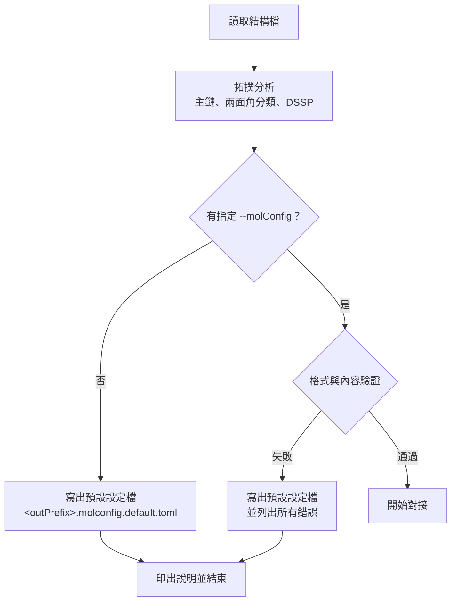
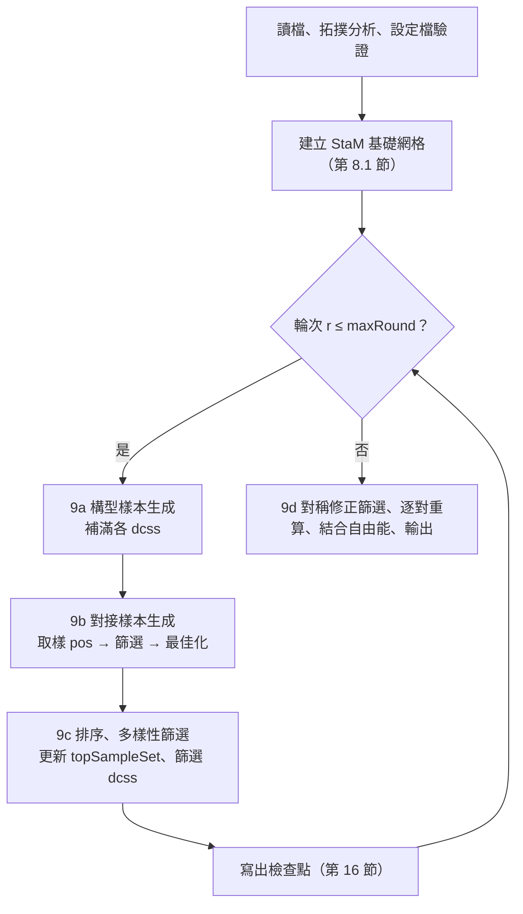

# OmegaDocker 0.40.0 規格書

| 項目 | 內容 |
|---|---|
| 文件版本 | 1.66 |
| 日期 | 2026-10-14 |
| 程式版本號 | **0.40.0** |
| 程式基礎 | 新架構；能量與梯度 kernel 取自 AutoDock-GPU 1.6，並移植 OmegaDocker 的修改 |
| 狀態 | 定案（1.0）；實作中需修正時遞增版本，修訂紀錄見第 19 節 |

---

## 1. 目的與範圍

- 支援 **生物分子（蛋白質、核酸）與寡聚物** 的對接，同時保留小分子對接能力。
- **不設原子數硬性上限**（取消 AutoDock-GPU 的 256 原子限制），實際上限由 GPU 記憶體決定。
- 將「構型取樣」與「位置與定向取樣」分成兩個階段（9a、9b），以輪次反覆進行。
- 本版只最佳化 **兩面角**；鍵長、鍵角維持輸入值。能量函式沿用目前 OmegaDocker（AD4 系列）。兩者的擴充列於第 18 節。

---

## 2. 名詞定義

| 名詞 | 英文 / 縮寫 | 定義 |
|---|---|---|
| 穩態分子 | Stationary molecule, **StaM** | 不可平移、不可轉動的分子；內部兩面角可依設定變動 |
| 穩態分子群 | StaM group | 所有 StaM 的集合，視為一個整體（multimer）；可只含一個分子 |
| 動態分子 | Mobile molecule, **MobM** | 可個別平移、轉動的分子；每個 MobM 彼此獨立，不考慮 MobM 間作用 |
| 重原子 | heavy atom | 氫以外的原子 |
| 兩面角 | dihedral / torsion | 由 4 個重原子定義，繞中間鍵旋轉 |
| 主鏈 | backbone | 蛋白質 `N–CA–C(=O)` 重複單元，或核酸 `P–O5'–C5'–C4'–C3'–O3'` 重複單元 |
| 構型樣本 | conformational sample | 一個一維陣列，內容為該分子（或 StaM 群）所有可轉動兩面角的數值 |
| 第一階構型樣本 | L1 conf sample | 由 csgm 產生、尚未經 9a 最佳化與篩選的樣本 |
| 第二階構型樣本 | L2 conf sample | 9a 最佳化後能量 < `E_max` 的樣本 |
| 第二階構型樣本池 | L2 pool | 儲存 L2 樣本的池子，供補充 dcss |
| 對接構型樣本集 | Docking Conformational Sample Set, **dcss** | 本輪參與 9b 的構型樣本集合 |
| 構型樣本產生方式 | Conformational Sample Generation Method, **csgm** | csgm1a、csgm1b、csgm2、csgm3 |
| 位置與定向樣本 | Position and Orientation Sample, **pos** | MobM 的平移向量 + 定向（單位四元數） |
| 位置與定向取樣方法 | Position and Orientation Sampling Method, **posm** | posm1、posm2、posm2_fft、posm3、posm4 |
| 第一階 / 第二階位置與定向樣本集 | **L1poss** / **L2poss** | 篩選前 / 篩選後的 pos 集合 |
| 強靜電勢區域集合 | Strong Electrostatic Potential Area Set, **sepas** | 見 8.4.4 |
| 強靜電勢區域配對集合 | Strong Electrostatic Potential Area Pairs Set, **sepaps** | 見 8.4.4 |
| 構型配對 | conformation pair | 一個 StaM dcss 樣本 × 一個 MobM dcss 樣本 |
| 對接樣本 | docking sample | 構型配對 + 一個 pos，經 9b 最佳化後的結果 |
| topSampleSet | — | 每個 MobM 累計所有輪次的最佳對接樣本集合 |

---

## 3. 輸入

### 3.1 檔案格式

| 格式 | 鍵級來源 | 殘基 / 鏈資訊 | 部分電荷 |
|---|---|---|---|
| mmCIF | 化學成分字典（CCD）的 `chem_comp_bond`；殘基間連接用 `struct_conn` 與主鏈規則 | 有 | 程式計算 Gasteiger |
| SDF / MOL（V2000、V3000） | 檔案本身 | 無（主鏈以圖形比對辨識） | 程式計算 Gasteiger |
| mol2 | 檔案本身（含 `am`、`ar`） | 有（substructure） | 讀取檔案 |

規則：
- **不自行推斷鍵級**。mmCIF 中查不到 CCD 定義的殘基 → 報錯並結束。
- 內附標準胺基酸、核苷酸的 CCD 子集；使用者可用 `ccd <file>` 提供額外的 CCD 檔。
- **氫原子由使用者提供**（質子化狀態由使用者負責）。程式不新增、不刪除氫原子。
- 鍵長、鍵角必須合理；程式不修正。

**mmCIF 讀取細則：**
- 只讀第一個 model；同一殘基有多個 altloc 時，保留第一個出現的 altloc，其餘略過並警告。同一鏈中重複的殘基序號（微異質性）只保留第一個。
- 內附 CCD 子集：20 種標準胺基酸、`A C G U DA DC DG DT`、`HOH`。
- 殘基內的鍵取自 CCD；CCD 未列出的末端原子：胜肽 N 端的 `H`、`H1`、`H2`、`H3` 接到 `N`；核酸 5′ 端的 `HO5'` 接到 `O5'`。其他 CCD 沒有的原子名稱 → 報錯。元素與 CCD 不符 → 報錯。
- 殘基間的鍵：同一鏈相鄰殘基的 C–N（≤ 2.0 Å）與 O3′–P（≤ 2.2 Å）；`_struct_conn` 中 `covale`、`disulf`、`metalc` 類型（`metalc` 與含金屬的鍵視為金屬配位鍵）。
- 形式電荷：依每個原子在檔案中實際的鍵（含使用者提供的氫）的鍵級總和決定，例如 N 為 4 → +1、O 為 1 → −1。不支援的情況（例如 C 為 3、O 為 3）→ 報錯，提示可能缺原子或氫，或改用 SDF / mol2。金屬與無鍵的離子使用 CCD 的電荷。
- CCD 標為芳香的鍵所組成的共軛系統，依實際存在的氫重新分配單、雙鍵（例如 HIS 的 HID / HIE / HIP）；只有在沒有中性解時，才把吡咯型 N 設為 +1。此步驟只在 CCD 的芳香鍵範圍內進行，不屬於自行推斷鍵級。
- 硫醇陰離子（S 為 −1）與另一個 S 的距離 ≤ 2.5 Å 時警告，提示 `_struct_conn` 可能缺少雙硫鍵。
- 元素符號 `D`、`T` 視為氫；但原子名稱仍須與 CCD 一致。

**SDF / mol2 讀取細則：**
- 檔案可含多筆紀錄（SDF record、mol2 `@<TRIPOS>MOLECULE`）；所有紀錄的分子都依 3.2 劃分。
- 依原子價需要但檔案中沒有的氫，不會補上，只警告。
- mol2 的殘基取自每個原子的 `subst_id`、`subst_name`（殘基名稱與序號由 `subst_name` 拆出，例如 `ALA12`），鏈名稱取自 `@<TRIPOS>SUBSTRUCTURE` 的 chain 欄。
- mol2 標示 `NO_CHARGES` 或缺電荷欄時，改算 Gasteiger 電荷並警告。

**Gasteiger 電荷細則：**
- 計算前先移除金屬配位鍵；金屬原子的部分電荷等於其形式電荷。
- 沒有 Gasteiger 參數的其他原子使用形式電荷，並警告。
- 原因：金屬沒有 Gasteiger 參數；若保留金屬配位鍵，無效數值會沿鍵結擴散到大部分原子（實測 1ZNF：424 個原子中 231 個）。

### 3.2 分子的劃分與角色指定

- 一個 **分子** = 鍵結圖中的一個連通元件（connected component）。
- `--stamFile=<file>`：檔案中的**所有分子**皆為 StaM，共同組成 StaM 群。不支援在檔案內細分角色。**只能指定一次**，指定多次時報錯並結束。
- `--mobmFiles=<file>`：檔案中**必須只有一個分子**，否則報錯並結束。可指定多次，每個檔案一個 MobM。
- 每個 MobM 視為獨立的對接任務（見第 11 節）。

### 3.3 對接範圍

- `box.center x,y,z`、`box.size x,y,z`（Å）。
- 能量網格與距離網格涵蓋此範圍。
- posm1、posm2 只產生使 MobM 所有探針原子都在範圍內的 pos（8.4）；8.5 仍保留「超出範圍」檢查。

---

## 4. 分子拓撲分析

### 4.1 主鏈辨識

| 類型 | 辨識規則（以鍵結圖比對，不依賴殘基名稱） |
|---|---|
| 蛋白質 | 連續的 `N–CA–C(=O)–N` 模式（`-NC(CO)-NC(CO)-`） |
| 核酸 | 連續的 `P–O5'–C5'–C4'–C3'–O3'–P` 模式 |

- 不辨識側鏈是否為標準胺基酸或標準核酸鹼基。
- 實作細則：
  - 蛋白質單元：C 以雙鍵連接只有一個重原子鄰居的 O，C 連接 CA（碳），CA 連接 N。核酸單元：C3′、C4′ 為環上的碳且以環內鍵相連，O3′、C5′、O5′ 不在環上；P 可缺（5′ 端無磷酸）。
  - 單元之間以 C(i)–N(i+1)（蛋白質）或 O3′(i)–P(i+1)（核酸）相連；至少兩個相連的單元才算主鏈。
  - 同一分子同時有兩種主鏈時，採用單元數較多者並警告。
- 辨識結果寫入分子設定檔的 `backboneType`（`protein` | `nucleic` | `none`），使用者不可修改。

### 4.2 主鏈兩面角

| 類型 | 兩面角 | StaM 預設 | MobM 預設 |
|---|---|---|---|
| 蛋白質 | φ（C–N–CA–C）、ψ（N–CA–C–N） | 不可動 | 可動 |
| 蛋白質 | ω（CA–C–N–CA） | 保持輸入（`fixed`） | 保持輸入（`fixed`） |
| 核酸 | α、β、γ、δ、ε、ζ | 不可動 | 可動 |

- ω 若設為 `cisTrans`，只產生 0° 或 180°。
- 兩面角歸屬：φ_i = C_{i−1}–N_i–CA_i–C_i、ψ_i = N_i–CA_i–C_i–N_{i+1}、ω_i = CA_i–C_i–N_{i+1}–CA_{i+1}（ω 歸屬前一個殘基 i）；α_i = O3′_{i−1}–P_i–O5′_i–C5′_i、β_i = P_i–O5′–C5′–C4′、γ_i = O5′–C5′–C4′–C3′、δ_i = C5′–C4′–C3′–O3′、ε_i = C4′–C3′–O3′–P_{i+1}、ζ_i = C3′–O3′–P_{i+1}–O5′_{i+1}。缺少所需原子的兩面角（鏈端）不屬於主鏈兩面角，依 4.4 分類。
- 角度符號依 IUPAC 慣例，範圍 (−180°, 180°]。
- **脯胺酸的 φ** 在吡咯烷環內，固定不可動（除非該環設定斷鍵，見 4.5）。
- 核酸 δ（C5'–C4'–C3'–O3'）的中間鍵屬於核糖環，固定不可動（除非設定斷鍵）。

### 4.3 ω 檢查

- 若 ω 為 `fixed`，且輸入角度與 0° 和 180° 的差距 **都** 大於 `omegaTolerance`（預設 30°）→ 警告並結束程式。
- 使用 `topology.acceptNonPlanarOmega` 可接受此情況並繼續。

### 4.4 側鏈與非主鏈分子的兩面角分類

主鏈分子的側鏈，與沒有主鏈的分子，使用相同規則。

**預設不可轉動：**

| 類型 | 例子 |
|---|---|
| 醯胺鍵（含側鏈） | 肽鍵、Asn/Gln 的 C(=O)–N |
| 共振部分雙鍵 | 酯 C(=O)–O、胍基（Arg NE–CZ、CZ–NH1/NH2）、脒、脲、胺甲酸酯、硫醯胺 |
| 雙鍵 | C=C、C=N、N=N |
| 三鍵與共線原子 | C≡C、C≡N；兩端原子共線導致兩面角無定義的鍵 |
| 芳香鍵 | 芳香環內所有鍵 |
| 環內鍵 | 非芳香環內的鍵（除非設定斷鍵） |
| 無重原子兩面角的鍵 | 鍵的一端只連接氫原子（例如 –CH3、–OH） |
| 對稱基團 | –CF3、–C(CH3)3、–NO2、–SO3⁻、–PO3²⁻ 等，轉動只產生等價結構 |
| 金屬配位鍵 | 含金屬原子的鍵 |

**預設可轉動**：其餘的單鍵（包含雙硫鍵 S–S、聯芳基鍵、核酸醣苷鍵 χ）。

**實作細則**：
- 列出的兩面角：兩端重原子都另有重原子鄰居的鍵（含環內鍵與芳香鍵，供 `ringBreak` 使用）。「無重原子兩面角的鍵」不列出。
- 非主鏈兩面角的 4 個原子：鍵兩端各取編號最小的重原子鄰居（優先非金屬）。
- 分類依下列順序，取第一個符合者：金屬 → 芳香 → 環內 → 三鍵／共線（任一端的所有其他重原子鄰居與鍵的夾角 > 170°）→ 雙鍵 → 醯胺（C(=O)–N）→ 共振（其他 C(=X)–Y，X ∈ {O, S, N}，Y ∈ {N, O}）→ 對稱 → 單鍵。
- 對稱基團：鍵的一端除另一端外，其餘鄰居（至少兩個，含氫）都是只連接該端的重原子，且元素與氫數相同。不依鍵級判斷，因此共振等價的基團（–COO⁻、–NO2、–SO3⁻、–PO3²⁻）也屬於此類；例如 Asp χ2、Glu χ3、C 端 ψ。

**StaM 的範圍限制**：StaM 中，只有「任一重原子位於對接範圍外擴 `stamFlexMargin`（預設 4 Å）內」的殘基（無殘基資訊時以原子為單位），其兩面角才依上述規則預設可轉動；其餘預設不可轉動。使用者可在分子設定檔中修改。

### 4.5 環狀結構斷鍵

- 使用者在分子設定檔的 `ringBreak` 中指定要斷開的鍵。
- 斷開後，環內鍵依 4.4 重新判斷是否可轉動。
- `ringBreak` 的鍵必須在環內（以未斷開的鍵結圖判斷），且不可為芳香鍵或金屬配位鍵（金屬配位鍵見 4.7 的 `metalBond`）。
- 被斷開的鍵（`ringBreak`、`chainBreak`）本身的兩面角由閉合約束決定（4.8），不可設為可轉動。
- 以距離約束恢復斷鍵，方式見 4.8。每對約束原子：能量 `E = G·d²`、梯度 `2G·d`（`G` 預設 200，`energy.closureG`）。
- 源自 OmegaDocker v0.34.0 的 G 原子對做法（`pdbqtAddDistFix.pl`），新版不再需要前處理腳本，並修正兩個已知問題：
  1. 梯度只有正確值一半（`calcLigandEneGra.cu` 中累加 `G·d`）。
  2. 「距離過遠」判斷因 `else if` 結構，實際門檻變成 `collDistance` 而非 `inRangeDist`。
- 約束能量只用於 9a、9b 最佳化；**不計入** 9c 排序與 `E_max` 篩選。閉合是否成功由 `maxBreakDist` 判斷（4.8）。

### 4.6 二級結構判定

- 對所有蛋白質分子（StaM 與 MobM）以 **DSSP 演算法**（Kabsch & Sander 1983）判定每個殘基的二級結構，包含 DSSP 4 新增的 κ 螺旋（PPII，代碼 `P`；Hekkelman et al. 2025）。
- 不使用 STRIDE：STRIDE 授權僅限學術使用；且其判定所需的 φ/ψ 機率表只見於原始碼，論文中沒有數值，無法自行實作。
- 自行實作，行為與 DSSP 4（PDB-REDO/dssp，BSD-2-Clause）一致，包括單精度座標、氫鍵能量取到 0.001 kcal/mol、H 原子由前一個殘基的 C=O 方向放置、梯子（ladder）合併時的間隔判斷。
- 判定範圍：StaM 群組的所有分子一起判定（可找到分子之間的 β 摺板）；每個 MobM 各自判定。
- 殘基依主鏈單元（4.1）取得 N、CA、C、O，不依原子名稱；N 除了 CA 與前一殘基的 C 之外另連有重原子者（脯胺酸、N-甲基化殘基）不作為氫鍵供體。
- 代碼：`H` α 螺旋、`G` 3₁₀ 螺旋、`I` π 螺旋、`P` κ 螺旋、`E` 摺板、`B` 孤立橋、`T` 轉角、`S` 彎曲、`.` 無。
- 驗證：開發時以 mkdssp 4.6.1 比對（只用於驗證，不隨 OmegaDocker 散佈）；18 個 PDB 結構共約 5,800 個殘基，結果完全一致。

### 4.7 扭轉樹與錨點

- MobM：扭轉樹的根原子為最靠近分子質心的重原子（同 AutoDock）。質心取重原子座標的平均。
- **錨點與移動側（通則）**：錨點原子在兩面角轉動時不動。轉動一個兩面角時，移動的是「不含錨點原子」的一側（不經過已斷開的鍵）。
  - 兩側都含錨點原子 → 該兩面角無法轉動，驗證時報錯（5.3），提示改為不可轉動或在兩者之間加斷鍵。
  - 斷鍵後分出的每一段都必須含錨點原子，否則報錯（5.3）。MobM 與只有一個錨點原子的 StaM，等同「分子不可分成兩段」。
  - 錨點以分子（3.2 的連通分量）為單位；含多條鏈的分子（以交聯鍵相連）共用錨點。
- StaM：依 `stamFixedResMovable`（預設 `false`）決定。

**固定殘基**：主鏈兩面角全部不可動的殘基（蛋白質 φ、ψ、ω 皆不可動，ω 為 `fixed`；核酸 α–ζ 皆不可動）。
**loop**：同一條鏈上連續的非固定殘基。

#### `stamFixedResMovable = false`（預設）
- 固定殘基的**主鏈原子**座標在 9a 最佳化中不變；側鏈依 4.4 的設定，不受此限制。
- 每段 loop 的錨點與斷鍵：

| loop 位置 | 錨點 | 建構方向 | 斷鍵（4.8） |
|---|---|---|---|
| 兩個固定段之間 | N 端側相鄰的固定殘基 | N → C | loop 最後一個殘基與下一個固定殘基之間的主鏈鍵（蛋白質 C–N；核酸 O3′–P） |
| 鏈的 N 端 | C 端側相鄰的固定殘基 | C → N | 無（自由端） |
| 鏈的 C 端 | N 端側相鄰的固定殘基 | N → C | 無（自由端） |
| 整條鏈無固定殘基 | 該鏈最靠近質心的殘基 | 由錨點往兩端 | 無 |

- 錨點原子：分子中有固定殘基時，為所有固定殘基的主鏈原子（蛋白質 N、CA、C、O；核酸 P～O3′）；整個分子都沒有固定殘基時，為最靠近分子質心的主鏈單元的 CA（蛋白質）或 C4′（核酸）；沒有主鏈的 StaM 為最靠近質心的重原子。
- **loop 斷鍵在讀取分子設定檔時決定**：StaM 的主鏈兩面角預設不可轉動（全部為固定殘基），因此預設檔沒有 loop；使用者把主鏈改為可轉動後才形成 loop。驗證通過後：
  - 兩個固定段之間的 loop，若其主鏈相連鍵（前一個固定殘基 → loop → 下一個固定殘基之間的 C–N 或 O3′–P）都沒有斷開，程式在上表的位置自動斷開，並在執行紀錄中列出（`added chainBreak ... source = "auto-loop"`）。
  - 使用者可在設定檔以 `[[molecule.chainBreak]]`（`source = "user"` 或 `"auto-loop"`）改選同一 loop 中其他主鏈相連鍵；每段 loop 只能斷一處（否則中間一段沒有錨點）。
  - 自動斷開處的 ω（或 ζ）若為 `cisTrans`（或可轉動）→ 報錯，提示改為 `fixed` 或改選其他斷鍵位置。
  - `source = "auto-loop"` 只能用於兩個固定段之間 loop 的主鏈相連鍵。
- 預設可轉動的限制：StaM（`stamFixedResMovable = false`）中，非主鏈兩面角若兩側都含主鏈原子（例如未斷開的鏈間雙硫鍵上 Cys 的 χ2、χ3），預設不可轉動。

- 交聯鍵（雙硫鍵 S–S 等跨殘基共價鍵）若使扭轉樹形成環，自動在該鍵斷開，並依 4.8 約束閉合。
  - 候選鍵：兩端原子屬於不同殘基、不是主鏈相連鍵（蛋白質 C–N、核酸 O3′–P）、不是金屬配位鍵。
  - 選取方式：不計金屬配位鍵，先放入所有非候選鍵，再依鍵的順序放入候選鍵；兩端已相連的候選鍵才斷開。因此分子不會因斷鍵而分成兩段（例如 A、B 兩條鏈之間有兩個雙硫鍵時，只斷開一個）。
  - 判斷兩面角類別時，已斷開的鍵不算在環內（4.4、4.5）。
  - 沒有殘基資訊的分子（SDF、無 substructure 的 mol2）不偵測交聯鍵；需要時使用 `ringBreak`。

#### 金屬配位鍵（`metalBond`）
- 金屬配位鍵在環內的分子（例如鋅指蛋白中 Zn 與 Cys、His 配位），使用者須在分子設定檔以 `metalBond` 選擇處理方式：

| `metalBond` | 處理 | 結果 |
|---|---|---|
| `"keep"`（選項 A，預設） | 不斷開 | 經過金屬的環內所有鍵不可轉動（例如 1ZNF 中殘基 3 的 ψ 到殘基 23 的 φ，共 40 個主鏈兩面角，以及配位殘基的側鏈） |
| `"break"`（選項 B） | 斷開金屬配位鍵，寫成 `[[molecule.chainBreak]]`，`source = "auto-metal"`；以距離約束閉合（4.8） | 金屬仍與一個配位原子相連，隨分子移動；經過金屬的環消失，環內的鍵依 4.4 重新判斷，使用者可再設為可轉動 |

- 預設檔寫 `metalBond = "keep"`，並以註解（`# `）列出選項 B 建議斷開的 `auto-metal` 項目；改選 `"break"` 時，使用者把 `metalBond` 改為 `"break"`，並移除這些項目開頭的 `# `。
- 建議斷鍵的選取：先放入所有非金屬配位鍵（自動斷開的交聯鍵除外），再依鍵的順序放入金屬配位鍵；兩端已相連者才斷開。例如 1ZNF 的 Zn 有 4 個配位鍵，建議斷開 3 個。
- 使用者可改選要斷開的金屬配位鍵，但驗證時（5.3）：
  - `"break"`：斷鍵後，不可有金屬配位鍵仍在環內；分子不可分成兩段。
  - `"keep"`：不可有斷開金屬配位鍵的項目。
  - 不符合時報錯並結束，由使用者重新決定。
- 金屬配位鍵不在環內的分子不使用 `metalBond`。

#### `stamFixedResMovable = true`
- 錨點為最靠近分子質心的主鏈單元的 CA（蛋白質）或 C4′（核酸）（無主鏈時為最靠近質心的重原子）；轉動兩面角時，遠離錨點的一側移動。單鏈分子即為「最靠近該鏈質心的殘基」；含多條鏈的分子共用一個錨點。
- 不自動產生 loop 斷鍵；交聯鍵仍依上述規則處理。

### 4.8 斷鍵與閉合

- 斷鍵來源：(1) 使用者在 `ringBreak` 指定；(2) 4.7 自動產生的 loop 斷鍵、交聯斷鍵與金屬配位斷鍵（`metalBond = "break"`）。
- 自動產生的交聯斷鍵寫入預設分子設定檔（`[[molecule.chainBreak]]`，見 5.2）；金屬配位斷鍵以註解列出（4.7）；loop 斷鍵在讀取設定檔時決定（4.7）。三者都在執行紀錄中列出。
- 閉合約束方式：程式內部在斷鍵兩端產生虛擬複製原子（不參與其他能量計算，位置取自輸入座標），約束三對原子重合，同時約束鍵長、兩個鍵角與斷鍵兩面角：

| 斷鍵 A–B | A 端帶的複製原子 | B 端帶的複製原子 | 約束的兩面角 |
|---|---|---|---|
| 肽鍵 C_i–N_{i+1} | N′、CA′ | C′ | ω |
| 核酸 O3′–P | P′、O5′′ | O3′′ | ζ |
| 雙硫鍵 S–S | S′、CB′ | S′ | χ3 |
| 使用者指定的斷鍵 | B′、B 的一個重原子鄰居′ | A′ | 斷鍵所在的兩面角 |

- 複製原子的取法：斷鍵 A–B 有兩面角（4.4）時，A、B 依該兩面角的原子順序 `X–A–B–Y` 決定，B 的鄰居取 `Y`（因此肽鍵 A = C、Y = CA；O3′–P 的 A = O3′、Y = O5′；雙硫鍵 Y = CB）。沒有兩面角時，A、B 依鍵的原子順序，Y 取 B 的其他重原子鄰居中序號最小者，沒有則不放 Y′。
- 複製原子與其所屬原子剛性相連：所屬原子被某個兩面角移動時，複製原子一起移動。
- 金屬配位斷鍵（`auto-metal`）：配位角度變化大，**只約束距離**——金屬 M 與配位原子 L 的距離維持輸入值 `r₀`：`E = G·(|M−L| − r₀)²`。閉合失敗篩選以 `||M−L| − r₀| > maxBreakDist` 判斷。

- 閉合失敗篩選：9a 最佳化後，任一約束原子對距離 > `maxBreakDist`（預設 0.5 Å）→ 捨棄該樣本。
- 可達距離篩選（`CsgmBuild = grow` 時）：每建一段，若目前末端到閉合目標的距離 > 剩餘殘基數 × `reachPerRes`（蛋白質預設 3.8 Å；核酸預設 7.0 Å），即依 7.8 的規則重抽或捨棄。
  - 只在沒有 loop 閉合時使用（`closure = "none"`，或沒有可調整兩面角的斷鍵）。有 loop 閉合時不做：閉合會調整路徑上所有可調整的兩面角，生長中的末端距離不代表能否閉合（2KJJ：`grow` + RCD 的 20000 個樣本中 19999 個因可達距離被捨棄，而 `whole` + RCD 不做碰撞檢查時 40/40 可閉合）。
  - 只用於主鏈連接鍵（蛋白質 C–N、核酸 O3′–P）的斷鍵；交聯斷鍵與金屬配位不檢查。
  - 斷鍵 A–B 的兩端各檢查一次：往 A 建構時目標為 B，往 B 建構時目標為 A；目標原子尚未建構時不檢查。
  - 目前末端：扭轉樹中通往該端的路徑上、本段所含最深的兩面角的移動側鍵原子。
  - 剩餘殘基數：從目前末端所在殘基到目標原子所在殘基（同一條鏈上，含兩端）的殘基數；不在同一條鏈時不檢查。
  - 命令列：`topology.reachPerRes <蛋白質>,<核酸>`。

---

## 5. 分子設定檔（TOML）

### 5.1 流程



- 程式**不覆寫**使用者的檔案；預設檔一律使用新檔名。檔案已存在時改用 `<outPrefix>.molconfig.default.<n>.toml`（n = 1, 2, …）。
- 未指定 `--molConfig` 時，寫出預設檔後以狀態 0 結束；驗證失敗時以狀態 1 結束。
- 錯誤訊息須包含：行號、欄位名稱、原因；依行號排序，一次列出全部錯誤。
- ω 檢查（4.3）在設定檔驗證通過後進行，只檢查設為 `fixed` 的 ω。

### 5.2 格式

原子參照：
- 同一殘基項目內的原子：有原子名稱且在該殘基內唯一時用名稱，例如 `"CB"`。
- 其他殘基的原子，以及分子層級的項目（`molecule.torsion`、`ringBreak`、`chainBreak`）：`<鏈>:<殘基序號><插入碼>:<原子名稱>`，例如 `"A:45:C"`。
- 原子沒有殘基資訊、名稱空白或在殘基內不唯一時：`#<檔案內原子序號>`（1 起算；SDF / mol2 為該筆紀錄內的序號）。

項目的位置：
- 有主鏈的分子：每個主鏈單元一個 `[[molecule.residue]]`，依鏈的順序排列。有殘基資訊時以 `chain`、`resSeq`、`iCode` 識別（`resName` 必須與偵測結果一致）；沒有殘基資訊時以 `unit`（依序 1 起算）識別。
- 主鏈兩面角寫成殘基的欄位：蛋白質 `phi`、`psi`、`omega`；核酸 `alpha`～`zeta`。鏈端缺少的角度不寫。
- 其他兩面角：中間鍵第一個原子所在的殘基若有主鏈單元，寫在該殘基的 `[[molecule.residue.torsion]]`；否則寫在 `[[molecule.torsion]]`。
- `ssType`、`dsspSS`、`csgm1` 只用於蛋白質分子。
- `[[ssType]]` 列出全部內建類型（`R`、`O` 與 7.5 的 `RAMA_*`）。
- `ssType` 預設：鏈端殘基（缺 φ 或 ψ）→ `R`；DSSP 為 H / G / I → `O`；其他 → `R`。
- `metalBond` 只在金屬配位鍵位於環內的分子寫出（4.7），預設檔的值為 `"keep"`，並以註解列出選項 B 的 `auto-metal` 斷鍵。檔案開頭的註解說明兩個選項與改選方式。

分子 `id`：
- 有殘基與鏈資訊：`<stam|mobm>:<檔名>:<鏈名稱，多條以 + 連接>`；同一檔案中有重複時，再加上 `:<第一個殘基名稱><序號><插入碼>`（例如水分子 `stam:r.cif:A:HOH501`）。
- 沒有殘基或鏈資訊：`<stam|mobm>:<檔名>:<k>`，`k` 為該分子在檔案中的順序（1 起算）。

```toml
formatVersion = 1
generatedBy   = "OmegaDocker <version>"

# ---------- 二級結構產生類型（僅 csgm1b 使用） ----------
ssHalfWidth    = 15.0            # 自訂 point 與 O 的 φ、ψ 範圍（±度），所有點統一；0 < 值 ≤ 90
ssOriginalProb = 0.9             # O 取輸入角度範圍內的機率，其餘依 R；0 < 值 ≤ 1

# R、O 為必要的內建類型，不可刪除或修改
[[ssType]]
name    = "R"                    # 均勻分佈
builtin = true

[[ssType]]
name    = "O"                    # Original：以輸入角度 ± ssHalfWidth，機率 ssOriginalProb
builtin = true

# RAMA_GENERAL、RAMA_GLY、RAMA_TRANSPRO、RAMA_CISPRO、RAMA_PREPRO、RAMA_ILEVAL、RAMA_AUTO 同上（builtin = true）

[[ssType]]
name = "A"                       # 自訂範例：alpha
  [[ssType.point]]
  phi  = -58
  psi  = -48
  prob = 0.9                     # 在 (−58 ± ssHalfWidth, −48 ± ssHalfWidth) 內均勻取值；其餘 0.1 均勻分配給範圍外的所有角度組合

# ---------- 蛋白質分子 ----------
[[molecule]]
id           = "stam:receptor.cif:A"
role         = "StaM"            # StaM | MobM（由命令列決定，僅供參考）
file         = "receptor.cif"
chain        = "A"
backboneType = "protein"         # 偵測結果，不可修改
csgm1        = "1a"              # 僅蛋白質：1a | 1b
metalBond    = "keep"            # 只在金屬配位鍵位於環內時：keep | break（4.7）

  [[molecule.chainBreak]]       # 自動產生（4.7）；使用者可刪除或新增
  bond   = ["A:45:C", "A:46:N"]  # 鏈:殘基序號[插入碼]:原子名
  source = "auto-loop"           # auto-loop | auto-crosslink | auto-metal | user

  # metalBond = "break": set metalBond and remove the leading "# " of these entries (spec 4.7)
  # [[molecule.chainBreak]]
  # bond   = ["A:60:NE2", "A:301:ZN"]
  # source = "auto-metal"

  [[molecule.residue]]
  chain    = "A"
  resName  = "SER"
  resSeq   = 12
  iCode    = ""
  dsspSS   = "."                 # DSSP 結果（參考用）
  ssType   = "R"                 # 預設：鏈端 → R；helix(H/G/I) → O；其他 → R
  phi      = false               # StaM 預設 false；MobM 預設 true
  psi      = false
  omega    = "fixed"             # fixed | cisTrans
    [[molecule.residue.torsion]]
    atoms     = ["N", "CA", "CB", "OG"]
    rotatable = true
    category  = "single"         # 分類結果（參考用）

# ---------- 核酸分子 ----------
[[molecule]]
id           = "mobm:rna.cif:A"
role         = "MobM"
file         = "rna.cif"
chain        = "A"
backboneType = "nucleic"

  [[molecule.residue]]
  chain   = "A"
  resName = "G"
  resSeq  = 2
  iCode   = ""
  alpha   = true                 # StaM 預設 false；MobM 預設 true
  beta    = true
  gamma   = true
  delta   = false                # 核糖環內，不可設為 true（除非 ringBreak）
  epsilon = true
  zeta    = true

# ---------- 無主鏈分子 ----------
[[molecule]]
id           = "mobm:lig1.sdf:1"
role         = "MobM"
file         = "lig1.sdf"
backboneType = "none"

  [[molecule.torsion]]
  atoms     = ["#3", "#4", "#9", "#12"]
  rotatable = true
  category  = "single"

  [[molecule.ringBreak]]
  bond = ["#5", "#10"]
```

### 5.3 驗證規則

| 項目 | 規則 |
|---|---|
| 版本 | `formatVersion` 必須為程式支援的版本（目前為 1） |
| 取值範圍參數 | `ssHalfWidth`：數值，0 < 值 ≤ 90，省略時為 15；`ssOriginalProb`：數值，0 < 值 ≤ 1，省略時為 0.9 |
| 欄位 | 不認得的欄位視為錯誤；設定欄位（`csgm1`、`ssType`、主鏈兩面角、`rotatable`、`source`）必須寫出；參考欄位（`role`、`file`、`chain`、`dsspSS`、`category`、`generatedBy`）不檢查內容 |
| 分子 | 每個偵測到的分子都必須出現一次；`id`、`backboneType` 必須與偵測結果一致 |
| 殘基與兩面角 | 必須與偵測結果一一對應，不可增減 |
| 不可轉動的類別 | 依斷鍵後重新分類的結果（4.5），不可轉動類別者 `rotatable = true` 視為錯誤（主鏈兩面角相同） |
| 脯胺酸 φ、核酸 δ | 不可設為 `true`（除非該環有 `ringBreak`） |
| 斷鍵 | `ringBreak` 見 4.5；`chainBreak` 的 `source` 為 `auto-loop`、`auto-crosslink`、`auto-metal`、`user`；鍵必須存在、不可重複；被斷開的鍵不可設為可轉動，該處的 ω 不可設為 `cisTrans`；斷鍵後每一段都必須含錨點原子（MobM 等同不可分成兩段）（4.7） |
| loop 與扭轉樹 | 以上全部通過後檢查（4.7）：`auto-loop` 只能用於兩個固定段之間 loop 的主鏈相連鍵；自動斷開處的兩面角必須不可轉動；可轉動的兩面角兩側不可都含錨點原子 |
| 金屬配位鍵 | 金屬配位鍵在環內的分子必須有 `metalBond`（`keep` 或 `break`），其他分子不可有；金屬配位鍵只能以 `source = "auto-metal"` 斷開，`auto-metal` 只能用於金屬配位鍵；`keep` 時不可斷開任何金屬配位鍵；`break` 時斷鍵後不可有金屬配位鍵仍在環內（4.7） |
| `csgm1` | 只有 `backboneType = "protein"` 可設定，值為 `1a` 或 `1b` |
| `ssType` 名稱 | 必須已定義；必須包含 `R`、`O`；`builtin = true` 只能用於內建名稱，且不可有 `point`；自訂類型不可使用內建名稱 |
| `RAMA_*` 與殘基 | `RAMA_AUTO` 以外的 `RAMA_*` 必須與殘基類別相符（7.5），否則報錯；Pro 前一個 ω 為 `cisTrans` 時不可用 `RAMA_TRANSPRO`、`RAMA_CISPRO`（改用 `RAMA_AUTO`） |
| 自訂類型 | 至少一個 `point`；同一類型內 (φ, ψ) 不可重複；`prob` 皆 > 0 且總和 ≤ 1；每個 `point` 的範圍為 φ ± `ssHalfWidth`、ψ ± `ssHalfWidth`（所有點統一，不可個別設定；跨越 ±180° 時環繞） |
| 角度範圍 | (−180°, 180°] |

---

## 6. 整體流程



- 每個 MobM 各自擁有：MobM 的 dcss / L2 pool、**StaM 的 dcss**、topSampleSet。
- 所有 MobM 共用：StaM 的 L2 pool、StaM 構型的網格快取。
- 每輪的 9a 依 MobM 順序補滿：先補第 i 個 MobM 的 StaM dcss（從共用的 StaM L2 pool 取），再補其 MobM dcss。樣本移入 dcss 時取得 ID（StaM 群一組、每個 MobM 一組，從 0 起依序編號）；無可動兩面角的分子只有 ID 0（輸入結構）。
- 每輪的 9b：取所有 MobM 的 StaM dcss 的聯集，依 StaM 構型樣本 ID 由小到大，每個 StaM 構型建立一次網格與距離網格，供 StaM dcss 含有它的所有 MobM 使用；用完即釋放，下一輪若仍需要則重建，不跨輪快取。例外：StaM 群完全不可動（無可動兩面角，只有輸入結構）時，第一輪建立的網格與距離網格保留到所有輪次結束。每個 MobM 依 MobM dcss 的順序對接每個構型配對。

---

## 7. 9a：構型樣本生成

### 7.0 csgm 參數的分組

7.4 的批次與上限（`MaxL1TotalNum`、`MaxL1BatchNum`）及 7.3–7.8 的 csgm 參數與 7.2 相同分為兩組：StaM 群一組（前綴 `stam`），所有 MobM 共用一組（前綴 `mobm`）。本章中以大寫開頭、不帶前綴的名稱（如 `CsgmBuild`、`GrowMaxRetry`）指該分子所屬的一組，例如 `stam.csgmBuild`、`mobm.csgmBuild`。

### 7.1 樣本表示

- 一個構型樣本 = `float[D]`，D = 該分子（StaM 群則為所有 StaM）可轉動兩面角數。
- 數值為絕對角度（度），範圍 (−180°, 180°]。
- D = 0 的分子（無可轉動兩面角）：dcss 只有輸入結構一個樣本，略過 9a。

### 7.2 樣本數參數

兩組命令列參數：StaM 群一組（前綴 `stam`，套用到每個 MobM 的 StaM dcss），所有 MobM 共用一組（前綴 `mobm`）；不提供個別 MobM 的覆寫。

| 參數（StaM 群／MobM） | 預設 | 限制 |
|---|---|---|
| `stamDockingConfSampleNum`／`mobmDockingConfSampleNum` | 有可動兩面角時**必填** | ≥ 4 |
| `stamMinL2confSampleNum`／`mobmMinL2confSampleNum` | `2 × dockingConfSampleNum` | ≥ `2 × dockingConfSampleNum` |
| `stamInitL1confSampleNum`／`mobmInitL1confSampleNum` | `minL2confSampleNum` | ≥ `minL2confSampleNum` |
| `stamEliteConfSampleNum`／`mobmEliteConfSampleNum` | `max(2, ceil(0.25 × dockingConfSampleNum))` | 2 ≤ 值 ≤ `dockingConfSampleNum / 2` |

- 本節其他段落中不帶前綴的名稱（`dockingConfSampleNum` 等）指該分子所屬的一組。
- StaM 群有可動兩面角 → `stamDockingConfSampleNum` 必填；任一 MobM 有可動兩面角 → `mobmDockingConfSampleNum` 必填。是否有可動兩面角在讀取分子設定檔後判斷。
- 只給 `MinL2`／`InitL1`／`Elite` 而未給同組的 `DockingConfSampleNum` → 報錯。
- 第一批之後的 L1 數量由 7.4 計算，沒有對應的參數。

違反限制 → 報錯並結束。

### 7.3 補充 dcss 的邏輯

```text
need = dockingConfSampleNum − |dcss|
if |L2pool| < need:
    if 第一次產生: L1 = initL1confSampleNum
    method = csgm1  if |dcss| < eliteConfSampleNum
             else 使用者指定的 csgm2 或 csgm3
    repeat:
        產生 L1 個 L1 樣本（method）→ 9a 最佳化 → 能量 < E_max 者加入 L2pool
        if |L2pool| ≥ minL2confSampleNum: break
        L1 = nextL1（7.4）
從 L2pool 取出 need 個樣本移入 dcss（取出順序：先進先出）
```

- 「使用者指定」：StaM 群用 `stam.csgmGA`，MobM 用 `mobm.csgmGA`。
- csgm1 的父代不依賴 dcss。
- StaM 群：L2 pool 由所有 MobM 共用（7.10），補充時的 dcss 是觸發補充的那個 MobM 的 StaM dcss（csgm2 的父代、csgm3 的端點），適應度也是對該 MobM 的值；產生的樣本進入共用的 L2 pool，之後可能被其他 MobM 取用。
- csgm2 的父代、csgm3 的端點 = 目前 dcss 中的樣本（必定 ≥ `eliteConfSampleNum` ≥ 2 個，且都已有 9b 能量）。

### 7.4 下一批 L1 數量

```text
if addedL2 > 0:
    nextL1 = 2 × ceil((minL2confSampleNum − nowL2) × L1 / addedL2)
else:
    nextL1 = L1 × 1024
nextL1 = min(nextL1, MaxL1BatchNum)
```

- `nowL2`：加入後 L2 pool 的樣本數；`addedL2`：本批新增數；`L1`：本批產生數。
- csgm3 不使用上式：每次產生的 L1 固定為 k(k−1)·n（7.7），第一次也不用 `initL1confSampleNum`；仍以 `MaxL1BatchNum` 分批處理、受 `MaxL1TotalNum` 限制（最後一次可能只產生部分線上的樣本）。之後若改回 csgm1，沿用上式由最後一次 csgm3 算出的 nextL1。
- `MaxL1BatchNum`：單批上限，以 `stam.maxL1BatchNum`／`mobm.maxL1BatchNum`（預設 65536）指定；超過時分批處理。GPU 版在一批之內再以 `gpu.conf9aBatchNum` 個樣本同時最小化（15.1.3）。
- 一批（L1 個）全部處理完才檢查是否達到 `minL2confSampleNum`，因此 L2 pool 可能超過該數。
- 單次補充的累計 L1 達 `MaxL1TotalNum` 仍未達到 `minL2confSampleNum` → 報錯並結束；最後一批的數量不超過剩餘額度。
- `MaxL1TotalNum`（`stam.maxL1TotalNum`／`mobm.maxL1TotalNum`，預設 10⁹）：單次補充的累計 L1 上限；達到時報錯並結束（避免產率為 0 時無限迴圈）。

### 7.5 csgm1：憑空產生

#### csgm1a（均勻分佈）
- 每個可轉動兩面角：`θ = θ_input + Δ`，`Δ` 為 `Csgm1AngleStep`（預設 1°，0 < 值 ≤ 180）的整數倍，均勻取自 (−180, 180] 內所有的倍數。
- ω 為 `cisTrans` 時：0° 或 180° 各 0.5。

#### csgm1b（序列與結構關係）
- 只用於 `csgm1 = "1b"` 的蛋白質分子；其他分子仍用 csgm1a。
- **兩面角是否可轉動，一律以分子設定檔的開關為最終標準**（所有分子，不論是否有主鏈）。`ssType` 只決定「可轉動的主鏈 φ、ψ 依什麼機率分佈取值」；不可轉動的兩面角維持輸入角度，與 `ssType` 無關。
- φ、ψ 都可轉動的殘基，依 `ssType` 同時取 (φ, ψ)：
  - `R`：φ、ψ 依 csgm1a。
  - `O`（Original）：盡量保持該殘基在輸入結構中的二級結構。以機率 `ssOriginalProb`（預設 0.9）在輸入角度 φ₀ ± `ssHalfWidth`、ψ₀ ± `ssHalfWidth`（預設 ±15°）內均勻取值；否則（機率 `1 − ssOriginalProb`）依 `R`。
  - 自訂類型：以 `prob` 選中某個 `point`，在 φ ± `ssHalfWidth`、ψ ± `ssHalfWidth` 內均勻取值；否則（機率 `1 − Σprob`）從所有 `point` 範圍以外的角度組合中均勻選取。例如 `A` 類型以 90% 取 α 螺旋附近的角度，10% 取其他角度。
  - `RAMA_*`：見下表。
- 鏈端殘基（缺 φ 或 ψ）：不論 `ssType`，一律依 `R`。
- 只有 φ、ψ 其中之一可轉動的殘基：不論 `ssType`，可轉動的角度依 `R`。
- 側鏈兩面角與 ω 依 csgm1a。
- 取值方式：`R` 與 csgm1a 為 `Csgm1AngleStep` 的倍數；`O`、自訂 `point` 範圍內、自訂範圍外與 `RAMA_*` 格內為連續均勻分佈。
- 自訂類型的範圍外：在 (φ, ψ) 平面均勻取值，落在任一 `point` 範圍內則重抽；若所有 `point` 範圍幾乎涵蓋全部角度（重抽 100000 次仍失敗），改依各 `point` 的相對機率選一個 `point`。
- 產生順序：先取所有非 φ/ψ 配對的兩面角（含 `cisTrans` 的 ω），再取 φ/ψ 配對；因此 `RAMA_AUTO` 可依同一樣本中已取得的 ω 判斷 cis／trans-Pro。
- Pro 的 φ 位於環內，預設不可轉動，因此 Pro 殘基依「只有 φ、ψ 其中之一可轉動」的規則取值；`RAMA_TRANSPRO`、`RAMA_CISPRO` 只在該 Pro 環有 `ringBreak` 且 φ 設為可轉動時才實際使用。
- 內建 Ramachandran 類型，資料取自 Richardson Lab 的 Top8000 `rama8000-*.data`（CC BY 4.0，見第 15 節）：

| 類型名稱 | 資料檔 | 適用殘基 |
|---|---|---|
| `RAMA_GENERAL` | `rama8000-general-noGPIVpreP.data` | 其他殘基 |
| `RAMA_GLY` | `rama8000-gly-sym.data` | Gly |
| `RAMA_TRANSPRO` | `rama8000-transpro.data` | trans-Pro |
| `RAMA_CISPRO` | `rama8000-cispro.data` | cis-Pro |
| `RAMA_PREPRO` | `rama8000-prepro-noGP.data` | Pro 前一個殘基（非 Gly/Pro） |
| `RAMA_ILEVAL` | `rama8000-ileval-nopreP.data` | Ile、Val（非 Pro 前） |
| `RAMA_AUTO` | — | 依殘基自動選用上列之一 |

- 殘基類別依殘基名稱判定，順序：`GLY` → Gly；`PRO` → trans-Pro 或 cis-Pro；下一個殘基為 `PRO` → pre-Pro；`ILE`、`VAL` → Ile/Val；其他 → general。沒有殘基名稱的主鏈單元視為 general。
- Pro 的 cis / trans 依其前一個 ω：ω 為 `fixed` 時，輸入角度與 0° 相差 < 90° 為 cis，否則為 trans；ω 為 `cisTrans` 時，先抽 ω 再選分佈（只能用 `RAMA_AUTO`）；沒有前一個 ω（鏈的第一個殘基）視為 trans。
- 資料檔放在 `third_party/top8000/`（原檔，未修改），建置時以組譯器 `.incbin` 嵌入執行檔，第一次使用時解析。

  - 格式：φ、ψ 各 180 格（2° 一格），週期邊界；檔案中未列出的格點值為 0。
  - 檔案數值是 MolProbity 用的**百分位等高值**，不是機率密度，但隨密度單調增加。本版以該值作為抽樣權重（正規化後），格內再均勻取角度。
  - 權重下限 `RamaFloor`（預設 1×10⁻⁴，正規化前加上），使所有角度都有被抽到的機會。

### 7.6 csgm2：基因演算法

承襲 AutoDock-GPU 1.6 的遺傳操作，只作用在兩面角基因上：

| 參數 | 預設（AutoDock-GPU 1.6） |
|---|---|
| `TournamentRate` | 60% |
| `CrossoverRate` | 80%（兩點交配） |
| `MutationRate` | 2% |
| `AbsMaxDang` | ±90° |

- 父代池：dcss，適應度 = 該樣本在上一輪 9c 的本輪最低排序能量（9 節步驟 5 所用的值，含 StaM 分子內能量項）；越低越好。通過 9c dcss 篩選的樣本都有有限值。
- 產生數量：依 7.3、7.4 的 L1 數量。
- 不沿用 OmegaDocker v0.34 kernel4 的錦標賽寫法（該處能量與候選者索引不對應）。
- 每個子代的操作（同 AutoDock-GPU 1.6 kernel4，基因只有兩面角，順序同樣本表示 7.1）：
  1. 從父代池均勻取 4 個候選（可重複），兩兩做二元錦標賽：以機率 `TournamentRate` 選適應度較好者，否則選另一個；得到父代 1、2。
  2. 以機率 `CrossoverRate` 交配：兩個交配點 c0 ≤ c1 均勻取自 0 … D−2；c0 ≠ c1 時為兩點交配（i ≤ c0 或 i > c1 取父代 1，其餘取父代 2），c0 = c1 時為單點交配（i ≤ c0 取父代 1，其餘取父代 2）。不交配時複製父代 1。
  3. 每個基因以機率 `MutationRate` 突變：加上 [−`AbsMaxDang`, `AbsMaxDang`) 的均勻亂數後 wrap 到 (−180°, 180°]。`cisTrans` 的 ω 改為在 0° 與 180° 間切換（與 0° 相差 < 90° → 180°，否則 → 0°），以符合 4.2 只產生 0°／180° 的規定。
- 不做菁英保留：父代仍留在 dcss 中，子代只進入 L1。
- 機率參數以百分比指定（0–100，同 AutoDock-GPU）；`AbsMaxDang` 範圍 (0, 180]。
- 亂數：每個子代的亂數只依 (seed, 分子的串流, 樣本序號)（7.9），與執行緒數無關。

### 7.7 csgm3：Path Exploring

輸入：dcss 中 k 個樣本（k ≥ 2，D ≥ 2）。

1. 取所有有序配對 (i, j)，i ≠ j，共 k(k−1) 條線。
2. 對每條線：
   1. 方向 `u = wrap(P_j − P_i) / |…|`；`wrap` 取每一維繞週期後的最短差值。
   2. 產生兩個垂直向量 v1、v2：隨機向量 r → `v = r − (r·u)u` → 正規化 → 乘上長度。長度為整數，均勻取自 [0°, `PeMaxOffset`]（預設 30°）。
   3. `A = P_i + v1`、`B = P_j + v2`，直線 L 方向 `w = wrap(B − A)` 正規化。
   4. 隨機選 A 或 B 為基準點 S。
   5. 延伸長度 `Ltot`：使 `|w|` 最大分量的維度涵蓋 `PeCoverAngle`（預設 360°）。
   6. 新樣本：`S + m·(Ltot/n)·w`，m = 0 … n−1，每一維 wrap 到 (−180°, 180°]。
3. 新樣本數 = `k(k−1)·n`；n = `PeSampleNumPerLine`（預設 4）。

實作細節：
- 線的編號：有序配對 (i, j) 依 i、再依 j 排序（i = 線號 / (k−1)，j 為其餘 k−1 個中的第 線號 mod (k−1) 個）；線上第 m 個樣本的 L1 序號 = 線號 × n + m。
- 亂數：同一條線的所有樣本使用同一個亂數狀態 `(seed, 分子的串流, 該線第一個樣本的全域序號)`，因此 v1、v2、S 在線上一致，且與執行緒數、分批無關。取用順序：v1 的長度、v1 的方向、v2 的長度、v2 的方向、S。
- 隨機向量 r 的各分量為標準常態分佈（方向均勻）；r 與 u 平行時重抽（最多 64 次）。D = 1 或 P_i、P_j 相同（u = 0）時：D = 1 沒有垂直方向，偏移為 0；u = 0 時 v 直接取 r 的方向。
- `Ltot = PeCoverAngle / max|w_d|`（w 已正規化），步長 `Ltot / n`；m = 0 即 S。w = 0（A = B）時 n 個樣本都等於 S。
- `cisTrans` 的 ω：wrap 之後改為較近的 0° 或 180°（與 0° 相差 < 90° → 0°，否則 → 180°），以符合 4.2。
- 不做菁英保留；端點仍留在 dcss 中。
- 參數範圍：`peMaxOffset` 為整數，[0, 180]；`peCoverAngle` (0, 360]；`peSampleNumPerLine` ≥ 1。

- **每次產生全部 k(k−1) 條線**，依 `gpu.memLimit` 分批在 GPU 上即時產生、篩選，只有通過的樣本寫入 L2 pool。
- 規模參考（k = 2000、n = 4）：約 1,600 萬個 L1 樣本；記憶體由分批控制，計算時間隨樣本數線性增加。

### 7.8 建構方式 `CsgmBuild`

適用所有 csgm。

| 值 | 做法 |
|---|---|
| `whole`（預設） | 一次套用所有兩面角，再進行 9a 最佳化 |
| `grow` | 沿扭轉樹由根部逐段建構，每加一段檢查新原子與已建原子的碰撞；全部建完後做 loop 閉合（7.11） |
| `growClose` | ① 閉合路徑上的兩面角直接套用 csgm 的值（不檢查、不重抽）；② loop 閉合（7.11）；③ 其餘兩面角（側鏈等）在閉合後的主鏈上逐段建構，規則同 `grow` |

`grow` 細節：
- 一段：一起取值的兩面角。csgm1b 的 φ/ψ 配對為一段（`RAMA_AUTO` 且前一個 ω 為 `cisTrans` 時，該 ω 也在同一段）；其餘每個兩面角各為一段。
- 建構順序：依各段第一個兩面角在扭轉樹中的順序；某段只在其所有兩面角的父兩面角都已建構（或在同一段內）時才建構。
- 每建一段，檢查「兩原子都已建構、且其中一個由本段建構」的重原子對；先檢查碰撞，再檢查可達距離（4.8）。
- 兩面角移動側的鍵原子（如 χ1 的 CB、φ 的 CA）位於旋轉軸上，位置由父兩面角決定，因此歸屬父兩面角所在的段建構與檢查（否則碰撞會晚一段才發現，重抽本段無法排除）。
- 碰撞判定同 7.9（重原子、排除 1-2/1-3/1-4、距離 < `clashDistance`）。
- csgm1：碰撞時重新抽該段的兩面角，最多 `GrowMaxRetry` 次（預設 16）。
- 回溯：重抽用完仍失敗時，重新抽父段（該段中第一個兩面角之外最近的父兩面角所在的段；只往上一層）一次，從父段起重新建構（父段與其後各段重新檢查，各自可再重抽），再回到該段並重新計算重抽次數；每段最多回溯 `growMaxBacktrack` 次（預設 4），仍失敗則捨棄該樣本。父段為根部或 `growClose` 的 ① 時不回溯。
  - 依據：埋在內部的側鏈（如 2KJJ 的 A:19 TYR）若 χ1 已轉入核心，只重抽 χ2 無法解決。1L2Y：300 個樣本中，不回溯 174 個建成，回溯後 281 個。
- csgm2、csgm3：兩面角已決定，碰撞或可達距離檢查失敗即捨棄（不重抽、不回溯，不使用 `GrowMaxRetry`、`growMaxBacktrack`）。
- 搭配 `confMinMaxStep = 0` 時，9a 最佳化只計算能量。
- 第一次嘗試的取值與 `whole` 相同（先產生完整樣本）；重抽只改變該段的兩面角，已建構的段不變。
- 捨棄的樣本計入 L1，但不進行 9a 最佳化。

`growClose` 細節：
- 閉合路徑上的兩面角：copy 斷鍵的環路徑上每個鍵的兩面角（含 `cisTrans` 等不可調整者），金屬配位斷鍵為移動 M、L 其中一個而不移動另一個的兩面角（7.11）。含有其中任一個的段屬於 ①，其餘的段屬於 ③。
- ① 不做碰撞檢查：這些兩面角閉合時會被調整（RCD 全部、KIC 6 個），閉合前的位置大多不會保留；決定性的檢查為閉合後的碰撞檢查。
- ② 閉合後的碰撞檢查：閉合移動的所有原子，排除 ③ 才建構的原子（兩原子都不屬於 ③ 的原子對；7.11）。
- ③ 只檢查由 ③ 的段完成的原子對；① 的段完成的原子對留給 ②。
- 沒有 loop 閉合（`closure = "none"`，或沒有可調整兩面角的斷鍵）時以 `grow` 執行，並在執行紀錄中註明。
- 執行紀錄 9a 行：`grow`（`grow` 的生長失敗）、`closure`（閉合失敗）、`grow after closure`（`growClose` 的 ③ 失敗）分開計數；① 不會失敗。
- 已驗證（StaM，`stam.maxL1TotalNum` 20000，RCD；通過篩選數 / L1）：

| 結構與 loop | `whole` | `grow` | `growClose` |
|---|---|---|---|
| 1L2Y A:6–11 | 1269 / 16400 | 16 / 112 | 19 / 36（KIC 27 / 36） |
| 2KJJ A:8–15（含雙硫鍵 A:6–A:11） | 1 / 20000（失敗） | 6 / 20000（失敗） | 55 / 16400 |
| 1D18 A:3–6（DNA） | 87 / 16400 | 114 / 16400 | 27 / 496 |

### 7.9 9a 能量與最佳化

**能量項：**
- 分子內 AD4 能量（vdW、氫鍵、靜電、去溶劑化），沿用目前 OmegaDocker；**不含溶劑**。
- StaM 群：包含不同鏈之間的作用（視為一個整體）。
- 斷鍵約束能量（4.5）。
- **碰撞懲罰**：對每個重原子對（排除 1-2、1-3、1-4），距離 d < `clashDistance`（預設 1.8 Å）時加上
  `E_clash = E_clashBase + K_clash·(clashDistance − d)²`

| 參數 | 預設 | 說明 |
|---|---|---|
| `clashDistance` | 1.8 Å | 可設定 |
| `E_clashBase` | 10000 kcal/mol | 必須 > `E_max`，使任何殘留碰撞都會被淘汰 |
| `K_clash` | 1000 kcal/mol/Ų | 提供推開原子的梯度 |
| `E_max` | 1000 kcal/mol | 9a 篩選門檻；實測後調整 |

**AD4 原子類型**（規則同 AutoDock／Meeko；計算鄰居數與鍵級總和時不計金屬配位鍵）：

| 元素 | 類型 |
|---|---|
| H | 接在 N、O、F、P、S 上 → `HD`；接在其他原子上 → 併入該重原子（united atom）；無鍵 → `H` |
| C | 芳香 → `A`；其他 → `C` |
| N | 預設 `NA`；形式電荷 +1，或 3 個鄰居、鍵級總和 3 且接芳香原子或 sp2 碳（3 個鄰居、鍵級總和 4）→ `N` |
| O | `OA` |
| S | 非芳香且 2 個鄰居 → `SA`；其他 → `S` |
| P、F、Cl、Br、I、Mg、Ca、Mn、Fe、Zn、B、Si | 同名類型 |
| 其他元素 | 無 AD4 參數 → 報錯並結束 |

- 併入的非極性氫：不參與能量計算，部分電荷加到所接的重原子；座標保留（輸出用）。
- 驗證：與 Meeko 0.8.0 比對（蛋白質 1L2Y、2KJJ、1D3Z，核酸 1D18、1RNG 以 `mk_prepare_receptor.py`；40 個涵蓋各類官能基的小分子與 `tests/data` 的 SDF／mol2 以 `MoleculePreparation`），類型全部一致。
- 參數與係數取自 AutoDock-GPU 1.6（AD4.1_bound，unbound model 為 bound：vdW 0.1662、氫鍵 0.1209、靜電 0.1406 × 332.06363、去溶劑化 0.1322；qasp 0.01097）。

**原子對能量**（函式形式同 AutoDock-GPU 1.6 的 GPU kernel `calcMergeEneGra.cu`，CPU 與 GPU 共用同一份 `src/ad4_pair.hpp`）：
- vdW（12-6）／氫鍵（12-10，`HD`／`HS` 與 `NA`、`NS`、`OA`、`OS`、`SA`）：距離 < 8 Å；平滑 0.5 Å（距離在 reqm ± 0.25 Å 內視為 reqm，其外往 reqm 移 0.25 Å）。
- 靜電（擬合的 Mehler–Solmajer 距離相依介電常數）與去溶劑化（擬合的 σ = 3.6 Å 高斯）：距離 < 20.48 Å；距離 < 0.01 Å 時以 0.01 Å 計算。
  - 20.48 Å 的來源：沿用 AutoDock-GPU（1.5.2 `cuda/calcenergy.cu` 第 414–415 行；1.6 `cuda/calcenergy.cu` 第 416–417 行、`cuda/calcMergeEneGra.cu` 第 505–506 行：`// Cuttoff2: internuclear-distance at 20.48A only for el and sol.`、`if (atomic_distance < 20.48f)`）。此值來自其查表的範圍：`host/inc/processligand.h`（1.5.2 第 315–320 行、1.6 第 326 行起）的 `r_epsr_table[2048]`、`desolv_table[2048]` 等，註解為 `distances 0.01:0.01:20.48 A`，即 2048 格 × 0.01 Å。是查表大小留下的上限，不是依物理考量決定的距離。
  - 程式中為 `src/ad4_pair.hpp` 的 `kElecCutoff`，同時用於分子內能量（7.9）、9b 網格與 `flexres` 逐對計算（8.1）、搖動熵的範圍（10）。之後的版本很可能修改此值。
- 梯度為上述計算式的精確導數。AutoDock-GPU 的去溶劑化梯度使用未擬合高斯的導數，與能量式不一致；新版不沿用。
- 扭轉自由能項（`N_tors × 0.2983`）為常數，不計入 9a 能量。

**參與計算的原子對**：
- 排除 1-2、1-3、1-4（以全部鍵判斷，含已斷開的鍵與金屬配位鍵）。
- 排除距離不隨兩面角改變的原子對（同 AutoDock-GPU `get_intraE_contributors` 的情況 1、3、4）：同一剛體段的原子；兩面角軸上的原子與軸另一側剛體段的原子。所有 StaM 的錨點段同屬固定座標，StaM 群中不同分子的固定部分之間也排除。
- 碰撞懲罰只用於上述原子對中的重原子對。
- 輸入結構檢查：距離不隨兩面角改變的原子對（不含 1-2、1-3、1-4）中，若有重原子對距離 < `energy.clashDistance`，列出這些原子對（最多 50 對）並報錯結束；StaM 群與每個 MobM 各自檢查。
- 閉合用的虛擬複製原子不參與上述能量。

**最佳化變數**：只有該分子的兩面角（不含平移、定向）。

**停止條件**（任一成立即停止）：
1. 步數達 `confMinMaxStep`（預設 100）。
2. 單步 `|ΔE| < confMinDeltaE`（預設 10 kcal/mol）。

**篩選**：最佳化後 `E < E_max` → L2 pool；否則捨棄。
`E_max` 不再作為停止條件，但仍是 L1 → L2 的篩選條件。

**最佳化方法**：`conf9a.minMethod`，預設 L-BFGS（第 12 節；1.56 前為 FIRE）；每步每個兩面角變化上限 `confMaxDihedralStep`（預設 10°）。
- 最佳化的目標函數為含閉合約束的總能量；篩選用的能量（比較 `E_max`）不含閉合約束（4.5）。
- L-BFGS：記憶 7 步、Armijo 回溯式 line search（第 12 節）。
- FIRE 細節（`conf9a.minMethod = "fire"`）：變數為兩面角（rad），質量 1；`dt₀ = 0.1`、`dt_max = 1.0`；每步先依 FIRE 規則調整速度，再 `v += dt·F`、`Δx = dt·v`；任一兩面角的變化超過 `confMaxDihedralStep` 時，整個 `Δx` 等比例縮小（保持方向）。
- FIRE 每步計算一次能量與梯度；`confMinMaxStep = 0` 時只計算能量。
- 回傳最佳化過程中能量最低的構型（不一定是最後一步）。
- 停止條件：步數達 `confMinMaxStep`，或一步的 |ΔE| < `confMinDeltaE`（即第 12 節的連續步數取 1），或 line search 找不到下降（`sd`、`cg`、`lbfgs`）。

**亂數**：每個樣本的亂數由 (`seed`, 分子串流, 樣本序號) 決定，與執行緒數及分批方式無關；StaM 群為串流 0，第 i 個 MobM 為串流 i。未指定 `seed` 時隨機產生，並寫入執行紀錄。

### 7.10 StaM 的特殊情況

- 所有 StaM 兩面角皆不可動 → StaM dcss 只有輸入結構。
- StaM 的 L2 pool 只依分子內能量，與 MobM 無關，所有 MobM 共用。
- StaM 的 dcss 每個 MobM 各一份（適應度依該 MobM 的對接結果）。

### 7.11 loop 閉合演算法

- 方法：`{stam,mobm}.closure` = `"none"` | `"rcd"`（預設）| `"kic"`。
  - RCD：random coordinate descent（Chys & Chacón 2013, *JCTC* 9:1821；RCD+：López-Blanco et al. 2016, *NAR* 44:W395）。
  - KIC：kinematic closure（Coutsias et al. 2004, *J Comput Chem* 25:510；取樣流程參考 Mandell et al. 2009, *Nat Methods* 6:551）。
  - 不使用 NGK（Stein & Kortemme 2013, *PLoS One* 8:e63090）的名稱：NGK 相對於 KIC 的改進（Taboo sampling、ω 取樣、鄰近殘基相關的 Ramachandran 分布 Rama2b、排斥項與 Ramachandran 項的 ramping）都屬於 Rosetta 的 Monte Carlo 流程或與本規格衝突（ω 為 `fixed`／`cisTrans`；樣本彼此獨立，Taboo 需要依序累積的歷史），本程式只實作 KIC 本體。
  - 不採用 RCD+ 的鍵長鍵角隨機化（只動兩面角，18 F1）、ω 常態取樣、Ting 2010 的 Ramachandran 分布、ICOSA 評分與 Rosetta 精修；也不使用 RCD 的矩形 Ramachandran 篩選（會排除左手螺旋區，且與 ssType 衝突）。
- 位置：csgm 產生樣本之後、9a 最佳化之前；`csgmBuild = grow` 時在全部建完之後，`growClose` 時在建構側鏈等之前（7.8）。9a 最佳化仍含閉合約束，`maxBreakDist` 篩選不變（4.8、7.9）。
- 對象：所有斷鍵（4.8：loop 斷鍵、交聯、使用者指定的斷鍵、金屬配位斷鍵）。
- 耦合的斷鍵：共用可調整兩面角的斷鍵（例如 2KJJ 的 loop A:8–15 與雙硫鍵 A:6–A:11，Cys 11 在 loop 內）歸為一組（遞移），一起閉合；依各組第一個斷鍵在 `TorsionTree::links` 的順序逐組閉合（多分子的 StaM 群依分子順序）。
  - 遞移例：2KJJ loop A:3–6（斷鍵 A:6:C–A:7:N）與 loop A:8–15 彼此不共用兩面角，但都與雙硫鍵 A:6–A:11 共用，三者為一組。1.41 版的分組有錯（union-find 的根不一定是組內最小的索引，而收集成員時從根開始），此例中 A:6:C–A:7:N 被漏掉、從未閉合；1.42 修正，並加入單元測試。
- 可調整的兩面角：斷鍵兩端之間路徑上可自由轉動的兩面角（`cisTrans` 的 ω 不調整）。
  - 路徑：分子鍵結圖去掉所有斷鍵後，由 A 到 B 的最短路徑；錨點原子（4.7）不會移動，視為彼此相連（路徑可經過固定區域）。
  - 金屬配位斷鍵：移動 M、L 其中一個（不在軸上）而不移動另一個的兩面角。
  - 一組的可調整兩面角為組內各斷鍵的聯集；沒有可調整的兩面角時跳過，只靠閉合約束。
- 盡力閉合（best effort）：只有金屬配位斷鍵的組（只約束距離，配位角度變化大），以及可調整的兩面角少於 6 ×（組內 copy 斷鍵數）的組（三對原子一般需要 6 個自由度）。只做一次 RCD（不重新開始、不做碰撞檢查），結果保留（偏差不會變大），由 9a 最佳化與 `maxBreakDist` 篩選決定去留；不會因閉合而捨棄樣本。
- 其他組：只有一個 copy 斷鍵時可用 KIC；選 `kic` 但不適用（沒有 Y′、找不到 3 個樞紐，或為多個斷鍵的組）時改用 RCD。執行紀錄中每組一行，列出斷鍵、路徑原子數、可調整的兩面角數、KIC 樞紐數（單一斷鍵時）與實際使用的方法。
- 偏差已在 `rcdTolerance` 以內的組不調整。
- RCD：
  - 每次隨機選一個可調整的兩面角（與上一次不同），求使組內所有原子對距離平方和最小的轉角。只有 copy 原子對，或只有一個金屬配位距離時用解析式：對每對原子（被該兩面角移動的一方 m、另一方 s，軸 k 通過 o，⊥ 為垂直於 k 的分量），δ = atan2(Σ k·(r⊥×s⊥), Σ r⊥·s⊥)，r = m − o、s = s − o；金屬配位斷鍵取使 |M − L| 最接近 r₀ 的 δ（兩解取 |δ| 較小者）。
  - 碰撞項（`{stam,mobm}.rcdClash`，預設 `"none"`）：目標加上 w·Σ(c − d)²（d < c 的碰撞原子對，c = `energy.clashDistance`，w = `rcdClashWeight`，預設 1，單位與閉合項同為 Ų）。`"repair"`：從第一次「已閉合但碰撞檢查失敗」起加入，收斂改為「已閉合且無碰撞」；`"full"`：從第一次更新起加入。碰撞原子對與閉合後的碰撞檢查相同；只計入一個原子被該兩面角移動、且其圓周軌跡與另一原子的最近距離 < c 的原子對，以距離 < c + 4 Å 的鄰近表加速（每 20 次更新重建）；有碰撞項時以 1° 掃描加黃金分割法求轉角。盡力閉合的組不使用。結果與成本見 7.11.1：閉合率提高，但每個樣本的時間增為 160–600 倍，預設不使用，保留為選項。
  - copy 原子對與金屬配位距離同時受影響，或有多個金屬配位距離時，目標為 Σ|m − s|² + Σ(|M − L| − r₀)²：以 1° 掃描後在最佳點 ±1° 內以黃金分割法細化，只在低於轉角 0 時採用。
  - 扭轉樹中轉動永遠移動遠離錨點的一側，兩側的相對幾何與方向無關，因此不需要 RCD 的正向／反向閉合。
  - 收斂：組內每個 copy 斷鍵三對原子的 RMSD 都 ≤ `rcdTolerance`（預設 0.25 Å，Chys & Chacón 2013 的值；須 ≤ `maxBreakDist`）；與 copy 斷鍵同組的金屬配位距離不列入收斂判斷；只有金屬配位斷鍵的組為各 ||M − L| − r₀| 的最大值。
  - 每次最多 `rcdMaxIter` ×（組內斷鍵數）次更新（`rcdMaxIter` 預設 20000；1.43 版以前為 1000，見 7.11.1 嘗試 4）；未收斂或碰撞檢查失敗時重新開始，最多 `rcdMaxRestart`（預設 10）次。
    - 依據：耦合的組收斂較慢。2KJJ loop A:8–15 + 雙硫鍵 A:6–A:11（20 個兩面角）40 個樣本、不做碰撞檢查：1000 次 18/40，2000 次 36/40，4000 次 40/40。
- KIC：
  - 只用於只有一個 copy 斷鍵的組。把斷鍵的 A、B 以複製原子的剛體關係（{A′, B, Y} → {A, B′, Y′}）接回，路徑成為一個環；在環上選 3 個樞紐原子（兩側的鍵都是可調整的兩面角，A、B 不可當樞紐），樞紐之間的部分為剛體（其他兩面角保留樣本的值），解 6 個樞紐兩面角使環閉合。
  - 樞紐的選法：沿路徑由 A 到 B 排序，依序隨機選 i1 < i2 < i3，相鄰樞紐至少相隔 2 個鍵（每次都選得到後續樞紐）。
  - 解法：三個樞紐間的距離固定，三角形只能繞 P1–P2 轉動（角 τ）；給定 τ，P2、P1 的鍵角條件各為 a cos σ + b sin σ = c 的形式（各 0–2 解），P3 的鍵角條件為 τ 的一維方程。以 720 點掃描 τ ∈ [0, 2π)，在每個分支找變號後二分求根。與 Coutsias 2004 的 16 次多項式為相同的方程組，最多 16 組解；極接近重根的解可能漏掉。
  - 有多組解時以亂數均勻選一組（Mandell 2009）。
  - 沒有實數解或碰撞檢查失敗時重選樞紐，最多 `kicMaxTrial`（預設 100）次；第一次使用樣本的兩面角，之後先依下述規則重新抽樣路徑上的兩面角（相當於 KIC／NGK 依 Ramachandran 機率取樣非樞紐兩面角）。
- 重新抽樣（RCD 重新開始、KIC 重試）：先回到 csgm 產生的樣本，再以 csgm1 的規則（7.5，含 ssType）重新抽樣「全部由可調整兩面角組成」的 csgm1 片段（7.8）；不在這些片段中的可調整兩面角以均勻分布抽樣。csgm2／csgm3 的樣本也使用 csgm1 的規則。
- 碰撞檢查（閉合之後）：重原子對（9a 能量計算的原子對）距離 < `energy.clashDistance` → 失敗。
  - `whole`、`grow`：檢查組內路徑原子中會被移動者與其他重原子；只檢查路徑原子：csgm 產生的側鏈常與其他原子碰撞，交給 9a 最佳化處理。
  - `growClose`：檢查會被移動的所有原子（含路徑外的 CB、O 等），兩原子都不屬於 `growClose` ③ 才建構的原子（7.8）。
- 失敗：重新開始／重試用完仍未閉合 → 捨棄該樣本，計入執行紀錄 9a 行的 `closure`（與 `grow`、`E >= Emax`、`not closed` 分開）；樣本的兩面角回到閉合前。
- 亂數：使用該樣本的亂數串流（7.9），與執行緒數無關。
- CPU 以 OpenMP 依樣本平行（與 9a 相同）。
- 已驗證：2KJJ loop（A:12–17，12 個兩面角，不與雙硫鍵耦合）40 個 csgm1a 樣本，不做碰撞檢查時 RCD、KIC 都 40/40 閉合；做碰撞檢查時 22/40、24/40。2KJJ loop A:8–15 與雙硫鍵 A:6–A:11 的組：不做碰撞檢查時 36/40；做碰撞檢查時 0–1/40（`growClose` 的檢查範圍也是 1/40），閉合後與殘基 1–6 的距離多為 1.4–1.7 Å，屬於堆積而非幾何問題。1.40 版（逐一閉合）的 2KJJ loop A:8–15：不做碰撞檢查時 RCD、KIC 都 40/40，做碰撞檢查時 15/40、27/40，但雙硫鍵 A:6–A:11 只剩 4 個兩面角。1L2Y loop（A:6–11）9a：不閉合時 20000 個 L1 只有 18 個通過篩選，RCD 16400 個中 1269 個、KIC 496 個中 63 個通過。1D18 DNA loop（A:3–6，19 個兩面角）RCD、KIC 都可完成。

#### 7.11.1 閉合後碰撞的處理：嘗試與結果（2KJJ）

背景：1.41 版中 2KJJ 的耦合組（loop A:8–15 + 雙硫鍵 A:6–A:11）做碰撞檢查時幾乎無法閉合（0–1/40），閉合後殘基 11–12 與殘基 1–6 的距離多為 1.4–1.7 Å。以下依序記錄四項嘗試。

共同條件（除另註外）：StaM `tests/data/2KJJ.cif`（類胰島素，A、B 兩條鏈；雙硫鍵 A:6–A:11、A:7–B:7、A:20–B:19），MobM `tests/data/BTN_ideal.sdf`；`box_size` 30 Å、`dock9b.posm = posm1`、`posm1SampleNum` 10、`{stam,mobm}.dockingConfSampleNum` 8、`dock9c.maxRound` 1、`seed` 3、`stam.maxL1TotalNum` 20000；RCD。表中數字為「9a 通過篩選的樣本數 L2 ／ 產生的樣本數 L1」，「失敗」表示用完 `maxL1TotalNum` 仍不足 `dockingConfSampleNum` 的 2 倍（16）而結束。時間為整個執行的牆鐘時間（AMD Ryzen 7 9700X，16 執行緒）。每個條件只執行一次（同一 seed）。

**嘗試 1：降低閉合後碰撞檢查的門檻**（9a 的 `energy.clashDistance` 與 `energy.Emax` 不變）

| 門檻 (Å) | 2KJJ `whole`（閉合失敗 / E ≥ Emax） | 2KJJ `growClose` | 1L2Y `whole` | 1L2Y `growClose` | 1D18 `whole` | 1D18 `growClose` |
|---|---|---|---|---|---|---|
| 1.8（現行） | 1/20000 失敗（19487 / 512） | 55/16400 | 1269/16400 | 19/36 | 87/16400 | 27/496 |
| 1.6 | 1/20000 失敗（18854 / 1145） | 54/16400 | 1304/16400 | 17/36 | 78/16400 | 23/576 |
| 1.5 | 1/20000 失敗（18409 / 1590） | 52/16400 | 1250/16400 | 16/36 | 74/16400 | 20/576 |
| 1.4 | 1/20000 失敗（17839 / 2159） | 53/16400 | 1201/16400 | 23/64 | 72/16400 | 19/576 |
| 1.2 | 1/20000 失敗（16290 / 3708） | 49/16400 | 1120/16400 | 26/88 | 69/16400 | 17/576 |
| 1.0 | 1/20000 失敗（13959 / 6039） | 45/16400 | 1052/16400 | 22/88 | 66/16400 | 19/1048 |
| 0（不檢查） | 1/20000 失敗（2832 / 17166） | 33/16400 | 813/16400 | 23/126 | 61/16400 | 17/1048 |

- 結論：不採用。多放行的樣本在 9a FIRE 後大多因 E ≥ `Emax` 被捨棄（1.4–1.7 Å 的擠壓 FIRE 推不開），且每個都多花一次最佳化；`growClose` 時主鏈越擠，③ 越難放入側鏈（2KJJ 的 `grow after closure` 由 374 增為 9786）。1L2Y `whole` 1.6 Å 的 +35 為單次執行，視為持平。

**嘗試 2：擴大可動範圍（方向 A）**

- 限制：A:7 以未斷開的鏈間雙硫鍵 A:7–B:7 與 B 鏈相連，殘基 3–7 的主鏈兩面角兩側都有固定原子而無法轉動（5.3 驗證報錯）；只有讓 A:7 保持固定，或由使用者斷開 A:7:SG–B:7:SG（`source = "user"`）。
- 試驗的設定（皆在原本 A:8–15 之外再開放）：
  - base：A:8–15（loop 斷鍵 A:15:C–A:16:N）。閉合組：loop + A:6–A:11（20 個兩面角）。
  - A1：A:1–6 + A:8–15，A:7 固定。A:1–6 為 N 端自由端，不需 loop 斷鍵。閉合組：loop + A:6–A:11（21 個兩面角）。
  - A2：A:3–6 + A:8–15，A:1–2 與 A:7 固定。兩段 loop（自動斷鍵 A:6:C–A:7:N、A:15:C–A:16:N）。閉合組：兩個 loop 斷鍵 + A:6–A:11（3 個斷鍵，28 個兩面角）。
  - A3：A:1–15，使用者斷開 A:7:SG–B:7:SG。N 端自由端，無 loop 斷鍵。閉合組：A:6–A:11 + A:7–B:7（23 個兩面角）。
- 結果（`rcdMaxIter` 1000（1.43 版以前的預設），耦合組上限為 1000 × 組內斷鍵數；另列 10000）：

| 設定 | `whole` | `grow` | `growClose` | `growClose`，`rcdMaxIter` 10000 |
|---|---|---|---|---|
| base | 1/20000 失敗 | 6/20000 失敗 | 55/16400（0.34%），10.7 s | 253/16400（1.5%），28.8 s |
| A1 | 0/20000 失敗 | 19/20000，30.2 s | 24/736（3.3%），6.8 s | 44/1048（4.2%），7.7 s |
| A2 | 0/20000 失敗 | 0/20000 失敗 | 0/20000 失敗 | 27/16400（0.16%），57.9 s |
| A3 | 0/20000 失敗 | 3/20000 失敗 | 199/16400（1.2%），17.5 s | 674/16400（4.1%），47.4 s |

- A2 的數字為修正分組錯誤（7.11）之後重跑的結果；修正前三個斷鍵中只有兩個被閉合。A2 的三斷鍵組即使不做碰撞檢查也難以收斂（單元測試 40 個樣本：每斷鍵 1000 次更新 3/40、3000 次 27/40、10000 次 40/40）。
- 結論：讓與 loop 擠在一起的區段也能移動（A1、A3）可提高通過率（L2/L1 由 0.34% 提高到 1.2–3.3%；`rcdMaxIter` 10000 時由 1.5% 提高到 4.1–4.2%）；A1 只需 736 個 L1 就湊滿 L2。但擴大範圍會增加耦合組的斷鍵數與兩面角數，A2 反而更難閉合。是否擴大、擴大多少屬於使用者對結構的判斷，程式不自動處理。`whole` 在所有設定下都失敗：側鏈為隨機值，9a 後大多 E ≥ `Emax`。

**嘗試 3：碰撞項納入 RCD 目標函數（方向 B，`rcdClash`）**

- 方法見 7.11 RCD 的碰撞項。
- 單元測試（base 的耦合組，100 個 csgm1a 樣本，`seed` 7；閉合成功數，每個樣本的平均時間，單執行緒）：

| 碰撞檢查範圍 | `rcdMaxIter` | `none` | `repair` w=1 | `repair` w=10 | `full` w=1 | `full` w=10 |
|---|---|---|---|---|---|---|
| `whole` | 1000 | 2，0.002 s | 4，0.087 s | 4，0.082 s | 4，1.52 s | 7，1.43 s |
| `whole` | 3000 | 5，0.005 s | 13，1.04 s | 18，0.95 s | 14，4.18 s | 20，3.87 s |
| `growClose` | 1000 | 4，0.002 s | 4，0.082 s | 7，0.073 s | 6，1.40 s | 15，1.27 s |
| `growClose` | 3000 | 16，0.005 s | 15，0.94 s | 27，0.79 s | 22，3.66 s | 39，3.13 s |

- A2 的三斷鍵組：所有組合 0–2/100。
- 完整執行（base，`growClose`）：

| 條件 | 結果 | 時間 |
|---|---|---|
| `none`，`rcdMaxIter` 1000 | 55/16400 | 10.7 s |
| `repair` w=10，`rcdMaxIter` 1000 | 92/16400 | 141.6 s |
| `none`，`rcdMaxIter` 3000 | 170/16400 | 18.7 s |
| `repair` w=10，`rcdMaxIter` 3000 | 345/16400 | 1365 s |
| `whole`，`repair` w=10，`rcdMaxIter` 3000 | 1/20000 失敗 | 2085 s |

- 結論：碰撞項使閉合率提高約 1.5–2.5 倍（同一 `rcdMaxIter`），但每個樣本的時間增為約 160 倍（`repair`）至 600 倍（`full`）；以每 CPU 秒得到的閉合樣本數計，`none` 約 32 個／秒，`repair` w=10 約 0.34，`full` w=10 約 0.13（`growClose`、3000 次）。在 L1 上限內增加樣本或更新次數更有效率，因此預設不使用（`"none"`），保留為選項。時間主要花在每次更新的 360 點掃描與鄰近表；若之後改為 GPU 或局部掃描可再評估。

**嘗試 4：RCD 更新次數上限**（嘗試 2、3 中觀察到的影響）

| `rcdMaxIter` | base `growClose` | 時間 | base `whole` |
|---|---|---|---|
| 1000（1.43 版以前的預設） | 55/16400 | 10.7 s | 1/20000 失敗 |
| 2000 | 91/16400 | 15.8 s | |
| 3000 | 170/16400 | 18.7 s | 1/20000 失敗 |
| 5000 | 220/16400 | 22.5 s | |
| 10000 | 253/16400 | 28.8 s | 1/20000 失敗 |
| 20000（1.44 版起的預設） | 271/16400 | 29.5 s | |
| 40000 | 270/16400（閉合失敗 12947） | 31.1 s | 1/20000 失敗（閉合失敗 17571），35.8 s |
| 80000 | 269/16400（閉合失敗 12948） | 30.5 s | 1/20000 失敗（閉合失敗 17571），36.0 s |

- 耦合組的上限為 `rcdMaxIter` × 組內斷鍵數（此組為 2）。
- 結論：耦合組的閉合受更新次數限制明顯，但約 10000–20000 後飽和：40000、80000 與 20000 相同（差異在單次執行的變動內），`whole` 的閉合失敗數在 40000 與 80000 完全相同，時間也幾乎不再增加，表示其餘樣本在上限前已停滯（收斂到不閉合的局部最小值，交由重新開始處理），而非次數不足。1.44 版起預設改為 20000（飽和點）；對一般可閉合的樣本沒有影響（收斂後即停止），只增加無法閉合樣本的時間。

**總結**：碰撞的根源是 loop 與鄰近固定區段的堆積。最有效的是讓鄰近區段也能移動（嘗試 2）與提高 RCD 更新次數（嘗試 4）；降低門檻（嘗試 1）無效；碰撞項（嘗試 3）有效但成本過高。

---

## 8. 9b：對接樣本生成

### 8.1 能量場（StaM–MobM 分子間能量）

網格在程式內以 GPU 計算，不需外部 AutoGrid。網格間距 `gridSpacing`（預設 0.375 Å），參數檔沿用 AD4。

| `grid.mode` | 做法 | 適用 |
|---|---|---|
| `full` | 每個 StaM 構型樣本一份完整網格 | 任何情況；對照基準 |
| `flexres` | 固定原子用一份網格；可動原子與 MobM 逐對計算（鄰近表） | StaM 主鏈不可動時最有效率 |
| `delta` | 樣本 0 完整網格；其他樣本只存差異區塊 | 主鏈不可動或局部變動 |

- 預設 `grid.mode = "auto"`：StaM 群沒有可轉動的主鏈兩面角（扭轉樹中沒有 phi／psi／omega／alpha–zeta 等主鏈角）→ `delta`；否則 → `full`。`flexres` 只在明確指定時使用（8.1.1：CPU 版 9b 慢約 12 倍）。
- **固定原子**：不在任何可動兩面角下游的 StaM 原子（扭轉樹任一兩面角的 `moving` 都不含該原子）；其餘為**可動原子**。只計網格原子（8.1 網格範圍與內容）。
- `flexres` 實作（CPU 參考版）：
  - 固定原子的網格（能量、距離）以輸入構型建立一次，跨輪次沿用。
  - 可動原子對 MobM 探針原子逐對計算 8.1 網格的各項（同一分解：`vdW/H-bond(t, j) + c_desolv·(S_t·V_j + S_j·V_t)·G(r) + q·c_elec·q_j·ε(r)/r + |q|·c_desolv·qasp·V_j·G(r)`），截斷距離同 7.9，不設 1×10⁵ 上限；以 4 Å 的 cell list 找 20.48 Å 內的原子。
  - 距離（8.2）= min（固定原子距離網格的內插值，到可動重原子的最近距離）；梯度取較小者。
  - 逐對項以 float 計算，總和以 double 累加（12.1）。
- `delta` 實作（CPU 參考版）：
  - 參考構型 = StaM 輸入構型（「樣本 0」），其完整網格建立一次，跨輪次沿用。
  - 網格切成 8³ 格點的區塊（邊緣區塊不足 8 的部分不使用）。
  - 樣本 k 對每個區塊記錄一個索引：−1 表示沿用參考構型；否則指向差異區塊。
  - 差異區塊 = 樣本 k 與參考構型在該區塊的任一張圖（各 type map、elec、desolv、距離網格）有任一格點差值 > `grid.deltaThreshold`（預設 1×10⁻⁴；距離網格的單位為 Å）。
  - 差異區塊儲存樣本 k 所有圖的完整數值（不是差值），查詢時不需相加。CPU 版仍需先建立樣本 k 的完整網格再比較，只節省記憶體。
  - StaM 群沒有可轉動兩面角時，三種模式都只用輸入構型的網格。
- 網格依 StaM 構型快取，多個 MobM 選到同一 StaM 構型時共用。
- 執行紀錄：開始時印出實際的模式、網格原子數、可動原子數、主鏈是否可動；每輪印出建網格時間、`flexres` 的可動原子數、`delta` 儲存的區塊比例。

**網格範圍與內容**（三種模式共用）：
- 範圍：以 `boxCenter` 為中心，每軸的間隔數為 ≥ `boxSize / gridSpacing` 的最小偶數，格點數 = 間隔數 + 1。
- 產生網格的原子：StaM 的實際原子；併入重原子的非極性氫與斷鍵的複製原子不列入。
- 探針類型：所有 MobM 的 AD4 類型聯集（第 11 節），每個類型一張 type map；另有 elec map 與 desolv map。
- MobM 原子 i（類型 t、電荷 q）在點 p 的能量：`E = typeMap_t(p) + q·elecMap(p) + |q|·desolvMap(p)`，三張圖皆以三線性內插取值與梯度。
  - `typeMap_t = Σ_j [vdW/H-bond(t, j) + c_desolv·(S_t·V_j + S_j·V_t)·G(r)]`，其中 `S_t` 為類型 t 的溶劑化參數（不含電荷項），`S_j = solpar_j + qasp·|q_j|`。
  - `elecMap = Σ_j c_elec·q_j·ε(r)/r`；`desolvMap = Σ_j c_desolv·qasp·V_j·G(r)`。
  - 三者相加即 7.9 原子對能量 `vdW/H-bond + elec + c_desolv·(S_i V_j + S_j V_i)·G(r)`。
- 函數形式與截斷距離同 7.9（vdW/H-bond 8 Å，elec 與 desolv 20.48 Å）；與 AutoGrid 不同，**不使用 H-bond 方向性**，使網格與 `flexres` 的逐對計算一致。
- type map 的格點值上限 1×10⁵ kcal/mol（同 AutoGrid 的 EINTCLAMP）；elec、desolv map 不設上限。
- 格點以 float 儲存。
- 網格外的 MobM 原子不計入網格能量，另外計數；9b 最佳化中出現網格外原子時移除該 pos（8.6）。

#### 8.1.1 `grid.mode` 的測試結果（CPU 參考版）

- 單元測試（2KJJ 為 StaM、1L2Y 的原子類型為探針，16 Å 的盒子，四分之一的原子當作可動原子）：
  - 格點上 `flexres` 與 `full` 一致（相對誤差 < 1×10⁻⁴），兩者都等於逐對總和。
  - 格點之間與逐對總和的平均絕對誤差：`full` 0.0716、`flexres` 0.0513 kcal/mol（可動原子部分為精確值）。
  - `flexres` 的能量、距離梯度與有限差分一致；9b pose 的能量、梯度亦同。
  - `delta`：門檻 0 時與 `full` 的 float 結果逐位元相同；門檻 τ 時差值 ≤ τ·(1 + 2|q|)。
- `delta` 的差異區塊比例（只將一個側鏈大小的 8 個原子沿 x 移動 0.7 Å）：

| 盒子 | 門檻 | 差異區塊（任一張圖） | 只看 type map | 只看 elec | 只看 desolv |
|---|---|---|---|---|---|
| 16 Å（216 塊） | 1×10⁻⁴ | 100% | | | |
| 30 Å（1331 塊） | 1×10⁻⁴ | 88.9% | 511 | 1130 | 599 |
| 30 Å | 1×10⁻³ | 65.8% | 330 | 694 | 337 |
| 30 Å | 1×10⁻² | 14.4% | 101 | 140 | 95 |
| 48 Å（4913 塊） | 1×10⁻⁴ | 45.2% | 528 | 2172 | 630 |
| 48 Å | 1×10⁻² | 8.1% | 101 | 348 | 95 |

  - 原因：elec（以及 type map、desolv 中的 desolvation 項）的截斷距離為 20.48 Å，一個帶電原子移動就改變其 20 Å 內的所有格點；elec 影響最大。
- 完整執行（2KJJ 預設分子設定檔：StaM 主鏈不可動，491 個網格原子中 223 個可動；MobM `BTN_ideal.sdf`；`box_size` 30 Å、`posm1`、`posm1SampleNum` 1000、`{stam,mobm}.dockingConfSampleNum` 8、`maxRound` 1、`seed` 3；AMD Ryzen 7 9700X，16 執行緒）：

| 模式 | 建網格（8 個 StaM 構型） | 9b 對接 | L2poss | 對接樣本 | `E_top_max` |
|---|---|---|---|---|---|
| `full` | 1.98 s | 0.97 s | 19792 | 14120 | 25.068 |
| `flexres` | 0.14 s | 11.33 s | 19742 | 13660 | 24.653 |
| `delta`（`auto` 的選擇，自 1.46） | 2.17 s（區塊 100% 儲存） | 0.98 s | 19792 | 14120 | 25.068 |

  - `flexres` 省下建網格的時間，但每次能量計算要逐對計算 223 個可動原子（20.48 Å 內），9b 慢約 12 倍；此例中每個 StaM 構型約 2,500 個 L2poss，`flexres` 只有在每個 StaM 構型的 pose 數很少時才較快。`flexres` 的結果與 `full` 不同（可動原子為精確值，最佳化路徑因而不同）。
  - `delta` 的結果與 `full` 相同；實際的 StaM 樣本有許多側鏈同時移動，所有區塊都被儲存，沒有節省記憶體。
  - 以上為 CPU 參考版的結果；GPU 版的成本比例不同，須另行評估。
  - 本例的盒子（30 Å）相對於 20.48 Å 的截斷距離太小，所以區塊幾乎全部被儲存。盒子較大時（例如 120 × 120 × 120 Å），距離移動原子超過 20.48 Å 的區塊比例高得多，預期可節省大量記憶體；CPU 版測試此大小太花時間，**待 CUDA 版完成後再測試** `delta` 在大盒子時節省的記憶體與其他資源。
  - `grid.deltaThreshold` 維持 1×10⁻⁴（四種圖共用同一門檻）。

### 8.2 距離網格

- 每個格點存「到最近 StaM 重原子的距離」（distance transform），上限為 `max(maxNearDistance, clashDistance)` 再加 2 個 `gridSpacing`；超過者存上限值。
- 查詢以三線性內插取值。
- 與能量網格使用相同的 `grid.mode`（`flexres` 時：固定原子用網格，可動原子逐對計算；`delta` 時與能量網格一起分區塊儲存）。
- 用途：8.5 的快速篩選。

### 8.3 定向表示

- 所有定向以 **單位四元數** 表示，繞 **MobM 重原子中心**旋轉。重原子中心 = MobM 所有重原子座標的不加權平均（與質量無關），在 MobM 構型樣本的座標上計算。
- 隨機定向：Shoemake 方法，u1、u2、u3 ∈ [0, 1)：
  `q = (√(1−u1)·sin2πu2, √(1−u1)·cos2πu2, √u1·sin2πu3, √u1·cos2πu3)`
- 均勻定向：Yershova (2010) Hopf 格點。基礎層 72 點，每加一層 ×8，間距約減半：

| 層 | 點數 | 約略間距 |
|---|---|---|
| 0 | 72 | 60° |
| 1 | 576 | 30° |
| 2 | 4,608 | 15° |
| 3 | 36,864 | 7.5° |
| 4 | 294,912 | 3.75° |

- 參數 `rotStep`（預設 7.5°，即第 3 層）：選用間距最接近的層，並印出實際間距。
- 格點：第 L 層的 S2 部分為 HEALPix（RING 編號，`Nside = 2^L`，12·4^L 個像素中心 (θ, φ)），S1 部分為 `ψ_k = (k + 0.5)·2π / (6·2^L)`；四元數 `(cos(θ/2)cos(ψ/2), cos(θ/2)sin(ψ/2), sin(θ/2)cos(φ+ψ/2), sin(θ/2)sin(φ+ψ/2))`。
- 實測（CPU 參考版測試）：第 0、1、2 層最近兩點夾角 58.3°、27.8°、12.7°，覆蓋半徑（任一定向到最近格點的最大角度）51.4°、27.1°、13.2°。
- 四元數 q 與 −q 表示相同定向；兩定向的夾角為 `2·acos(|q1·q2|)`。

### 8.4 位置與定向取樣方法

每個構型配對各自產生 L1poss。

**位置格點與定向的精確範圍（posm1、posm2 共用）**
- 位置格點：MobM 重原子中心 t（8.3）取 `boxMin + posStep × i`，`boxMin = boxCenter − boxSize/2`，每軸 `i = 0～floor(boxSize / posStep)`；`posStep` 預設 1 Å。
- 定向 q 決定後，以所有探針原子（8.1）相對重原子中心 c 旋轉後的座標 `r = R(q)(y − c)`，求每軸 `lo = min r`、`hi = max r`。
- 合法範圍：`boxMin + m ≤ t + lo` 且 `t + hi ≤ boxMax − m`，即 `i` 在 `ceil((m − lo) / posStep)`～`floor((boxSize − m − hi) / posStep)` 之間；`m = 0.01 Å`，吸收 float 計算（12.1）的捨入誤差。此範圍是精確的（差 m 以內）：範圍內的 pos 所有探針原子都在對接範圍內，多一格即有原子比 m 更靠近或超出邊界。
- r、lo、hi 以 float 計算（與 9b 能量計算相同的座標）。
- 某軸範圍為空時，該定向放不下，沒有位置。
- 不使用 radius / diameter of gyration：Rg 不保證所有原子在範圍內，2Rg 與最遠原子距離則與定向無關，會排除細長分子在部分定向下放得下的位置。

#### 8.4.1 posm1：隨機取樣
- 先取定向（Shoemake 隨機四元數），再於該定向的合法範圍內，每軸均勻取整數 i。
- 定向放不下時，該 L1pos 計為「超出範圍」並捨棄，不重新抽定向（避免定向分佈偏向放得下的定向）。
- 亂數：第 k 個 L1pos 只由 `(seed, 構型配對的串流, k)` 決定；串流由（輪次（從 1 起）、MobM 編號（從 0 起）、StaM 構型樣本 ID、MobM 構型樣本 ID）雜湊而得，與執行緒數無關。
- 數量：`posm1SampleNum`（每個構型配對，預設 1000，含捨棄者）。
- 所有 L1pos 都被捨棄時輸出警告，提示 `box.size` 可能太小。

#### 8.4.2 posm2：均勻完整取樣
- 定向：Hopf 格點（`rotStep`，預設 7.5°）。
- 位置：每個定向只取其合法範圍內的格點。
- 樣本數 = Σ（各定向的合法格點數），全部進入篩選與最佳化。順序以定向為外層、位置為內層。
- 樣本數為 0 時輸出警告。

#### 8.4.3 posm2_fft：FFT 均勻完整取樣
1. 每個 StaM 構型：對各原子類型網格（含靜電、去溶劑化）做 FFT，結果快取。
   - 先將網格值上限設為 `fftClamp`（預設 +10 kcal/mol），避免碰撞區破壞數值精度。
   - 補零：每邊補 MobM 最大半徑。
2. 每個定向（Hopf 格點）：
   1. 旋轉 MobM，各類型原子以三線性權重分配到網格（靜電項乘以電荷）。
   2. 各類型做正向 FFT，在頻率空間與 StaM 網格共軛相乘並加總。
   3. 做 1 次 IFFT，得到所有平移（間距 = `gridSpacing`）的分子間能量。
   4. 保留能量最低的 `fftTopPerRot` 個平移（預設 1，同 ZDOCK / PIPER）。
3. 保留的 pos 進入 8.5 篩選與最佳化。

- `flexres` / `delta` 模式下，FFT 使用該 StaM 構型的完整網格（臨時組合）。

**CPU 參考版的做法（1.53）：**
- StaM 網格：取該 StaM 構型在各格點上的值（`flexres` 加上可動原子的成對加總，`delta` 取各區塊實際的值）。上限：原子類型網格與去溶劑化網格 ≤ `fftClamp`；靜電網格限制在 ±`fftClamp`（電荷有正負，只設上限會使負電荷的能量沒有下限）。
- FFT 大小：每軸補到 ≥ 網格點數、只含 2、3、5、7 因數的最小值（15.2.1），補上的格點為 0。不另外補 MobM 半徑：只讀取所有探針原子都在盒子內的平移，這些平移的循環相關不會繞回，結果與直接加總相同。
- MobM：探針原子（含極性氫）以三線性權重分配到格點；類型網格每個 MobM 用到的類型各 1 個通道，靜電通道權重 q，去溶劑化通道權重 |q|。各通道正向 FFT 後與 StaM 頻譜的共軛乘積累加，最後 1 次 IFFT。平移 T 的能量即為「重原子中心放在格點 T、各探針原子三線性內插」的格點能量（使用限制後的網格），與直接加總的差 < 10⁻⁴ kcal/mol（單元測試）。
- 平移：重原子中心放在格點上，且所有探針原子在盒子內 0.01 Å（同 8.4 的 `m`）。沒有合法平移的定向略過。
- 保留：每個定向能量最低的 `fftTopPerRot` 個平移（同能量時格點索引小者優先），依定向順序、定向內能量由低到高排列，作為 L1poss；之後照常 8.5 篩選與最佳化（最佳化使用未限制的網格）。
- StaM 頻譜每個 StaM 構型計算一次；StaM 沒有可轉動兩面角且非 `flexres` 時跨輪次重複使用。
- 平行化：各定向平行計算（OpenMP），每個 FFT 單執行緒。結果與執行緒數無關。

**實測（1.53）**：2KJJ 預設分子設定檔、MobM `BTN_ideal.sdf`、`box_size` 30 Å（81³ 個格點，FFT 81³）、16 個構型配對、`maxRound` 1、`seed` 3、`fftTopPerRot` 1，其餘為預設值；AMD Ryzen 7 9700X（8 核 16 執行緒）。

| `rotStep` | 定向數 | 執行緒 | L1poss | 9b 時間 | 總時間 | 最大 RSS | `E_top_max` | 第 1 名 |
|---|---|---|---|---|---|---|---|---|
| 15° | 4,608 | 16 | 7.37×10⁴ | 236 s | 277 s | 0.28 GB | −7.191 | −7.758 |
| 15° | 4,608 | 8 | 7.37×10⁴ | 170 s | 218 s | 0.20 GB | −7.191 | −7.758 |
| 7.5°（預設） | 36,864 | 16 | 5.90×10⁵ | 2019 s | 2061 s | 0.32 GB | −7.327 | −7.823 |

- 所有 L1poss 都通過 8.5 篩選（FFT 能量最低的平移不會有重疊或離 StaM 太遠）；最佳化中約 7.6% 移出網格。
- 9b 時間幾乎都花在 FFT：每個定向 8 個 81³ FFT（5 個類型通道 + 靜電 + 去溶劑化 + 1 次 IFFT），單執行緒約 9 ms。每個執行緒的工作記憶體約 6 MB，16 個執行緒超過 L3 快取（32 MB），受記憶體頻寬限制，比 8 個執行緒慢。CPU 版建議 `OMP_NUM_THREADS` 設為實體核心數；GPU 版見 15.1.5。
- 對照（同條件，8.4.4.1）：posm3 預設（三點 + 配對，2 Å）9b 78 s、`E_top_max` −7.008、第 1 名 −8.113；posm1 1×10⁵ 個 9b 22 s、`E_top_max` −6.998、第 1 名 −8.037。

#### 8.4.4 posm3：最低靜電位能配對法

**建立 sepas：**
- StaM：靜電網格上，距最近 StaM 重原子 `sepaShellMin`–`sepaShellMax`（預設 2.5–6 Å）的格點中，`|φ|` 位於前 `sepaPotPercentile`（預設 5%）者；若使用者指定 `sepaPotThreshold`（kcal/mol/e），則改用 `|φ| ≥ sepaPotThreshold`。相連且同號的格點合併為一個區域，以質心代表，記錄正負號。
- MobM：`|q| ≥ sepaChargeThreshold`（預設 0.3 e）的原子，記錄位置與正負號。

**建立 sepaps**：每個 sepas 內所有兩兩配對，記錄距離與兩端正負號。

**配對取樣：**
1. StaM 配對 (s1, s2) 與 MobM 配對 (m1, m2) 符合：
   - `|d_StaM − d_MobM| ≤ sepaDistTolerance`（預設 1.0 Å）。
   - 正負號互補：sign(m1) = −sign(s1) 且 sign(m2) = −sign(s2)。
2. 對齊：MobM 的 m1→m2 軸對齊 s1→s2 軸，兩軸中點重合。
3. 平移：中點周圍 ±`sepaPosRange`，間距 `sepaPosStep`（預設 2 Å）均勻取點；`sepaPosRange` 預設等於 `sepaPosStep`，必須 ≥ `sepaPosStep`。預設每軸 3 個值、共 27 個平移（1 個為零，26 個有位移）。其餘偏差交給 8.5 篩選與最佳化。posm3 的平移不使用 `posStep`（`posStep` 只用於 posm1、posm2 與 posm4 的 posm1 部分）。
4. 定向：繞配對軸每 `rotStep`（預設 7.5°）取一個角度。

**單點取樣**（`sepaSamplingSingle = true` 時才做）：
1. StaM 區域 s 與 MobM 原子 m 符號互補。
2. 平移：使 m 落在 s 周圍 ±`sepaPosRange`、間距 `sepaPosStep` 的格點上。
3. 定向：以 m 為中心，Hopf 格點（`rotStep`）。

**三點取樣**（`sepaSamplingTriple = true` 時才做）：
1. StaM 區域 s1 < s2 < s3 與 MobM 原子 (m1, m2, m3)（三者不同，順序有別）符合：
   - 正負號互補：sign(mi) = −sign(si)。
   - 三邊距離都符合 `|d_StaM − d_MobM| ≤ sepaDistTolerance`。
2. 共線排除：任一三角形以最長邊為底的高 < 0.5 Å 者略過（此時繞軸的定向不確定，已由配對取樣涵蓋）。
3. 對齊：以 Kabsch 法求使 (m1, m2, m3) 疊合到 (s1, s2, s3) 的旋轉（不含鏡像），兩個三角形的重心重合；疊合 RMSD > `sepaDistTolerance` 者略過。定向完全決定，不再繞軸旋轉。
4. 平移：重心周圍 ±`sepaPosRange`、間距 `sepaPosStep`（同配對取樣）。
- 做法：由配對取樣的符合清單 (s1, s2, m1, m2) 延伸第三點，計算量與配對數成正比。
- 每組三點只有 1 個定向，配對取樣每組有 `360 / rotStep`（48）個。

**取樣方式**（posm3 與 posm4 都適用，三者可任意組合，至少一個為 `true`）：

| 參數 | 預設 | 內容 |
|---|---|---|
| `dock9b.sepaSamplingTriple` | `true` | 三點取樣 |
| `dock9b.sepaSamplingPair` | `true` | 配對取樣 |
| `dock9b.sepaSamplingSingle` | `false` | 單點取樣 |

- 以百分位為預設的原因：不同 StaM 的靜電勢大小差異很大，固定門檻在某些系統會選不到區域、在另一些系統會選到太多。實測後可再改為固定門檻。

**CPU 參考版的做法：**
- 靜電勢 φ：每單位電荷的靜電能（含 `c_elec`，單位 kcal/mol/e），以 8.1 的能量場在格點上取 `(E(q = +1) − E(q = −1)) / 2`，三種 `grid.mode` 都適用。到最近 StaM 重原子的距離取自距離網格（8.2）；使用 posm3／posm4 時，距離網格的上限加入 `sepaShellMax`。
- 殼層：距離在 [`sepaShellMin`, `sepaShellMax`] 的格點。百分位：依 |φ| 由大到小取前 `ceil(sepaPotPercentile% × 殼層格點數)` 個（至少 1 個），以第該名的 |φ| 為門檻，|φ| ≥ 門檻者入選（同值者一併入選）。
- 相連：兩個入選格點在任一軸相差 1 格、其他兩軸相同（共用一個面，每個格點 6 個鄰居）且 φ 同號，即屬同一區域（使用者確認採用 6 鄰居，不採用 26 鄰居）。區域的代表點 = 其格點座標的不加權平均。
- MobM：所有探針原子（含極性氫）中 |q| ≥ `sepaChargeThreshold` 者；位置與距離取自各 MobM 構型樣本的座標。
- 配對：StaM 區域 i < j；MobM 原子取有序對 (a, b)，a ≠ b，所以 (m1, m2) 與 (m2, m1) 兩種方向都會檢查。
- 對齊：先以最小旋轉將 m1→m2 的方向轉到 s1→s2，再繞 s1→s2 軸轉 `k × 360° / n`，`n = round(360 / rotStep)`（預設 48）。
- 平移：每軸 `2 × floor(sepaPosRange / sepaPosStep) + 1` 個值（預設 3，共 27 個），以錨點為中心（配對：兩軸中點；單點：區域代表點）。
- 單點取樣的定向：Hopf 格點（`rotStep`，預設第 3 層，36,864 個）。
- 樣本順序：配對取樣（配對、繞軸角度、平移由外到內）→ 單點取樣（區域與原子、定向、平移）→ 三點取樣（三點、平移）；未選用的部分沒有樣本。
- 盒子：所有探針原子須在對接範圍內 0.01 Å（同 8.4 的 `m`），否則捨棄（計入 outside box）。
- posm3 為決定性方法（不用亂數）。

#### 8.4.4.1 posm3 的測試結果（CPU 參考版）

- 條件：2KJJ 預設分子設定檔、MobM `BTN_ideal.sdf`、`box_size` 30 Å、`{stam,mobm}.dockingConfSampleNum` 4（16 個構型配對）、`maxRound` 1、`seed` 3，其餘為 1.48 的預設值（`sepaPosRange` 4 Å、`sepaSampling` `pairSingle`）；AMD Ryzen 7 9700X，16 執行緒，188 GB 記憶體。
- 每個 StaM 構型約 86 個區域（約 19 萬個殼層格點中選出約 9,400 個）。單元測試（2KJJ，48 Å 的盒子）中，6 個鄰居得 94 個區域，26 個鄰居（共用面、邊或角都算相連）只有 24 個。
- 第 1 個構型配對的數量：

| 項目 | 數量 |
|---|---|
| 配對（對齊組合） | 771 |
| 單點（區域 × 原子） | 259 |
| L1poss：配對取樣 | 2.70×10⁷ |
| L1poss：單點取樣 | 6.96×10⁹ |
| 移除：超出盒子／重疊／太遠 | 2.66×10⁹／3.49×10⁹／4.5×10⁶ |
| L2poss | 8.33×10⁸（配對取樣 3.47×10⁶） |

- 時間與資源：
  - 8.5 篩選：342 s／構型配對。
  - 最佳化：約 20,000 個 pose／s，8.33×10⁸ 個約 11.6 小時／構型配對；16 個構型配對的一輪約 7.8 天（未跑完，執行 815 s 後中止）。
  - 記憶體：最大 RSS 12.5 GB，主要是 L2poss 的索引（每個 8 bytes，約 6.7 GB），以及合併各執行緒結果時的暫存。
- 第 1 個構型配對的最低能量（9b 樣本能量，kcal/mol）：

| 方法 | 最佳化的 pose 數 | 時間 | 最低能量 |
|---|---|---|---|
| posm3：配對取樣全部 | 3.47×10⁶ | 約 175 s | −9.165 |
| posm3：配對取樣 + 單點取樣的前 7.0×10⁶ 個 | 1.05×10⁷ | 815 s（含篩選） | −9.352 |
| posm1：`posm1SampleNum` 3.5×10⁷ | 1.03×10⁷ | 446 s | −9.292（3.47×10⁶ 個時已達到） |

- 參考：同條件下 posm1 跑完整輪（16 個構型配對）：`posm1SampleNum` 1000 時 9b 0.25 s，最低 −8.214，`E_top_max` −6.421；1×10⁵ 時 9b 22 s，最低 −9.559，`E_top_max` −6.998。
- 參考（縮小取樣，非預設）：`sepaPosRange` 0、`rotStep` 30°（繞軸 12 個角度、Hopf 576 個定向、平移 1 個），2 輪共 56 s，`E_top_max` −7.052。

**只做配對取樣（`sepaSampling = "pair"`，1.52 起為 `sepaSamplingPair` 單獨為 `true`）與 `sepaPosRange` 的影響**（1.50）：條件同上，跑完整輪（16 個構型配對）。「第 1 名」為 `rank_9b.tsv` 第 1 名的能量（kcal/mol），與上表 9b 樣本的最低能量不能直接比較（後者未經 9c／9d）。

| 方法 | `sepaPosRange` | L1poss | L2poss | 9b 時間 | 總時間 | 最大 RSS | `E_top_max` | 第 1 名 |
|---|---|---|---|---|---|---|---|---|
| posm3 pair | 0 | 5.37×10⁵ | 2.69×10⁴ | 1.4 s | 43 s | 0.11 GB | −6.050 | −6.689 |
| posm3 pair | 1（預設） | 1.45×10⁷ | 1.01×10⁶ | 52 s | 94 s | 0.14 GB | −6.736 | −7.160 |
| posm4 pair | 1（預設） | 1.45×10⁷ | 1.01×10⁶ | 52 s | 93 s | 0.14 GB | −6.807 | −7.474 |
| posm3 pair | 2 | 6.71×10⁷ | 6.27×10⁶ | 323 s | 364 s | 0.19 GB | −7.008 | −8.113 |
| posm3 pair | 4 | 3.91×10⁸ | 4.84×10⁷ | 2474 s | 2521 s | 0.48 GB | −7.558 | −8.033 |
| posm1 | — （1000 個） | 1.6×10⁴ | 4,993 | 0.25 s | 41 s | 0.11 GB | −6.421 | −7.474 |
| posm1 | — （1×10⁵ 個） | 1.6×10⁶ | 4.92×10⁵ | 22 s | 63 s | 0.13 GB | −6.998 | −8.037 |

- 總時間含 9a（約 36 s）與 9d。
**平移間距（1.51）**：`sepaSampling = "pair"`，`posStep` = `sepaPosRange`，每軸 3 個值、共 27 個平移（1 個為零，26 個有位移）；條件同上。

| `posStep` = `sepaPosRange` | L2poss | 9b 時間 | 總時間 | `E_top_max` | 第 1 名 |
|---|---|---|---|---|---|
| 1 Å | 1.01×10⁶ | 52 s | 94 s | −6.736 | −7.160 |
| 1.5 Å | 1.25×10⁶ | 73 s | 117 s | −6.797 | −7.547 |
| 2 Å | 1.47×10⁶ | 81 s | 123 s | −7.008 | −8.113 |
| 4 Å | 1.92×10⁶ | 100 s | 143 s | −7.379 | −8.095 |

- 四者的 L1poss 都是 1.45×10⁷；間距越大，通過 8.5 篩選的越多（錨點附近重疊被移除的比例較高）。
- 間距 2 Å 的 27 個平移是「`sepaPosRange` 2、`posStep` 1」125 個平移的子集，兩者的 `E_top_max` 與第 1 名相同，時間為 123 s 對 364 s。
- 1.52 起 `sepaPosStep` 獨立於 `posStep`；表中的 `posStep` 即現在的 `sepaPosStep`。
- 間距 4 Å 的 `E_top_max`（−7.379）接近「`sepaPosRange` 4、`posStep` 1」729 個平移（−7.558，2521 s）。

**三點取樣（1.51）**：`sepaSampling = "triple"`（1.52 起為 `sepaSamplingTriple` 單獨為 `true`），條件同上。每個構型配對平均 232 組三點（配對取樣為 699 組配對 × 48 個角度）。

| `posStep` = `sepaPosRange` | L1poss | L2poss | 9b 時間 | 總時間 | `E_top_max` | 第 1 名 |
|---|---|---|---|---|---|---|
| 1 Å | 1.00×10⁵ | 6,248 | 0.42 s | 46 s | −4.901 | −5.982 |
| 1.5 Å | 1.00×10⁵ | 8,082 | 0.50 s | 46 s | −5.269 | −6.690 |
| 2 Å | 1.00×10⁵ | 9,706 | 0.65 s | 46 s | −5.615 | −6.820 |

- 1.52 預設（三點 + 配對，`sepaPosStep` 2 Å，27 個平移）：L1poss 1.46×10⁷、L2poss 1.48×10⁶、9b 78 s、總時間 120 s、最大 RSS 0.14 GB、`E_top_max` −7.008、第 1 名 −8.113，與只做配對取樣（2 Å）相同；三點取樣多出的樣本在此例中沒有改變結果。
- 單元測試（2KJJ、48 Å 盒子、MobM 1L2Y）：三點 8.1×10⁵ 組、配對 1.3×10⁵ 組；MobM 帶電原子多時，三點的組數可多於配對，但仍少於配對 × 48 個角度。

- `sepaPosRange` 1 Å、`pairSingle` 的單點取樣：每個構型配對約 259 × 36,864 × 27 ≈ 2.6×10⁸ 個 L1poss，依 1.48 的篩選比例估計約 3×10⁷ 個 L2poss，約 26 分鐘／構型配對，16 個構型配對約 7 小時（未實測）。

#### 8.4.5 posm4
- L1poss = posm3 結果 ∪ posm1 結果。
- CPU 參考版：先列 posm3 的樣本，再列 `posm1SampleNum` 個 posm1 樣本；posm1 部分第 j 個樣本的亂數與 posm1 的第 j 個相同（同一 PRNG 串流）。
- 後續輪次中已對接過的構型配對只重做 posm1 部分（9），該配對的最低能量取兩者中較低者。

### 8.5 L1poss → L2poss 快速篩選

對每個 pos，以距離網格查 MobM 每個重原子的 d：

| 條件 | 移除規則 | 參數（預設） |
|---|---|---|
| 重疊 | d < `clashDistance` 的原子數 ≥ `maxOverlapAtomNum` | `maxOverlapAtomNum` = 1 |
| 太遠 | 所有原子 d > `maxNearDistance` | `maxNearDistance` = 6 Å |
| 超出範圍 | 任一 MobM 原子在對接範圍外 | — |

- d 由距離網格三線性內插取得；「重疊」「太遠」只看重原子，「超出範圍」看所有探針原子（8.1）。
- 檢查順序：超出範圍 → 重疊 → 太遠；每個 pos 只計入第一個成立的條件。
- posm1、posm2 產生的 pos 已在範圍內（8.4），「超出範圍」只作為保險；posm1 放不下的定向也計入此項。

### 8.6 9b 最佳化

- **全部 L2poss 都進行最佳化**（不預先篩選）。
- 變數：MobM 的平移（3）、定向（3，旋轉向量增量）、可轉動兩面角。
- 座標：`x = R(q)·(y(θ) − c) + t`；y 為扭轉樹座標系中的 MobM 座標，c 為最佳化開始時構型的重原子中心（最佳化過程中固定），t 為 c 的位置。
- 旋轉增量乘在左側（`q ← exp(ω)·q`，繞 t 旋轉），每接受一步後把 ω 併入 q 並歸零；梯度 `∂E/∂ω = Σ (x_i − t) × ∂E/∂x_i`。
- StaM 構型在 9b 固定（本版不調整 StaM 兩面角）。
- 能量：分子間（8.1）+ StaM–MobM 碰撞懲罰 + MobM 分子內（含 MobM 碰撞懲罰）+ 斷鍵約束；StaM 分子內能量在 9b 為常數，不計入。
  - StaM–MobM 碰撞懲罰：MobM 每個重原子以距離網格內插得 d，d < `clashDistance` 時加 `E_clashBase + K_clash·(clashDistance − d)²`（7.9 的形式，以原子計，不以原子對計）。
  - 對接樣本的能量（9b 能量）= 上述總和扣除斷鍵約束（4.5）。9c 的排序能量另加 StaM 項（第 9 節）。
- 停止條件（任一成立）：
  1. 步數達 `dockMinMaxStep`（預設 1000）。
  2. 連續 `dockMinConvSteps`（預設 10）步 `|ΔE| < dockMinDeltaE`（預設 1×10⁻³ kcal/mol）。
- 最佳化方法：`dock9b.minMethod`，預設 L-BFGS（第 12 節）。
- **移出網格**：最佳化過程中任一 MobM 探針原子（8.1 的實際原子，不含併入重原子的非極性氫）移出網格範圍，即移除該 pos，不再最佳化，也不進入 9c，並計數（`left grid`）。line search 的試探點也算在內。
  - 起始 pos 已由 8.4 保證在對接範圍（⊆ 網格）內。
  - 出界判定不設容許值。
- **計算精度**：能量在 float 的 pose（`float(t)`、`float(q)`）與 float 的兩面角上計算（精度分工見 12.1）。
- **對接樣本 = 能量最低的被接受點**：儲存的 pose、兩面角（float）與能量，就是被接受的點中能量最低者（含起點）那次計算所用的值與結果，不在最佳化之後重算；以相同的值重算會得到完全相同的結果。`sd`、`cg`、`lbfgs` 只接受能量下降的步，此點即最後被接受的點；`fire`、`adadelta` 每步都接受，此點不一定是最後一步。
- 每個構型配對記錄其所有對接樣本中的最低能量，作為 9c 篩選 dcss 的依據；StaM 構型樣本與 MobM 構型樣本的「最低能量」分別取其參與之所有構型配對的最小值。

---

## 9. 9c：排序與篩選

每個 MobM 獨立進行：

1. **合併**：上一輪 topSampleSet ∪ 本輪所有對接樣本。合併順序：上一輪 topSampleSet（依其順序），再接本輪對接樣本（依 9b 的對接順序：StaM 構型樣本 ID、MobM dcss 順序、L1pos 序號）。
2. **排序**：依排序能量由低到高；能量相同時保持合併順序（穩定排序）。
   - 排序能量 = 9b 能量（8.6，不含閉合約束）+ StaM 項。
   - StaM 項 = 該樣本所用 StaM 構型樣本的 9a 能量（7.9 的篩選能量：分子內 AD4 能量 + 碰撞懲罰，不含閉合約束）− 目前所有 StaM 構型樣本（L2 pool 與已移入 dcss 者）9a 能量的最低值。StaM 不可動時為 0。
   - 原因：同一 StaM 構型內 StaM 分子內能量是常數，9b 不計入；但不同 StaM 構型的樣本一起排序時，須計入其差異。
   - 實作：每個樣本儲存相對於固定參考值（第 1 輪補滿 dcss 後的最低值）的 StaM 項；最低值之後下降時，所有樣本平移相同的量，排序、`E_top_max` 與 dcss 篩選（步驟 5）的比較都不受影響。執行紀錄顯示的值換算為相對於目前最低值。
   - 步驟 5 的「本輪最低能量」也使用排序能量。
3. **多樣性篩選**（貪婪法）：
   - 依序檢查每個樣本；若與已保留樣本「使用相同 StaM 構型」且 RMSD < `diversityRmsd`，則跳過。
   - RMSD：MobM 重原子（8.1 的探針原子中 H、HD、HS 以外者），不疊合（StaM 為固定座標框架）；座標與 9b 相同，以 float 由對接樣本的 pose 與兩面角計算。原子 i 與原子 i 配對，不做對稱修正（對稱修正在 9d 進行）。
   - 質心距離加速：一對一配對時 RMSD ≥ 重原子質心距離，因此質心距離 ≥ `diversityRmsd` 的配對直接視為不同。已保留樣本依（StaM 構型樣本 ID, 質心所在格子）建立雜湊，格子邊長 = `diversityRmsd`；受檢樣本只與相鄰 27 格中、質心距離 < `diversityRmsd` 的已保留樣本計算 RMSD。
   - 相同位置、不同定向的樣本因 RMSD 大，會被保留。
   - 依序檢查到保留 `topSampleNum` 個為止；只計算被檢查樣本的座標。
   - `diversityRmsd` 預設 2.0 Å；設為 0 表示關閉。

**分批（sampleBuffer）**：
- 9b 產生的對接樣本先放入每個 MobM 各自的 sampleBuffer；每當其中的樣本數 ≥ `sampleBufferNum`，就先對「目前的 topSampleSet ∪ sampleBuffer」執行步驟 1–4（合併時 topSampleSet 在前），清空 sampleBuffer 後回到 9b 繼續；本輪全部對接完後，再對剩下的樣本執行一次步驟 1–4，然後做步驟 5。
- 中間的 9c（本輪最後一次以外）在步驟 4 保留 `midTopSampleFactor` × `topSampleNum` 個；本輪最後一次保留 `topSampleNum` 個。`midTopSampleFactor` 預設 1（每次都保留 `topSampleNum` 個）；使用 `dock9c.midKeepSkipped` 時預設 2。不使用 `dock9c.midKeepSkipped` 時，大於 1 實測無明顯改善（見下），僅供實驗。
- 保留池（`dock9c.midKeepSkipped`，預設關閉）：中間的 9c 不只保留通過多樣性篩選的樣本，也保留被跳過的樣本。
  1. 合併「保留池 ∪ sampleBuffer」（保留池在前，本輪開始時為上一輪的 topSampleSet），依能量穩定排序。
  2. 執行多樣性篩選，直到保留 `midTopSampleFactor` × `topSampleNum` 個；最後一個保留樣本的能量為 E_cut（保留數不足時 E_cut = +∞）。
  3. 新的保留池 = 所有能量 ≤ E_cut 的樣本（保留的與被跳過的）。
  4. 上限 `sampleBufferNum` 個：超過時，保留的樣本全部留下，被跳過的樣本依能量由低到高補足到上限，其餘丟棄。
  - 本輪最後一次 9c 與不使用保留池時相同：對「保留池 ∪ sampleBuffer」執行步驟 1–4，取 `topSampleNum` 個。
  - 依據：多樣性篩選中，能量 ≤ E 的樣本是否被保留，只取決於能量 ≤ E 的樣本。保留池含有目前為止所有能量低於 E_drop 的樣本（E_drop：本輪被丟棄樣本中的最低能量），因此最終 topSampleSet 有 `topSampleNum` 個且最高能量 < E_drop 時，結果與一次做完相同（同能量樣本的先後除外）。執行紀錄顯示最大保留池大小、E_drop，以及「same as a single 9c: yes / not guaranteed」。
  - 「not guaranteed」的原因：保留池達到上限；或新的低能量樣本同時擋掉多個已保留樣本，使 E_cut 上移，而介於其間的樣本已被丟棄（`midTopSampleFactor` 越大越不易發生）。
  - 主機記憶體多了保留池（最多 `sampleBufferNum` 個樣本）；9c 時間因每次重新篩選保留池而增加。
- `sampleBufferNum` 預設 65536；實際值 = max(`sampleBufferNum`, max(4, `midTopSampleFactor` + 2) × `topSampleNum`)，即預設至少 4 × `topSampleNum`；`midTopSampleFactor` > 2 時，每次 9c 的新樣本數至少為保留數的 2 倍。
- 9b 在一個構型配對內也分批最佳化：每批 `sampleBufferNum` 個 L2pos（依 L1pos 序號），每批結束後把對接樣本放入 sampleBuffer 並檢查是否達到上限。批次邊界只由對接順序決定，與執行緒數無關。
- 分批的結果與一次做完不一定相同（9b 的對接樣本相同：每個樣本的最佳化只取決於 seed、構型配對與 L1pos 序號）。不使用多樣性篩選時兩者相同。差異有兩個來源：
  - 截掉後空出位置：某次 9c 中樣本 S 排在保留數之外而被丟棄；之後更低能量的樣本 L 使已保留的 K 被跳過，空出位置。一次做完時 S 會入選。`midTopSampleFactor` > 1 針對此來源。
  - 被之後消失的樣本擋掉：S 因與已保留的 K 太相似而被跳過；之後 K 又因更低能量的 L 被跳過，而 S 與 L 不相似。一次做完時 S 會入選。此來源與保留數無關；`dock9c.midKeepSkipped` 針對此來源。
- 步驟 5 的本輪最低能量跨批累計，不受分批影響。
- `sampleBufferNum` 太小時，每批可平行處理的樣本少，平行效率較差。
- 實測（BTN 對 2KJJ，StaM 不可動，posm2、`dock9b.rotStep 15`、`dock9b.posStep 2`、`mobm.dockingConfSampleNum 4`，1 輪 5,444,698 個對接樣本；CPU 執行，9b 約 290–298 s，各設定相同）。「分批」為 `sampleBufferNum` 65536（`topSampleNum` 20000 時實際為 max(4, `midTopSampleFactor` + 2) × 20000，即 ×1、×2 為 80000，×4 為 120000）；「一次」為 `sampleBufferNum` 2,000,000,000，即全部對接完才執行 9c。「共同」：最終 topSampleSet（9d 篩選後）中與「一次」相同的樣本數；「較差名次」：依能量排序後逐名次比較，能量高於「一次」的名次數。

  | topSampleNum | 方式 | 9c 次數 | 9c 時間 | 主機記憶體 | topSampleSet 最高能量 | 最終數 | 共同 | 較差名次 |
  |---|---|---|---|---|---|---|---|---|
  | 20 | 分批 ×1 | 64 | 0.70 s | 199 MB | −7.783 | 19 | 17 | 0 |
  | | 分批 ×2 | 64 | 0.68 s | 228 MB | −7.783 | 19 | 17 | 0 |
  | | 分批 ×4 | 64 | 0.66 s | 209 MB | −7.783 | 19 | 17 | 0 |
  | | 一次 | 1 | 1.88 s | 2063 MB | −7.795 | 18 | — | — |
  | 200 | 分批 ×1 | 64 | 0.70 s | 216 MB | −6.771 | 187 | 169 | 139 |
  | | 分批 ×2 | 64 | 0.75 s | 192 MB | −6.771 | 187 | 169 | 139 |
  | | 分批 ×4 | 64 | 0.82 s | 210 MB | −6.771 | 187 | 169 | 139 |
  | | 一次 | 1 | 1.94 s | 2053 MB | −6.778 | 184 | — | — |
  | 2000 | 分批 ×1 | 64 | 1.23 s | 210 MB | −5.340 | 1817 | 1319 | 1715 |
  | | 分批 ×2 | 64 | 2.15 s | 216 MB | −5.347 | 1817 | 1319 | 1715 |
  | | 分批 ×4 | 64 | 4.35 s | 224 MB | −5.347 | 1817 | 1319 | 1715 |
  | | 一次 | 1 | 2.08 s | 2051 MB | −5.452 | 1760 | — | — |
  | 20000 | 分批 ×1 | 53 | 11.35 s | 228 MB | −2.700 | 17627 | 6843 | 15998 |
  | | 分批 ×2 | 53 | 18.87 s | 265 MB | −2.700 | 17627 | 6843 | 15998 |
  | | 分批 ×4 | 35 | 17.39 s | 298 MB | −2.746 | 17544 | 6969 | 15998 |
  | | 一次 | 1 | 6.91 s | 2065 MB | −3.287 | 16043 | — | — |

  （×n：`midTopSampleFactor` = n。能量單位 kcal/mol。）

  保留池（`dock9c.midKeepSkipped`；K×n：`midTopSampleFactor` = n；`sampleBufferNum` 同上，保留池上限 = `sampleBufferNum`；「保留池」：最大保留池大小；「相同」：執行紀錄的 same as a single 9c）：

  | topSampleNum | 方式 | 9c 時間 | 主機記憶體 | topSampleSet 最高能量 | 最終數 | 共同 | 較差名次 | 保留池 | E_drop | 相同 |
  |---|---|---|---|---|---|---|---|---|---|---|
  | 20 | K×1 | 0.76 s | 227 MB | −7.795 | 18 | 18 | 0 | 1,160 | −7.795 | yes |
  | | K×2 | 0.70 s | 215 MB | −7.795 | 18 | 18 | 0 | 3,089 | −7.418 | yes |
  | | K×4 | 0.74 s | 205 MB | −7.795 | 18 | 18 | 0 | 5,197 | −7.161 | yes |
  | 200 | K×1 | 1.05 s | 252 MB | −6.778 | 184 | 184 | 0 | 11,677 | −6.778 | yes |
  | | K×2 | 1.35 s | 202 MB | −6.778 | 184 | 184 | 0 | 26,028 | −6.427 | yes |
  | | K×4 | 2.56 s | 261 MB | −6.778 | 184 | 184 | 0 | 65,536 | −6.037 | yes |
  | 2000 | K×1 | 4.23 s | 220 MB | −5.351 | 1796 | 1526 | 1013 | 65,536 | −6.045 | not guaranteed |
  | | K×2 | 4.68 s | 246 MB | −5.368 | 1799 | 1522 | 1029 | 65,536 | −6.059 | not guaranteed |
  | | K×4 | 6.81 s | 256 MB | −5.367 | 1798 | 1514 | 1030 | 65,536 | −6.087 | not guaranteed |
  | 20000 | K×1 | 13.66 s | 245 MB | −2.709 | 17588 | 7221 | 15313 | 80,000 | −6.069 | not guaranteed |
  | | K×2 | 20.88 s | 276 MB | −2.711 | 17612 | 7145 | 15457 | 80,000 | −6.242 | not guaranteed |
  | | K×4 | 20.26 s | 314 MB | −2.750 | 17518 | 7450 | 15231 | 120,000 | −6.025 | not guaranteed |

  加大 `sampleBufferNum`（同時加大保留池上限）；×1 為不使用保留池：

  | topSampleNum | 方式 | sampleBufferNum | 9c 次數 | 9c 時間 | 主機記憶體 | topSampleSet 最高能量 | 最終數 | 共同 | 較差名次 | 保留池 | 相同 |
  |---|---|---|---|---|---|---|---|---|---|---|---|
  | 2000 | ×1 | 262,144 | 17 | 1.49 s | 344 MB | −5.349 | 1820 | 1376 | 1707 | — | — |
  | | ×1 | 1,048,576 | 5 | 1.87 s | 954 MB | −5.405 | 1803 | 1517 | 1679 | — | — |
  | | K×2 | 262,144 | 17 | 6.12 s | 444 MB | −5.452 | 1760 | 1760 | 0 | 262,144 | yes |
  | | K×2 | 1,048,576 | 5 | 3.69 s | 1161 MB | −5.452 | 1760 | 1760 | 0 | 535,917 | yes |
  | 20000 | ×1 | 262,144 | 17 | 9.08 s | 370 MB | −2.667 | 17346 | 7462 | 15990 | — | — |
  | | ×1 | 1,048,576 | 5 | 8.16 s | 979 MB | −2.872 | 16892 | 9292 | 15962 | — | — |
  | | K×2 | 262,144 | 17 | 18.99 s | 425 MB | −2.857 | 17240 | 8563 | 14116 | 262,144 | not guaranteed |
  | | K×2 | 1,048,576 | 5 | 21.49 s | 1187 MB | −3.109 | 16523 | 13101 | 9610 | 1,048,576 | not guaranteed |

  （9b 時間與設定無關，各次在 278–314 s 之間變動，為機器負載差異；總時間的差異主要來自此變動。）
- 實測的意義：
  - 所有設定的最低能量相同（−9.012），前 5 名相同；差異從第 6 名開始，`topSampleNum` 越大差異越大。最低能量的樣本在任何一次 9c 都會保留，因此分批不影響最佳結果。
  - 分批時 topSampleSet 的最高能量較高，表示有一次做完會入選的低能量樣本被移除。
  - 不使用保留池時，`midTopSampleFactor` 2 或 4 幾乎沒有改善，代表差異主要來自「被之後消失的樣本擋掉」，而非截掉。
  - 保留池未達上限時（`topSampleNum` 20、200），結果與一次做完完全相同，主機記憶體仍約 0.2–0.26 GB（一次做完 2.05 GB）。
  - 保留池的大小約為 `topSampleNum` 的 58–270 倍（被跳過的近似重複樣本很多），且隨 `midTopSampleFactor` 增加。`topSampleNum` 2000 時需約 54 萬個（`sampleBufferNum` 262,144 即可得到相同結果，主機記憶體 0.44 GB）；`topSampleNum` 20000 時 `sampleBufferNum` 1,048,576 仍不足，但共同樣本由 9292 增為 13101。
  - 相同 `sampleBufferNum` 下，保留池的改善大於只加大 `sampleBufferNum`（例如 2000、262,144：共同 1760 對 1376）。
  - 保留池達到上限時，`midTopSampleFactor` 越大，被跳過樣本可用的空間越少，改善不一定更好；此時 ×1 或 ×2 即可。
  - 9c 時間增加為不使用保留池的 1–6 倍，但仍不到總時間的 8%。
- 使用建議（主機記憶體與 topSampleSet 完整度的取捨）：
  - 只需要最佳的少數結果：預設（不使用保留池）即可，主機記憶體最少。
  - 需要完整的 topSampleSet（例如大量候選結合點位）：使用 `dock9c.midKeepSkipped`，並視記憶體加大 `dock9c.sampleBufferNum`；執行紀錄顯示「not guaranteed」時，表示加大 `dock9c.sampleBufferNum` 仍可能改善。保留池大小可參考執行紀錄的 largest pool。
  - 記憶體足夠時，可直接以很大的 `dock9c.sampleBufferNum` 一次做完（對接樣本約每個 0.4 KB，以本例估計）。
4. **取前 `topSampleNum` 個** 為新的 topSampleSet。
   - 預設 `topSampleNum = eliteConfSampleNum(StaM) × eliteConfSampleNum(MobM)`。
   - StaM 無可動兩面角時，StaM 的 elite 視為 1；MobM 無可動兩面角時，該 MobM 的 elite 視為 1。
   - 保存：StaM 構型、MobM 構型、位置、定向、最佳化後兩面角、能量。
5. **篩選 dcss**：
   - `E_top_max` = topSampleSet 中的最高能量。
   - MobM dcss 與 StaM dcss 中，本輪最低能量 > `E_top_max` 的樣本移除。
   - 樣本的「本輪最低能量」：該樣本與本輪 dcss 中所有配對對象的構型配對中，對接樣本的最低排序能量；不重做的配對（決定性 posm）使用先前記錄的值。
   - 本輪沒有任何對接樣本的樣本（所有配對的 pos 都被移除），本輪最低能量記為 +∞，因此一律移除；topSampleSet 為空時，dcss 全部移除。
   - 無可動兩面角的分子（只有輸入結構）不篩選。
6. 下一輪的 9a 補滿 dcss。

**已對接過的構型配對**：以 (StaM 構型樣本 ID, MobM 構型樣本 ID) 記錄。後續輪次中：
- posm2、posm2_fft、posm3：不重做（決定性方法，結果相同）。
- posm1：重做（使用新亂數）。
- posm4：posm3 部分不重做，posm1 部分重做。

---

## 10. 9d：停止與輸出

- 停止條件：輪數達 `maxRound`。
- 9d 的順序：對稱修正篩選 → 重算與結合自由能（10.1、10.2）→ 排序與選出輸出樣本 → 寫出檔案（10.3）。執行紀錄另列出最終 topSampleSet（9b 網格能量）。
- 對稱修正篩選（目前已實作，在所有輪次結束後執行）：依最終 topSampleSet 的順序（能量由低到高），與已保留樣本「使用相同 StaM 構型」且對稱修正 RMSD < `diversityRmsd` 的樣本移除；執行紀錄顯示移除數。質心距離加速同 9c（兩種對稱修正都是一對一配對）。
  - 對稱修正 RMSD：MobM 重原子圖（標記為 AD4 類型，不分鍵級，不含金屬配位鍵）的自同構數 ≤ `symMaxPerm` 時，取所有自同構中最小的 RMSD（C1）；超過時，在每個 AD4 類型內以 Hungarian 法求最佳一對一配對（C2，不考慮鍵結）。
  - 自同構於啟動時列舉一次（色彩細化後回溯），列舉到 `symMaxPerm` + 1 個即停止。
  - `symMaxPerm` 預設 256。實測（CPU 單執行緒）：C1 每個自同構約 0.15 µs（154 個重原子）至 0.37 µs（405 個重原子），與自同構數成正比；C2 約 26 µs（154 個重原子）、235 µs（405 個重原子）。兩者相等的自同構數約 170–650。
- 不分群：9c 與 9d 篩選後，以相同門檻分群只會得到單一成員的群，因此不做分群（1.27）。

### 10.1 重算

- 對象：對稱修正篩選後的最終 topSampleSet 全部樣本。
- 座標：與 9b 相同的單精度 pose 與兩面角（R(float q)(y − float center) + float t），不再最佳化。
- StaM–MobM 分子間能量改用逐原子對計算（單精度逐對項，雙精度加總；截斷距離與函式同 8.1），取代網格內插。
  - 實測（2KJJ 對 BTN，約 1,850 個樣本）：預設網格間距 0.375 Å 時，網格值與逐對雙精度值的最大差 0.55 kcal/mol、平均 0.17；網格值一律偏高（最佳化後的 pose 位於能量井底，三線性內插墊高井底）；網格用 float 或 double 結果相同；逐對 float 與 double 最大差 0.0006（1L2Y：0.0055）。前 200 名中 11 個與逐對計算的排序不同。
- 碰撞懲罰：每個 MobM 重原子與最近的 StaM 重原子距離 < `clashDistance` 時計入（同 9b 距離網格的定義）。
- MobM 分子內能量與碰撞懲罰：以單精度重算（同 9b）。
- StaM 分子內能量與碰撞懲罰：該 StaM 構型樣本單獨以單精度計算。
- 9b 排序能量（重算）E_9b = 分子間 + 分子間碰撞懲罰 + MobM 分子內 + MobM 碰撞懲罰 + StaM 項（第 9 節，相對於所有 StaM 構型樣本 9a 能量的最低值）。

### 10.2 結合自由能

- `dock9d.freeEnergy <list>`：`adgpu_16`、`od_0100`，以逗號分隔；`none` 表示不計算。預設 `od_0100`。
- 兩種方法都不計入碰撞懲罰與閉合約束；含碰撞懲罰的樣本在輸出表中標記（`clash = yes`）。
- 其他評分函數留待後續版本（18 節 F2）。

#### adgpu_16（AutoDock-GPU 1.6）

- ΔG = 分子間能量（10.1，AD4 各項）+ 0.2983 × N_tors。
- N_tors：MobM 扭轉樹中可轉動的兩面角數（對應 AutoDock-GPU 的 TORSDOF）。
- 與 AutoDock-GPU 1.6 相同，假設未結合構型與結合構型相同，分子內能量互相抵消。

#### od_0100（OmegaDocker v0.33.0 方法的修正版）

- 概念：由原子周圍可被佔據的空間估計亂度（的上限）。周圍空間越大，原子越可能自由。
- 原子搖動（每個重原子；氫原子不搖動）：
  - 格點：以原子位置為中心、間距 `shaking.step` 的立方晶格中，距離 ≤ `shaking.radius` 的點（中心點包含在內）。
  - 每點能量：只移動該原子，其他原子不動；逐原子對（單精度）計算 AD4 各項。原子對為三鍵以內（1-2、1-3、1-4）以外的所有原子對，包含 9a 中距離不變而不計的原子對；不計鍵結項、碰撞懲罰與閉合約束。複合物另含 StaM–MobM 分子間原子對。
  - 機率權重（配分函數）：w_k = exp(−(E_k − E_min) × `shaking.rrtScaling`)（reverse RT scaling，mol/kcal）。
    - 預設暫定 4（1/RT 在 298.15 K 時為 1.6878），**尚未校準**，之後擬合最佳化。
    - 與熵項的 RT 無關：`temperature` 只決定 −TS 的 RT（R = 1.987204259 × 10⁻³ kcal/(mol·K)）。
    - `rrtScaling` ≥ 0；0 時所有格點權重相同，f_i = 1。
  - 可佔據比例：f_i = Σ_k w_k / 點數，介於 (0, 1]；步長變小時收斂，不受 `grid.spacing` 影響。
- 熵項（未乘係數）：(−TS)_X = −RT × Σ_{i∈X} ln f_i（≥ 0），X 為 StaM 群或 MobM 的重原子。v0.33.0 的 nts 少了負號，且 `molRandomness` 在每個原子重設，只計入最後一個原子；兩者在此修正。
  - 複合物中的 (−TS)_X 依原子所屬分子分為 StaM 與 MobM 兩部分，搖動時兩者都受對方影響。距離所有 MobM 原子 ≥ 20.48 Å + `shaking.radius` 的 StaM 原子不受 MobM 影響，直接使用該 StaM 構型單獨時的值（結果相同）。
- 能量項 t = vdW、hbond、elec、desolv（AD4 各項，已含 AD4 權重；hbond 為 12-10 原子對）。
- 自由能（係數見下表）：
  - G_complex = Σ_t a_t E_inter,t + Σ_t b_t (E_intra,t(StaM) + E_intra,t(MobM)) + s_StaM (−TS)_StaM,complex + s_MobM (−TS)_MobM,complex。
  - G_unbound(X) = min over 候選構型 [Σ_t b_t E_intra,t(X) + s_X (−TS)_X,單獨]。
    - 候選構型：X 所有 9a 構型樣本（L2 pool 與 dcss）中 9a 能量最低的 `unboundCandidateNum` 個；不可動時為輸入構型。
    - 9a 構型樣本是單獨存在、各自最小化的構型，比對接後的構型更符合未結合狀態；所得最低值為真正最低值的上限。
    - 選取哪個候選構型取決於 b_t 與 s_X；離線擬合時視為固定（以執行時的係數選取）。
    - 同一 MobM 的所有樣本使用相同的 G_unbound，因此排序不受影響，只影響絕對值。
  - ΔG = c0 + c_tors × N_tors + G_complex − G_unbound(StaM) − G_unbound(MobM)，等同
    ΔG = c0 + Σ_t a_t E_inter,t + Σ_t b_t ΔE_intra,t + s_StaM Δ(−TS)_StaM + s_MobM Δ(−TS)_MobM + c_tors N_tors。
  - ΔE_intra,t = 複合物中 StaM 與 MobM 的 E_intra,t − 兩者未結合構型的 E_intra,t（形變能）；Δ(−TS)_X = 複合物 − 未結合。參考體積在相減後消去。
  - N_tors：MobM 扭轉樹中可轉動的兩面角數（同 adgpu_16）。

| 係數 | 參數檔鍵 | 預設 | 說明 |
|---|---|---|---|
| c0 | `od_0100.c0` | 0 | 常數項（平移／轉動熵的損失等） |
| c_tors | `od_0100.tors` | 0 | 每個可轉動兩面角（AD4 為 0.2983） |
| a_t | `od_0100.inter.{vdw,hbond,elec,desolv}` | 0.7564 | 分子間各項 |
| b_t | `od_0100.intra.{vdw,hbond,elec,desolv}` | 0.7564 | 分子內形變能各項（StaM 與 MobM 共用） |
| s_StaM、s_MobM | `od_0100.entropy.{stam,mobm}` | 0.9 | 熵項；預期相同，分開以便驗證 |

| 其他參數 | 參數檔鍵 | 預設 | 說明 |
|---|---|---|---|
| T | `od_0100.temperature` | 298.15 K | −TS 的溫度（> 0） |
| — | `od_0100.unboundCandidateNum` | 20 | 未結合狀態的候選構型數（整數 ≥ 1） |
| — | `od_0100.shaking.radius` | 1.4 Å | 搖動球半徑（> 0） |
| — | `od_0100.shaking.step` | 0.2 Å | 搖動格點間距（> 0） |
| — | `od_0100.shaking.rrtScaling` | 4（暫定） | 搖動權重的 reverse RT scaling（≥ 0，mol/kcal） |

- 係數預設值沿用 1.32 的 `enthalpyScaling` 0.7564（來源待查）與 `entropyScaling` 0.9；所有預設值（含 `shaking.rrtScaling` 4）**尚未校準**，CUDA 版與 OpenCL 版完成後，以標準資料最佳化。
- 這些參數是參數檔（第 14 節）的 `[od_0100]` 表，命令列以 `--od_0100_<鍵>=<值>` 覆寫（例如 `--od_0100_shaking_rrtScaling=2`、`--od_0100_inter_vdw=0.5`）。係數不限正負（擬合可能得到負值），其他參數的範圍見上表。實際使用的值寫入 `<outPrefix>/params.used.toml`。
- 係數都是線性的：`summary.tsv` 輸出未乘係數的各分項（10.3），一次對接的結果即可離線以最小平方法擬合，不需重新執行。`shaking.radius`、`shaking.step`、`shaking.rrtScaling`、`unboundCandidateNum` 改變時需重新計算；`temperature` 只經由 RT 線性影響熵項，與 s_X 的效果重疊，擬合時固定為 298.15 K。
- 方法名稱維持 `od_0100`（代表預計在 OmegaDocker v1.0.0 正式支援的版本）；係數改變不改名稱，以參數檔區分。
- 半徑與步長實測（前 40 名，r = 1.4 Å／步長 0.2 為參考）：
  - 半徑固定時，步長 0.2–0.4 的 Δ(−TS) 平均值差 0.1–0.3 kcal/mol；步長 0.25 的最大差 0.16（BTN）、0.60（1L2Y），時間約一半。
  - 半徑改變 Δ(−TS) 的大小（r 0.8 約為 r 1.4 的一半），半徑越小排序與參考差越多（Spearman：r 1.2 為 0.92–0.99，r 0.8 為 0.86–0.95）。f_i 是佔球的比例，半徑為模型參數。
  - 2KJJ 對 BTN：Δ(−TS) 約 +5 至 +11 kcal/mol；2KJJ 對 1L2Y：−0.3 至 +11（少數為負，表示結合後部分原子的可佔據空間變大）。
  - 時間（16 執行緒，CPU）：r 1.4／步長 0.2 時，2KJJ（786 個原子）的複合物每個樣本約 0.15–0.2 s。

### 10.3 排序與輸出

- 排序：9b（E_9b）與 `dock9d.freeEnergy` 啟用的每種方法，各自對整個 topSampleSet 由低到高排序（穩定排序，相同值依 9b 順序）。
- 輸出樣本：每種排序的前 `output.minPerRank` 個（預設 40）的聯集；topSampleSet 不足時依實際數量。
- 輸出目錄：每個 MobM 一個 `<outPrefix>/<MobM id>/`；MobM id 中英數字與 `._+-` 以外的字元改為 `_`（例：`mobm_BTN_ideal.sdf_1`）。
- 寫出前先刪除該目錄中先前執行留下的 `pose_*`、`stam_*`、`summary.tsv`、`rank_*.tsv`（例如 `--resume` 前以較小 `maxRound` 完成的輸出），避免殘留舊檔；其他檔案不動。
- 結構檔：
  - 每個輸出樣本：MobM 座標（含所有氫原子），檔名 `pose_NNNN`，編號依 9b 排序在輸出樣本中的名次（從 1 起）。
  - 每個被輸出樣本使用的 StaM 構型：`stam_<StaM 構型樣本 ID>`。
  - 依下表啟用的格式各輸出一份。
- `summary.tsv`：每個輸出樣本一列，依 pose 編號排序。欄位：
  - `pose`、`mobm_files`、`stam_files`（以逗號分隔的檔名）、`stam_sample`、`mobm_sample`。
  - `rank_<方法>`：在整個 topSampleSet 中的名次（`rank_9b`、`rank_adgpu_16`、`rank_od_0100`）。
  - `E_9b`（重算）、`E_9b_grid`（9c 排序能量，網格）、`inter`、`inter_clash`、`mobm_intra`、`mobm_clash`、`stam_term`、`stam_intra`、`stam_clash`、`clash`（任一碰撞懲罰 > 0 時為 `yes`）。
  - `dG_adgpu_16`（啟用時）。
  - od_0100 啟用時：`dG_od_0100`、`G_complex`、`G_unbound_stam`、`G_unbound_mobm`；未乘係數的分項 `inter_{vdw,hbond,elec,desolv}`（E_inter,t）、`dintra_{vdw,hbond,elec,desolv}`（ΔE_intra,t）、`mTS_complex_stam`、`mTS_complex_mobm`、`mTS_unbound_stam`、`mTS_unbound_mobm`、`n_tors`。由這些欄位與係數可重算 `dG_od_0100`（差異只來自小數 4 位的捨入）。
- `rank_<方法>.tsv`：該方法的排序，欄位 `rank`、`pose`、`mobm_files`、`stam_files`、`energy`、`clash`；只列輸出樣本，依名次排序。

| 格式 | 參數 | 預設 | 副檔名 |
|---|---|---|---|
| PDB | `output.pdb` | `true` | `.pdb` |
| mmCIF | `output.cif` | `false` | `.cif` |
| SDF / MOL | `output.sdf` | `false` | `.sdf` |
| mol2 | `output.mol2` | `false` | `.mol2` |

- 四個參數各自獨立，值為 `true` / `false`。
- 四個皆為 `false` → 報錯並結束。
- 部分電荷：每個原子的部分電荷（Gasteiger 或輸入檔的電荷；計算時非極性氫的電荷併入重原子）。mol2 寫入原子欄位；SDF 以 `atom.dprop.PartialCharge` 資料欄位寫入；PDB、mmCIF 不寫部分電荷，寫入形式電荷。
- PDB 已啟用但超過 PDB 格式上限（原子數 > 99999、鏈 ID 超過 1 個字元、殘基名稱超過 3 個字元、殘基編號超出 −999–9999）時，該檔改輸出 mmCIF（即使 `output.cif = false`），並在執行紀錄中警告；若 `output.cif = true`，則該檔只輸出 mmCIF 一份。
- 各格式的寫法：
  - 沒有殘基資訊的分子（SDF、mol2 輸入）：殘基 `UNL`，鏈 `L`（MobM）或 `S`（StaM），編號 1；沒有原子名稱時以元素符號加流水號命名（`C1`、`C2`、…）。
  - PDB：標準胺基酸與核苷酸為 `ATOM`，其他為 `HETATM`；每條鏈後加 `TER`；`HETATM` 的鍵與殘基間主鏈以外的鍵（雙硫鍵、交聯、金屬配位）寫成 `CONECT`。
  - mmCIF：`_atom_site`；殘基間主鏈以外的鍵寫成 `_struct_conn`（`disulf`、`metalc`、`covale`）；非標準殘基內的鍵寫成 `_chem_comp_bond`（本程式讀取 mmCIF 時仍以 CCD 為準，`UNL` 需另以 `ccd` 提供）。
  - SDF：原子數與鍵數 ≤ 999 時 V2000，否則 V3000；鍵級為 Kekulé 形式，金屬配位鍵寫成單鍵；形式電荷寫入 `M  CHG`；多個分子（StaM 群）各一筆紀錄。
  - mol2：SYBYL 原子類型由元素、鍵級與芳香性判定；鍵類型 `1`／`2`／`3`／`ar`／`am`（金屬配位鍵為 `1`）；附 `@<TRIPOS>SUBSTRUCTURE`；多個分子各一個 `@<TRIPOS>MOLECULE`。mol2 沒有形式電荷欄位，讀取時形式電荷可能落在等價的共振原子上。

---

## 11. 多 MobM 批次執行

- 每個 MobM 等同一個獨立的 docking 程序，各自有完整輸出。
- 共用：StaM 拓撲、StaM L2 pool、StaM 網格與距離網格快取。
- 網格原子類型取所有 MobM 原子類型的聯集。
- GPU 工作分配：依 MobM 原子數分組送出，同組內原子數相近。

---

## 12. 最佳化方法（共同規格）

| 方法 | 名稱 | 說明 |
|---|---|---|
| `sd` | Steepest Descent | 步長自適應（成功放大、失敗縮小） |
| `cg` | Conjugate Gradient | Polak–Ribière，回溯式 line search |
| `fire` | FIRE | 標準參數（N_min = 5、f_inc = 1.1、f_dec = 0.5、α₀ = 0.1、f_α = 0.99） |
| `lbfgs` | L-BFGS | 記憶 `lbfgsMemory`（預設 7）步，Armijo 回溯式 line search |
| `adadelta` | ADADELTA | 保留自 AutoDock-GPU，作為比較基準 |

| 階段 | 參數 | 預設 |
|---|---|---|
| 9a | `confMinMethod` | `lbfgs` |
| 9b | `dockMinMethod` | `lbfgs` |

- 變數尺度：平移（Å）、旋轉（rad）、兩面角（rad）以 `scaleTrans`、`scaleRot`、`scaleTors` 預先縮放（預設 1、1、1）。
- 每步最大變化：平移 `maxTransStep`（預設 0.5 Å）、旋轉與兩面角 `maxAngleStep`（預設 10°）。平移以向量長度、旋轉以旋轉向量長度、兩面角以各自的變化量判斷；超過時整個搜尋方向等比例縮小，再進行 line search。
- L-BFGS 細節（CPU 參考版）：
  - two-loop recursion，初始 Hessian 取 `(sᵀy / yᵀy)·I`；`sᵀy ≤ 10⁻¹²` 的步不存入記憶。
  - 方向不是下降方向時清空記憶，改用最陡下降方向。
  - Armijo 條件 `E(x + αd) ≤ E(x) + 10⁻⁴·α·∇Eᵀd`，α 從 1 開始每次減半，最多 20 次；仍不滿足時視為收斂並停止。目標函數回報不可行（8.6 移出網格）時立即中止最佳化。
- 各方法細節（CPU 參考版，1.54；9a、9b 共用同一實作）：
  - 共同：每步的變化先依上述每步最大變化等比例縮小（9a 為 `confMaxDihedralStep`）。「被接受的點」為成為目前位置的點；回傳能量最低的被接受點（含起點）。停止：被接受的步數達上限、連續 `convSteps` 步 |ΔE| < `deltaE`（9a 為 1 步、`confMinDeltaE`）、梯度為 0，或下列各方法的停止條件。目標函數回報不可行時立即中止。
  - `sd`：方向 −∇E，步長因子 a（起始 1；縮小後的步長若較小，a 改為縮小後的值）。Armijo 條件成立則接受並 a × 1.2，否則 a × 0.5；連續 20 次不成立即停止。
  - `cg`：Polak–Ribière（PR+，β = max(0, ∇Eₖᵀ(∇Eₖ − ∇Eₖ₋₁) / ∇Eₖ₋₁ᵀ∇Eₖ₋₁)）；不是下降方向時改用 −∇E。試探步長取 αₖ₋₁ (∇Eₖ₋₁ᵀdₖ₋₁)/(∇Eₖᵀdₖ)（第 1 步為 1），縮小後以 L-BFGS 相同的 Armijo 回溯；找不到下降即停止。
  - `fire`：7.9 的參數與規則；每步計算一次能量與梯度，每步都接受。
  - `lbfgs`：如上；9a 的記憶步數固定為 7（`dock9b.lbfgsMemory` 只用於 9b）。
  - `adadelta`：ρ = 0.8、ε = 10⁻²（同 AutoDock-GPU）；E[g²] ← ρE[g²] + (1−ρ)g²，Δx = −g·√((E[Δx²] + ε)/(E[g²] + ε))，縮小後 E[Δx²] ← ρE[Δx²] + (1−ρ)Δx²；每步都接受。變數使用 AutoDock-GPU 的單位：平移以網格間距、旋轉與兩面角以度（再乘上 `scaleTrans` 等）。以 rad 為單位時起始步約 0.22 rad，1L2Y（MobM）測試中 3000 個 pose 全部移出網格。
    - 步長特性（由公式推得）：g² ≫ ε 時第一步約 ±√(ε/(1−ρ)) ≈ 0.224 單位，與梯度大小無關（每個變數只依梯度正負號）；梯度方向不變時第 k 步約 0.1·√(1 + 0.2k) 單位，逐步變大、沒有上限。步長小，|ΔE| 容易低於 `deltaE` 而提早停止。

**實測（1.54）**：AMD Ryzen 7 9700X，16 執行緒，2KJJ 預設分子設定檔、MobM `BTN_ideal.sdf`、`box_size` 30 Å、`seed` 3，其餘為預設值。

9b（posm1、`posm1SampleNum` 6250、16 個構型配對，共 10⁵ 個 L1poss，30,804 個進入最佳化；`maxRound` 1）：

| `dock9b.minMethod` | 步數／pose | 移出網格 | 對接樣本 | 9b 時間 | `E_top_max` | 第 1 名 |
|---|---|---|---|---|---|---|
| `lbfgs`（預設） | 55.1 | 9,051 | 21,753 | 1.39 s | −6.807 | −7.474 |
| `cg` | 45.4 | 6,927 | 23,877 | 0.68 s | −5.161 | −5.636 |
| `sd` | 43.7 | 5,900 | 24,904 | 0.73 s | −4.750 | −5.590 |
| `fire` | 43.4 | 7,035 | 23,769 | 0.51 s | −4.756 | −5.526 |
| `adadelta` | 793.2 | 4,198 | 26,606 | 8.63 s | −6.471 | −7.245 |

- `minDeltaE` 改為 10⁻⁶ 時 `sd`、`cg`、`fire` 的結果不變（`lbfgs` 第 1 名 −7.640），差異不是停止條件造成。
- 診斷（1L2Y 對 2KJJ 單元測試設定，3000 個起點）：`sd`、`cg`、`fire` 的平移平均只移動 0.07–0.22 Å（`lbfgs` 0.74 Å），最後的能量平均約 −36 kcal/mol（`lbfgs` −46.7）。原因是方向依原始梯度、兩面角梯度遠大於平移梯度，整步依兩面角的上限縮小；`scaleTors`、`scaleRot` 取 0.1 時平移可移動 1.2–1.8 Å，但能量平均仍約 −38。這三種方法停在 line search 找不到下降之處（網格三線性內插在格子邊界不平滑，且能量以 float 計算）。

9a（`stam.dockingConfSampleNum`、`mobm.dockingConfSampleNum` 16，StaM 群；L1 依 7.4 自動增加至 L2 足夠為止）：

| `conf9a.minMethod` | L1 | L2 | 通過率 | 步數／樣本 | 9a 時間 |
|---|---|---|---|---|---|
| `fire` | 9,232 | 45 | 0.49% | 54.6 | 40.4 s |
| `lbfgs`（1.56 起預設） | 4,882 | 34 | 0.70% | 26.8 | 20.0 s |
| `cg` | 32,800 | 68 | 0.21% | 28.9 | 116 s |
| `sd` | 67,552 | 37 | 0.055% | 43.9 | 318 s |
| `adadelta` | 4,000（上限） | 0 | 0% | — | 31 s 後中止 |

- 捨棄的樣本幾乎都是 E ≥ `Emax`。`adadelta` 在預設停止條件下（1 步 |ΔE| < `confMinDeltaE` = 10 即停止）因步長小而提早停止，未能推開碰撞；不設上限時 2 小時仍未完成。
- 改為 `confMinDeltaE` 0、`confMinMaxStep` 300（`stam.maxL1TotalNum` 40000）時 `adadelta` 可以通過：

| `conf9a.minMethod` | L1 | L2 | 通過率 | 步數／樣本 | 9a 時間 |
|---|---|---|---|---|---|
| `adadelta` | 8,402 | 61 | 0.73% | 300 | 197 s |
| `fire` | 2,180 | 42 | 1.9% | 300 | 51 s |
| `lbfgs` | 3,188 | 39 | 1.2% | 62.5 | 50 s |

- 此例 9a 以 `lbfgs` 最快（通過率較高、步數較少）；1.56 起 9a 預設改為 `lbfgs`。

### 12.1 9b 的數值精度

9b 的計算以 float 為主；只有下列地方用 double：

| 項目 | 內容 | 原因 |
|---|---|---|
| 加總 | 能量各項的總和；每個原子的梯度累加；每個兩面角的梯度（Σ 原子梯度 · (u × v)）；平移與旋轉梯度（Σ g、Σ r × g）；重原子中心（座標平均） | 生物分子的原子對可達 10⁵～10⁶ 個，float 累加的捨入誤差會累積 |
| L-BFGS | 變數向量、搜尋方向、記憶 (s, y)、內積與 two-loop recursion、Armijo 比較、步長限制 | 變數只有數十至數百個，成本可忽略；避免 sᵀy 因相減抵銷而誤判 |
| pose 更新 | 旋轉增量與四元數相乘、正規化；格點位置 `boxMin + posStep·i`；亂數轉四元數 | 少量純量運算；結果轉成 float 後才用於能量計算 |

- 以 float 計算：扭轉樹座標、四元數旋轉、網格內插、逐原子（分子間）與逐原子對（分子內）的能量與梯度、碰撞懲罰、斷鍵約束、8.4 位置範圍、8.5 快速篩選。單項結果以 double 加總。
- 9b 以外（輸入、拓撲、網格與距離網格的產生、Hopf 格點產生、9a）目前維持 double；網格本身以 float 儲存。
- 精度檢查（測試）：
  - 1D3Z（287 個兩面角，扭轉樹深度 86）以隨機兩面角建構座標，float 與 double 最大差 7.5×10⁻⁴ Å，鍵長最大變化 1.1×10⁻⁴ Å。
  - 9b 能量的 float 與 double 參考版相對差 < 10⁻⁴；梯度差 < 10⁻⁴ × 最大梯度分量。
- CPU 參考版與 GPU 版因 FMA、加總順序不同，不會逐位元相同，兩者之間以容許誤差比對。

---

## 13. 記憶體管理

- `gpu.memLimit <MiB>`：預設為啟動時可用 GPU 記憶體的 90%。
- 所有大量樣本的步驟（9a L1 生成、9b L1poss/L2poss、最佳化）依此上限分批。
- L2 pool、topSampleSet 存在主機記憶體；L2 pool 不設容量上限。
- 9b 的對接樣本以 sampleBuffer 分批交給 9c（9），主機記憶體中同時存在的對接樣本最多約 2 × `sampleBufferNum` + `midTopSampleFactor` × `topSampleNum` 個（使用 `dock9c.midKeepSkipped` 時約 3 × `sampleBufferNum` 個）；另外每個構型配對保留其 L2pos 序號（每個 8 bytes）。
- csgm2、csgm3 的一批樣本即使 L2 pool 已達 `minL2confSampleNum`，仍處理完整批。

---

## 14. 參數總表

### 14.1 參數檔與命令列

- 執行參數有三個來源，優先順序：內建預設 < 參數檔 `--paramFile=<file>` < 命令列。參數檔中未列出的鍵維持預設。
- 參數檔與分子設定檔（`--molConfig`，第 5 節）分開，兩者都是 TOML 格式；各自只接受自己的鍵，傳錯檔案時以「unknown key」報錯。參數檔可在不同分子之間重複使用。
- 參數檔的鍵為 `<表>.<名稱>`（最上層的鍵沒有表名）。對應的命令列選項把「.」換成「_」：`[stam] csgmBuild` → `--stam_csgmBuild`，`[od_0100.shaking] rrtScaling` → `--od_0100_shaking_rrtScaling`。比對時使用完整名稱，名稱中原有的底線（`od_0100`）不影響。
- 命令列的寫法：
  - 所有選項都只接受 `--<名稱>=<值>`；`--<名稱> <值>` 與不給值的寫法都報錯。例外：`--help`、`--version` 不帶值。
  - 布林值：`true`/`false`、`1`/`0`、`yes`/`no`（參數檔中只能寫 TOML 的 `true`/`false`）。
  - 陣列以逗號分隔：`--box_center=0,0,0`、`--ccd=a.cif,b.cif`、`--dock9d_freeEnergy=adgpu_16,od_0100`；空值為空陣列。
  - 同一選項出現多次時，最後一個有效；`--paramFile` 在命令列中的位置不影響優先順序。
- 只能在命令列的選項：`--paramFile`、`--stamFile`、`--mobmFiles`（可多次）、`--molConfig`、`--outPrefix`、`--resume`、`--help`、`--version`。
- 參數檔可有 `formatVersion = 1`（可省略；有寫時必須為 1）。`ccd` 等檔案路徑相對於執行時的目前目錄。
- 檢查：
  - 型別與數值格式：參數檔的問題（附行號）與命令列的問題（附原始引數）一起列出後結束，在讀取分子之前完成。
  - 範圍與必填（例如 `box.center`、`dock9b.posm`）：在合併之後檢查，所以可在參數檔或命令列任一處指定；有依賴的預設值（`dock9c.topSampleNum`、`dock9c.midTopSampleFactor`、樣本數參數）也在合併後計算。
- 合併後實際使用的值（包含實際使用的 `seed`）寫入 `<outPrefix>/params.used.toml`，每個鍵附說明與預設值；未設定的選擇性參數寫成註解。此檔可直接作為 `--paramFile` 重現結果，也可作為參數檔範本。隨機產生的 `seed` 限制在 63 位元內，以符合 TOML 整數範圍。

### 14.2 參數

「未實作」的參數是規格中預定的名稱，目前不接受。

| 參數檔鍵 | 命令列選項 | 預設 | 節 |
|---|---|---|---|
| — | `--stamFile`、`--mobmFiles` | 必填 | 3.2 |
| — | `--molConfig` | 無 | 5 |
| — | `--outPrefix` | 必填 | 10 |
| — | `--paramFile` | 無 | 14.1 |
| — | `--resume` | 無 | 16 |
| `seed` | `--seed` | 隨機（寫入執行紀錄與 `params.used.toml`） | 7.9 |
| `ccd` | `--ccd` | `[]` | 3.1 |
| `box.center`、`box.size` | `--box_center`、`--box_size` | 必填 | 3.3 |
| `grid.spacing` | `--grid_spacing` | 0.375 Å | 8.1 |
| `grid.mode` | `--grid_mode` | `auto`（依主鏈可動與否） | 8.1（`auto`、`full`、`flexres`、`delta`） |
| `grid.deltaThreshold` | `--grid_deltaThreshold` | 1×10⁻⁴ | 8.1（kcal/mol；距離網格為 Å） |
| `gpu.memLimit`（未實作） | `--gpu_memLimit` | 可用量 90% | 13 |
| `gpu.enable` | `--gpu_enable` | true | 15.1.3（以 CUDA 建置且有裝置時使用 GPU） |
| `gpu.device` | `--gpu_device` | 0 | 15.1.3 |
| `gpu.conf9aBatchNum` | `--gpu_conf9aBatchNum` | 8192 | 15.1.3（受可用 GPU 記憶體 90% 限制） |
| `gpu.dock9bBatchNum` | `--gpu_dock9bBatchNum` | 8192 | 15.1.4（受可用 GPU 記憶體 90% 限制） |
| `output.pdb` | `--output_pdb` | true | 10 |
| `output.cif`、`output.sdf`、`output.mol2` | `--output_cif`、`--output_sdf`、`--output_mol2` | false | 10 |
| `output.minPerRank` | `--output_minPerRank` | 40 | 10.3 |
| `topology.omegaTolerance` | `--topology_omegaTolerance` | 30° | 4.3 |
| `topology.acceptNonPlanarOmega` | `--topology_acceptNonPlanarOmega` | false | 4.3 |
| `topology.maxBreakDist` | `--topology_maxBreakDist` | 0.5 Å | 4.8 |
| `topology.reachPerRes` | `--topology_reachPerRes` | `[3.8, 7.0]`（蛋白質, 核酸；Å） | 4.8 |
| `energy.closureG` | `--energy_closureG` | 200 | 4.5 |
| `energy.clashDistance` | `--energy_clashDistance` | 1.8 Å | 7.9 |
| `energy.Emax` | `--energy_Emax` | 1000 kcal/mol | 7.9 |
| `energy.EclashBase` | `--energy_EclashBase` | 10000 kcal/mol | 7.9 |
| `energy.Kclash` | `--energy_Kclash` | 1000 kcal/mol/Ų | 7.9 |
| `stam.flexMargin` | `--stam_flexMargin` | 4 Å | 4.4 |
| `stam.fixedResMovable` | `--stam_fixedResMovable` | false | 4.7 |
| `{stam,mobm}.dockingConfSampleNum` | `--{stam,mobm}_dockingConfSampleNum` | 有可動兩面角時必填 | 7.2 |
| `{stam,mobm}.minL2confSampleNum` | `--{stam,mobm}_minL2confSampleNum` | 2 × docking | 7.2 |
| `{stam,mobm}.initL1confSampleNum` | `--{stam,mobm}_initL1confSampleNum` | minL2 | 7.2 |
| `{stam,mobm}.eliteConfSampleNum` | `--{stam,mobm}_eliteConfSampleNum` | max(2, ceil(0.25 × docking)) | 7.2 |
| `{stam,mobm}.maxL1TotalNum` | `--{stam,mobm}_maxL1TotalNum` | 10⁹ | 7.4 |
| `{stam,mobm}.maxL1BatchNum` | `--{stam,mobm}_maxL1BatchNum` | 65536 | 7.4 |
| `{stam,mobm}.csgmGA` | `--{stam,mobm}_csgmGA` | `csgm2` | 7.3（`csgm2` 或 `csgm3`） |
| `{stam,mobm}.csgmBuild` | `--{stam,mobm}_csgmBuild` | `whole` | 7.8（`whole`、`grow`、`growClose`） |
| `{stam,mobm}.growMaxRetry` | `--{stam,mobm}_growMaxRetry` | 16 | 7.8 |
| `{stam,mobm}.growMaxBacktrack` | `--{stam,mobm}_growMaxBacktrack` | 4 | 7.8 |
| `{stam,mobm}.csgm1AngleStep` | `--{stam,mobm}_csgm1AngleStep` | 1° | 7.5 |
| `{stam,mobm}.ramaFloor` | `--{stam,mobm}_ramaFloor` | 1×10⁻⁴ | 7.5 |
| `{stam,mobm}.tournamentRate`、`.crossoverRate`、`.mutationRate` | `--{stam,mobm}_tournamentRate` 等 | 60、80、2（%） | 7.6 |
| `{stam,mobm}.absMaxDang` | `--{stam,mobm}_absMaxDang` | 90° | 7.6 |
| `{stam,mobm}.peMaxOffset` | `--{stam,mobm}_peMaxOffset` | 30° | 7.7 |
| `{stam,mobm}.peCoverAngle` | `--{stam,mobm}_peCoverAngle` | 360° | 7.7 |
| `{stam,mobm}.peSampleNumPerLine` | `--{stam,mobm}_peSampleNumPerLine` | 4 | 7.7 |
| `{stam,mobm}.closure` | `--{stam,mobm}_closure` | `rcd` | 7.11（`none`、`rcd`、`kic`） |
| `{stam,mobm}.rcdTolerance` | `--{stam,mobm}_rcdTolerance` | 0.25 Å | 7.11（≤ `topology.maxBreakDist`） |
| `{stam,mobm}.rcdMaxIter` | `--{stam,mobm}_rcdMaxIter` | 20000 | 7.11 |
| `{stam,mobm}.rcdMaxRestart` | `--{stam,mobm}_rcdMaxRestart` | 10 | 7.11 |
| `{stam,mobm}.kicMaxTrial` | `--{stam,mobm}_kicMaxTrial` | 100 | 7.11 |
| `{stam,mobm}.rcdClash` | `--{stam,mobm}_rcdClash` | `none` | 7.11（`none`、`repair`、`full`） |
| `{stam,mobm}.rcdClashWeight` | `--{stam,mobm}_rcdClashWeight` | 1 | 7.11 |
| `conf9a.minMethod` | `--conf9a_minMethod` | `lbfgs` | 7.9、12（`sd`、`cg`、`fire`、`lbfgs`、`adadelta`） |
| `conf9a.minMaxStep` | `--conf9a_minMaxStep` | 100 | 7.9 |
| `conf9a.minDeltaE` | `--conf9a_minDeltaE` | 10 kcal/mol | 7.9 |
| `conf9a.maxDihedralStep` | `--conf9a_maxDihedralStep` | 10° | 7.9 |
| `dock9b.posm` | `--dock9b_posm` | 必填 | 8.4（`posm1`、`posm2`、`posm2_fft`、`posm3`、`posm4`） |
| `dock9b.posStep` | `--dock9b_posStep` | 1 Å | 8.4 |
| `dock9b.posm1SampleNum` | `--dock9b_posm1SampleNum` | 1000 | 8.4.1、8.4.5 |
| `dock9b.rotStep` | `--dock9b_rotStep` | 7.5° | 8.3、8.4.4（繞配對軸的角度間距） |
| `dock9b.fftClamp` | `--dock9b_fftClamp` | 10 kcal/mol | 8.4.3（> 0；靜電網格限制在 ±此值） |
| `dock9b.fftTopPerRot` | `--dock9b_fftTopPerRot` | 1 | 8.4.3（1–10⁶） |
| `dock9b.sepaShellMin`、`dock9b.sepaShellMax` | `--dock9b_sepaShellMin` 等 | 2.5 Å、6 Å | 8.4.4 |
| `dock9b.sepaPotPercentile` | `--dock9b_sepaPotPercentile` | 5% | 8.4.4 |
| `dock9b.sepaPotThreshold` | `--dock9b_sepaPotThreshold` | 無（指定時取代百分位） | 8.4.4 |
| `dock9b.sepaChargeThreshold` | `--dock9b_sepaChargeThreshold` | 0.3 e | 8.4.4 |
| `dock9b.sepaDistTolerance` | `--dock9b_sepaDistTolerance` | 1.0 Å | 8.4.4 |
| `dock9b.sepaPosStep` | `--dock9b_sepaPosStep` | 2 Å | 8.4.4（> 0） |
| `dock9b.sepaPosRange` | `--dock9b_sepaPosRange` | 同 `sepaPosStep` | 8.4.4（≥ `sepaPosStep`） |
| `dock9b.sepaSamplingTriple` | `--dock9b_sepaSamplingTriple` | `true` | 8.4.4 |
| `dock9b.sepaSamplingPair` | `--dock9b_sepaSamplingPair` | `true` | 8.4.4 |
| `dock9b.sepaSamplingSingle` | `--dock9b_sepaSamplingSingle` | `false` | 8.4.4（posm3／posm4 時三者至少一個為 `true`） |
| `dock9b.maxOverlapAtomNum` | `--dock9b_maxOverlapAtomNum` | 1 | 8.5 |
| `dock9b.maxNearDistance` | `--dock9b_maxNearDistance` | 6 Å | 8.5 |
| `dock9b.minMethod` | `--dock9b_minMethod` | `lbfgs` | 8.6、12（同上） |
| `dock9b.minMaxStep` | `--dock9b_minMaxStep` | 1000 | 8.6 |
| `dock9b.minConvSteps` | `--dock9b_minConvSteps` | 10 | 8.6 |
| `dock9b.minDeltaE` | `--dock9b_minDeltaE` | 1×10⁻³ kcal/mol | 8.6 |
| `dock9b.lbfgsMemory` | `--dock9b_lbfgsMemory` | 7 | 12 |
| `dock9b.scaleTrans`、`dock9b.scaleRot`、`dock9b.scaleTors` | `--dock9b_scaleTrans` 等 | 1、1、1 | 12 |
| `dock9b.maxTransStep` | `--dock9b_maxTransStep` | 0.5 Å | 12 |
| `dock9b.maxAngleStep` | `--dock9b_maxAngleStep` | 10° | 12 |
| `dock9c.maxRound` | `--dock9c_maxRound` | 10 | 10 |
| `dock9c.topSampleNum` | `--dock9c_topSampleNum` | eliteStaM × eliteMobM | 9 |
| `dock9c.diversityRmsd` | `--dock9c_diversityRmsd` | 2.0 Å | 9 |
| `dock9c.sampleBufferNum` | `--dock9c_sampleBufferNum` | 65536（至少 max(4, `midTopSampleFactor` + 2) × `topSampleNum`） | 9 |
| `dock9c.midTopSampleFactor` | `--dock9c_midTopSampleFactor` | 1（`midKeepSkipped` 為 true 時 2） | 9 |
| `dock9c.midKeepSkipped` | `--dock9c_midKeepSkipped` | false | 9 |
| `dock9d.symMaxPerm` | `--dock9d_symMaxPerm` | 256 | 10 |
| `dock9d.freeEnergy` | `--dock9d_freeEnergy` | `["od_0100"]` | 10.2 |
| `od_0100.c0`、`od_0100.tors` | `--od_0100_c0`、`--od_0100_tors` | 0、0 | 10.2 |
| `od_0100.inter.{vdw,hbond,elec,desolv}` | `--od_0100_inter_vdw` 等 | 0.7564 | 10.2 |
| `od_0100.intra.{vdw,hbond,elec,desolv}` | `--od_0100_intra_vdw` 等 | 0.7564 | 10.2 |
| `od_0100.entropy.{stam,mobm}` | `--od_0100_entropy_stam` 等 | 0.9 | 10.2 |
| `od_0100.temperature` | `--od_0100_temperature` | 298.15 K | 10.2 |
| `od_0100.unboundCandidateNum` | `--od_0100_unboundCandidateNum` | 20 | 10.2 |
| `od_0100.shaking.radius`、`od_0100.shaking.step` | `--od_0100_shaking_radius`、`--od_0100_shaking_step` | 1.4 Å、0.2 Å | 10.2 |
| `od_0100.shaking.rrtScaling` | `--od_0100_shaking_rrtScaling` | 4（暫定） | 10.2 |

樣本數參數（7.2）與 csgm 參數（7.0）：StaM 群用 `[stam]`，所有 MobM 共用 `[mobm]`，不提供個別 MobM 的覆寫。StaM 專用的參數也放在 `[stam]`（`stam.flexMargin`、`stam.fixedResMovable`）。

---

## 15. 開發順序、語言與依賴套件

### 15.1 開發順序
| 階段 | 版本 | 語言 |
|---|---|---|
| 1 | CPU 版 | C++20 + OpenMP |
| 2 | GPU 版（CUDA） | C++20（主機端）+ CUDA C++ |
| 3 | GPU 版（OpenCL） | C++20（主機端）+ OpenCL C |

- 三個版本共用同一套主機端程式（輸入、拓撲分析、設定檔、9a–9d 流程控制、檢查點、輸出）；只有計算後端不同。
- CPU 版作為正確性基準：GPU 版的能量、梯度與篩選結果須與 CPU 版在容許誤差內一致。
- AutoDock-GPU 1.6 的能量與梯度 kernel 為 C++ / CUDA C++，CPU 版與 CUDA 版盡量沿用；OpenCL 版改寫為 OpenCL C。
- CPU 與 CUDA 共用的計算函式以 `__host__ __device__` 撰寫一份；需與 OpenCL 共用的部分限用 C 子集。
- CPU 版以 OpenMP 平行化。

- **GPU 效能最佳化與原子數（之後處理）**：AutoDock-GPU 以 256 個原子為上限，並針對這個規模最佳化（例如資料放入 shared memory／constant memory、每個 block 的執行緒安排）。超過 256 個原子時，最佳的資料結構與 CUDA 資源安排很可能不同。舊版 OmegaDocker 不論原子數都使用同一套演算法。新版不硬性限制原子數，但進行 GPU 效能最佳化時，應依原子數（及兩面角數）分級，各級採用不同的資料結構與 kernel 設定；分級界線與做法待 GPU 版實作時以實測決定。

### 15.1.1 開發與測試環境
| 項目 | 內容 |
|---|---|
| CPU 版 | `source sansGcc1430`（GCC 14.3.0） |
| CUDA 版 | `source sansGcc1430openmpi5010cuda1299211`（GCC 14.3.0、CUDA 12.9.86） |
| OpenCL 版 | CUDA 12.9 內附的 `CL/` 標頭與 `libOpenCL.so` |
| 建置工具 | CMake 3.28.3 |
| GPU | NVIDIA TITAN V（Volta，sm_70，12 GiB） |

- CUDA 13.0 已移除 sm_70 以下的編譯支援，CUDA 12.9 是支援 TITAN V 的最後一版；本版以 CUDA 12.x 為目標，CUDA 程式碼不得使用需要 sm_75 以上的功能。
- 已確認 `nvcc -std=c++20 -arch=sm_70 -Xcompiler -fopenmp` 可編譯並在 TITAN V 上執行。

### 15.1.2 CUDA 版：建置與正確性基準（1.57）

- **建置**：CMake 選項 `OD_CUDA`（預設 `OFF`）；`CMAKE_CUDA_ARCHITECTURES` 未指定時為 70；C++20；`OD_STATIC_DEPS=ON` 時連結 `cudart_static` 與 `cufft_static_nocallback`（不需 device link），否則 `cudart` 與 `cufft`。CUDA 程式碼在 `src/gpu/`，啟用時定義 `OD_HAVE_CUDA`。不啟用時程式與 CPU 版完全相同。
- **共用的計算函式**（`src/energy_kernel.hpp`）：`EnergySystem::model()` 把 9a 能量系統（7.9）轉成扁平的資料（`EnergyModel`：參考座標、兩面角與移動原子、原子對、閉合項、各原子的電荷與溶劑化參數）。座標建構、單一原子對、單一閉合項、單一兩面角梯度項寫成 `__host__ __device__` 函式，CPU 與 GPU 共用；運算順序與 `EnergySystem::evaluate` 相同，CPU 以這些函式逐一計算的結果與 `evaluate` 逐位元相同（double 與 float，測試）。
- **GPU 計算**（`GpuEnergy`）：一個樣本一個 thread block（256 執行緒）；座標放在 shared memory（放不下時放在 global memory），每原子梯度放在 global memory（sm_70 的 shared memory double atomic 為軟體模擬，較慢）；兩面角依序處理（每個兩面角由多個執行緒旋轉其移動原子）；原子對與閉合項分給各執行緒，每原子梯度以 double `atomicAdd` 累加（原子對依 i 排序，每個 warp 先把同一 i 的貢獻以 shuffle 分段加總，每段只做一次 `atomicAdd`；j 端逐對 `atomicAdd`）；能量各項以 warp 內加總後再加總各 warp；每個兩面角的梯度由一個 warp 加總。精度分工同 12.1（float 版：座標與逐項計算為 float，加總為 double）。原子數與兩面角數不設上限。
- **與 CPU 版的差異來源**：加總順序（`atomicAdd` 的順序每次執行可能不同，因此 GPU 結果不保證每次逐位元相同）、FMA（nvcc 預設合併乘加）、CUDA 的 `sinf`／`cosf` 與 glibc 的捨入不同。關閉 FMA（`--fmad=false`）時差異大小不變，主要來源為 float 三角函數與加總順序。
- **容許誤差**（測試 `gpu: energy and gradient match the CPU reference`；各 64 組兩面角：輸入值，以及加上寬度 5°、10°、…的均勻隨機擾動）：
  - 能量：各項與 CPU 的差 ÷ max(1, 各項絕對值和)；梯度：差 ÷ max(1, 最大梯度分量)；座標：最大差（Å）。
  - double：GPU 與 CPU double 的差 < 10⁻¹⁰（能量、梯度、座標）；碰撞原子對數相同。
  - float：GPU float 與 CPU float 都和 CPU double 比較；GPU 的誤差 ≤ 2 × CPU 的誤差 + 10⁻⁵。即 GPU float 的精度不得明顯差於 CPU float。不直接比較 GPU float 與 CPU float，因為兩者的差和 float 本身的誤差同級，且隨扭轉樹深度與碰撞程度變大。
- **實測**（TITAN V；對 CPU double 的最大差）：

| 系統 | 兩面角 | 原子對 | GPU double | GPU float／CPU float：能量 | 梯度 | 座標（Å） |
|---|---|---|---|---|---|---|
| 1L2Y | 61 | 16,904 | 3.5×10⁻¹³ | 9.7×10⁻⁵／1.5×10⁻⁴ | 9.8×10⁻⁵／1.8×10⁻⁴ | 3.1×10⁻⁵／3.1×10⁻⁵ |
| 2KJJ（A:10–14 可動，含閉合） | 93 | 79,200 | 9.9×10⁻¹⁴ | 7.6×10⁻⁵／8.1×10⁻⁵ | 1.1×10⁻⁴／9.5×10⁻⁵ | 1.1×10⁻⁵／1.2×10⁻⁵ |
| 1ZNF（`metalBond = "break"`） | 57 | 31,107 | 5.6×10⁻¹⁴ | 9.5×10⁻⁵／8.3×10⁻⁵ | 1.0×10⁻⁴／9.0×10⁻⁵ | 8.3×10⁻⁶／9.2×10⁻⁶ |
| 1D3Z | 287 | 274,653 | 3.7×10⁻¹² | 2.0×10⁻²／2.0×10⁻² | 2.3×10⁻²／2.3×10⁻² | 1.4×10⁻³／1.4×10⁻³ |

  - 1D3Z 的 float 誤差較大，是因為最大擾動很大（數百度，嚴重碰撞），float 與 double 的碰撞原子對數差 1（GPU 與 CPU 相同）；GPU 與 CPU 的 float 誤差相同。
- **速度**（未最佳化的第一版；float、含梯度，不含座標下載；CPU 為 AMD Ryzen 7 9700X 16 執行緒，以 OpenMP 平行計算各樣本）：8192 個樣本時每個樣本 GPU／CPU 為 1L2Y 9.5／32.6 μs（3.4 倍）、2KJJ 40.6／211 μs（5.2 倍）、1ZNF 16.0／61.0 μs（3.8 倍）、1D3Z 62.4／420 μs（6.7 倍）。效能最佳化（依原子數分級，15.1）之後處理。

### 15.1.3 CUDA 版：9a 最小化（1.58）

- **分工**：最小化方法（`conf9a.minMethod`，12）的控制邏輯留在 CPU，GPU 只負責批次計算能量與梯度（double，與 CPU 版 9a 相同精度，12.1）。樣本產生（csgm、grow、迴圈閉合）仍在 CPU 以 OpenMP 平行處理。
- **批次最小化**（`minimizeTorsionsBatch`）：每個樣本以原本的 `minimizeTorsions` 最小化，各自在一個協程（`ucontext`，每個 256 KiB 堆疊）中執行；樣本需要能量時暫停，所有進行中的樣本都暫停後，以一次 GPU 呼叫計算全部請求，再繼續（1.59 起由多個 OpenMP 執行緒同時繼續不同的樣本；排程為 `runBatched`，`src/fiber_batch.hpp`，9a、9b 共用）。完成的樣本立即由下一個樣本遞補，同時進行的樣本數維持在 `gpu.conf9aBatchNum`（受啟動時可用 GPU 記憶體的 90% 限制，超過時記錄實際值）。五種方法都不需改寫。
- **介面**：`ConfEvaluator`（`conf9a.hpp`）；`Fill9aParams.evaluator` 為空時與原本的 CPU 版完全相同。GPU 實作為 `GpuConfEvaluator`（`src/gpu/conf9a_gpu.hpp`），每個 StaM 群、MobM 各一個；每次 `fillL2Pool` 結束時釋放工作記憶體。最小化後的能量各項（篩選 `energy.Emax`、`topology.maxBreakDist` 用）也在 GPU 上計算。
- **參數**：`gpu.enable`（預設 true；未以 CUDA 建置或沒有 CUDA 裝置時使用 CPU，並在記錄中說明）、`gpu.device`（預設 0）、`gpu.conf9aBatchNum`（預設 8192）。三者都可在 `--resume` 時修改（16）。
- **正確性**：
  - 以 CPU 計算能量的 `ConfEvaluator` 執行批次最小化，結果（角度、步數、能量各項）與逐一呼叫 `minimizeConf` 逐位元相同（五種方法，同時進行 1、7、64 個樣本）；`fillL2Pool` 的 L2 pool 也逐位元相同（測試）。
  - GPU 與 CPU：能量的差約 10⁻¹²（15.1.2），但最小化路徑對捨入很敏感：大型且嚴重碰撞的系統，起始角度差 10⁻¹⁰° 就可能走到不同的局部極小。因此 GPU 測試以「CPU 從起始角度 +10⁻¹⁰° 出發」為對照：最小化後 9a 能量（相對差 < 10⁻⁶）與 CPU 一致的樣本數不得比對照少超過 5%。
  - 實測（各樣本起始角度為輸入值加 ±30° 均勻擾動，L-BFGS）：

| 系統 | 樣本 | 與 CPU 一致：GPU | CPU 對照 | 步數相同 |
|---|---|---|---|---|
| 1L2Y | 256 | 256 | 238 | 256 |
| 2KJJ（A:10–14 可動） | 256 | 256 | 247 | 256 |
| 1ZNF（`metalBond = "break"`） | 256 | 256 | 253 | 256 |
| 1D3Z | 64 | 48 | 26 | 53 |

- **可重現性**：GPU 的每原子梯度以 `atomicAdd` 累加，順序每次可能不同，因此 GPU 版 9a 的結果不保證每次執行逐位元相同（16 的「接續後與不中斷時逐位元相同」只適用於 CPU 版）。L2 pool 的樣本若剛好落在 `energy.Emax` 邊界，篩選結果可能改變，進而改變下一次補充的 L1 數量（7.4）。
- **速度**（2KJJ 為 StaM、1L2Y 為 MobM，`mobm.minL2confSampleNum` 8000；TITAN V／Ryzen 7 9700X 16 執行緒）：9a StaM 群 1,464 個樣本 CPU 6.65 s → GPU 2.26 s；MobM 約 16,600 個樣本 CPU 10.62 s → GPU 3.62 s（約 2.9 倍）。核心尚未最佳化（15.1.2）。

### 15.1.4 CUDA 版：9b 最小化（1.59）

- **分工**：與 15.1.3 相同：最小化方法（`dock9b.minMethod`）的控制邏輯留在 CPU；GPU 計算姿勢能量與梯度（8.6：每項 float、加總 double）。L1poss 的產生、8.5 快速篩選與 posm2_fft 見 15.1.5。
- **共用計算函式**：
  - `field_kernel.hpp`：StaM 場（`StamField`，8.1、8.2）的平面形式 `FieldView`（`StamField::model()`），涵蓋 `full`、`flexres`（移動原子以 cell list 逐對加總）、`delta`（區塊表）三種模式；`field::energy`、`field::distance` 與 `StamField::energy`、`StamField::distance` 逐運算相同（CPU 上 float、double 都逐位元相同，測試）。
  - `dock_kernel.hpp`：探針原子的格點能量、StaM–MobM 碰撞懲罰、平移與旋轉梯度（`dock::probeTerm`、`dock::probeGrad`）；CPU 的 `dock::evaluate` 與 `MobmDocker::evaluate` 逐位元相同（測試）。MobM 分子內能量沿用 15.1.2 的核心，外部項在閉合項之後、扭轉角梯度之前加入（與 `EnergySystem::evaluate` 相同）。
- **GPU 資料**：`GpuField` 存放目前的 StaM 構型的場，由所有 MobM 共用；換構型時只上傳差異部分：參考格點（`delta` 的參考、`flexres` 的固定原子格點、StaM 無可轉扭轉角時的格點）在相同時沿用，`delta` 的區塊與 `flexres` 的移動原子每次上傳。每個 MobM 一個 `GpuPoseEvaluator`（`src/gpu/dock9b_gpu.hpp`）。
- **批次**：
  - `MobmDocker::dockPairs`：同一個 StaM 構型、同一個 MobM 的所有構型配對一起處理：各配對先在 CPU 產生 L1poss 並篩選，所有配對的 L2poss 依配對順序合併，以 max(`dock9c.sampleBufferNum`, `gpu.dock9bBatchNum`) 個為一批最小化；同時進行的姿勢數為 `gpu.dock9bBatchNum`（受可用 GPU 記憶體 90% 限制）。
  - 交給 9c 的方式不變：每個配對的對接樣本仍以 `sampleBufferNum` 個為一段、依配對順序交出，因此 9c 的部分選擇時機與逐一呼叫 `dockPair` 相同（測試）。
  - CPU 版（`gpu.enable = false` 或未以 CUDA 建置）仍逐一呼叫 `dockPair`，輸出與 1.58 逐位元相同（已比對 `state.bin` 與所有輸出檔）。
- **核心**：每個姿勢一個 thread block，block 大小依系統選 32–256 個執行緒（約每執行緒 8 個原子對，且不少於探針原子數；9a 也適用）。每次呼叫輸入、輸出各一次傳輸（page-locked 主機記憶體）。
- **正確性**（2KJJ 為 StaM、1L2Y 為 MobM，48 Å 盒子，三種 `grid.mode`）：
  - 單點：128 個姿勢（扭轉角 ±20° 擾動）的 GPU 與 CPU float 能量相對差 ≤ 5×10⁻⁵，梯度 ≤ 9×10⁻⁵（相對最大分量）。
  - 最小化：與 15.1.3 相同，以「CPU 從平移 +10⁻⁵ Å 的起點出發」為對照；最小化後能量（相對差 < 10⁻⁴）與 CPU 一致的姿勢數不得比對照少超過 10%。實測一致數 GPU／對照：full 62／65、flexres 68／65、delta 66／66（128 個姿勢）；float 最小化對捨入的敏感度遠高於 9a 的 double。
- **速度**（2KJJ 為 StaM，4 個 StaM 構型，posm1；TITAN V／Ryzen 7 9700X 16 執行緒）：

| MobM | 設定 | L2poss | 9b CPU | 9b GPU |
|---|---|---|---|---|
| BTN（16 個重原子） | 30 Å 盒子、8 個 MobM 構型、`posm1SampleNum` 2000 | 20,918 | 0.95 s | 0.93 s |
| 1L2Y（304 個原子） | 64 Å 盒子、4 個 MobM 構型、`posm1SampleNum` 20000 | 85,805 | 328.7 s | 74.3 s（4.4 倍） |

  - 小分子受主機端（最小化方法的控制、協程切換）限制；大分子由 GPU 核心主導（1L2Y 約 83% 為核心時間），核心尚未最佳化。
- **可重現性**：與 15.1.3 相同，GPU 版不保證每次執行逐位元相同。

### 15.1.5 CUDA 版：8.5 快速篩選與 posm2_fft（1.60）

- **分工**：`PoseEvaluator` 新增可選的 `quickFilter`、`fftBatch`／`fftTop` 與 `prepared`；GPU 版由 `GpuDockPrep`（`src/gpu/prep_gpu.hpp`，所有 MobM 共用）實作。未以 CUDA 建置或 `gpu.enable = false` 時一律走 CPU，輸出與 1.59 逐位元相同（posm1、posm2_fft、posm3 已比對所有輸出檔與檢查點）。
- **8.5 快速篩選**：
  - posm2：L1poss 直接在 GPU 產生（與 `MobmDocker::l1Pose` 相同的定向與平移，每次 2²² 個）；posm1、posm3、posm4、posm2_fft：L1poss 在 CPU 以 OpenMP 產生（posm1 的 `randomQuat` 用到 double 的 sin／cos，GPU 與 glibc 的捨入可能不同），每次 2²⁰ 個上傳。
  - GPU 每個執行緒一個姿勢，運算順序與 `MobmDocker::quickFilter` 相同；`prep_gpu.cu` 以 `-fmad=false` 編譯（CPU 版不使用 FMA），因此篩選結果與 CPU **完全相同**（通過的 L1pos 依序排序；三種 `grid.mode`、posm1／posm2 測試，各計數也相同）。
- **posm2_fft**：
  - CPU 仍計算每個定向的探針格點座標與合法平移範圍（8.4.3）；StaM 頻譜仍以 pocketfft 建立，上傳一次（每個 StaM 構型）。
  - MobM 頻譜有兩種算法（`GpuDockPrep::Spectra`）：
    - **direct**：三線性分配可逐軸分解，原子 a 的頻譜為 P_a(k) = Π_d [(1 − u_d) e(k_d b_d) + u_d e(k_d (b_d + 1))]，e(m) = exp(−2πi m / p_d)。各定向、各原子先算三軸的因子表，再一次算出 Σ_a conj(P_a)(S_type(a) + q_a S_elec + |q_a| S_desolv)，不需正向 FFT；成本約與「探針原子數 × 頻譜點數」成正比。
    - **fft**：與 CPU 相同，每個通道一次 R2C（cuFFT）並累加。
    - 預設：探針原子數 ≤ 40 × 使用的通道數時用 direct（依下表實測的交叉點）。
  - 之後一次 C2R（cuFFT，批次），每個定向以 16 個 block 平行找出最低的 `fftTopPerRot` 個平移再合併（`fftTopPerRot` ≤ 16；更大時下載能量在 CPU 選）。同能量時取索引較小者（與 CPU 相同）。
  - 每批定向數依可用 GPU 記憶體的 50% 決定（最多 64）；工作記憶體在每個配對的 L1poss 準備完後釋放，不佔用最小化的記憶體。
  - 正確性（2KJJ／1L2Y，三種 `grid.mode`，`fftTopPerRot` 1、3、20，兩種算法）：保留的平移與 CPU 相同的比例 ≥ 99.7%（不同者與 CPU 同名次的能量仍在下述誤差內），同名次能量與 CPU 的差 ≤ 3.1×10⁻⁴ kcal/mol。
- **速度**（2KJJ 為 StaM，4 × 4 個構型配對，30 Å 盒子，TITAN V／Ryzen 7 9700X 16 執行緒）：

| 項目 | 設定 | CPU | GPU |
|---|---|---|---|
| posm2 快速篩選（BTN） | `rotStep` 30、`posStep` 1，L1poss 134,723,504 | 8.10 s | 0.27 s |
| posm2_fft 相關計算（BTN） | `rotStep` 15，73,728 個定向，81³ | 268.4 s | 7.9 s（direct）／36.0 s（fft） |
| posm2_fft 相關計算（1L2Y，40 Å 盒子） | `rotStep` 30，9,216 個定向，108³ | — | 9.8 s（direct）／11.4 s（fft） |
| posm2_fft 整個 9b（BTN，含最小化） | `rotStep` 15、`fftTopPerRot` 2 | 252.2 s | 20.4 s |

- **未改善的部分**：posm3／posm4 的小分子（BTN，L2poss 約 80 萬）整個 9b 在 GPU 上仍較慢（同一時段連續測：CPU 21.0 s，GPU 28.1 s；1.60 記載的 42.9 s／約 71 s 是在機器有其他負載時測得，數值不正確）：GPU 核心只佔一小部分，其餘為主機端的最小化控制（協程切換、請求的打包與解包）。1.63 以 CPU／GPU 重疊改善（15.1.8）。

### 15.1.6 CUDA 版：核心最佳化（1.61）

- **座標放在 shared memory**：每個樣本的座標（3 × 原子數，含虛擬原子）放在動態 shared memory，上限為裝置的 opt-in 上限減 4 KiB（TITAN V：96 KiB，float 約 7,900 個原子、double 約 3,900 個）；超過時退回 global memory。需要回傳座標時（9a 的 `coords`）在最後複製到 global memory。梯度仍放在 global memory。
- **原子對梯度的 i 端**：原子對依 i 排序，warp 的第 k 個執行緒處理第 base + k 對；同一 i 的貢獻以 `__shfl_down_sync` 分段加總後，每段做一次 `atomicAdd`。j 端仍逐對 `atomicAdd`（同一 warp 內 j 各不相同，沒有同位址衝突）。
- **測過但未採用**：每個 warp 處理連續一段原子對、同一 i 跨迴圈累加（比上述慢約 10%）；梯度也放在 shared memory（sm_70 無原生 shared double atomic，慢約 2 倍）。
- **結果**：double 版與 CPU 的差不變（≤ 3.7×10⁻¹²），float 版的誤差範圍不變；GPU 結果仍因 `atomicAdd` 順序而不保證每次逐位元相同。
- **速度**（TITAN V；單次呼叫的平均）：

| 項目 | 1.60 | 座標放在 shared memory | + i 端分段加總 |
|---|---|---|---|
| 9a double，1L2Y（304 座標，16,904 對），每樣本 | — | 4.89 µs | 3.20 µs |
| 9a double，2KJJ 環區（795 座標，79,200 對），每樣本 | — | 19.66 µs | 12.66 µs |
| 9a double，1D3Z（1,231 座標，274,653 對），每樣本 | — | 42.49 µs | 32.08 µs |
| 9b float，1L2Y，`grid.mode = full`，每姿勢 | — | 5.20 µs | 3.15 µs |
| 9b 姿勢核心合計（2KJJ + 1L2Y，posm1，5,000 樣本，4 × 4 配對） | 30.0 s | 15.9 s | 11.1 s |
| 同上，整個 9b | 42.0 s | 22.4 s | 19.9 s |

  （「—」：1.60 時未以此方式單獨量測。）

### 15.1.7 CUDA 版：核心最佳化（二）（1.62）

- **工具**：Nsight Compute（`ncu`，可讀效能計數器）以 `-lineinfo` 取得每行原始碼的 warp 取樣。9b float 核心（1L2Y，8,192 個姿勢）：每執行緒 121 個暫存器，理論與實際 occupancy 25%；停頓主要為 wait、global 讀取延遲、barrier。取樣比例最高的部分：兩面角旋轉階段（執行緒 0 依序算每個兩面角的軸與 cos／sin，其他執行緒等待）約 13%；原子對梯度的分段 shuffle 加總約 12%；12-6／12-10 的冪次迴圈約 10%。
- **採用**（結果逐位元不變；CPU 也使用同一函式，CPU 版輸出與 1.61 逐位元相同，已比對 posm1、posm2_fft、posm3 的所有輸出檔與檢查點）：
  - `ad4VdwHb`：m = 12、n = 6 或 10 時展開乘法（乘法順序與迴圈相同）；其他 m、n 仍用迴圈。
  - 各兩面角的 cos、sin 在旋轉前由所有執行緒平行算好放在 shared memory；依序處理時執行緒 0 只算軸。shared memory 放不下時沿用原做法。
- **測過但未採用**（同一時段量測）：
  - 每原子電荷、sv、vol 與實際用到的原子對參數表也放在 shared memory：9b 幾乎不變（2.70 → 2.67 µs），1D3Z 變慢（27.4 → 39.7 µs，shared memory 用量增加使 occupancy 下降）。這些讀取已大多命中 L1。
  - `__launch_bounds__` 限制暫存器（每 SM 3 或 4 個 256 執行緒的 block）：暫存器溢出，9b 變慢 2–6%。
  - 梯度在 shared memory 以 64 位元定點整數累加（加總順序無關，可使 GPU 結果每次相同）：sm_70 沒有原生的 shared 64 位元 atomic，9b 變慢約 7%。
  - 梯度在 shared memory 以 float atomic 累加（AutoDock-GPU 的做法；違反 12.1 的 double 加總，只作上限量測）：也沒有變快（2.58 → 2.76 µs），表示梯度累加的位置已不是瓶頸。
- **速度**（TITAN V，同一時段量測，每次呼叫的平均；1.61 的表是在機器有其他負載時測得，絕對值偏高）：

| 項目 | 1.61 | 1.62 |
|---|---|---|
| 9a double，1L2Y，每樣本 | 2.43 µs | 2.25 µs |
| 9a double，2KJJ 環區，每樣本 | 10.85 µs | 10.56 µs |
| 9a double，1ZNF，每樣本 | 4.06 µs | 3.82 µs |
| 9a double，1D3Z，每樣本 | 27.34 µs | 28.13 µs |
| 9b float，1L2Y，`full`，每姿勢 | 2.70 µs | 2.58 µs |
| 9b float，1L2Y，`flexres`，每姿勢 | 4.94 µs | 4.20 µs |
| 9b float，1L2Y，`delta`，每姿勢 | 2.70 µs | 2.56 µs |

- **測試分子的原子數**：除 BTN 等小分子外，測試用的生物分子都超過 256 個座標（含虛擬原子）：1L2Y 304、1ZNF 424、2KJJ 環區 795、1D3Z 1,231。核心沒有原子數上限；座標與 cos、sin 在 TITAN V 上 float 約 7,900 個、double 約 3,900 個座標以內放在 shared memory。

### 15.1.8 CUDA 版：9b 的 CPU／GPU 重疊（1.63）

- **原因**：`runBatched` 交替兩個階段：序列的 flush（打包請求、GPU 計算、解包）時其他 OpenMP 執行緒等待；平行恢復協程時 GPU 閒置。posm3、BTN（2KJJ，30 Å，4 × 4 配對）：flush 12.8 s（其中 GPU 核心 6.1 s、資料複製 2.0 s、序列打包／解包約 2.8 s），恢復 13.2 s。Nsight Systems 的 CPU 取樣中約 45% 在 libgomp 等待。
- **做法**：
  - `runBatchedAsync`（`src/fiber_batch.hpp`）：協程的 slot 分成連續的 `groups` 組；依序對每組：等待其計算完成（`complete`）、平行恢復其協程、送出下一次計算（`submit`）。一組的協程在 CPU 上執行時，其他組在 GPU 上計算。任何一組失敗時，先完成所有已送出的計算再拋出例外。
  - `PoseEvaluator` 新增可選的 `lanes()`、`submit`、`complete`；`lanes() = 1`（預設，例如 CPU 版）時沿用 `runBatched`。`GpuPoseEvaluator` 使用 2 條 lane（`GpuEnergy::kLanes`）：每條 lane 有自己的工作記憶體、pinned 主機記憶體與 CUDA stream，上傳、核心、下載都是非同步。`evaluateDock` 為 lane 0 的 submit + complete。
  - 打包與解包（請求轉 float、結果轉回、梯度重排）以 OpenMP 平行。
  - 每組的請求數約為 `gpu.dock9bBatchNum` 的一半（總工作記憶體不變）。
- **結果**：每個樣本的計算只取決於自己的請求，與分組無關；CPU 版輸出與 1.62 逐位元相同（posm1、posm3 已比對所有輸出檔與檢查點）。CPU 測試用的 evaluator 以 1、2、3 條 lane 執行，結果與不分批的 CPU 路徑逐位元相同。
- **速度**（整個 9b，舊版、新版交替各執行 2 次，2KJJ 為 StaM，4 × 4 配對）：

| 設定 | 1.62 | 1.63 |
|---|---|---|
| posm3，BTN，30 Å（CPU 版 21.0 s） | 27.3／26.9 s | 18.1／19.9 s |
| posm2_fft，BTN，30 Å，`rotStep` 15、`fftTopPerRot` 2 | 10.1／9.9 s | 8.1／8.1 s |
| posm1，1L2Y，64 Å，`posm1SampleNum` 5000 | 11.0／11.1 s | 8.6／8.5 s |

- **尚未處理**：9a 的批次最小化（`minimizeTorsionsBatch`、`GpuConfEvaluator`）仍為同步 flush（1.66 處理，15.1.11）。

### 15.1.9 協程切換（1.64）

- **原因**：`swapcontext`／`getcontext` 每次都呼叫 `rt_sigprocmask`（系統呼叫），保存與恢復 signal mask。posm3、BTN（15.1.8 的設定）的 GPU 版有 23 s 的系統時間，幾乎都是這個。
- **做法**：x86-64 改用組合語言的切換函式 `odFiberSwitch`（`src/fiber_batch.cpp`）：在目前的堆疊上保存 System V ABI 的 callee-saved 暫存器（`rbx`、`rbp`、`r12`–`r15`）、MXCSR 與 x87 控制字，換成另一個堆疊後恢復。新任務的初始堆疊會讓第一次切換「返回」到 `odFiberEntry`，再呼叫任務。signal mask 不隨協程切換（OmegaDocker 不在協程內改 signal mask）。其他架構沿用 `ucontext`。
- **結果**：協程內的計算不變；與 1.63 的 CPU 測試及批次測試結果逐位元相同。GPU 版兩次執行之間，檢查點本來就因 `atomicAdd` 的加總順序而不同（1.63 自身連續兩次執行也一樣），其餘輸出檔相同。
- **速度**（posm3、BTN，舊版、新版交替各執行 2 次；機器同時有其他負載，wall time 僅供參考）：

| 項目 | 1.63 | 1.64 |
|---|---|---|
| wall time | 34.8／34.6 s | 27.3／28.0 s |
| user time | 486／484 s | 396／408 s |
| system time | 23.2／22.9 s | 1.7／1.8 s |

  posm1、1L2Y（每個姿勢的計算量較大，切換次數較少）沒有明顯差異。

### 15.1.10 CUDA 版：能量格點、距離格點與 delta 區塊（1.65）

- **原因**：StaM 有可轉動的兩面角時，每個 StaM 構形樣本都要重建格點（8.1）。2KJJ 為 StaM、1L2Y 為 MobM、64 Å 盒子（173³ 點，5 個型別圖）、`stam.dockingConfSampleNum` 100：GPU 版整個執行 124 s 中，CPU 建格點佔 53.3 s（每個構形 0.46 s 能量格點、0.012 s 距離格點、0.05 s delta 比較），比 9a（26 s）和 9b 最小化（31 s）都多。
- **共用的計算**：每個格點的值由 `gridPoint`（能量格點）與 `distPoint`（距離格點）計算（`src/grid_kernel.hpp`，`__host__ __device__`），CPU 的 `buildEnergyGrids`／`buildDistanceGrid` 與 GPU 都呼叫它們。輸入（原子、對參數、cell list）由 `GridBuildData`／`DistBuildData` 整理成平坦陣列。原子的走訪順序（cell list）與加總順序和 CPU 相同；這些函式只用加減乘除與 `sqrt`（兩邊都是 IEEE 正確捨入），GPU 檔以 `-fmad=false` 編譯，因此 GPU 的格點與 CPU 逐位元相同（含 `kGridClamp` 截斷與 NaN 的處理）。
- **`GpuGridBuilder`**（`src/gpu/grid_gpu.cu`）：每個格點一個執行緒；依 z 方向分段計算（每次最多 2²⁶ 個輸出值），限制裝置記憶體。
  - `full`、`flexres` 與參考構形：能量格點與距離格點在 GPU 上計算後複製回主機。
  - `delta`：參考構形的所有圖（型別圖、elec、desolv、距離）上傳一次後留在裝置上。每個樣本以整層 8³ 區塊分段：計算所有圖、每個區塊與參考比較（與 CPU 相同：任一點 `|sample − ref| > grid.deltaThreshold`），依 bz、by、bx 順序編號後，只把不同的區塊複製回主機，由 `StamField::delta(ref, refDist, block, data)` 建立。區塊內容與 CPU 的 `StamField::delta` 逐位元相同。
  - 裝置記憶體：參考圖 (型別圖數 + 3) × 格點數 × 4 bytes（上例 166 MB），另加一段的工作記憶體。
- **驗證**：單元測試比較 GPU 與 CPU 的能量格點、距離格點與 delta 區塊（兩種盒子、預設分段與不整除的小分段、三個門檻），全部逐位元相同。CPU 版輸出與 1.64 逐位元相同。GPU 版的最終結果與 1.64 不同，但 1.64 自身連續兩次執行也不同（9a／9b 梯度 `atomicAdd` 的加總順序，15.1.4）；儲存的 delta 區塊數相同。
- **速度**（上例，舊版、新版各執行 1 次；機器同時有其他負載）：

| 項目 | 1.64 | 1.65 |
|---|---|---|
| 9b 格點，100 個 StaM 構形（`delta`） | 55.1 s | 5.4 s |
| 整個執行 | 143.4 s | 86.3 s |
| 9b 格點，8 個構形，`grid.mode = full` | 3.80 s | 0.51 s |
| 9b 格點，8 個構形，`grid.mode = flexres` | 0.28 s | 0.06 s |

### 15.1.11 CUDA 版：9a 的 CPU／GPU 重疊（1.66）

- **做法**：與 15.1.8 相同。`ConfEvaluator` 新增可選的 `lanes()`、`submit`、`complete`；`lanes() > 1` 時 `minimizeConfBatch` 改用 `minimizeTorsionsBatch` 的非同步形式（`BatchTorsionAsync`，以 `runBatchedAsync` 執行）。`GpuConfEvaluator` 使用 `GpuEnergy` 的 2 條 lane（`GpuEnergy::submit`／`complete`，雙精度、不輸出座標）。最後一次不含梯度的能量計算仍為同步。
- **結果**：CPU 測試用的 evaluator 以 1、2、3 條 lane 執行，5 種最小化方法的結果都與逐樣本最小化逐位元相同；CPU 版輸出與 1.65 逐位元相同。
- **速度**（15.1.10 的例子，舊版、新版交替各執行 2 次）：9a 30.2／30.4 s → 28.2／27.5 s。9a 的雙精度核心本身佔 22.9 s（Nsight Systems），所以重疊能省下的時間有限；9b 的單精度核心佔 9b 的 34.5／39.1 s。之後的加速主要取決於核心本身。

### 15.2 依賴套件

| 用途 | 套件 | 形式 | 取得方式 | 授權 |
|---|---|---|---|---|
| GPU 計算（階段 2） | CUDA Toolkit 12.x | 已安裝 | 環境腳本 | NVIDIA EULA |
| FFT（階段 2） | cuFFT | 已安裝（CUDA 內附） | 環境腳本 | NVIDIA EULA |
| GPU 計算（階段 3） | OpenCL | 已安裝（CUDA 內附） | 環境腳本 | — |
| 大數計數（沿用現有） | GMP 6.3.0 | 編譯式函式庫 | 已安裝：`~/bin/gcc1430/gmp630`（含 `libgmpxx`，GCC 14.3 環境內附） | LGPL-3.0 / GPL-2.0 |
| TOML | toml++ 3.4.0 | 純標頭檔 | `third_party/tomlplusplus/toml.hpp` | MIT |
| CPU FFT | pocketfft（C++ 版，commit `c90e55b`） | 純標頭檔 | `third_party/pocketfft/pocketfft_hdronly.h` | BSD-3-Clause |
| OpenCL FFT（階段 3） | VkFFT | 純標頭檔 | 原始碼放入 `third_party/` | MIT |
| mmCIF / CCD 讀取 | gemmi 0.7.5 | 標頭檔 + 編譯 `src/*.cpp` | `third_party/gemmi/`；由 OmegaDocker 的 CMake 直接編譯為靜態函式庫 `od_gemmi`（不使用 gemmi 的 CMakeLists、不含 gz 支援） | MPL-2.0 |
| 單元測試 | doctest 2.4.11 | 純標頭檔 | 使用 gemmi 內附的 `third_party/gemmi/third_party/doctest.h` | MIT |
| SDF / mol2 讀取、芳香性、環、Gasteiger | RDKit 2026.09.1 | 編譯式函式庫 | 原始碼以 GCC 14.3 自行編譯：`~/bin/gcc1430/rdkit202609` | BSD-3-Clause |
| RDKit 依賴 | Boost 1.90.0 | 編譯式函式庫 | 原始碼以 GCC 14.3 自行編譯：`~/bin/gcc1430/boost1900`（動態＋靜態，含 ICU）；`~/bin/gcc1430/boost1900noicu`（只有靜態，無 ICU，只含 iostreams、serialization、regex、random） | BSL-1.0 |
| RDKit 依賴 | Eigen 3.4.0 | 純標頭檔 | `~/bin/gcc1430/eigen340` | MPL-2.0 |
| Ramachandran 資料 | Top8000 `rama8000-*.data`（6 個檔） | 資料檔 | `third_party/top8000/`，取自 [rlabduke/reference_data](https://github.com/rlabduke/reference_data) commit `5ee6875`（`Top8000/Top8000_ramachandran_pct_contour_grids/`），附原 `LICENSE`、`README` 與 `README.reference_data.md`（版權與引用說明）；以 `.incbin` 嵌入執行檔 | CC BY 4.0 |

- `third_party/` 中每個套件固定版本（git submodule，同 AutoDock-GPU 1.6 的 `wmma_extension`），並保留其授權檔。
- DSSP：自行實作（4.6），不連結 DSSP 4 函式庫；mkdssp 僅作開發驗證。行為比照 DSSP 4（BSD-2-Clause），其版權聲明列於 `src/dssp.cpp` 與 README。
- Top8000 資料檔隨程式散佈時，附上原 `LICENSE` 與出處說明，並在文件中列出引用文獻：Williams CJ et al. (2018) MolProbity: More and better reference data for improved all-atom structure validation. *Protein Science* 27(1):293–315. https://doi.org/10.1002/pro.3330
- 未採用 Dunbrack NDRD（同為 CC BY 4.0）：需填表申請下載，且只含 loop 區域（不含 α 螺旋與 β 摺板），不適合作為全部殘基的分佈。
- CPU FFT 不使用 FFTW：FFTW 為 GPL，與 LGPL 散佈不相容。

#### 15.2.1 CPU FFT 效能比較：pocketfft 與 FFTW

- 目的：了解兩者的效能差異。FFTW（GPL）只在測試時暫時編譯（3.3.10，`--enable-float --enable-openmp --enable-avx2 --enable-fma`），測試後已刪除，不屬於 OmegaDocker 的依賴套件。
- 內容：posm2_fft 第 1 步（8.4.3）的網格 FFT，即單張網格的三維實數→複數正向 FFT（float），網格間距 0.375 Å。另測試把格點數補到只含 2、3、5、7 因數的大小（FFT 對這類大小較快）。取多次執行的中位數；兩者結果的最大相對差 < 5×10⁻⁷。
- 環境：AMD Ryzen 7 9700X，GCC 14.3，`-O3 -march=native`。

| 盒子 | 格點數 | 執行緒 | pocketfft | FFTW（ESTIMATE） | FFTW（MEASURE）規劃／執行 |
|---|---|---|---|---|---|
| 30 Å | 81³ | 1 | 0.6 ms | 1.6 ms | 58 ms／1.4 ms |
| 30 Å | 81³ | 16 | 0.2 ms | 15.3 ms | 503 ms／0.2 ms |
| 60 Å | 161³ | 1 | 10.6 ms | 26.0 ms | 0.63 s／23.9 ms |
| 60 Å | 161³ | 16 | 1.5 ms | 82.0 ms | 2.95 s／6.5 ms |
| 60 Å | 162³ | 1 | 6.6 ms | 13.9 ms | 0.14 s／9.1 ms |
| 60 Å | 162³ | 16 | 1.6 ms | 3.8 ms | 0.57 s／1.2 ms |
| 120 Å | 321³ | 1 | 153 ms | 603 ms | 10.2 s／476 ms |
| 120 Å | 321³ | 16 | 31.4 ms | 587 ms | 12.6 s／122 ms |
| 120 Å | 324³ | 1 | 73.3 ms | 155 ms | 1.0 s／86.2 ms |
| 120 Å | 324³ | 16 | 27.0 ms | 32.8 ms | 2.2 s／28.2 ms |

- 81 = 3⁴ 本身即為這類大小；161 = 7 × 23、321 = 3 × 107 不是，兩個函式庫都明顯變慢。
- 結論：此測試中 pocketfft 都不比 FFTW 慢；FFTW 只有在格點數為這類大小、且使用 MEASURE 規劃時與 pocketfft 相近，但規劃需 0.1–12 s。posm2_fft 實作時，網格補到只含 2、3、5、7 因數的大小。
- 參考：同一盒子建立能量網格（2KJJ，5 種原子類型 + elec + desolv，16 執行緒）需 0.23 s（30 Å）、0.45 s（60 Å）、0.65 s（120 Å）；以 pocketfft 對這 7 張網格做 FFT，120 Å（324³）約 0.19 s。

### 15.3 RDKit / Boost / Eigen 建置紀錄
- 版本選擇：RDKit 2026.09.1（2026-10-03 發佈）要求 Boost ≥ 1.81、C++20；選 Boost 1.90.0，與 conda-forge 的 RDKit 2026.09.1 所用版本相同。Eigen 3.4.0 為 RDKit `External/Eigen` 指定版本。
- 校驗：Boost 1.90.0 的 SHA-256 與官方 `.json` 一致。
- Boost：`b2 toolset=gcc cxxstd=20 variant=release link=shared,static threading=multi`，排除 python、mpi、graph_parallel。
- RDKit：關閉 Python / SWIG / PostgreSQL / CoordGen / MaeParser / MolInterchange / PubChemShape / ChemDraw / InChI / Avalon / Cairo / FreeType / Qt；開啟 Descriptors3D、Boost serialization、Boost iostreams、RPATH。
- 測試：RDKit C++ 測試 195 項全部通過。另以小程式驗證 SDF、mol2 讀取、芳香性、環偵測、Gasteiger 電荷（含隱含氫的 `_GasteigerHCharge`，總電荷等於形式電荷）。
- 使用方式：OmegaDocker 的 CMake 以 `find_package(RDKit CONFIG)` 引入，`CMAKE_PREFIX_PATH` 加入上述三個目錄。不可只用 `-I`／`-l` 手動連結：RDKit 的編譯定義（如 `RDK_BUILD_THREADSAFE_SSS`）會改變類別記憶體配置，缺少時程式會在執行期損壞記憶體（已實測）。
- 建置目錄：`OmegaDocker_v.0.40.0/build_deps/`（原始碼壓縮檔、解壓原始碼、`env.sh`、`rdkit_cfg.sh`、建置與測試紀錄）。
- RUNPATH：RDKit 函式庫的 RUNPATH 只含 RDKit 與 Boost 目錄；OmegaDocker 執行檔需在 RUNPATH 加入 `~/bin/gcc1430/lib64`，使 `libstdc++` 取自 GCC 14.3。

### 15.3.1 動態／靜態連結（`OD_STATIC_DEPS`）

| 值 | 連結方式 | Boost 目錄 | 用途 |
|---|---|---|---|
| `OFF`（預設） | 全部動態 | `boost1900` | 開發 |
| `ON` | RDKit（`RDKit::*_static`）、Boost、GMP、cudart、cuFFT（`libcufft_static_nocallback`）、libstdc++、libgcc 靜態；glibc、libz、libbz2、liblzma 動態 | `boost1900noicu` | 拿到其他機器執行 |

- `Boost_USE_STATIC_LIBS` 必須在 `find_package(RDKit)` 之前設定，否則 RDKit 內部的 `find_package(Boost)` 會選用動態版。
- 使用含 ICU 的 Boost 靜態連結時，系統 ICU 會再載入系統 `libstdc++`，造成同一程式有兩份 libstdc++；因此靜態版改用無 ICU 的 Boost。
- 實測（RDKit 測試程式）：動態版 73 KB；靜態版 16 MB，執行結果相同，`ldd` 只剩 glibc、libz、libbz2、liblzma。
- OpenMP 執行期函式庫（libgomp）在 `ON` 時也靜態連結（`-l:libgomp.a`），否則執行檔會依 RUNPATH 尋找 `~/bin/gcc1430/lib64/libgomp.so`。實測 `ldd` 只剩 glibc、libz、libbz2、liblzma。
- 授權：GMP 為 LGPL，靜態連結須讓使用者能重新連結；OmegaDocker 原始碼公開即滿足。cuFFT 靜態函式庫依 CUDA EULA 可隨程式散佈。

### 15.3.2 原始碼位置與建置

- 原始碼：`OmegaDocker_v.0.40.0/OmegaDocker/`（`src/`、`tests/`、`data/ccd/`、`third_party/`、`cmake/`）。
- 內附 CCD 子集在建置時嵌入執行檔（`cmake/embed_ccd.cmake`），執行時不需要資料檔。
- 建置：
  ```
  source OmegaDocker_v.0.40.0/build_deps/env.sh
  cmake -S . -B build -DCMAKE_PREFIX_PATH="$HOME/bin/gcc1430/rdkit202609;$HOME/bin/gcc1430/boost1900;$HOME/bin/gcc1430/eigen340"
  cmake --build build -j16 && build/tests/od_tests
  ```
  靜態版加 `-DOD_STATIC_DEPS=ON`，並把 `boost1900` 換成 `boost1900noicu`。

### 15.4 環境腳本注意事項
- 腳本為切換式（設計如此）：第二次 `source` 會移除路徑。`sansGcc1430openmpi5010cuda1299211` 內含 `sansGcc1430`，兩者依需求擇一；切換時先再 `source` 一次目前使用的腳本，再 `source` 另一個。
- 結尾 `:` 問題：原本變數為空時，舊版腳本會產生結尾 `:`（空項目，代表目前目錄），`LD_RUN_PATH` 的空項目會寫進執行檔 RUNPATH；移除最後一個路徑後留下的「已設定但為空」的 `LD_RUN_PATH` 也會寫入空的 RUNPATH（均已實測）。修正版範本為工作目錄下的 `sansGcc1430`：加入時改用 `$targetPath${VAR:+:$VAR}`，移除後若為空則 `unset`。其他腳本待依此修正。

---

## 16. 檢查點與接續執行

### 16.1 OmegaDocker v0.34.0 的做法（對照）
- 參數：`--stateFileOutPre <prefix>`（啟用寫出）、`--stateFileInName <file>`（啟用讀入）。
- 寫出時機：每一代迴圈結束、`cudaSortArray()` 排序之後（第 0 代除外），檔名 `<prefix>_<generation>.bin`；結束時另寫 `<prefix>_last.bin`（`host/src/performdocking.cpp.Cuda`）。
- 內容（每個 run）：上一代的族群、能量、`energyToConforIndex`，以及目前的族群與能量。
- 未保存：代數 `generation_cnt`、評估次數、亂數狀態；接續後代數從 0 開始、亂數重新產生種子。
- 無輸入一致性檢查；無訊號處理。

### 16.2 新版做法
- 寫出時機：**僅在每輪 9c 結束時**（對應 v0.34.0 的「每代排序後」）。
- 收到 SIGINT / SIGTERM：不做特別處理，直接結束程式；接續時從最後一個完整的 9c 檢查點開始。
- 寫入方式：先寫暫存檔，完成後以 rename 取代，避免中斷時產生損壞的檢查點。
- 檔名：`<outPrefix>/checkpoint/round_<r>/`，每輪各留一份（同 v0.34.0），使用者自行刪除；另以 `last` 指向最新一輪。
- 每次寫出時，同時輸出目前的 topSampleSet（第 10 節格式，不做 9d 精確重算），供中途檢視。

### 16.3 內容
| 項目 | 說明 |
|---|---|
| `manifest.toml` | 程式版本、輸入檔與分子設定檔的 SHA-256、全部參數、已完成輪次 |
| 每個 MobM | dcss、L2 pool、StaM dcss、topSampleSet、已對接構型配對清單 |
| 共用 | StaM L2 pool |
| 亂數狀態 | 所有亂數產生器狀態（v0.34.0 未保存；新版保存，使接續結果與不中斷時相同） |

- 網格不存入檢查點（可由 StaM 構型重算）。
- 檔案（`round_<r>/`）：
  - `manifest.toml`：`version`、`round`（已完成輪次）、`state_sha256`、`[[inputs]]`（`role` = `stamFile`／`mobmFiles`／`molConfig`／`ccd`，絕對路徑，SHA-256）。
  - `params.toml`：全部參數（同 `params.used.toml` 的格式，含實際使用的 `seed`）。
  - `state.bin`：二進位狀態，開頭為識別碼、位元組順序標記與格式版本（1）；以主機位元組順序寫出，在不同位元組順序的機器上讀取時報錯。
  - `<MobM 目錄>/topSampleSet.tsv`：目前 topSampleSet 的全部樣本（rank、結構檔、StaM／MobM 樣本 ID、9c 排序能量 `E_9b_grid`、inter、inter_clash、mobm_intra、stam_term），前 `output.minPerRank` 個另寫結構檔 `top_<rank>`、`stam_<id>`（格式依 `output.*`）；未做 9d 對稱篩選與精確重算。
- 亂數狀態：所有亂數都是計數器式（7.9、8.3）。9a 只需保存每個構型集（StaM 群、各 MobM）的樣本計數器；9b 的串流由（輪次、MobM、StaM 樣本 ID、MobM 樣本 ID）決定，不需保存。另保存 7.4 的 nextL1 與是否已做過第一次補充。
- 其他狀態：StaM 分子內能量的固定參考值（9）、各 MobM 的已對接構型配對最低能量（posm2 略過已對接配對用）、上一輪 dcss 的本輪最低排序能量（csgm2 適應度）。
- `state.bin` 的 SHA-256 記在 `manifest.toml`；接續時不一致 → 報錯（檢查點損壞）。
- 寫入順序：檔案先寫入 `round_<r>.tmp/`，完成後 rename 為 `round_<r>/`（已存在時先刪除），再以暫存 symlink rename 更新 `last`。

### 16.4 接續
- `--resume=<outPrefix>`（只能在命令列）：從最後一個完整的檢查點的下一輪開始。
  - 「最後一個完整的檢查點」：`checkpoint/` 下有 `manifest.toml` 的 `round_<r>/` 中 r 最大者（不依賴 `last`，因此 rename 之後、更新 `last` 之前中斷也能取得最新一輪）；`.tmp` 目錄忽略。
  - 參數：以該檢查點的 `params.toml` 為參數檔，再套用命令列的 `--<table>_<key>=<value>`；結果與檢查點比較時忽略 `dock9c.maxRound` 與 `gpu.*`，其他參數只要值相同即可在命令列重複指定（例如 `--seed`），值不同 → 報錯並列出差異。
  - 不可同時使用 `--paramFile`、`--outPrefix`（報錯）；輸出寫回 `--resume` 指定的目錄。
  - 輸入檔：未在命令列指定時使用 `manifest.toml` 記錄的路徑；可重新指定 `--stamFile`、`--mobmFiles`、`--molConfig`（例如檔案已搬移），但 SHA-256 必須相同。`ccd` 是參數，路徑須相同、內容也比對 SHA-256。
  - `maxRound` ≤ 已完成輪次：不再執行新的輪次，直接以檢查點的狀態進行 9d 並輸出。
  - 接續後的結果與不中斷時逐位元相同（相同的執行檔；已以 `maxRound` 3 → 6 與一次跑完 6 輪、以及兩個 MobM、posm2 的情況驗證 `summary.tsv`、結構檔與各輪 `state.bin`）。
  - `gpu.*`（`gpu.enable`、`gpu.device`、`gpu.conf9aBatchNum`、`gpu.dock9bBatchNum`）可修改；改變 `gpu.enable` 時，接續後的結果與不中斷時不保證逐位元相同（15.1.3）。`gpu.memLimit` 尚未實作。
- 輸入檔或分子設定檔的 SHA-256 不一致 → 報錯並結束。
- 參數只允許修改 `maxRound`、`gpu.*`；其他參數不同 → 報錯並結束。
- 程式版本不同 → 報錯並結束。

---

## 17. 決定紀錄與待確認問題

### 17.1 已決定
| # | 決定 |
|---|---|
| Q1 | 新架構；能量 kernel 取自 AutoDock-GPU 1.6，移植 OmegaDocker 修改 |
| Q2 | 版本號 0.40.0 |
| Q3 | `--stamFile` 檔案內全部為 StaM；`--mobmFiles` 每個檔案只有一個分子，可多次指定 |
| Q4 | 樣本數參數：命令列共同值 + 分子設定檔覆寫 |
| Q5 | StaM 依 `stamFixedResMovable`（預設 false）：固定殘基主鏈不動、loop 由固定端建構並在另一端斷鍵；true 時錨點為最靠近質心的殘基（4.7） |
| Q6 | 9b 不調整 StaM 兩面角 |
| Q7 | 決定性 posm 不重做 |
| Q8 | L2 pool 先進先出、不設上限、整批處理完 |
| Q9 | `E_max` 1000、`E_clashBase` 10000、`K_clash` 1000，實測後調整 |
| Q10 | `fftTopPerRot` = 1 |
| Q11 | `maxRound` 10、`posm1SampleNum` 1000、sepas 以百分位 5% 篩選 |
| Q12 | Ramachandran 資料使用 Top8000（CC BY 4.0） |
| Q13 | StaM 只有對接範圍外擴 4 Å 內的殘基預設可動 |
| Q14 | 超過 PDB 上限時輸出 mmCIF |
| Q15 | 核酸 δ 預設不可動（除非斷環） |
| Q16 | 寫出檢查點，並支援從中斷處接續（第 16 節） |
| R1 | `--stamFile` 只能指定一次 |
| R2 | Top8000 數值直接作為抽樣權重 |
| R3 | 檢查點僅在 9c 結束時寫出；SIGINT / SIGTERM 直接結束 |
| — | 開發順序：CPU 版 → CUDA 版 → OpenCL 版 |
| R5 | CPU 版使用 OpenMP |
| R6 | 檢查點每輪各留一份，使用者自行刪除 |
| R4 | 主機端使用 C++20 |
| R7 | RDKit、Boost 下載原始碼以 GCC 14.3 自行編譯；GMP 使用 GCC 14.3 環境內附的 6.3.0 |
| — | 固定殘基只限制主鏈原子；側鏈依 4.4 |
| — | 交聯鍵自動斷開並約束閉合 |
| — | 加入可達距離篩選、`maxBreakDist` 0.5 Å |
| — | CMake 選項 `OD_STATIC_DEPS`；靜態版使用無 ICU 的 Boost |
| R8 | 閉合約束採三對原子（4.8） |
| R9 | `G` 預設 200；約束能量不計入 9c 排序與 `E_max` |
| — | 輸入只支援 mmCIF、SDF/MOL、mol2；不支援 PDB、pdbqt 輸入 |
| — | 輸出格式 PDB、mmCIF、SDF/MOL、mol2 各自以參數開關；預設只開 PDB（第 10 節） |
| — | 二級結構改用 DSSP（取代 STRIDE）；設定檔欄位 `dsspSS`（4.6） |
| — | 核酸殘基的設定檔欄位 `alpha`～`zeta`（δ 不可設為 true，除非斷環）（5.2） |
| — | 金屬配位鍵在環內時，由使用者以 `metalBond` 選擇 `keep`（選項 A，預設，保留，環內不可轉動）或 `break`（選項 B，斷開，距離約束）；設定衝突時報錯結束（4.7、4.8、5.3） |
| — | `O` 為 Original：csgm1b 下盡量保持輸入結構的二級結構（7.5） |
| — | 只有 φ、ψ 其中之一可轉動時依 `R`（7.5） |
| — | 自訂類型的 `point` 範圍為 ±`ssHalfWidth`（預設 15°，所有點統一，使用者可設定）（5.2、5.3、7.5） |
| — | `O` 以輸入角度 ± `ssHalfWidth`、機率 `ssOriginalProb`（預設 0.9）取值，其餘依 `R`（5.2、7.5） |
| — | Gasteiger 電荷計算前移除金屬配位鍵，金屬使用形式電荷（3.1） |
| — | 兩面角是否可轉動以設定檔開關為最終標準；`ssType` 只用於 csgm1b 且 φ、ψ 可轉動的殘基（7.5） |
| — | 鏈端殘基一律依 `R`（7.5） |
| — | `RAMA_*` 必須與殘基類別相符，否則報錯（5.3、7.5） |
| — | Top8000 資料檔與授權文件現在加入 `third_party/top8000/`，嵌入執行檔（7.5、15.2） |
| — | `rotStep` 預設 7.5°（Hopf 第 3 層）（8.3） |
| — | GPU 效能最佳化依原子數分級，之後處理（15.1） |
| — | 扭轉樹的移動側為不含錨點原子的一側；兩側都含錨點 → 報錯；斷鍵後每段須含錨點（4.7、5.3） |
| — | loop 斷鍵在讀取設定檔時決定並列入執行紀錄；使用者可改選同一 loop 的其他主鏈相連鍵（4.7） |
| — | 錨點以分子為單位（含多條鏈的分子共用）；質心取重原子座標平均（4.7） |
| — | 閉合複製原子依斷鍵的兩面角原子順序 X–A–B–Y 決定（4.8） |
| — | 9a 能量：AD4 原子類型（非極性氫併入重原子）、參數取自 AutoDock-GPU 1.6；函式形式同其 GPU kernel；梯度為精確導數（7.9） |
| — | 原子對排除 1-2/1-3/1-4 與距離固定的原子對；碰撞懲罰只用於參與計算的重原子對（7.9） |
| — | 距離固定的重原子對在輸入結構中若碰撞，報錯結束（7.9） |
| — | csgm1 取值方式、FIRE 細節（dt₀ 0.1、dt_max 1.0、整步等比例縮小、回傳最低能量點）、計數式亂數（7.5、7.9） |
| — | 樣本數參數分為 StaM 群（`--stam*`）與所有 MobM 共用（`--mobm*`），不提供個別 MobM 覆寫（7.2） |
| — | `grow` 的段、建構順序與可達距離檢查的細節；可達距離只用於主鏈連接鍵的斷鍵（4.8、7.8） |
| — | 參數前綴統一為 `stam`／`mobm`；csgm 參數分為 StaM 群與 MobM 兩組（7.0） |
| — | 9a 的批次與上限分為兩組；9a 最佳化、可達距離與能量相關參數兩組共用（7.0） |
| — | 輸入參數改為 `--stam`／`--mobm`，分子 id 前綴改為 `stam:`／`mobm:`（3.2、5.2） |
| — | 輸入參數再改為 `--stamFile`／`--mobmFiles`（3.2） |
| — | posm1／posm2 的位置與定向的旋轉中心為 MobM 重原子中心（重原子座標的不加權平均，與質量無關）（8.3、8.4） |
| — | 9b 最佳化中任一 MobM 原子移出網格（含 line search 試探點）時，移除該 pos（8.6）；曾改為拒絕試探點（1.20），1.22 改回 |
| — | 9b 以 float 計算，只有加總、L-BFGS、pose 更新用 double；對接樣本即最後被接受的點，不重算（8.6、12.1） |
| — | `--gridSpacing` 預設維持 0.375 Å（8.1） |
| — | 閉合後碰撞的處理：降低門檻、擴大可動範圍、RCD 碰撞項、RCD 更新次數四項嘗試與結果（7.11.1）；新增 `rcdClash`、`rcdClashWeight`（預設不使用）；修正耦合斷鍵分組漏掉成員的錯誤（7.11） |
| — | 新增 `csgmBuild = growClose`（先套用閉合路徑、閉合，再建構其餘部分）；有 loop 閉合時不做可達距離檢查（`grow` 也是）；`grow`／`growClose` 回溯父段（`growMaxBacktrack`）；共用兩面角的斷鍵一起以 RCD 閉合；`growClose` 的 ① 不做碰撞檢查，閉合後的碰撞檢查排除 ③ 的原子；9a 執行紀錄分開計數 grow、closure、grow after closure（7.8、7.11） |
| — | loop 閉合演算法：捨棄 CCD，實作 RCD（預設）與 KIC；NGK 的改進不適用，方法名稱維持 KIC；金屬配位與少於 6 個兩面角的斷鍵為盡力閉合；閉合失敗捨棄樣本；閉合後只檢查路徑原子的碰撞；不加 Ramachandran 篩選（7.11） |
| — | 9c：穩定排序、原子固定配對 RMSD 加質心距離加速（1.26 起；1.23–1.25 為 AutoDock 式最近配對）；9d 以對稱修正 RMSD（C1 自同構／C2 Hungarian，`--symMaxPerm` 256）再篩選；沒有對接樣本的 dcss 樣本移除；每輪每個 StaM 構型建一次網格，只有 StaM 完全不可動時跨輪快取（6、9） |
| — | 沒有對接樣本的 dcss 樣本，本輪最低能量記為 +∞（不用 `E_max − 1`）；9b／9c 以 `--sampleBufferNum` 分批，接受分批與一次做完結果不同（9） |
| — | StaM 可動時，9c 排序能量加入「StaM 構型樣本的 9a 能量 − 所有 StaM 構型樣本的最低值」（9） |
| — | 9d 以逐原子對單精度重算分子間能量，不另做精確能量的再最佳化（10.1） |
| — | 結合自由能 `adgpu_16`、`od_0100`，預設 `od_0100`；每種排序至少輸出 `outMinPerRank`（40）個（10.2、10.3） |
| — | od_0100：球形搖動格點（半徑 1.4 Å、步長 0.2 Å，與網格間距無關）、Boltzmann 權重（捨棄 `wellDepth` 線性權重）、可佔據比例 f_i、−TS = −RT × Σ ln f_i；鍵結不列入；未結合狀態取 9a 構型樣本中的最低自由能（10.2） |
| — | od_0100 係數拆分為 c0、c_tors、a_t（分子間 4 項）、b_t（分子內 4 項）、s_StaM、s_MobM，以 TOML 參數檔 `--feParamFile` 設定，取代 `--enthalpyScaling`、`--entropyScaling`；預設值未校準，CUDA 與 OpenCL 版完成後以標準資料最佳化；方法名稱維持 `od_0100`（10.2） |
| — | 執行參數放入參數檔 `--paramFile`（TOML，與分子設定檔分開），命令列 `--<表>_<鍵>=<值>` 覆寫；舊選項名稱不保留；所有選項只接受 `--x=值`，布林值接受 true/false、1/0、yes/no；搖動權重 w_k = exp(−ΔE_k × `rrtScaling`)，預設暫定 4，不依 `temperature`；擬合時 `temperature` 固定 298.15 K（14.1、10.2） |

### 17.2 待確認
- （無）

---

## 18. 未來版本預計支援項目

以下項目不在 0.40.0 範圍內，列為後續版本的開發方向。

| # | 項目 | 0.40.0 的現況 |
|---|---|---|
| F1 | 鍵長、鍵角的最佳化 | 只最佳化兩面角；鍵長、鍵角維持輸入值（1、3.1） |
| F2 | 更多種能量函式／評分函數 | 只支援 AD4 系列能量函式（1、10） |

---

## 19. 修訂紀錄

| 版本 | 日期 | 內容 |
|---|---|---|
| 1.0 | 2026-10-14 | 定案（草案 0.11 內容） |
| 1.1 | 2026-10-14 | 實作階段 1：補充 mmCIF / SDF / mol2 讀取細則（3.1）、分子 `id` 規則（5.2）、第三方套件版本與原始碼位置（15.2、15.3.2）、libgomp 靜態連結（15.3.1）；刪除與 `--closureG` 重複的 `--ringRestraintG` |
| 1.2 | 2026-10-14 | 實作拓撲分析：補充主鏈辨識細則（4.1）、主鏈兩面角歸屬與角度慣例（4.2）、兩面角列出範圍、原子選取、分類順序與對稱基團判定（4.4） |
| 1.3 | 2026-10-14 | 二級結構判定由 STRIDE 改為 DSSP（4.6、5.1、15.2）；設定檔欄位 `strideSS` 改名為 `dsspSS`（5.2） |
| 1.4 | 2026-10-14 | 實作分子設定檔：補充斷環規則（4.5）、交聯鍵選取方式（4.7）、流程細則（5.1）、原子參照與項目位置、核酸 `alpha`～`zeta` 欄位（5.2）、驗證規則（5.3） |
| 1.5 | 2026-10-14 | 金屬配位鍵 `metalBond`（4.7、4.8、5.2、5.3）；Gasteiger 電荷排除金屬配位鍵（3.1）；交聯鍵選取不計金屬配位鍵（4.7）；csgm1b 與開關的關係、鏈端用 `R`、`RAMA_*` 殘基檢查與類別判定、Top8000 嵌入（5.2、5.3、7.5、15.2）；`rotStep` 預設 7.5°（8.3、8.4、14）；GPU 效能最佳化依原子數分級的註記（15.1）；待確認 P1–P3（17.2） |
| 1.6 | 2026-10-14 | `metalBond` 預設改為 `keep`（選項 A），選項 B 的斷鍵以註解列出（4.7、5.2）；`O` 定義為 Original（5.2、7.5）；只有 φ、ψ 其中之一可轉動時依 `R`（7.5）；自訂 `point` 範圍 ±15°（5.3、7.5）；P2、P3 已確認，P1 改為 `O` 的分佈 |
| 1.7 | 2026-10-14 | 設定檔頂層 `ssHalfWidth`（預設 15°）與 `ssOriginalProb`（預設 0.9）；`O` 的分佈確定（P1）（5.2、5.3、7.5） |
| 1.8 | 2026-10-14 | 實作扭轉樹與閉合約束：錨點與移動側通則、錨點原子、loop 斷鍵在讀取設定檔時決定、預設可轉動限制（4.7）；複製原子取法（4.8）；驗證規則（5.3） |
| 1.9 | 2026-10-14 | 實作 9a 能量：AD4 原子類型、參數、原子對能量與梯度、參與計算的原子對、碰撞懲罰（7.9）；新增 `--clashDistance`、`--Emax`、`--EclashBase`、`--Kclash` |
| 1.10 | 2026-10-15 | 輸入結構中距離固定的重原子對碰撞時報錯結束；記錄 AD4 類型與 Meeko 0.8.0 的比對（7.9） |
| 1.11 | 2026-10-15 | 實作 csgm1a、csgm1b、FIRE 與 9a 的 L2 pool 補充（7.3–7.5、7.9）；新增 `--dockingConfSampleNum` 等樣本數參數、`--maxL1BatchNum`、`--csgm1AngleStep`、`--ramaFloor`、`--confMinMaxStep`、`--confMinDeltaE`、`--confMaxDihedralStep`、`--seed` |
| 1.12 | 2026-10-15 | 樣本數參數分為 `--stam*` 與 `--mobm*` 兩組（7.2）；實作 `csgmBuild = grow`（7.8）與可達距離檢查（4.8）；新增 `--csgmBuild`、`--growMaxRetry`、`--reachPerRes` |
| 1.13 | 2026-10-15 | `--staFlexMargin`、`--staFixedResMovable` 改名為 `--stamFlexMargin`、`--stamFixedResMovable`；csgm 參數分為 `--stam*`／`--mobm*` 兩組（7.0、14）；決定加入 loop 閉合演算法（17） |
| 1.14 | 2026-10-15 | 輸入參數 `--sta`、`--mob` 改為 `--stam`、`--mobm`，分子 id 前綴改為 `stam:`、`mobm:`；`--maxL1TotalNum`、`--maxL1BatchNum` 分為 `--stam*`／`--mobm*`（7.0、7.4）；新增 7.11 loop 閉合（CCD、KIC） |
| 1.15 | 2026-10-15 | 實作 9b 能量網格（`full`）與距離網格的 CPU 參考版：補充網格範圍、探針類型、type/elec/desolv map 的分解、截斷距離、不用 H-bond 方向性、格點上限（8.1、8.2）；新增 `--gridSpacing` |
| 1.16 | 2026-10-15 | 實作定向（8.3）：四元數、Shoemake 隨機定向、Hopf 格點的取點方式與實測間距；新增 `--rotStep` |
| 1.17 | 2026-10-15 | 輸入參數改為 `--stamFile`、`--mobmFiles`（3.2）；定向的旋轉中心與 posm1／posm2 的位置改為 MobM 重原子中心（8.3、8.4）；9b 最佳化中移出網格即移除該 pos（8.1、8.6） |
| 1.18 | 2026-10-15 | 實作 9b 的 posm1、posm2、8.5 快速篩選、L-BFGS 與 9b 最佳化（CPU 參考版）：補充位置取樣範圍、亂數串流、篩選順序、pose 座標定義、旋轉增量、StaM–MobM 碰撞懲罰、L-BFGS 細節（8.4、8.5、8.6、12）；新增 `--posm`、`--posStep`、`--posm1SampleNum`、`--maxOverlapAtomNum`、`--dockMin*`、`--lbfgsMemory`、`--scale*`、`--maxTransStep`、`--maxAngleStep` |
| 1.19 | 2026-10-15 | posm1、posm2 依每個定向計算 MobM 重原子中心的精確位置範圍（探針原子旋轉後的每軸上下限），只產生所有探針原子都在對接範圍內的 pos；posm1 定向放不下時捨棄不重抽；全部放不下時輸出警告（3.3、8.4、8.5） |
| 1.20 | 2026-10-15 | 9b 最佳化中有探針原子在網格外的試探點改為直接拒絕（視同不滿足 Armijo 條件），不再移除 pos；最佳化後重算樣本時允許 10⁻³ Å 的出界容許值（8.1、8.6、12） |
| 1.21 | 2026-10-15 | 9b 改為 float 計算（加總、L-BFGS、pose 更新維持 double），新增 12.1 數值精度；對接樣本直接取最後被接受的點，不重算，移除 1.20 的 10⁻³ Å 容許值；8.4 位置範圍改以 float 計算並向內保留 0.01 Å（8.4、8.6、12.1） |
| 1.22 | 2026-10-15 | 9b 最佳化中有探針原子移出網格（含 line search 試探點）時改回移除該 pos（1.17 的做法），取消 1.20 的拒絕試探點（8.1、8.6、12） |
| 1.23 | 2026-10-15 | 實作輪次流程與 9c（CPU 參考版）：補滿 dcss 的順序與樣本 ID、每輪的網格建立、合併順序與穩定排序、RMSD 的原子與配對方向、移除質心距離加速（與最近配對不相容）、dcss 的本輪最低能量與無對接樣本的處理；csgm2／csgm3 尚未實作前一律用 csgm1；新增 `--maxRound`、`--topSampleNum`、`--diversityRmsd`（6、7.3、8.4、9、10、13） |
| 1.24 | 2026-10-15 | StaM 群完全不可動時，網格與距離網格跨輪快取；其他情況每輪重建（6） |
| 1.25 | 2026-10-15 | 新增 sampleBuffer：9b 在構型配對內分批最佳化，對接樣本每達 `sampleBufferNum`（至少 4 × `topSampleNum`）就先執行 9c 步驟 1–4；無對接樣本的本輪最低能量記為 +∞；新增 `--sampleBufferNum`（9、13、14） |
| 1.26 | 2026-10-15 | 9c 改用原子固定配對 RMSD 加質心距離加速（質心雜湊）；所有輪次結束後以對稱修正 RMSD（C1 自同構、C2 Hungarian）篩選最終 topSampleSet 並顯示移除數；新增 `--symMaxPerm`（預設 256）；記錄 sampleBuffer 與對稱修正的實測（9、10、14） |
| 1.27 | 2026-10-15 | 9d 不分群，`summary.tsv` 移除分群編號（10） |
| 1.28 | 2026-10-15 | 新增 `--midTopSampleFactor`（預設 2）：中間的 9c 保留 `midTopSampleFactor` × `topSampleNum` 個；`sampleBufferNum` 下限改為 (`midTopSampleFactor` + 2) × `topSampleNum`；說明分批差異的兩個來源，記錄分批實測表與使用建議（9、13、14） |
| 1.29 | 2026-10-15 | `--midTopSampleFactor` 預設改為 1（大於 1 僅供實驗）；`sampleBufferNum` 下限改為 max(4, `midTopSampleFactor` + 2) × `topSampleNum`，預設維持 4 × `topSampleNum`（9、13） |
| 1.30 | 2026-10-15 | 新增 `--midKeepSkipped`（保留池，上限 `sampleBufferNum`，超過時保留的樣本優先）；搭配時 `midTopSampleFactor` 預設 2；執行紀錄顯示保留池大小、E_drop 與是否保證與一次做完相同；記錄保留池與加大 `sampleBufferNum` 的實測及使用建議（9、13、14） |
| 1.31 | 2026-10-16 | 9c 排序能量加入 StaM 項（StaM 構型樣本的 9a 能量 − 目前所有 StaM 構型樣本的最低值）；步驟 5 同樣使用排序能量（8.6、9） |
| 1.32 | 2026-10-16 | 實作 9d：逐原子對重算與網格誤差實測、結合自由能 `adgpu_16` 與 `od_0100`（原子搖動熵）、各排序與輸出樣本選取、結構檔（PDB、mmCIF、SDF、mol2）、`summary.tsv` 與 `rank_<方法>.tsv`；新增 `--freeEnergy`、`--outMinPerRank`、`--enthalpyScaling`、`--entropyScaling`、`--shakingRadius`、`--shakingStep`、`--temperature`、`--unboundCandidateNum`（10、14） |
| 1.33 | 2026-10-16 | od_0100 係數拆分（c0、c_tors、分子間 4 項、分子內 4 項、StaM／MobM 熵項），以 TOML 參數檔 `--feParamFile` 設定（取代 `--enthalpyScaling`、`--entropyScaling`），寫出 `feparams.used.toml`；`summary.tsv` 輸出未乘係數的分項以供離線擬合（10.2、10.3、14） |
| 1.34 | 2026-10-16 | 搖動權重改為 w_k = exp(−ΔE_k × `rrtScaling`)，新增 `--rrtScaling`（預設 1/RT），與熵項的 RT 分開（10.2、14） |
| 1.35 | 2026-10-16 | od_0100 的所有參數（含 `temperature`、`unboundCandidateNum`、`shaking.radius`、`shaking.step`、`shaking.rrtScaling`）放入參數檔，命令列選項改為覆寫參數檔；新增 `--feC0`、`--feTors`、`--feInter*`、`--feIntra*`、`--feEntropy*`；`rrtScaling` 預設暫定 4，不再依 `temperature`（10.2、14） |
| 1.36 | 2026-10-16 | 參數檔 `--paramFile`（TOML）涵蓋所有執行參數，命令列 `--<表>_<鍵>=<值>` 覆寫；取代 `--feParamFile` 與 `--fe*` 選項，舊選項名稱不保留；所有選項只接受 `--x=值`，布林值接受 true/false、1/0、yes/no；寫出 `params.used.toml`（取代 `feparams.used.toml`）；隨機 seed 限 63 位元（14.1、14.2，並更新各節的參數名稱） |
| 1.37 | 2026-10-16 | 實作 csgm2（7.6）：適應度為上一輪 9c 的本輪最低排序能量；AutoDock-GPU 1.6 的錦標賽、兩點／單點交配與突變只作用在兩面角；`cisTrans` 的 ω 突變為 0°／180° 切換；不做菁英保留；StaM 群以觸發補充的 MobM 的 dcss 為父代（7.3）；`grow` 搭配 csgm2 時失敗即捨棄（7.8）；新增 `csgmGA`、`tournamentRate`、`crossoverRate`、`mutationRate`、`absMaxDang`（14.2） |
| 1.38 | 2026-10-16 | 實作 csgm3（7.7）：線的編號與亂數（每條線一個亂數狀態）、r 為常態分佈、D = 1 與端點相同時的處理、`cisTrans` 的 ω 取較近的 0°／180°；csgm3 每次的 L1 固定為 k(k−1)·n，不使用 7.4 的 nextL1（7.4）；`csgmGA` 接受 `csgm3`，新增 `peMaxOffset`、`peCoverAngle`、`peSampleNumPerLine`（14.2） |
| 1.39 | 2026-10-16 | 實作檢查點與 `--resume`（16）：檔案內容與格式、亂數狀態只需保存 9a 計數器、寫入順序、以有 `manifest.toml` 的最大輪次為最新檢查點、接續時的參數比較（只忽略 `maxRound`，同值可重複指定）、可重新指定搬移後的輸入檔（SHA-256 須相同）、不可同時使用 `--paramFile`／`--outPrefix`；9d 輸出前刪除舊的輸出檔（10.3） |
| 1.40 | 2026-10-16 | 實作 loop 閉合（7.11）：捨棄 CCD，改為 RCD 與 KIC；新增 `{stam,mobm}.closure`、`rcdTolerance`、`rcdMaxIter`、`rcdMaxRestart`、`kicMaxTrial`（14）；9a 執行紀錄新增閉合失敗數 |
| 1.41 | 2026-10-17 | 新增 `csgmBuild = growClose`（7.8）；有 loop 閉合時不做可達距離檢查（4.8）；`grow`／`growClose` 的回溯，新增 `{stam,mobm}.growMaxBacktrack`（7.8、14）；耦合的斷鍵一起閉合，RCD 更新次數上限為 `rcdMaxIter` × 組內斷鍵數（7.11）；9a 執行紀錄新增 `grow after closure` |
| 1.42 | 2026-10-17 | 記錄閉合後碰撞處理的四項嘗試（7.11.1）；新增 `{stam,mobm}.rcdClash`、`{stam,mobm}.rcdClashWeight`（7.11、14）；修正耦合斷鍵分組的錯誤（1.41 版中遞移的組可能漏掉成員；7.11） |
| 1.43 | 2026-10-17 | 7.11.1 嘗試 4 補上 `rcdMaxIter` 40000、80000 的結果（飽和）；確定 `rcdClash` 保留為選項，預設 `none` |
| 1.44 | 2026-10-17 | `{stam,mobm}.rcdMaxIter` 預設由 1000 改為 20000（7.11、7.11.1、14） |
| 1.45 | 2026-10-17 | 實作 `grid.mode`（`auto`、`full`、`flexres`、`delta`）與 `grid.deltaThreshold`（CPU 參考版）：補充固定／可動原子、`flexres` 的逐對計算與距離、`delta` 的參考構型與比較範圍（8.1、8.2）；新增 8.1.1 測試結果 |
| 1.46 | 2026-10-17 | `grid.mode = "auto"`：StaM 主鏈不可動時改選 `delta`（原為 `flexres`），否則 `full`（8.1） |
| 1.47 | 2026-10-17 | 註記靜電與去溶劑化截斷距離 20.48 Å 的來源（7.9）；`delta` 大盒子的記憶體測試延至 CUDA 版、門檻維持 1×10⁻⁴（8.1.1） |
| 1.48 | 2026-10-17 | 實作 posm3、posm4（CPU 參考版）：靜電勢的取法、殼層與百分位、6 鄰居相連、配對方向、對齊與平移、樣本順序、盒子檢查（8.4.4）；新增 8.4.4.1 依規格預設值執行的時間、資源與最低能量；posm4 的樣本順序與已對接構型配對只重做 posm1 部分（8.4.5）；新增 15.2.1 pocketfft 與 FFTW 的效能比較；sepa 參數改為已實作 |
| 1.49 | 2026-10-17 | 使用者確認 sepas 區域以 6 鄰居判斷相連（8.4.4） |
| 1.50 | 2026-10-17 | `dock9b.sepaPosRange` 預設改為 1 Å；新增 `dock9b.sepaSampling`（`pair`／`pairSingle`，預設 `pairSingle`），posm3 與 posm4 可選擇只做配對取樣；單點取樣的定向數不縮減；8.4.4.1 新增只做配對取樣與 `sepaPosRange` 0／1／2／4 Å 的測試結果 |
| 1.51 | 2026-10-17 | 新增 `sepaSampling = "triple"`（三點取樣：三邊距離與正負號、共線排除、Kabsch 對齊與 RMSD 門檻、由配對清單延伸）；8.4.4.1 新增平移間距 1／1.5／2／4 Å（各 27 個平移）與三點取樣的測試結果 |
| 1.52 | 2026-10-17 | 新增 `dock9b.sepaPosStep`（預設 2 Å），posm3 平移不再使用 `posStep`；`sepaPosRange` 預設等於 `sepaPosStep`，必須 ≥ `sepaPosStep`；`dock9b.sepaSampling` 改為 `sepaSamplingTriple`／`sepaSamplingPair`／`sepaSamplingSingle`（預設 true／true／false）；8.4.4.1 新增新預設的測試結果 |
| 1.53 | 2026-10-17 | 實作 posm2_fft（CPU 參考版，pocketfft）：StaM 各格點值與上限（靜電 ±`fftClamp`）、FFT 大小（只補到 2、3、5、7 因數，不補 MobM 半徑）、MobM 三線性分配與通道、合法平移與保留順序、頻譜快取、平行化（8.4.3）；新增實測結果；`dock9b.fftClamp`、`dock9b.fftTopPerRot` 改為已實作 |
| 1.54 | 2026-10-17 | 實作 `conf9a.minMethod`、`dock9b.minMethod`：`sd`、`cg`、`fire`、`lbfgs`、`adadelta` 共用一個實作，補充各方法細節；`adadelta` 使用 AutoDock-GPU 的變數單位；9a 補充停止條件；對接樣本改為「能量最低的被接受點」（`sd`、`cg`、`lbfgs` 即最後被接受的點）（7.9、8.6、12）；新增 9a、9b 各方法實測 |
| 1.55 | 2026-10-17 | 修正 9a `adadelta` 實測說明：未通過的原因是預設停止條件（`confMinDeltaE`）使其提早停止，非無法推開碰撞；新增 `confMinDeltaE` 0、`confMinMaxStep` 300 的比較；補充 `adadelta` 步長特性（12） |
| 1.56 | 2026-10-17 | `conf9a.minMethod` 預設由 `fire` 改為 `lbfgs`（7.9、12、參數表） |
| 1.57 | 2026-10-18 | CUDA 版第 1 步：`OD_CUDA` 建置選項、CPU／GPU 共用的計算函式（`energy_kernel.hpp`、`EnergySystem::model()`）、GPU 批次能量與梯度（`GpuEnergy`）、CPU／GPU 比對的容許誤差與實測（15.1.2） |
| 1.58 | 2026-10-18 | CUDA 版第 2 步：9a 最小化以 GPU 計算能量與梯度（`ConfEvaluator`、協程批次最小化 `minimizeTorsionsBatch`）；新增 `gpu.enable`、`gpu.device`、`gpu.conf9aBatchNum`，可在 `--resume` 時修改；正確性對照與實測（15.1.3、16、14） |
| 1.59 | 2026-10-18 | CUDA 版第 3 步：9b 最小化以 GPU 計算姿勢能量與梯度（`field_kernel.hpp`、`dock_kernel.hpp`、`GpuField`、`GpuPoseEvaluator`）；`MobmDocker::dockPairs` 合併同一 StaM 構型的所有配對；協程排程 `runBatched` 改為多執行緒；GPU 核心 block 大小依系統選擇、每次呼叫各一次傳輸；新增 `gpu.dock9bBatchNum`（15.1.3、15.1.4、16、14） |
| 1.60 | 2026-10-19 | CUDA 版第 4 步：8.5 快速篩選在 GPU（與 CPU 結果完全相同；posm2 的 L1poss 在 GPU 產生）；posm2_fft 在 GPU（direct 頻譜或 cuFFT、批次 C2R、平行選擇）；`PoseEvaluator` 的可選介面、`GpuDockPrep`；靜態版改連 `cufft_static_nocallback`（8.4.3、15.1、15.1.4、15.1.5、15.3.1） |
| 1.61 | 2026-10-19 | CUDA 核心最佳化：座標放在 shared memory、原子對梯度的 i 端以 warp 分段加總（15.1.2、15.1.6）；更正 1.60 中 posm3 的 CPU／GPU 時間（15.1.5） |
| 1.62 | 2026-10-19 | CUDA 核心最佳化（二）：`ad4VdwHb` 展開 12-6／12-10 的乘法、兩面角 cos／sin 平行預先計算（結果逐位元不變）；記錄 Nsight Compute 分析、未採用的嘗試與同一時段的量測（15.1.7） |
| 1.63 | 2026-10-19 | 9b 的 CPU／GPU 重疊：`runBatchedAsync`、`PoseEvaluator` 的非同步介面、`GpuEnergy` 的 2 條 lane（各自的 stream 與工作記憶體）、平行打包與解包（15.1.5、15.1.8） |
| 1.64 | 2026-10-19 | x86-64 的協程切換改用不經系統呼叫的 `odFiberSwitch`（15.1.9） |
| 1.65 | 2026-10-19 | 能量格點、距離格點與 delta 區塊在 GPU 上計算（`GpuGridBuilder`、共用的 `gridPoint`／`distPoint`），與 CPU 逐位元相同（15.1.10） |
| 1.66 | 2026-10-19 | 9a 的 CPU／GPU 重疊：`ConfEvaluator` 的非同步介面、`BatchTorsionAsync`、`GpuEnergy::submit`／`complete`（15.1.11） |
